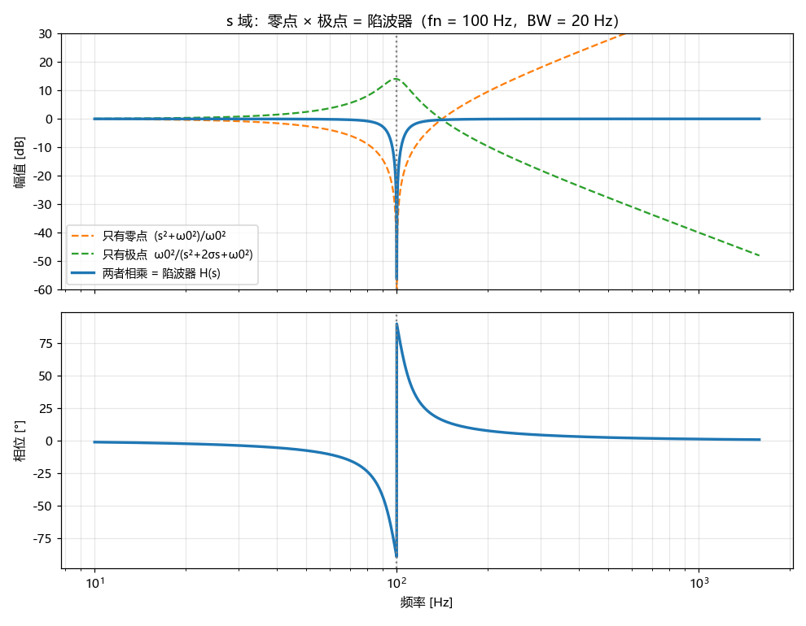
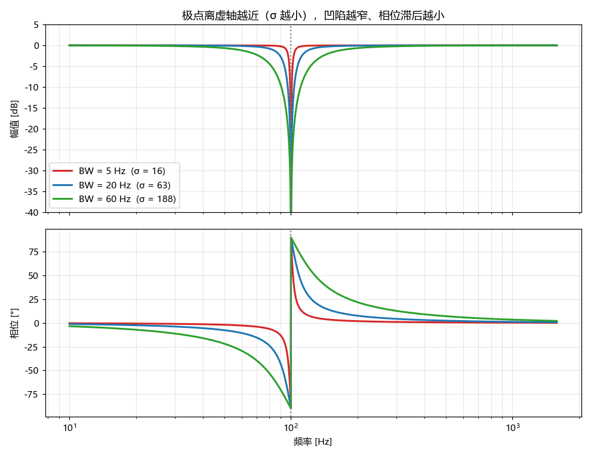
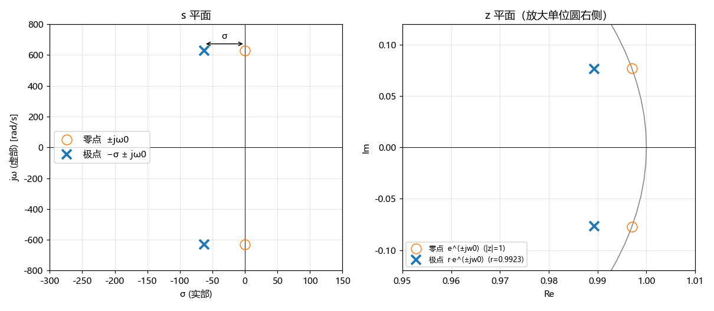
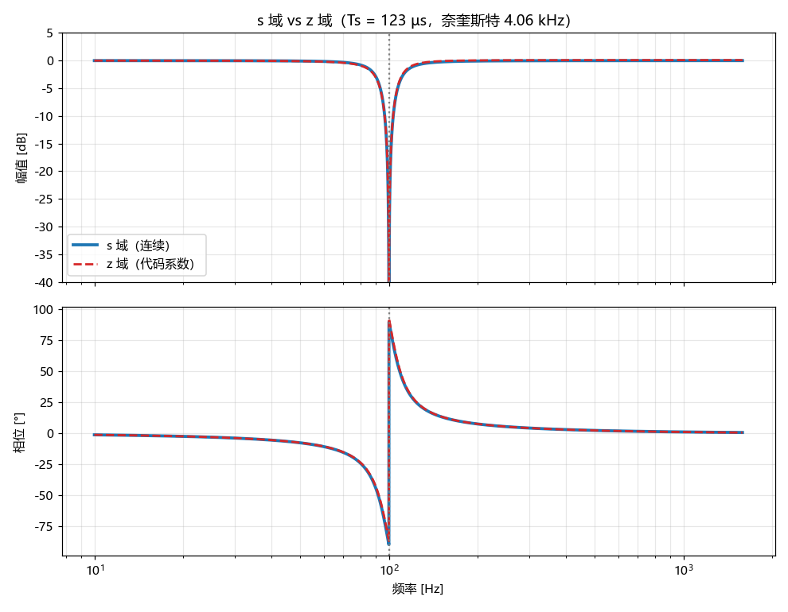
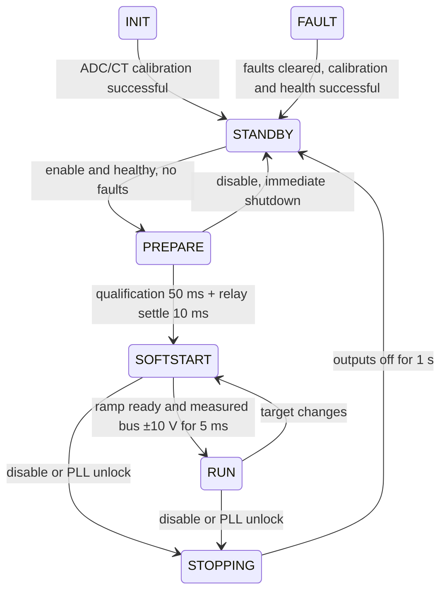

# 3 kW 交错图腾柱 PFC 固件 —— 软件架构、学习与调试手册

| 项 | 内容 |
|---|---|
| 文件名 | PFC_Software_Architecture_CN.md |
| 描述 | 软件架构、控制算法、硬件资源、上板调试与维护手册 |
| 原作者 | Chao Wang <chao.wang@microchip.com> |
| 创建日期 | 2026/10/27 |
| 修改人 | Chao Wang |
| 修改日期 | 2026/11/10 |
| 语言 | 中文 · [English](PFC_Software_Architecture_EN.md) |
| 适用工程 | `Microsoft_PSU_3kW_PFC.X` |
| MCU | dsPIC33AK256MPS206（32 位 dsPIC33A，硬件单精度 FPU） |
| 工具链 | MPLAB X v6.35 + XC-DSC v4.00 + dsPIC33AK-MP_DFP 1.6.273 + MCC Melody |
| 配套文档 | [PFC ↔ LLC 通信协议](PFC_LLC_Comm_Protocol_CN.md) |

本文面向第一次接手本工程的固件工程师。**先读第 0 章（约 30 分钟）**，读完后应能做到：

1. 说清每个文件、每个 ISR 的职责，以及数据在它们之间如何流动；
2. 独立完成编译、烧录，并用 X2Cscope 观测关键变量；
3. 按照第 12 章的步骤，安全地完成首次上电和逐级闭环调试；
4. 修改控制参数、增加故障项或新增模块时，不破坏已有的实时性和安全约束。

> **术语约定**：
> - 本文的"**拍**"按上下文分两种：65 kHz 控制中断里指一个 PWM 周期（15.38 µs），状态机、故障和调度里指一个 T1 节拍（100 µs）。容易混淆的地方会写明单位。
> - "**快管**"指 65 kHz 开关的 GaN 桥臂（PG3/PG4），"**慢管**"指工频桥臂（PG5）。
> - "**PU**"即标幺值，见第 7 章。

---

## 目录

0. [快速上手（30 分钟）](#0-快速上手30-分钟)
1. [系统概览](#1-系统概览)
2. [工程目录结构](#2-工程目录结构)
3. [编译、烧录与工程文件](#3-编译烧录与工程文件)
4. [启动流程](#4-启动流程)
5. [运行时调度：三个中断 + 主循环](#5-运行时调度三个中断--主循环)
6. [硬件资源映射（PWM / ADC / 中断 / 通信）](#6-硬件资源映射pwm--adc--中断--通信)
7. [标幺值（PU）体系与采样换算](#7-标幺值pu体系与采样换算)
8. [控制算法详解](#8-控制算法详解)
9. [过零与极性处理](#9-过零与极性处理)
10. [状态机](#10-状态机)
11. [故障保护](#11-故障保护)
12. [上板调试指南](#12-上板调试指南)
13. [X2Cscope 观测变量速查](#13-x2cscope-观测变量速查)
14. [可调参数总表](#14-可调参数总表)
15. [编码规范与扩展方法](#15-编码规范与扩展方法)
16. [已知待办（TODO）与风险清单](#16-已知待办todo与风险清单)
17. [常见问题排查](#17-常见问题排查)
18. [PFC ↔ LLC 通信](#18-pfc--llc-通信)

---

## 0. 快速上手（30 分钟）

### 0.1 项目一句话

3 kW、两相交错的图腾柱 PFC，GaN 快管每相 65 kHz（交错后输入纹波 130 kHz），输出 400 V 母线给后级 LLC。控制全部用**单精度浮点 + 标幺值（PU）**：

- 65 kHz 中断里跑 PLL、过零极性判断、两相电流环；
- 8.125 kHz 跑电压环，带负载前馈；
- 10 kHz 的 T1 里跑状态机和故障保护。

PFC 与副边 LLC 之间有两种通信：UART1（LLC 主机，PFC 从机）和两路占空比信号（RC4 输出母线电压，RD6 输入 LLC 负载）。详见第 18 章和[协议文档](PFC_LLC_Comm_Protocol_CN.md)。

### 0.2 软件全貌

```
 ┌──────────────────────── 65 kHz，优先级 5（两相互不抢占）────────────────────────┐
 │ _AD5CH1Interrupt（A 相）              _AD1CH1Interrupt（B 相，+180°）              │
 │  ADC→PU → 快速过流 → PLL → 极性       ADC→PU → 快速过流/过压 → RD6 负载            │
 │  → 电流环 A → PG3DC / 慢管 PG5        → 电压环（每 8 次）→ 电流环 B → PG4DC        │
 └─────────────────────────────────────────────────────────────────────────────────────┘
 ┌──────────── 10 kHz T1，优先级 1 ────────────┐   ┌──────────── 主循环 ────────────┐
 │ UART1 字节搬运 → 温度 → ISR 心跳            │   │ 喂狗（需心跳）→ X2Cscope       │
 │ → 有效值/X 电容 → 故障评估 → 状态机         │   │ → LLC 帧处理 → 1 ms 任务（RC4）│
 └─────────────────────────────────────────────┘   └────────────────────────────────┘
```

模块分层和依赖方向见 2.1 节，三个中断的详细内容见第 5 章。

### 0.3 第一天：编译、烧录、看变量

1. **编译**：MPLAB X 或 VS Code（第 3 章）。新增源文件时，**两套工程文件都要改**（3.3 节）。
2. **确认开关**（`app_config.h`，14.3a 节）：
   - 新板上电时 `APP_PFC_ENABLE_AT_STARTUP = 0`、`APP_PLL_PWM_TEST_ENABLE = 0`；
   - 不接功率、只测 PLL/PWM 时，把 `APP_PLL_PWM_TEST_ENABLE` 设为 1，会自动上电使能。
3. **烧录后用 X2Cscope 看这 5 个变量**（第 13 章）：

| 变量 | 正常现象 |
|---|---|
| `g_sm.state` | 0 INIT → 1 STANDBY（约 63 ms 后）；使能后 2 → 3 → 4 RUN；6 = FAULT |
| `g_fault.latchedFlags` | 0；非 0 时按位对照 11.2 节 |
| `g_pll.locked` / `g_pfcFreqPU` | 接入电网后为 1 / 约 1.0（50 Hz） |
| `g_pfcVoutPU` | 母线电压 / 400 V |
| `g_ilCalA.ok` / `g_ilCalB.ok` | 1 = CT 零点校准成功 |

4. **首次带功率上电**前，逐项完成 12.0 节的检查清单，再按 12.1～12.7 逐级闭环。

### 0.4 我要改……去哪里

| 要做的事 | 改哪里 | 参考章节 |
|---|---|---|
| 开关频率、采样系数、CT 量程、L/C | `sources/config/board_config.h` | 2.2、14.6 |
| 功能开关、测试模式、版本号 | `sources/config/app_config.h` | 2.2、14.3a |
| 保护阈值、回差、恢复策略 | `sources/apps/fault/fault.h` / `fault.c` | 11.2、11.3 |
| 新增一个故障项 | `fault.h` + `fault.c` | 11.6 |
| 电流环 / 电压环参数 | `smps_control.c`（由 L、C 自动推导） | 8.1a、14.2 |
| 过零、软起、占空比 | `pfc_loop.c` | 9、14.1 |
| 状态机时序（预充、软起速度、停机） | `smps_sm.c` / `smps_sm.h` | 10、14.3 |
| PWM 引脚、SWAP、慢管映射 | `pfc_pwm.h` | 6.1 |
| 继电器、X 电容放电、未用引脚 | `sources/drivers/pfc_io/` | 6.4、7.6 |
| PFC ↔ LLC 协议 | 协议文档 + `llc_protocol.h` + `common/llc_duty_def.h`（两边同时改） | 18、协议文档 |
| 新增一个模块 | 按模板新建 .c/.h，并加入两套工程文件 | 15.4、3.3 |

### 0.5 五条硬约束（违反会出安全或实时问题）

1. **只有 `user_isr.c` 读 ADC 数据寄存器**，其他模块只用 PU 变量（2.1 节）。
2. **只有 `pfc_pwm` 在运行时写 PWM 寄存器**，GPIO 只经 `pfc_io` 操作（2.1 节）。
3. **只有 T1 写 `g_fault`**，65 kHz 中断只置 `g_faultFastTrip[]` 和 `smpsTripLatched`（5.7 节、11.1 节）。
4. **65 kHz 路径有时间预算**：两相实测合计约 9 µs，周期是 15.38 µs（5.8 节）。不要在这条路径里加除法、开方、三角函数或阻塞操作。
5. **新增或移动源文件时，MPLAB X 和 VS Code 两套工程都要同步**（3.3 节）。

### 0.6 当前状态与主要风险

**最终构建快照**：当前 `APP_PLL_PWM_TEST_ENABLE=1` 强制有效上电使能。测试 ISR 使用虚拟 Vac/Vout、零电流和固定 25 ℃温度，不读取真实 ADC 数据，不启动 CT 校准，也不使用真实 CT/ADC 增益校准结果作启动或 PG 联锁；增益失败诊断仍保留。实际 ADC ISR 心跳、PLL、状态计时、快速锁存、看门狗和硬件 PCI 仍工作。以下校准保护流程适用于测试开关为 0 的真实采样模式。测试 PG/遥测不能用于真实功率级判断，实板前恢复 0。

2026/11/01 已按授权修复用户代码，并同步本手册、通信协议与审查记录的中英文版本。`mcc_generated_files`、PLL、X2Cscope 源码保持本轮开始时的内容；用户已更新 PG1/2/3 的双更新模式和死区。

- 覆盖同步由 `PwmInitExt()` 对 PG1/2/3 设置 `OSYNC=01`（尽快生效）；不需 UPDREQ，DC/SWAP 的 UPDMOD 保持原配置。仍需验证硬件与驱动延迟。
- RUN 必须满足参考到位、实测母线在目标 ±10 V 内持续 5 ms；PREPARE 和 SOFTSTART 各有 10 s 截止时间。继电器在资格连续成立 50 ms 后闭合，再等待 10 ms 才允许控制环工作。
- 已修复 UVP 恢复/重试、心跳失败重启、校准失败放行、手动清除绕过迟滞、负载前馈失效残留、UART 缓存/时间戳和状态快照等问题。故障位 15–18 已启用。
- 上板待验证：SWAP/OVRDAT 与采样重构、PCI 极性/阈值、传感器和 NTC 标定、双更新模式的采样/交错时序、实际门极关断延迟与最坏 ISR 时间。200 ns、10 ms 和 ±10 V 是当前配置，仍需实测确认适配硬件。
- NVM 在线升级仍只有会话框架，`GET_INFO.bootCaps=0`；有效的硬件 RD6 PWM 不能证明 LLC 软件仍在运行。

完整修复与验证范围见 [审查记录](PFC_Code_Review_CN.md) 和第 16 章。

## 1. 系统概览

### 1.1 功率拓扑

```
            L_A        快管桥臂 A (PG3, GaN, 65 kHz)
   L ──┬──/\/\/──┬────┤ Q_AH ├──┬──────────┐
       │         └────┤ Q_AL ├──┤          │
       │   L_B        快管桥臂 B (PG4, 与 A 相差 180°)   ═╪═ C_bulk  → Vout ≈ 400 V
       └──/\/\/──┬────┤ Q_BH ├──┤          │             (送后级 LLC)
                 └────┤ Q_BL ├──┤          │
                                │          │
   N ─────────────────┤ S_H  ├──┘          │
                      ┤ S_L  ├─────────────┘
                      慢管桥臂 (PG5, 工频切换, 由 override 直接驱动)
```

- **两相交错 Boost 快管**：PG3（A 相）和 PG4（B 相）以 65 kHz、相位差 180° 工作，输入电流纹波相互抵消。
- **慢管桥臂**：PG5 不产生 PWM 波形，而是通过 output override 按电网极性**静态**导通上管或下管，相当于一个同步整流的工频桥臂。每个半周内，工频管**不是**离开 BLANK 就导通，而是等 Boost 管软启动交接时才导通，与释放同步整流管在同一次调用里（见 §9.3）；软启动期间由工频管的体二极管导通。
- **正负半周**的区别在于：哪一个快管充当 Boost 主开关，哪一个充当同步整流管。代码通过 PWM 的 `SWAP` 位来切换，使得 `PGxDC` 寄存器**始终**表示 Boost 主开关的占空比，控制算法不必区分半周。

### 1.1a 正负半周的电流路径

约定：电感接 L 线，vac = L − N（即 `g_pfcVacPU`）。POS 表示 vac > 0，NEG 表示 vac < 0。下面以 A 相为例，B 相完全相同（Q_BH/Q_BL 对应 Q_AH/Q_AL）。

```
                    Bus+ ●────────────┬───────────────┐
                         │            │               │
                    Q_AH (PWM3H)  S_H (PWM5H)        ═╪═ C_bulk
                         │            │               │
   L ●───L_A──/\/\/──────● SW_A       ● ──────────● N │
                         │            │               │
                    Q_AL (PWM3L)  S_L (PWM5L)         │
                         │            │               │
                    Bus− ●────────────┴───────────────┘
```

**POS（vac > 0，L 高于 N）：工频管 S_L 常通，Boost 管 = Q_AL，同步整流 = Q_AH，都以 Bus− 为回路**

```
① 充电（Q_AL 导通，D·Ts）：
   L → L_A → SW_A → Q_AL↓ → Bus− → S_L↑ → N                 电感储能，iL 上升

② 放电（Q_AL 关断，Q_AH 导通，(1−D)·Ts）：
   L → L_A → SW_A → Q_AH↑ → Bus+ → C_bulk → Bus− → S_L↑ → N   电感向母线放电，iL 下降
```

**NEG（vac < 0，N 高于 L）：工频管 S_H 常通，Boost 管 = Q_AH，同步整流 = Q_AL，都以 Bus+ 为回路**

```
① 充电（Q_AH 导通，D·Ts）：
   N → S_H↑ → Bus+ → Q_AH↓ → SW_A → L_A → L                 电感储能，|iL| 上升

② 放电（Q_AH 关断，Q_AL 导通，(1−D)·Ts）：
   N → S_H↑ → Bus+ → C_bulk → Bus− → Q_AL↑ → SW_A → L_A → L   电感向母线放电，|iL| 下降
```

**工频周期时序**（BLANK 期间全部关断，见第 9 章）：

```
 极性         BLANK │        POS         │BLANK│        NEG         │BLANK
 vac            0  ↗    L > N（正半周）  ↘  0  ↘   N > L（负半周）  ↗  0
 PWM5H (S_H)   ____│____________________│_____│▔▔▔▔▔▔▔▔▔▔▔▔▔▔▔▔▔▔▔▔│_____
 PWM5L (S_L)   ____│▔▔▔▔▔▔▔▔▔▔▔▔▔▔▔▔▔▔▔▔│_____│____________________│_____
 Q_AL (PWM3L)   关 │  Boost（PG3DC）    │  关 │  同步整流          │  关
 Q_AH (PWM3H)   关 │  同步整流          │  关 │  Boost（PG3DC）    │  关
 PG3 SWAP       —  │        1           │  —  │        0           │  —
 电流反馈       0  │  iDn（下管电流）   │  0  │  iUp（上管电流）   │  0
```

> 图中 PWM5H / PWM5L 的高电平按整个半周画出。实际每个半周开头有约 16 次调用（≈246 µs）的 Boost 软启动，这段时间工频管仍关断，由体二极管导通；软启动交接时工频管才按极性导通，同一次调用里同步整流管放开（§9.3）。

| 半周 | 工频管 | Boost 管（PGxDC） | 同步整流管 | 回路母线 | SWAP | 慢管 OVRDAT | 电流反馈 |
|---|---|---|---|---|---|---|---|
| POS | S_L（PWM5L） | 下管 Q_xL（PWMxL） | 上管 Q_xH | Bus− | 1 | `0x1` | `iDn` |
| NEG | S_H（PWM5H） | 上管 Q_xH（PWMxH） | 下管 Q_xL | Bus+ | 0 | `0x2` | `iUp` |

记忆规则：
- **Boost 管和导通的工频管总在同一侧**：POS 时都是下管，NEG 时都是上管。电感充电回路要经过同一根母线（Bus− 或 Bus+）闭合。如果两者不在同一侧，充电回路闭合不了，电感两端会直接承受母线电压与电网电压之差，电流失控。
- **同步整流管和工频管在相对的一侧**，它在放电阶段把电感电流送到另一根母线。
- 电流反馈取 Boost 管的电流：POS 取 `iDn`、NEG 取 `iUp`（`PfcInductorCurrentSelect`）。`CAHALF=1`、TRIGA=0 设计为半周期采样；导通中点与平均电流的近似依赖对称 CCM 波形，当前双更新模式下需复核（6.2、#40）。

### 1.2 控制结构

电压外环在 B 相 8 分频执行（设计 8.125 kHz、穿越 20 Hz），实测母线先经跟踪 2 倍工频的陷波器。PI 输出 `g_smpsPfcVctrlPU` 是有符号功率校正量，与 RD6 前馈相加后限制成非负总需求 demand。原始母线 >目标+10 V 时需求归零，并把实际 PI 分量回写历史。

```text
Vref - Notch(Vout) -> V PI [-1.2,1.2] --+
RD6 power -> validity/filter/gain ------+-> demand [0,1.2]
                                   applied PI <- demand - FF
demand -> 0.5 / vPk -> ipk_per_phase -> × |cos(theta)| -> iref
iref - |iL| -> I PI -> + (1 - |vac|/vout) -> duty clamp -> soft-start -> PGxDC
```

A/B 两相电流环各设计 65 kHz、穿越约 4 kHz，共用幅值与正弦参考。A 相推进 SOGI-PLL 与极性，B 相更新负载和电压环。占空比前馈来自 Boost 稳态关系，PI 修正残差；最终施加输出同样回写控制器。理论推导中 vctrl 表示总功率需求，启用负载前馈时不等于实际 PI 变量。双更新模式的实际采样率和延迟仍需实测。

### 1.3 设计目标与关键数字

| 项目 | 值 | 来源 |
|---|---|---|
| 输出功率 | 3 kW | 项目要求 |
| 输入 | 90–264 Vac，45–65 Hz | 设计范围；保护阈值见 `fault.h`（VAC_UVP 128 Vpk ≈ 90 Vrms，VAC_OVP 380 Vpk ≈ 269 Vrms） |
| 输出 | 400 V（可设 350–410 V） | `smps_sm.h` |
| 开关频率 | 65 kHz/相，交错后输入纹波频率 130 kHz | `board_config.h`（`BOARD_FAST_LOOP_HZ`），须与 MCC `PG3PER` 一致 |
| 电流环频率 | 65 kHz（每相） | 同上 |
| 电压环频率 | 8.125 kHz | `PFC_VLOOP_DIVIDER = 8` |
| 慢任务 | 10 kHz（100 µs） | Timer1 |
| 运算方式 | 全浮点、全标幺值 | — |

### 1.4 架构来源

本工程的目录划分、故障框架、PU 体系和 ISR 分层**沿用** LLC 次级工程 `sec_pkcmc_llc`，PLL 模块**移植**自 `sogi_pll-main`。熟悉 LLC 工程的人可以直接对照阅读。

---

## 2. 工程目录结构

```
Microsoft_PSU_3kW_PFC.X/
├── main.c                          入口：初始化顺序 + 主循环
├── mcc_generated_files/            MCC Melody 自动生成（勿手改，重新生成会被覆盖）
│   ├── adc/        adc1..adc5      ADC 通道、触发源、采样时间
│   ├── cmp/        cmp1,4,5,6,7,8  比较器/DAC（CMP1/4/5/6 → PG3/PG4 逐周期限流；DAC7 → RA9 调试，DAC8 → RA8 外部 VREF）
│   ├── pwm_hs/     pwm.c           PG3/PG4/PG5 周期、模式、触发、override
│   ├── input_capture/ sccp1,2      RD6 捕获（LLC 负载占空比，LLC_SIGNAL_Init 重新配置）
│   ├── pwm/        sccp3           RC4 占空比输出（母线电压 → LLC）
│   ├── timer/      tmr1            100 µs 时基
│   ├── uart/       uart1, uart3    UART1 = LLC 链路，UART3 = X2Cscope（均 115200）
│   ├── uref/       uref            DAC7 → UREF 引脚（RA9），调试用
│   └── system/     clock, pins, interrupt(优先级), traps, dmt, config_bits
├── sources/
│   ├── config/
│   │   ├── app_config.h            软件开关（上电使能、测试开关、负载前馈、X 电容放电、DAC 电压、固件版本）
│   │   └── board_config.h          硬件常数（ISR/任务频率、采样标定系数、CT 量程、L/C），见 14.6 节
│   ├── common/
│   │   └── llc_duty_def.h          RC4/RD6 占空比编码常数（llc_signal 与 llc_protocol 共用）
│   ├── drivers/
│   │   ├── mcc_extended/mcc_ext.c/.h   MCC 之外的外设补充：ADC 增益校准、PWM 触发点/限流/LEB、DAC 电压、看门狗周期
│   │   ├── pfc_pwm/pfc_pwm.c/.h        图腾柱 PWM 访问层：占空比、SWAP、override、慢管
│   │   ├── pfc_io/pfc_io.c/.h          GPIO 唯一驱动者：继电器 RB2、X 电容放电 RA4、未用引脚拉低
│   │   ├── uart_link/uart_link.c/.h    UART1 寄存器访问（inline 收发、错误标志、清 FIFO）
│   │   └── llc_signal/llc_signal.c/.h  LLC 占空比信号：RC4 母线电压输出、RD6 负载测量（负责 SCCP1/2/3 配置）
│   ├── isr/
│   │   └── user_isr.c/.h           三个 ISR：ADC→PU 换算 + 调用状态机任务
│   ├── apps/
│   │   ├── control/
│   │   │   ├── smps_control.c/.h   PU 基值、测量变量、浮点 2P2Z 控制器
│   │   │   ├── pfc_loop.c/.h       快速控制路径：PLL 调用、极性、电流环、电压环、软起
│   │   │   ├── smps_sm.c/.h        状态机：INIT→STANDBY→PREPARE→SOFTSTART→RUN
│   │   │   └── smps_common.c/.h    通用工具：参考值斜坡
│   │   ├── fault/
│   │   │   ├── fault.c/.h          故障对象、恢复策略、快速跳闸锁存
│   │   │   └── fault_common.c/.h   通用检测器：阈值 + 回差 + 去抖
│   │   ├── pll/
│   │   │   └── sogi_pll.c/.h       单相 SOGI-PLL（可复用模块）
│   │   ├── meas/
│   │   │   ├── grid_meas.c/.h      电网电压 / 输入电流有效值，X 电容放电判定（经 pfc_io 驱动 RA4）
│   │   │   └── il_cal.c/.h         电流 CT 零点自校准（7.3a 节）
│   │   └── comm/
│   │       ├── llc_protocol.h      PFC ↔ LLC 协议定义（与 LLC 工程共享，逐字节相同）
│   │       ├── llc_link.c/.h       UART1 从机协议层：环形缓冲、帧解析、命令处理（寄存器经 uart_link）
│   │       └── fw_update.c/.h      固件升级会话（框架，Flash 擦写待实现；不依赖状态机）
│   ├── scheduler/
│   │   ├── scheduler.c/.h          主循环协作式调度（100 µs / 1 ms / 10 ms / 500 ms）
│   │   └── app_tasks.c/.h          各周期任务的实现（受 ISR 心跳约束的喂狗、LLC 链路、RC4 更新）
│   └── third_party/
│       └── X2Cscope/               X2Cscope 库（.a）+ UART 适配层
├── nbproject/                      MPLAB X 工程文件
└── docs/                           本文档
```

### 2.1 模块分层与依赖方向

```
                         main.c  （按顺序调用各模块 Init，见第 4 章）
                           │
   ┌──────────────┬────────┴───────┬──────────────────────┐
   ▼              ▼                ▼                      ▼
scheduler      user_isr ─────► smps_sm (状态机)        mcc_ext ──► pfc_pwm, pfc_io
   │            │    │             │
   ▼            │    │   ┌─────────┼──────────┬───────────┬──────────┐
app_tasks       │    │   ▼         ▼          ▼           ▼          ▼
 │    │         │    │ pfc_loop   fault     grid_meas  smps_common  il_cal
 │    │         │    │  │   │      │          │
 │    │         │    │  │   ▼      ▼          ▼
 │    │         │    │  │ sogi_pll fault_common  pfc_io ──► RB2 / RA4 / 未用引脚
 │    │         │    │  ▼
 │    │         │    └► smps_control ◄── board_config   (PU 基值 + 测量变量 + 控制器)
 │    │         │          │
 │    │         │          ▼
 │    │         │       pfc_pwm ──► 寄存器 (PG3/PG4/PG5)
 │    │         ▼
 │    │      il_cal（校准期间喂原始值）、llc_signal（RD6）、llc_link（字节搬运）
 │    ▼
 │  llc_link ──► uart_link ──► UART1
 │    ├──► fw_update（"PFC 已停机"作为参数传入）
 │    └──► smps_sm / fault（读状态、执行 SET_ENABLE 等命令）
 ▼
llc_signal ──► SCCP1/2（RD6 捕获）、SCCP3（RC4 输出）

llc_signal、llc_protocol ──► common/llc_duty_def.h
```

规则：

- **只有 `user_isr.c` 读 ADC 数据寄存器**，换算成 PU 后写入 `smps_control.h` 中的测量变量。其他模块只使用 PU 变量。
- **只有 `pfc_pwm` 写 PWM 寄存器**（MCC 初始化和 `mcc_ext.c` 的 `PwmInitExt` 一次性配置除外）。其他模块通过 `PFC_PWM_*` 接口操作。
- `smps_control.h` 是"数据总线"：PU 基值、所有测量量、所有控制变量和控制器对象都在这里声明。
- `g_fault` 只在 T1 上下文中写，65 kHz ISR 只设置 `g_faultFastTrip[]` 标志（详见第 11 章）。
- **只有 `pfc_io` 操作 GPIO**（RB2、RA4 和未用引脚）。`smps_sm`、`grid_meas` 通过 `PFC_IO_RelaySet()`、`PFC_IO_XcapSet()` 驱动。
- **只有 `uart_link` 操作 UART1 寄存器**，`llc_link` 只做协议；**只有 `llc_signal` 配置和读写 SCCP1/2/3**（MCC 初始化除外）。
- **没有模块级循环依赖**：状态机不负责初始化其他模块（`LLC_SIGNAL_Init`、`LLC_LINK_Init`、`IL_CAL_Start` 都由 `main` 调用）；`fw_update` 不读 `g_sm`，"PFC 是否已停机"由 `llc_link` 作为参数传入。
- 私有函数一律 `static`。私有变量保持外部链接，方便 X2Cscope 按名字访问。

### 2.2 配置与公共头文件的划分

`sources/config/` 和 `sources/common/` 下的三个头文件按"**谁会改、为什么改**"划分。各项参数的明细见 14.3a 节（app_config）和 14.6 节（board_config）。

**[app_config.h](../sources/config/app_config.h)：软件功能开关（这一版固件"做什么"）**

| 类别 | 宏 | 使用者 |
|---|---|---|
| 运行开关 | `APP_PFC_ENABLE_AT_STARTUP`、`APP_PLL_PWM_TEST_ENABLE`（测试开关为 1 时自动强制上电使能） | smps_sm.c、user_isr.c |
| 功能裁剪 | `APP_PFC_LOAD_FF_ENABLE`、`APP_XCAP_ENABLE`、`APP_X2CSCOPE_ENABLE` | pfc_loop.c、llc_link.c（状态标志 `LOAD_FF_ON`）、grid_meas.c、X2Cscope.h |
| 应用设定值 | `APP_XCAP_*`（时间、电压）、`APP_DAC_VREF_RA8_V`、`APP_DAC_DEBUG_RA9_V` | grid_meas.c、mcc_ext.c |
| 版本号 | `APP_FW_VERSION_MAJOR/MINOR/BUILD` | llc_link.c（`GET_INFO` 上报） |

调试版、量产版、台架测试版之间的差别，只应该体现在这个文件里。

**[board_config.h](../sources/config/board_config.h)：硬件决定的常数（这块板子"是什么"）**

| 类别 | 宏 | 必须与之一致的对象 |
|---|---|---|
| 执行频率 | `BOARD_FAST_LOOP_HZ`（65 kHz）、`BOARD_VLOOP_DIVIDER`、`BOARD_SLOW_TICK_US`（100 µs） | MCC 的 `PG3PER`、`PR1` |
| 采样标定 | `BOARD_FB_VAC/VOUT/TEMP_*`、`BOARD_FB_IL_RANGE_A`（±50 A，`BOARD_FB_IL_SCALE` 由它派生） | 分压比、CT 变比、运放增益 |
| 功率级 | `BOARD_PFC_L_H`、`BOARD_PFC_COUT_F` | 电感、电容实测值 |

使用者：
- smps_control.h：派生 `PFC_FAST_LOOP_HZ`、`PFC_VLOOP_DIVIDER`、`PFC_VLOOP_HZ`；smps_control.c 派生 `PFC_L_H`、`PFC_COUT_F`，控制器的 Kp、Ki 由 L 和 C 推导。
- user_isr.c：ADC → PU 换算。
- llc_signal.c：调用频率。
- pfc_loop.c：`BOARD_FAST_LOOP_HZ ≠ 65000` 时 `#error`（PLL 步长写死）。
- smps_sm.c：软起步长（`BOARD_SLOW_TICK_US`）。
- grid_meas.c：X 电容计时（`BOARD_SLOW_TICKS_PER_MS`）。
- scheduler.h：`SCHED_TICK_US = BOARD_SLOW_TICK_US`。
- fault.c：`_Static_assert` 检查快速 OCP 阈值在 CT 量程以内。

这个文件只在换板、改 MCC 时钟或改采样电路时才需要修改，不属于调参。

**[common/llc_duty_def.h](../sources/common/llc_duty_def.h)：PFC 与 LLC 共享的约定**

内容是 RC4/RD6 占空比编码：10 kHz（±1 %）、10 %~90 % 线性、5 %~95 % 以外视为无效、2 ms 没有边沿视为超时、满量程 500 V / 3600 W。使用者是 llc_signal.c（驱动层，产生和解析占空比）和 llc_protocol.h（协议层）。它属于两个 MCU 之间的接口约定，必须与 LLC 工程**逐字节相同**，任何一边修改，另一边都要同步。

**为什么这样划分**

1. **按修改原因分开**：调试只动 app_config，换硬件只动 board_config，改协议只动 common。每个文件只有一种修改理由，改开关时不会碰到硬件参数。
2. **硬件常数只定义一次，其余值由它派生**：以前 65000、8125、10、0.01465 这些数字分散在 pfc_loop、smps_control、llc_signal、user_isr 中，改 PWM 频率要找好几处，漏改一处就会出错。现在只改一个宏，`pfc_loop.c` 还会在频率与 PLL 步长不匹配时报 `#error`。
3. **用 common 纠正分层方向**：这些常数原来放在 `apps/comm/llc_protocol.h`，驱动层 `drivers/llc_signal` 因此要反向包含应用层的头文件。移到 `common/` 后，驱动层和协议层都只依赖一个仅含常数的底层头文件。
4. **便于移植到 LLC**：LLC 工程只需复制 `llc_protocol.h` 和 `common/llc_duty_def.h` 两个文件，不会带上 PFC 的板级配置。如果把这些常数放进 board_config，LLC 侧就无法直接共用。
5. **调参项不放进 config**：`FLT_*` 阈值在 fault.h，`PFC_ZC_*` 在 pfc_loop.c，控制器带宽在 smps_control.c。这些参数离开对应的算法就没有意义，放在代码旁边，读算法时可以同时看到（第 14 章也按模块列出参数）。
6. **只放 `#define`，不放代码和变量**：这些宏可以用于 `#if`、静态初始化和 `_Static_assert`；任何一层包含它们，都不会引入模块依赖或链接问题。

**新增常数放在哪里**，按下面的顺序判断：

1. PFC 和 LLC 两边都要用？→ `common/`
2. 只有换板子才会改？→ `board_config.h`
3. 是功能开关或版本号？→ `app_config.h`
4. 以上都不是 → 放在使用它的模块里

---

## 3. 编译、烧录与工程文件

### 3.1 IDE 编译

用 MPLAB X 打开 `Microsoft_PSU_3kW_PFC.X`，选择 `default` 配置，执行 Clean and Build。编译选项为 `-O2 -msmart-io=1 -Wall`，目标是 **0 error / 0 warning**。

### 3.2 命令行编译（与 IDE 结果一致）

```bash
cd Microsoft_PSU_3kW_PFC.X
MK="/c/Program Files/Microchip/MPLABX/v6.35/gnuBins/GnuWin32/bin/make.exe"
"$MK" -f nbproject/Makefile-default.mk SUBPROJECTS= .build-conf TYPE_IMAGE=DEBUG_RUN   # 调试版
"$MK" -f nbproject/Makefile-default.mk SUBPROJECTS= .build-conf                       # 发布版
```

输出位置：`dist/default/{debug,production}/Microsoft_PSU_3kW_PFC.X.*.elf/.hex/.map`。

### 3.3 新增源文件后必须做的事

MPLAB X 的 Makefile（`nbproject/Makefile-default.mk`）是根据 `configurations.xml` **生成**的。新增 `.c`/`.h` 后：

1. IDE 中右键 Source Files → Add Existing Item（这会更新 `configurations.xml`）；
2. 或者手动编辑 `nbproject/configurations.xml`（在 HeaderFiles / SourceFiles 的逻辑目录下加 `itemPath`），以及 `nbproject/project.xml` 的 `sourceRootList`；
3. 然后重新生成 Makefile：
   ```bash
   "/c/Program Files/Microchip/MPLABX/v6.35/mplab_platform/bin/prjMakefilesGenerator.bat" .
   ```

> **两套工程文件必须同步**：本工程同时存在两套构建系统，新增或移动源文件时**两边都要改**：
>
> | 构建方式 | 工程文件 | 生成物 | 输出 |
> |---|---|---|---|
> | MPLAB X IDE | `nbproject/configurations.xml`、`project.xml` | `nbproject/Makefile-default.mk` | `dist/default/` |
> | VS Code MPLAB 扩展（CMake + Ninja） | `.vscode/Microsoft_PSU_3kW_PFC.mplab.json` 的 `fileSets` | `cmake/.../.generated/file.cmake` | `out/Microsoft_PSU_3kW_PFC/` |
>
> 只改一边，另一边就会出现链接错误。例如新增 `sources/apps/meas/grid_meas.c` 时只更新了 nbproject，VS Code 编译就报 `undefined reference to '_GRID_MEAS_Init'`。修复方法是在 `.mplab.json` 的 `fileSets` 中加上一项字符串 `"sources/apps/meas/*"`，`file.cmake` 由扩展自动重新生成，**不要手动编辑**。
>
> **历史问题**：曾因 X2Cscope 从 `sources/utils/` 挪到 `sources/third_party/` 后工程文件没同步，出现 `No rule to make target 'sources/utils/X2Cscope/X2Cscope.c'`。遇到 "No rule to make target" 时，第一步就是检查 `configurations.xml` 中的路径是否和磁盘一致。

### 3.3a Include 路径与工程属性

`#include "..."` 的查找顺序是：**先找当前源文件所在的目录**，找不到再找编译器 `-I` 指定的目录。GCC 不会自动把编译命令的当前目录（工程根）加入搜索路径。

| 文件 | 所在目录 | `#include "sources/third_party/..."` 的第一步查找位置 | 结果 |
|---|---|---|---|
| `main.c` | 工程根 | `<根>/sources/third_party/...` | 找到，不依赖 `-I` |
| `user_isr.c` | `sources/isr/` | `<根>/sources/isr/sources/third_party/...` | 不存在，必须靠 `-I.` 兜底 |

两套构建对 `-I.` 的配置：

| 构建方式 | 配置位置 | 值 |
|---|---|---|
| VS Code | `.vscode/Microsoft_PSU_3kW_PFC.mplab.json`：`compiler.extra-include-directories`、`assembler.extra-include-directories-for-assembler`、`assembler.extra-include-directories-for-preprocessor` | `"."` |
| MPLAB X | `nbproject/configurations.xml` 的同名三项（`C30` / `C30-AS` 段）；改完需运行 `prjMakefilesGenerator.bat` 重新生成 Makefile，并重新打开工程 | `.` |

MPLAB X 里四个 include 目录属性的作用范围（在实验副本里逐项设置并检查生成的编译命令得到）：

| 属性 | `.c` | `.s` | `.S`（先过 C 预处理器） |
|---|---|---|---|
| `extra-include-directories` | `-I` | — | — |
| `extra-include-directories-for-assembler` | — | `-I` | — |
| `extra-include-directories-for-preprocessor` | — | — | `-I` |
| `common-include-directories` | `-I` | `-I` | 未测 |

- 本工程只有小写 `.s`，所以 `for-preprocessor` 当前不起作用，设置它只是和 VS Code 配置保持一致。
- 也可以只在 `common-include-directories` 里写 `.`，其余三项留空，效果相同；VS Code 的 `.mplab.json` 没有 common 这一项，所以两边目前都按"分开写三处"保持一致。

> **约定**：`sources/` 下的文件用**相对本文件的路径**包含其他模块（例如 `user_isr.c` 里写 `"../third_party/X2Cscope/X2Cscope.h"`），不依赖 `-I.`；`-I.` 只作为兜底。历史问题：`user_isr.c` 曾用 `"sources/..."` 写法，VS Code 构建通过，MPLAB X 构建报 `X2Cscope.h: No such file or directory`，原因就是 MPLAB X 的 include 目录属性为空。`main.c` 在工程根，用 `"sources/..."` 是对的。

### 3.4 链接库

X2Cscope 使用预编译库 `sources/third_party/X2Cscope/libx2cscope-generic-32dsp-dspic33a-mlarge-elf.a`（large memory model 版本），在 `configurations.xml` 的 `linkerLibFileItem` 中引用。

### 3.5 Flash 分区与 APP 链接布局

工程根目录的 [p33AK256MPS206.gld](../p33AK256MPS206.gld) 是基于 **dsPIC33AK-MP_DFP 1.6.273** 的器件链接脚本修改的，用于 3 kW 项目的 Boot + APP 布局。以下地址均为字节地址，起止地址均包含在范围内；容量统一使用 **KiB**。

> **容量单位说明（KiB 与 kB）**：
> - **KiB** 是 **kibibyte（二进制千字节）** 的符号，采用 IEC 二进制前缀 `Ki`（kibi，表示 2¹⁰）；其中 `i` 用于标识二进制前缀，`B` 表示 byte（字节），不是 bit（位）。**1 KiB = 2¹⁰ byte = 1024 byte**。
> - **kB** 使用 SI 十进制前缀 `k`（kilo，表示 10³），因此 **1 kB = 1000 byte**。规范写法中的 `k` 为小写。
> - 嵌入式资料中常见的“KB”有时指 1024 byte，有时指 1000 byte，存在歧义；本文用 **KiB** 明确表示按 1024 计算的 Flash 容量。
> - 例如，`0x1000` = 4096 byte = **4 KiB**；`0x20000` = 131072 byte = **128 KiB**。改用 KiB 仅规范单位写法，不改变实际容量或地址范围。

#### 3.5.1 双分区模式下的空间分配

本工程使用**双分区模式**：Flash 分为 **Active Panel（活动分区）** 和 **Inactive Panel（非活动分区）**，每个 Panel 为 `0x20000`（128 KiB），总容量为 **256 KiB**。

| Panel | 起始字节地址 | 最后一个 32 位字的起始地址 | 最后一个字节地址 | 完整字节地址窗口 | 容量 |
|---|---|---|---|---|---|
| Active Panel | `0x800000` | `0x81FFFC` | `0x81FFFF` | `0x800000–0x81FFFF` | 128 KiB |
| Inactive Panel | `0xC00000` | `0xC1FFFC` | `0xC1FFFF` | `0xC00000–0xC1FFFF` | 128 KiB |

> **末尾地址口径**：Inactive Panel 常写为 `0xC00000–0xC1FFFC`，其中 `0xC1FFFC` 是最后一个 32 位字（4 byte）的起始地址，该字覆盖 `0xC1FFFC–0xC1FFFF`。按包含首尾的字节范围计算，容量为 `0xC1FFFF - 0xC00000 + 1 = 0x20000`（128 KiB）；不能将 `0xC1FFFC` 当作最后一个字节地址来计算容量。Active Panel 的末尾同理。

**下表描述 Active Panel 内部的 Boot + APP 布局**，不是两块 Panel 之间的容量分配：

| 区域 | 起始地址 | 结束地址 | 长度（byte） | 容量 | 用途 |
|---|---|---|---|---|---|
| Boot 整体 | `0x800000` | `0x80BFFF` | `0xC000` | 48 KiB | 包含 Boot 向量区和代码区 |
| ↳ Boot 向量区 | `0x800000` | `0x800FFF` | `0x1000` | 4 KiB | 包含复位入口及 Boot 向量表的预留区 |
| ↳ Boot 代码区 | `0x801000` | `0x80BFFF` | `0xB000` | 44 KiB | Boot 程序代码区 |
| APP 整体 | `0x80C000` | `0x81FFFF` | `0x14000` | 80 KiB | 包含 APP 向量表区和代码区 |
| ↳ APP 向量表区（IVT） | `0x80C000` | `0x80CFFF` | `0x1000` | 4 KiB | APP 起始处为向量表保留的空间 |
| ↳ APP 代码区 | `0x80D000` | `0x81FFFF` | `0x13000` | 76 KiB | 3 kW APP 的 `program (xr)` 区域 |

Active Panel 内的容量关系为 **48 KiB Boot + 80 KiB APP = 128 KiB**；另外还有独立的 **128 KiB Inactive Panel**，两块 Panel 合计 **256 KiB**。其中：

- **48 KiB Boot = 4 KiB 向量区 + 44 KiB 代码区**；
- **80 KiB APP = 4 KiB IVT + 76 KiB 代码区**。

Boot 整体起始地址是 `0x800000`，代码区起始地址是 `0x801000`；APP 整体起始地址是 `0x80C000`，代码区起始地址是 `0x80D000`。整体起始地址与代码区起始地址不能混用。

#### 3.5.2 链接脚本中的代码区定义

在 `p33AK256MPS206.gld` 的双分区分支（`__DUAL_PARTITION`）中，当前工具链将 APP 代码链接到 **Active Panel**，程序存储区定义为：

```ld
program (xr)   : ORIGIN = 0x80D000,      LENGTH = 0x13000
```

对应的代码起始地址和长度符号为：

```ld
__CODE_BASE = 0x80D000;
__CODE_LENGTH = 0x13000;
```

两组定义必须保持一致。代码区的上界为 `0x80D000 + 0x13000 = 0x820000`（不包含），因此最后一个字节地址为 `0x81FFFF`。这些修改位于 `__XC16_VERSION__ >= 3020` 的分支；脚本中的单分区及旧工具链分支仍保留原有布局，不能把它们当作当前 APP 的地址定义。

#### 3.5.3 IDE 向量表地址与构建检查

MPLAB X IDE 的链接属性增加了以下参数，将 APP 向量表基址设置为 `0x80C000`：

```text
--ivt=0x80C000
```

该参数已记录在 [nbproject/configurations.xml](../nbproject/configurations.xml) 的 `C30-LD` 节点中：

```xml
<appendMe value="--ivt=0x80C000"/>
```

APP 起始的 4 KiB（`0x80C000–0x80CFFF`）用于向量表布局，代码从下一段 `0x80D000` 开始。`--ivt` 指定的是向量表基址；4 KiB 是本工程为其划定的区域大小，并不是该参数本身设置了向量表长度。

构建或升级 DFP 时检查以下项目：

1. 工程启用双分区模式，并实际使用工程根目录下修改过的 `p33AK256MPS206.gld`，而不是 DFP 默认脚本。
2. 实际链接命令包含 `--ivt=0x80C000`，生成的 `.map` 中 APP 向量表位于预留区内，APP 程序段落在 `0x80D000–0x81FFFF`。
3. MPLAB X 与 VS Code 两套构建保持相同的链接脚本、双分区选项和 IVT 地址。当前 [.vscode/Microsoft_PSU_3kW_PFC.mplab.json](../.vscode/Microsoft_PSU_3kW_PFC.mplab.json) 未显式记录 `0x80C000`，使用 VS Code 构建时需核对实际链接命令，不能仅凭 MPLAB X 的属性推定两边一致。
4. 升级 DFP 后，重新核对并保留上述自定义布局，避免用新版本默认脚本覆盖工程脚本。

> **范围说明**：本节记录 Flash 分配及 APP 链接约定，不表示在线升级已经实现。Flash 擦写、镜像校验和分区切换仍是待实现功能，见第 16 章及通信协议文档。

---

## 4. 启动流程

初始化顺序以 [main.c](../main.c) 为准：

```c
SYSTEM_Initialize();             // MCC；此函数内部可能开启全局中断
MCC_EXT_SystemInitialize();      // 先关闭中断，配置死区、覆盖、PCI、ADC 等扩展
USER_ISR_AdcScaleInit();
SMPS_SM_Init();                  // 故障、PLL、控制器、安全输出
LLC_SIGNAL_Init();
LLC_LINK_Init();
#if !APP_PLL_PWM_TEST_ENABLE
IL_CAL_Start();                  // 仅真实采样模式采集 CT 零点
#endif
SCHEDULER_Init();
TMR1_Start();
X2Cscope_Init();
WATCHDOG_TimerSoftwareEnable();  // 周期由配置字决定，约 4 ms
g_userIsrReady = true;           // 所有 ISR 使用的对象已初始化
INTERRUPT_GlobalEnable();
while (1) SCHEDULER_Run();
```

`g_userIsrReady` 上电为 false。两个 ADC ISR 和 T1 ISR 在 false 时仅清本中断标志后返回，避免 MCC 初始化中途开启中断时访问未初始化的用户对象。新增 ISR 也必须遵守这项启动约束。`SMPS_SM_Init()` 先保持输出覆盖为低；PWM 时间基运行用于 ADC 校准，门极输出由状态机控制。

ADC 增益超时或零结果设置 `g_adcCalibrationFailedMask`；CT 校准必须完成且 `g_ilCalA.ok && g_ilCalB.ok`。缺少任一成功条件会锁存 `FLT_CALIBRATION`，禁止启动。

## 5. 运行时调度：三个中断 + 主循环

### 5.1 执行上下文总表

| 上下文 | 触发源 | 频率 | 优先级 | 入口 | 主要工作 |
|---|---|---|---|---|---|
| A 相 ISR | AD5CH1 转换完成（PWM3 Trigger1） | 65 kHz | 5 | `_AD5CH1Interrupt` | （校准期间 `IL_CAL_Update` 累加 iA 原始值）采 iA_up/dn、vac → `SMPS_SM_TaskPhaseA` |
| B 相 ISR | AD1CH1 转换完成（PWM4 Trigger1） | 65 kHz | 5 | `_AD1CH1Interrupt` | （校准期间 `IL_CAL_Update` 累加 iB 原始值）采 iB_up/dn、vout → RD6 负载 `LLC_SIGNAL_LoadUpdate` → `SMPS_SM_TaskPhaseB` → `X2Cscope_Update` |
| 慢任务 ISR | Timer1（PR1 = 9999） | 10 kHz | 1 | `_T1Interrupt` | 采温度 → `SMPS_SM_TaskSlow` → UART1 字节搬运 `LLC_LINK_ByteService` → 调度节拍 +1 |
| 主循环 | — | 尽可能快 | 0 | `SCHEDULER_Run` | 喂狗（需 ISR 心跳）、X2Cscope 通信、LLC 帧解析和应答 `LLC_LINK_Task`、1 ms 任务（链路计时、RC4 更新） |

### 5.2 时序图（一个 PWM 周期 ≈ 15.38 µs）

```
 PWM3 周期  |<─────────────────── 15.38 µs ───────────────────>|
            ▲ Trigger1(A)                  ▲ Trigger1(B, +180°)
 ADC        [AD5/AD2/AD4 转换]              [AD1/AD3CH0 转换]
 ISR(prio5)   ├─ A 相 ISR ─────┤              ├─ B 相 ISR ──┤
                PLL ~1.3 µs                    (每 8 次)电压环
                极性 + 电流环 A                 电流环 B
                有效值累加                      X2Cscope_Update
 T1(prio1)  ──────(每 100 µs 一次，可被上面两个 ISR 抢占)────────
 main(prio0)────────────(空闲时间全部给主循环)────────────────────
```

### 5.3 A 相任务 `SMPS_SM_TaskPhaseA()`（[smps_sm.c](../sources/apps/control/smps_sm.c)）

以下为真实采样模式（测试开关 0）；台架测试模式的例外见 0.6。

A 相 ADC ISR 读取 CT 和 L/N 数据后执行 A 相任务。代码不检查 `ADxSTAT.CHyRDY`；AD2 与 AD5 的转换完成时序见风险 #7。

`SMPS_SM_TaskPhaseA()` 推进心跳，执行控制器复位握手、PLL、网侧测量和 A 相电流环。进入 BLANK 时一次请求两相快桥及慢桥全部关闭，并将两相占空比置零。控制关闭时仍用原始 CT 幅值更新慢速 OCP 的滤波输入，避免停机后冻结的电流值阻止恢复。

### 5.4 B 相任务 `SMPS_SM_TaskPhaseB()`

以下为真实采样模式（测试开关 0）；台架测试模式的例外见 0.6。

B 相 ADC ISR 读取 CT 和母线数据后执行 B 相任务。B 相推进心跳、更新 RD6 捕获、执行电压环分频与 B 相电流环。电压 PI 每 8 次 B 相调用运行一次，设计频率 8.125 kHz；RD6 捕获和其它每周期工作不能算入这个分频。控制关闭时仍刷新 B 相 OCP 滤波输入。双更新模式下实际 ISR 频率需实测。

### 5.5 慢任务 `SMPS_SM_TaskSlow()`（10 kHz）

T1 每 100 µs 服务 UART 字节、调度时基与 `SMPS_SM_TaskSlow()`。慢任务先检查两相心跳。两相计数都推进过一次之后（`smpsHealthArmed`）才开始判定，所以上电后 ADC 中断还没起来的头几拍不算故障；在这之后任一计数没有推进，即锁存 `FLT_ISR_HEALTH`、撤销喂狗令牌、关断并进入 FAULT，该故障位阻止本次及后续启动，只能手动清除。INIT 状态要等心跳判定启动后才会离开。

T1 是 `g_fault` 的唯一运行期写入者：合并快速故障，检查校准，处理一次性清故障请求，评估迟滞/消抖，然后执行状态机。UVP 在 RUN 外只抑制新检测，已经检测到的 UVP 继续恢复判断。清故障成功且健康条件满足后才允许 FAULT 返回 STANDBY。

### 5.6 主循环 `SCHEDULER_Run()`

主循环执行 `SCHEDULER_Run()`；常驻任务处理通信、升级会话、RMS 和 X2Cscope。周期任务可以补执行，但 UART 缓存、链路/状态年龄与升级会话超时使用实际 T1 时间戳，不能通过补执行次数代替时间。

看门狗由配置字 `FWDT_SWDTMPS=PS4`、`FWDT_RWDTPS=PS4`、`FWDT_RCLKSEL=BFRC244` 确定，按用户配置约 **4 ms**。应用扩展不再覆盖 RMPS；保留软件使能和 `WATCHDOG_TimerClear()`。主循环只能消费一个新的双相健康令牌后喂狗；消费令牌的读和清不屏蔽中断：单字节访问本身是原子的，被 T1 抢占而丢掉的一次令牌会在下一个 100 µs 节拍重新置位，对远大于它的看门狗周期没有影响。任一 ADC 心跳失效后令牌立即失效，停止喂狗。

### 5.7 并发与数据共享规则（**必须遵守**）

- 两个 ADC ISR 优先级同为 5，不互相抢占；T1 为 1，主循环为 0。A 相拥有极性决策与控制复位；B 相消费已发布状态。
- `volatile FAULT_OBJ_T g_fault` 运行期仅由 T1 修改；快速 ISR 只发布 `g_faultFastTrip[]` 并关断。锁定掩码已缓存，状态查询为固定开销；锁存查询同时合并尚未转入 T1 的快速故障。
- UART RX/TX 环采用单写者/单读者，发布头尾前设置编译器屏障。每个 RX 字节同时保存 100 µs T1 时间戳；错误后短临界区丢弃积压并重置解析。
- `GET_STATUS` 与 `GET_LOAD_ECHO` 在短暂全局中断屏蔽期间复制状态、掩码、标志和原始浮点数据，恢复中断后再定点编码和组帧。这样获得一致的协议快照；定点 NaN/Inf 编码为 0，不能据此推断测量有效。
- 临界区调用仅允许在现有主循环路径；不得把默认恢复全局中断的 API 随意放进 ISR。新增更高优先级 ISR 必须重新检查共享状态和最坏时延。
- `volatile` 不提供整组字段的原子性；安全决策不得使用普通的跨上下文多字段读。RMS 与控制器复位继续遵循原有握手。

### 5.8 CPU 负载估算（-O2，200 MHz）

旧版 A≈4.4 µs、B≈4.6 µs 是历史测量。本轮新增滤波、保护及快照后没有重新上板测 WCET；下表估算不能作为当前 4 ms 喂狗预算或 UART 服务连续性的证明。

| 项 | 时间 |
|---|---|
| SOGI-PLL | ~1.3 µs |
| 2P2Z 控制器 | ~0.37 µs/次 |
| 极性判断 + 软起 + 有效值累加 | ~0.1 µs |
| A 相 ISR 合计 | **实测约 4.4 µs**（估算为 2–2.5 µs，实测偏大，含中断进出开销） |
| B 相 ISR 合计 | **实测约 4.6 µs**（估算为 1–1.5 µs）；需确认是否为电压环那一拍（每 8 拍一次）的最坏值 |
| 两相合计占 15.38 µs 周期的比例 | **约 59 %**（4.4 + 4.6 = 9.0 µs 实测），每周期留给 T1 和主循环约 6.4 µs |
| T1 ISR（100 µs） | **实测引脚脉宽约 15 µs**，这是墙钟时间，包含被两个 65 kHz ISR 抢占的时间（约各 1 次，9.0 µs）；T1 自身约 6 µs，占 CPU 约 6 % |
| 总 CPU 负载 | 约 59 % + 6 % ≈ **65 %**，剩余约 35 % 给主循环（X2Cscope 通信、LLC 帧处理） |

> 实测方法：在 ISR 入口和出口翻转一个空闲 GPIO，用示波器测量脉宽（参见 12.8 节）。

---

## 6. 硬件资源映射（PWM / ADC / 中断 / 通信）

> 以下内容来自 MCC 生成代码（`mcc_generated_files/`）和 `mcc_ext.c`。**修改硬件配置请在 MCC 中进行**，然后重新生成。

### 6.1 PWM

| 发生器 | 用途 | 模式 | 周期 | 更新方式 | 说明 |
|---|---|---|---|---|---|
| PG3 | A 相快管（PWM3H/L：RD2/RD3） | 双更新中心对齐、互补（MODSEL=5） | `PG3PER = 0x1808E`（设计 65 kHz） | UPDMOD = SOC | 主时基；PGTRGSEL = Trigger D 比较事件（`PG3TRIGD`）作为 PG4、PG5 的 SOC 源；TRIGA 用于触发 ADC |
| PG4 | B 相快管（PWM4H/L：RD0/RD1） | 双更新中心对齐、互补（MODSEL=5） | 同 PG3 | UPDMOD = SOC | SOCS = PG3，设计相位差 180° |
| PG5 | 慢桥（PWM5H/L：RC10/RC11） | 双更新中心对齐 MODSEL=5 | 同 PG3 | Immediate | SOCS = PG3；通过覆盖驱动 |
| PG6 | 未用于功率级 | 独立边沿，只开 PWM6H（RC3） | `PG6PER = 0xC7F0` | UPDMOD = Immediate | MCC 配置，`PWM_Enable()` 会一起启动；PWM6L 无引脚映射，`PwmInitExt()` 将 `PG6IOCON1.PENL` 清 0；`DC = 0` 所以 RC3 保持低；不受 `PFC_PWM_*` 管理，软件不使用 |
| PG1 | A 相同步窗口（仅片内，无引脚） | 独立边沿、独立输出（PMOD=01），重触发（`TRGMOD=01`） | `PG1PER = 0xFFFFF`（`PwmInitExt` 覆盖 MCC 的 `0x400`） | UPDMOD = SOC，`UPDTRG` = DC 写入 | 由 PG3 的 PWM 事件 A 重触发；`PG1DC` = 窗口宽度；PWM1H/L 与 LOGCON A/B 的源相连，详见 §6.1a |
| PG2 | B 相同步窗口（仅片内，无引脚） | 同 PG1 | `PG2PER = 0xFFFFF` | 同 PG1 | 由 PG4 的 PWM 事件 B 重触发；`PG2DC` = 窗口宽度；PWM2H/L 与 LOGCON C/D 的源相连 |

> **PWM 发生器编号变更（2026/11/10）**：MCC 的 PWM 配置已重建，发生器整体后移：原 PG1/PG2/PG3（A 相 / B 相 / 慢桥）现为 **PG3/PG4/PG5**，原 PG4（RC3 上的 PWM4H）现为 **PG6**（RC3 上的 PWM6H）。物理引脚不变（PWM3~PWM6 由 `pins.c` 的 PPS 映射）。**PG1/PG2 随后作为同步窗口发生器重新启用**（内部用，无引脚，见 §6.1a）。ADC Trigger 1 源现为 PWM3（A 相）和 PWM4（B 相）。

> **当前 MCC 配置（#40）**：PG3/4/5 为 PFC 发生器，CON=0x8D / 0x3008D / 0x103008D，均双更新中心对齐，PG4/PG5 的 SOCS = PG3；PG1/PG2 的 MCC `CON=0xF0088`（独立边沿，SOCS=TRIG 位或 PCI 同步），`PwmInitExt()` 将 `TRGMOD` 置为重触发后为 `0x4F0088`。每周期两次缓冲更新机会；ADC TRIGA 1:1、CAHALF=1、比较值 0 不等于自动双倍采样。设计各相 65 kHz、180°交错须实测。

**Override 机制**（`PGxIOCON2`）：

- `OVRENH/OVRENL = 1`：输出由 `OVRDAT` 决定，不受 PWM 发生器控制。
- `OVRDAT<1>` 对应 PWMxH，`OVRDAT<0>` 对应 PWMxL。
- MCC 复位值 `PGxIOCON2 = 0x300800`，即 OVREN 置位、OVRDAT = 0，**上电默认所有输出为低**。
- 覆盖同步由 `PwmInitExt()` 对 PG3/4/5 设置 `OSYNC=01`（尽快生效）；不需 UPDREQ，DC/SWAP 的 UPDMOD 保持原配置。仍需验证硬件与驱动延迟。

**SWAP 机制**（`PGxIOCON1.SWAP`）：交换 PWMxH 和 PWMxL 的输出。代码保证 `PGxDC` 始终代表 Boost 主开关的占空比：

| 极性 | 快管 SWAP | 慢管 OVRDAT | 含义（**需对照原理图确认**） |
|---|---|---|---|
| POS（vac > 0） | `PFC_PWM_FAST_LEG_SWAP_POS = 1` | `0x1`（PWM5L 导通） | 下管为 Boost 主开关 |
| NEG（vac < 0） | `PFC_PWM_FAST_LEG_SWAP_NEG = 0` | `0x2`（PWM5H 导通） | 上管为 Boost 主开关 |
| BLANK | — | `0x0`（全关） | 过零禁止开关 |

**同步整流管所在的引脚**（`pfc_pwm.h` 中的 `PFC_PWM_SYNC_OVREN_POS/NEG`）：override 作用在**引脚**上、在 SWAP 之后（数据手册 16.x：SWAP 最先应用，会被其他控制覆盖），所以同步整流管所在的引脚随半周变化：

| 极性 | SWAP | PGxDC 驱动的引脚（Boost 主开关） | 同步整流管所在引脚 | 软起期间保持 override 的位 |
|---|---|---|---|---|
| POS | 1 | PWMxL（下管） | PWMxH（上管） | `OVRENH` |
| NEG | 0 | PWMxH（上管） | PWMxL（下管） | `OVRENL` |

> ⚠️ 以上按"PWMxH 引脚 = 上管、PWMxL 引脚 = 下管"推出，**需对照原理图确认**（与 SWAP 表的 TODO 同一项）。台架上已确认 PWM3H 是上管，NEG 半周时 PWM5H 为高、PWM3H 为 Boost，与上表一致（该结论是在旧编号 PWM1H/PWM3H 下确认的，引脚未变）。各半周的电流路径见第 1.1a 节。

> **死区**：PG3/4/5 双边 200 ns，MCC 已更新，`PwmInitExt()` 启动前再次写 `PGxDT=0x0A000A00`；1.25 ns 粗时钟、低 4 位细分编码。须测实际门极，不能仅凭寄存器值确认安全。

**逐周期限流（CBC，[mcc_ext.c](../sources/drivers/mcc_extended/mcc_ext.c) `PinsInitExt` + `PwmInitExt`）**：

| 项 | PG3（A 相） | PG4（B 相） |
|---|---|---|
| PCI 来源（`PGxF1PCI2`） | CMP4、CMP6、RD4（外部 OCP A），经 PCI8/9/10 | CMP5、CMP1、RD7（外部 OCP B），经 PCI11/12/13 |
| 输出动作 | `FLT1DAT = 00`：PCI 有效期间 PWMxH、PWMxL 都拉低 | 同左 |

两相的 Fault PCI 配置相同：
- **接受方式**：`ACP = Latched`，PCI 信号一到就锁存，当拍立即关断（`PSYNC = 0`，不等周期结束）。
- **结束方式**：`TERM = Auto`，PCI 源变为无效后自动结束；`TSYNCDIS = 0`，等到周期结束（EOC）才放开，所以下一个周期从头恢复，实现逐周期限流。
- **前沿消隐**：以 LEB 作为接受条件（`AQSS = LEB`，取反），LEB 在 PWMxH 上升沿启动（`PwmInitExt()` 中显式置 `PGxLEBbits.PHR = 1`；之前 MCC 值为 0，LEB 没有触发源，已修复），消隐时间 `LEB_TIME_NS = 200 ns`，用来躲开开通瞬间的电流尖峰。
  - 换算：PWM 时钟 800 MHz，1 个计数 = 1.25 ns；消隐时间 = (LEB + 1) × 1.25 ns，所以 `PERIOD_LEB` = 200 / 1.25 − 1 = 159，寄存器读回 `PGxLEB = 0x080009F0`（PHR 为 bit 27，LEB = 159 在 bit 19:4）。
- **硬件阈值**：比较器门限由 CMP1/4/5/6 各自的 DAC 设定（MCC），**待上板标定**（第 16 章风险 #4）。

### 6.1a 同步窗口门控（PG1/PG2 + 组合逻辑 LOGCON）

> **目的**：限制 A/B 相同步整流管的最大导通宽度，并在过零后同步管开始发波时做软起。窗口由 PG1（A 相）、PG2（B 相）产生，经 LOGCON 与 PG3/PG4 的引脚信号相与。本节时序按数据手册（DS70005591C §16）推算，**待台架确认**，见第 16 章。

**(1) 事件到窗口的链路**（A 相；B 相同理：PG4 → 事件 B → PG2）

| 步 | 动作 | 寄存器 / 代码 |
|---|---|---|
| 1 | 写占空比：先写 `PG3TRIGB = dc \| (1<<31)`，再写 `PG3DC = dc` | `PFC_PWM_DutyASet()`。`DC` 写入即发出更新请求（`UPDTRG=01`），下一个 SOC 把 TRIGB 与 DC 一起锁存，所以必须先写 TRIGB |
| 2 | PG3 在第二个半周期计数到 `TRIGB`（bit31 = CAHALF = 1）：此刻是 H 脚下降沿，即不含死区的 L 上升沿 = 同步管起点 | `PG3EVT2.ADTR2EN2 = 1`，TRIGB 比较事件进入 ADC Trigger 2 |
| 3 | PWM 事件 A = ADC Trigger 2 信号 | `PWMEVTA.EVTAPGS = 0b010`（PG3），`EVTASEL = 0b01010`，`EVTAOEN = 0` |
| 4 | 事件 A 作为 PCI 源重触发 PG1 | `PG1SPCI2 = 1<<23`；`PG1CON.TRGMOD = 01`；`PG1SPCI1`：`ACP = Latched`、`TERM = Auto`、`TSYNCDIS = 1`、`LATMOD = 1` |
| 5 | PG1 为独立边沿：从被触发起，H（= L）为高 `PG1DC` 个计数，即窗口宽度 | 独立输出模式下 H、L 是同一个信号，无死区、不互补 |

B 相：`PWMEVTB.EVTBPGS = 0b011`（PG4）→ `PG2SPCI2 = 1<<24` → PG2。

**(2) LOGCON 组合逻辑**（`PwmInitExt()`，在 `PWM_Enable()` 之前静态配置）

| 单元 | 源 1 | 源 2 | 功能 | 目标 |
|---|---|---|---|---|
| LOGCONA | PWM1H（`0b0000`） | PWM3H（`0b0100`） | AND（`0b01`） | PWM3H（`PWMLFAD = 0b010`） |
| LOGCONB | PWM1L（`0b0001`） | PWM3L（`0b0101`） | AND | PWM3L（`PWMLFBD = 0b010`） |
| LOGCONC | PWM2H（`0b0010`） | PWM4H（`0b0110`） | AND | PWM4H（`PWMLFCD = 0b011`） |
| LOGCOND | PWM2L（`0b0011`） | PWM4L（`0b0111`） | AND | PWM4L（`PWMLFDD = 0b011`） |

- 输入取自 SWAP、死区、override 之**后**、POL 之**前**；输出**替换**目标引脚信号。
- 奇数单元（A/C/E）只能出 PWMxH，偶数单元（B/D/F）只能出 PWMxL；PWM1 不能作目标（只能作源）。
- 运行中**不修改** LOGCON（手册提示 `PGxCON.ON = 1` 时修改结果可能不可预期）。

**(3) 门控状态**：因为 SWAP 之后 H/L 引脚在正负半周交替承载 Boost 与同步管，四个 LOGCON 单元不能一直用窗口去与。改用 PG1/PG2 的 `IOCON2` 的 `OVREN/OVRDAT` 对窗口信号的 H、L **分别强制**（LOGCON 取的是 override 之后的信号）：

| 状态 | 同步管一侧窗口 | Boost 一侧窗口 | 何时进入 |
|---|---|---|---|
| OPEN | 强制 1（透传，不限幅） | 强制 1（透传） | `PwmInitExt()` 启动前、`PFC_PWM_Init`、`PFC_LOOP_Reset`、进入 BLANK、同步斜坡结束 |
| PENDING | 强制 0（同步管关断） | 强制 1（透传） | 离开 BLANK，在 `SwapSet` / `BoostEnable` 之后，同时写入初始窗口 |
| WINDOW | 释放 override，跟随 PG1/PG2 窗口脉冲 | 强制 1（透传，Boost 不被截） | Boost 斜坡移交，与释放 PG3/PG4 同步管 override 在同一次调用里 |

- **OPEN 的含义**：PG1/PG2 的 H、L 两路窗口都被强制为 1，LOGCON 的 AND 对 PWMxH、PWMxL 两个目标脚都是直通，窗口不再限制任何一路——即"放开 / 透传"。OPEN **不会**让同步管导通；同步管是否导通仍由 PG3/PG4/PG5 的 override 决定（BLANK 时 `PFC_PWM_AllOutputsOff()` 已全部拉低）。
- 同步管一侧的选择与 `PFC_PWM_SyncOvrenMask(polarity)` 一致：POS 为 H，NEG 为 L。
- 状态函数在 `pfc_pwm.h`：`PFC_PWM_PhaseA/BSyncGateOpen / Pending / Window`；窗口宽度写 `PFC_PWM_PhaseA/BSyncWindowSet()`。
- 窗口 `DC` 随下一个 SOC（下一次事件）生效，所以待命期间就写入初始窗口，移交时窗口已就位。

**(4) 正负半周发波**

| 极性 | SWAP | Boost 引脚（`PGxDC` 驱动） | 同步管引脚 | 慢桥（PG5）导通 | 窗口作用的一侧 |
|---|---|---|---|---|---|
| POS（vac > 0） | 1 | PWM3L（RD3）、PWM4L（RD1） | PWM3H（RD2）、PWM4H（RD0） | PWM5L（RC11） | H 侧窗口 |
| NEG（vac < 0） | 0 | PWM3H、PWM4H | PWM3L、PWM4L | PWM5H（RC10） | L 侧窗口 |
| BLANK | — | 全关（override） | 全关 | 全关 | OPEN |

> 表中"慢桥（PG5）导通"指 Boost 软启动交接之后；离开 BLANK 到交接之间慢桥仍全关。

> ⚠️ 以 "PWMxH 引脚 = 上管、PWMxL 引脚 = 下管" 推出，**需对照原理图确认**，见 §6.1 SWAP 表。

**(5) 窗口宽度与软起**

- 窗口起点是不含死区的边沿，而同步管引脚上的边沿晚一个死区（200 ns），所以：窗口宽度 = 期望导通宽度 + 死区。
- 换算以 PG3 周期为参考：窗口计数 = (导通宽度 + 死区) × `g_pfcPwmPeriodCnt` ÷ Tsw（`PfcSyncWindowCount()`，`PG1PER` 只需不小于窗口，不参与换算）。
- 软起从 Boost 软起移交的那一刻开始，每个 65 kHz 周期推进一步：导通宽度 = `X0 + (PFC_SYNC_DUTY_MAX·Tsw − X0) · n/N`，其中 `X0 = PFC_SYNC_SS_START_NS = 100 ns`，`N = PFC_SYNC_SS_CYCLES = 16`；达到 N 后门控回到 OPEN（完全放开）。

**(6) 与 ADC 触发的关系**：PG3 的 `TRIGA = 1<<31` 触发 PWM3 Trigger1（A 相 ISR，`_AD5CH1Interrupt`），PG4 的 `TRIGA = 1<<31` 触发 PWM4 Trigger1（B 相 ISR，`_AD1CH1Interrupt`）；TRIGB 另用于事件 A/B，二者互不干扰。

**(7) PG1/PG2 的 MCC 默认值与 `PwmInitExt()` 的覆盖**

| 项 | MCC 生成值 | `PwmInitExt()` 之后 | 原因 |
|---|---|---|---|
| `PGxPER` | `0x400`（高分辨率最小周期，约 80 ns） | `0xFFFFF` | 窗口脉冲宽度不能超过周期；重触发每次重新计数，取最大值不受限制 |
| `PGxIOCON1.PENH/PENL` | PG1 = 0、PG2 的 PENH = 1 | 均为 0 | PWM1H/L、PWM2H/L 的固定引脚是 RD2/RD3、RD0/RD1，已被 PPS 分给 PWM3/PWM4，窗口只在片内给 LOGCON 用 |
| `PGxIOCON2` | `0x300800`（OVREN 置位、OVRDAT = 0） | OVRDAT = 11，OVREN 置位 | 上电窗口为低会把 Boost 一并封死，先置 OPEN |
| `PGxIOCON2.OSYNC` | 10 | 01 | override 尽快生效 |
| `PGxEVT1.UPDTRG` | 01（`EVT1 = 0x80000`，写 `DC` 自带更新请求） | 01（重申，无变化） | 窗口 `DC` 写入后无需软件 UPDREQ |

### 6.2 ADC（单次采样，12 位结果 0–4095）

> 所有运行通道的 `ADxCHyCON1.MODE = 0`（Single sample），**没有过采样**，满量程是 4095。MCC 在生成代码的注释里写的 "ACCNUM 4 samples, 13 bits result" 只是 `ACCNUM = 0`（复位值）的文字翻译，在 `MODE ≠ 3` 时不生效，请不要据此认为是 13 位。只有启动时的增益校准通道（`mcc_ext.c`）显式使用 `MODE = 3`、`ACCNUM = 3`（256 次、16 位）。

| ADC 通道 | 引脚 | 信号 | 触发 | 读取位置 | PU 变量 |
|---|---|---|---|---|---|
| AD5CH0 | AD5AN1 | A 相上管电流 | PWM3 Trig1 | A 相 ISR | `g_pfcIaUpPU` |
| AD5CH1 | AD5AN2 | A 相下管电流（**产生 A 相中断**） | PWM3 Trig1 | A 相 ISR | `g_pfcIaDnPU` |
| AD2CH0 | AD2AN4 | 电网 L 线 | PWM3 Trig1 | A 相 ISR | `g_pfcVacPU`（L − N） |
| AD2CH1 | AD2AN3 | 电网 N 线 | PWM3 Trig1 | A 相 ISR | ↑ |
| AD3CH0 | AD3AN0 | 母线电压 Vout | PWM4 Trig1（PG4TRIGA，与 B 相同拍） | B 相 ISR | `g_pfcVoutPU` |
| AD1CH0 | AD1AN4 | B 相上管电流 | PWM4 Trig1 | B 相 ISR | `g_pfcIbUpPU` |
| AD1CH1 | AD1AN0 | B 相下管电流（**产生 B 相中断**） | PWM4 Trig1 | B 相 ISR | `g_pfcIbDnPU` |
| AD3CH1 | AD3AN2 | GaN 散热器温度 | PWM3 Trig1 | T1 | `g_pfcTempGanPU` |
| AD4CH0 | AD4AN5 | 进风口温度 | PWM3 Trig1 | T1 | `g_pfcTempInletPU` |
| AD4CH1 | AD4AN3 | LLC-A 温度 | PWM3 Trig1 | T1 | `g_pfcTempLlcAPU` |
| AD4CH2 | AD4AN0 | LLC-B 温度 | PWM3 Trig1 | T1 | `g_pfcTempLlcBPU` |

说明：

- **电流采样点**：`PG3TRIGA = PG4TRIGA = 0x80000000` 表示在中心对齐周期的第二半周、比较值为 0 时触发，设计上落在半周期边界。理想对称 CCM 波形下可近似平均电感电流；双更新带来的边沿不对称、DCM、采样延迟与开关噪声会破坏这一近似，不能据此保证精确平均值或免除滤波/校准。见 #7、#40。
- **电感电流重构**：硬件只测量开关管电流。`PfcInductorCurrentSelect()` 按极性选择当前正处于导通中点的那个开关管（POS 选下管，NEG 选上管），取绝对值作为 |iL|。**这个假设需要对照原理图确认**。
- **温度通道**虽然也由 PWM 触发，但只在 T1 中读取最新值，采样时刻与 T1 异步，对慢变的温度没有影响。
- ADC1–5 增益校准使用内部 AN6；超时/零结果虽然保留单位增益用于诊断，但设置 `g_adcCalibrationFailedMask` 并禁止启动。


### 6.3 中断优先级（`mcc_generated_files/system/src/interrupt.c`）

| 中断 | 优先级 |
|---|---|
| AD5CH1（A 相） | 5 |
| AD1CH1（B 相） | 5 |
| T1（慢任务） | 1 |
| 主循环 | 0 |

> 如果将来增加更高优先级的中断（例如硬件比较器故障中断），必须重新审视第 5.7 节的并发假设。
>
> UART1（LLC 链路）**没有开中断**，由 T1 每 100 µs 轮询一次：硬件 FIFO 收发各 8 字节，115200 下每 100 µs 约收发 1.15 字节，RX 名义容量约相当于 7 拍数据。历史 ADC ISR 测量已超过原 2 µs 估算，T1 还可能等待连续 A/B ISR；不能据此保证最坏延迟或 TX 不断流。需测实际 T1 服务间隔并检查 RX 溢出（5.8、#27）。

### 6.4 通信与其他外设

| 外设 | 用途 |
|---|---|
| UART3 | X2Cscope，115200 bps（BRG = 868，100 MHz 外设时钟），在 `X2CscopeComm.c` 中适配 |
| UART1 | **LLC 链路**，115200 8N1，RC8 = RX、RC9 = TX，PFC 为从机，T1 轮询（第 18 章） |
| SCCP3 | **RC4 输出**：10 kHz 双沿 PWM，占空比 10%~90% 对应母线 0~500 V（`LLC_SIGNAL_VbusUpdate`）。MCC 已写 `CCP3CON2 = 0x1000000`（OCAEN = 1）；`LLC_SIGNAL_Init` 再显式置 1 一次，防止 MCC 重新生成后丢失 |
| SCCP1 + SCCP2 | RD6：SCCP2 自由运行捕获上升沿周期，同时复位 SCCP1；SCCP1 捕获下降沿高时间。B 相轮询 FIFO、检测频率与溢出/积压，duty=high/实测周期 |
| CMP1/4/5/6 | PG3/PG4 逐周期限流的 PCI 源：CMP4/CMP6 → PG3，CMP5/CMP1 → PG4（第 6.1 节）。门限由各自 DAC 设定（MCC） |
| RD4 / RD7 | 外部 OCP 信号，分别作为 PG3 / PG4 逐周期限流的第三个 PCI 源 |
| CMP7 / DAC7 + UREF | **RA9 调试输出**：DAC7 经 UREF（`UREFCON = 0x8C01`：INSEL = DAC7，UREFOUTEN = 1）输出到 RA9。电压由 `APP_DAC_DEBUG_RA9_V` 设置，默认 3.135 V（DACDAT = 3890） |
| CMP8 / DAC8 | **RA8 外部 VREF**：DAC8 经 DACOUT2（`DAC8CON.DACOEN = 1`）输出到 RA8。电压由 `APP_DAC_VREF_RA8_V` 设置，默认 3.135 V（DACDAT = 3890） |
| 未使用引脚 | RA0、RB6、RB7、RB10、RB11：`PFC_IO_Init()`（[pfc_io.c](../sources/drivers/pfc_io/pfc_io.c)）先写 LAT = 0 再设为输出，不依赖 MCC 的 TRIS |
| DMT / WDT | WDT 配置字约 4 ms，应用不覆盖 RMPS；主循环消费健康令牌后喂狗（5.6） |
| RA4（GPIO 输出） | **X 电容放电**，高电平接通泄放电阻；`PFC_IO_Init()` 置为低电平输出。由 `grid_meas.c` 判定，经 `PFC_IO_XcapSet()` 驱动（第 7.6 节） |
| RB2（GPIO 输出） | 浪涌限流电阻的旁路继电器，**高电平吸合**；`PFC_IO_Init()` 置为低电平输出，上电时继电器断开（`SmpsRelaySet()` → `PFC_IO_RelaySet()`，第 10.3 节） |

> 所有 GPIO 输出只由 `pfc_io` 驱动。MCC 重新生成时即使把某个引脚改成输入，`PFC_IO_Init()` 也会把方向改回输出，继电器和放电不会失效。

---

## 7. 标幺值（PU）体系与采样换算

### 7.1 为什么用 PU

- 控制器增益与功率等级解耦，换一个电压/电流规格只需修改基值和采样系数。
- 所有阈值都在 0~1 量级，便于检查、便于在 X2Cscope 中观测。
- 与 LLC 工程保持一致，前后级交互的数值含义相同。

### 7.2 基值（[smps_control.h](../sources/apps/control/smps_control.h)）

基值按额定工况 **230 Vac / 3 kW / 400 V** 定义，由 `PFC_VAC_NOM_RMS_V = 230`、`PFC_P_NOM_W = 3000` 两个宏算出：

| 宏 | 定义 | 1.0 PU = |
|---|---|---|
| `VAC_BASE` | `PFC_VAC_NOM_RMS_V * 1.41421356f`，230 Vac 的**峰值** | 325.27 V |
| `VOUT_BASE` | 额定母线电压 | 400 V |
| `IL_BASE` | `PFC_P_NOM_W / PFC_VAC_NOM_RMS_V * 1.41421356f`，230 Vac、3 kW 时**输入电流的峰值**（两相合计，不除以 2） | 18.45 A |
| `TEMP_BASE` | 温度基值 | 25 °C |
| `FREQ_BASE` | 电网频率基值 | 50 Hz |

- √2 直接写成字面量 `1.41421356f`，基值是纯常量表达式，可用于全局变量的静态初始化、`_Static_assert`，不依赖编译器把 `sqrtf()` 折叠。
- **每相电感电流也以 IL_BASE 为基值**。两相各承担一半电流，所以 230 Vac 满载时 `g_pfcIaPU / g_pfcIbPU` 的峰值是 **0.5 PU**（9.22 A），输入电流合计 1.0 PU。低压输入时每相电流更大：115 Vac 满载每相 1.0 PU，90 Vac 满载每相 1.28 PU（23.6 A）。
- 额定工况下各量都接近 1：`g_pfcVacPeakPU ≈ 1.0`、`g_pfcVoutPU ≈ 1.0`、`g_smpsPfcVctrlPU ≈ 1.0`（见 8.1a.4）。

> **所有 PU 阈值都写成"物理量 / 基值"**，例如 `FLT_VOUT_OVP_THRESHOLD = 430.0f / VOUT_BASE`。修改基值时阈值的物理值不变，不需要逐个重算。新增阈值时请沿用这种写法，不要直接写 PU 数字。

### 7.3 ADC → PU 换算（[user_isr.c](../sources/isr/user_isr.c)）

```c
pu = (float)((int32_t)DATA − (int32_t)OFFSET) * k
k  = FB_xxx_SCALE / xxx_BASE * ADC 增益校准系数     // 启动时一次算好
```

- 强制转换为 `int32_t` 后再相减，保证低于偏置的值（负电流、负电压）保持负号。
- 每次换算只需**一次乘法**，`k` 在 `USER_ISR_AdcScaleInit()` 中预先算好。

**增益校准系数的定点 → 浮点转换（`AdcGainGet()`）**

```c
#define ADC_GAIN_FRAC_SCALE  (1.0f / 262144.0f)   // 2^-18
gain = (coeff == 0U) ? 1.0f : ((float)coeff * ADC_GAIN_FRAC_SCALE);
```

`g_adcxGainCoeff[]` 是 18 位小数的定点数（`1 << 18` = 1.0）。这一步转换**完全无损**：

| 步骤 | 是否精确 | 原因 |
|---|---|---|
| `(float)coeff` | 精确 | coeff ≈ 2^18 ≪ 2^24，float 的 24 位有效位能精确表示所有小于 2^24 的整数（即增益 < 64 都精确） |
| `1.0f / 262144.0f` | 精确 | 2^-18 是 2 的整数次幂，二进制尾数全 0（位模式 `0x36800000`），十进制精确值 `0.000003814697265625` |
| `× 2^-18` | 精确 | 乘 2 的幂只改指数，不动尾数，不会舍入 |

> 常见误解："float 只有约 7 位有效数字，`1/262144` 展开后精度不够"。7 位是**相对精度**（2^-24 ≈ 6e-8）的十进制估算，与数值大小无关；调试器显示 `3.814697e-06` 只是显示截断，内部存储是精确的。结果在 1.0 附近的 float 步长为 2^-23 ≈ 1.2e-7，比定点源数据的分辨率 2^-18 ≈ 3.8e-6 还细 32 倍。
>
> 唯一的量化误差在上游 `mcc_ext.c` 计算 coeff 时的整数除法截断（≤ 1 LSB = 2^-18 ≈ 3.8 ppm），小于 16 位校准结果的 1 LSB（≈ 15 ppm），可忽略。

| 信号 | `BOARD_FB_*_SCALE`（物理量/count，[board_config.h](../sources/config/board_config.h)） | `OFFSET`（count） | 说明 |
|---|---|---|---|
| vac（L、N 各一路） | 0.2000 V/count | 2048 / 2048 | 差分 L − N，双极性 |
| vout | 0.1221 V/count | 0 | 约 500 V 满量程 |
| 电流（四路 CT） | 0.02441 A/count（= 50 A / 2048） | 默认 2048，**上电自校准后每路各自取实测值**（见 7.3a） | 双极性 CT，中点偏置，满量程 ±50 A，大于 35 A 快速过流阈值 |
| 温度 | 0.0806 °C/count | 0 | NTC 线性化占位 |

> ⚠️ 全部是占位值（TODO），必须按采样电路的分压比、运放增益和传感器手册重新计算。计算方法：`SCALE = (3.3 V / 4096) / 采样电路增益[V/物理单位]`（12 位，满量程 4095）。

### 7.3a 电流 CT 零点自校准（[il_cal.c](../sources/apps/meas/il_cal.c)）

以下为真实采样模式（测试开关 0）；台架测试模式的例外见 0.6。

四路 CT 必须在门极关闭、实际电感电流为 0 时采集。`IL_CAL_Start()` 在保存/屏蔽中断后检查状态：INIT 可启动；STANDBY/FAULT 必须 enable=0；PREPARE/SOFTSTART/RUN/STOPPING 或已使能的停止状态拒绝。检查与两相复位在同一临界区，最后恢复原中断状态，不会在 main 初始化中途意外开启中断。

```text
main -> IL_CAL_Start -> 每相各累计 4096 对原始样本（设计约 63 ms）
offset = (sum + 2048) >> 12
两路偏置均在 2048 ±256 内 -> ok=true，采用均值
任一路超窗 -> ok=false，保留默认 2048
完成后 done=true
T1：done && A.ok && B.ok && ADC 增益失败掩码为 0 -> 校准合格
否则完成后的失败结果锁存 FLT_CALIBRATION，禁止启动
```

`IL_CAL_Done()` 只表示采样结束，不能单独作为成功判断。每相仅由所属 ADC ISR 更新，T1 读取完成/成功标志。默认偏置用于校准前及失败诊断，不能保证异常硬件不会触发快速 OCP。运行期维护应先关闭使能并确认停止/零电流；校准成功后仍需手动清已有校准故障。增益校准没有运行期重试接口，失败后排除根因并复位。物理变比与增益仍需第 12 章标定。

### 7.4 PU → 实际物理量

需要实际值（显示、通信、有效值）时，只需乘以基值：

```c
g_pfcVacRms = g_pfcVacRmsPU * VAC_BASE;     // V
g_pfcIinRms = g_pfcIinRmsPU * IL_BASE;      // A
```

跨基值比较时要先换到同一基值，例如预充电判断 `vout ≥ 0.9 × vPk`：

```c
g_pfcVoutPU >= 0.9f * (VAC_BASE / VOUT_BASE) * vPkPU
```

### 7.5 测量变量一览（均为 `volatile float`）

| 变量 | 写入方 | 频率 | 含义 |
|---|---|---|---|
| `g_pfcVacPU` | A 相 ISR | 65 kHz | 电网瞬时电压，带符号 |
| `g_pfcVoutPU` | B 相 ISR | 65 kHz | 母线电压（含 2 倍工频纹波；前馈、OVP、故障检测使用） |
| `g_pfcVoutNotchPU` | B 相 ISR（电压环） | 8.125 kHz | 陷波后的母线电压，电压环 PI 的反馈 |
| `g_pfcIaUpPU / g_pfcIaDnPU` | A 相 ISR | 65 kHz | A 相上/下管电流，带符号 |
| `g_pfcIbUpPU / g_pfcIbDnPU` | B 相 ISR | 65 kHz | B 相上/下管电流 |
| `g_pfcIaPU / g_pfcIbPU` | A/B 相 ISR | 65 kHz | 重构的 \|iL\|，BLANK 中为 0，停机时清零 |
| `g_pfcIaFiltPU / g_pfcIbFiltPU` | A/B 相 ISR | 65 kHz | \|iL\| 经约 1 kHz 一阶低通，用于慢速 OCP |
| `g_pfcVacPeakPU` | T1 | 10 kHz | PLL 幅值估计（峰值） |
| `g_pfcFreqPU` | T1 | 10 kHz | PLL 频率 / 50 Hz |
| `g_pfcVacRmsPU / g_pfcVacRms` | T1 | 每工频周期 | 电网电压有效值（PU / V） |
| `g_pfcIinRmsPU / g_pfcIinRms` | T1 | 每工频周期 | 输入电流有效值（PU / A），iin = \|iA\| + \|iB\| |
| `g_pfcTemp*PU` | T1 | 10 kHz | 四路温度 |

### 7.6 X 电容放电（RA4，[grid_meas.c](../sources/apps/meas/grid_meas.c)）

**为什么需要**：拔掉交流插头后，输入 EMI 滤波器的 X 电容上会残留接近峰值的直流电压，人手碰到插头有触电风险。安规（IEC 62368-1）要求插头两端电压在规定时间内降到安全值。常规做法是并一个常通的泄放电阻，但它在正常运行时一直耗电，影响待机功耗。这里改成**只在检测到交流断开时，才由 RA4 接通泄放电阻**。

**判定原理**：交流在线时，vac 每 10 ms 过零一次；拔掉插头后，X 电容上是一个直流电压，不再过零。只用原始的 `g_pfcVacPU` 判断，**不依赖 PLL**，因为断电后 PLL 可能还在自由旋转、仍然报锁定。

| 步骤 | 条件 | 动作 |
|---|---|---|
| 过零 | vac 从 > +10 V 变到 < −10 V，或者反过来（±10 V 迟滞，抗噪） | 无过零计时清零，允许下一次放电 |
| 开始放电 | 连续 40 ms 没有过零，**且** \|vac\| > 30 V | RA4 = 1，`g_xcapEvents++` |
| 停止放电 | \|vac\| < 30 V；或放电满 1 s；或重新出现过零（交流恢复） | RA4 = 0 |
| 防止反复 | 因满 1 s 停止后，直到再次出现过零前不会再放电 | 一次断电最多放电一次，保护泄放电阻 |

- 在 T1（100 µs）中运行，任何状态都运行，包括 FAULT 和 STANDBY。
- 40 ms 约为 47 Hz 下 2 个工频半周，正常电网不会误判。
- 电网短时跌落（vac 接近 0）时 \|vac\| < 30 V，不会触发放电，不影响掉电穿越。
- 仿真（230 Vac，假设放电时间常数 0.2 s）：电网在线时 RA4 始终为低；在峰值处拔插头，40 ms 后开始放电，约 0.5 s 后电压降到 30 V 并停止。如果直流一直不下降（例如采样故障），放电 1 s 后停止，之后不再重复。
- 所有参数都是 `app_config.h` 中的 `APP_XCAP_*` 宏（第 14.3a 节），默认值需要按实际 X 电容、泄放电阻和安规要求核算（第 16 章风险 #22）。

---

## 8. 控制算法详解

### 8.1 浮点 2P2Z 控制器（[smps_control.c](../sources/apps/control/smps_control.c)）

数据结构 `SMPS_FLOAT_NPNZ_T` 通过指针绑定参考、反馈和输出变量：

```c
e[n] = *ref − *fb
u[n] = B0·e[n] + B1·e[n−1] + B2·e[n−2] + A1·u[n−1] + A2·u[n−2]
u[n] = clamp(u[n], min, max)          // 限幅后的值写回历史 → 天然抗积分饱和
```

目前三个控制器都是用 2P2Z 形式写的 **PI**（后向欧拉积分）：

```
u[n] = u[n−1] + (Kp + Ki·Ts)·e[n] − Kp·e[n−1]
A1 = 1, A2 = 0, B0 = Kp + Ki·Ts, B1 = −Kp, B2 = 0
```

| 控制器 | 对象 | Ts | Kp | Ki | 输出限幅 | ref | fb | out |
|---|---|---|---|---|---|---|---|---|
| `g_vLoop2p2z` | 电压环 | 1/8125 s | 6.702 | 168.4 | [−1.2, 1.2] PI；总需求 [0, 1.2] | `g_smpsPfcVrefPU` | **`g_pfcVoutNotchPU`**（陷波后，见 8.2a） | `g_smpsPfcVctrlPU` |
| `g_iaLoop2p2z` | A 相电流环 | 1/65000 s | 0.3477 | 873.9 | [−0.5, 0.5] | `g_smpsPfcIrefPU` | `g_pfcIaPU` | `g_smpsPfcIaCtrlPU` |
| `g_ibLoop2p2z` | B 相电流环 | 1/65000 s | 0.3477 | 873.9 | [−0.5, 0.5] | `g_smpsPfcIrefPU` | `g_pfcIbPU` | `g_smpsPfcIbCtrlPU` |

> Kp、Ki 不再手写，而是由功率级参数（L、C、Vout）和目标穿越频率**在编译期推导**，推导方法见 8.1a 节。

辅助函数：

| 函数 | 作用 | 调用时机 |
|---|---|---|
| `SMPS_FloatController2P2ZUpdate` | 执行一拍（约 370 ns） | 每个控制周期 |
| `SMPS_FloatController2P2ZReset` | 历史和输出全部清零 | 运行中**只在** `PFC_LOOP_Reset`（停机/故障）中调用；初始化时 `Controller2P2ZSetup` 也调用一次 |
| `SMPS_FloatController2P2ZErrorSeed` | 用当前误差填历史，配合输出跟踪 | 软起交接 |
| `SMPS_FloatController2P2ZTrackOutput` | 回写施加输出与控制历史，处理外部限幅 | PI+FF 限幅、最终占空比限幅和交接 |

### 8.1a 控制器参数设计方法（由 L、C 推导 Kp、Ki）

本节写给第一次做环路设计的读者，每一步都给出单位核对和数字例子。设计输入：

| 输入 | 宏 | 值 |
|---|---|---|
| 每相电感（**峰值电流下**的有效感量） | `PFC_L_H` | 300 µH |
| 母线电容总量 | `PFC_COUT_F` | 1000 µF |
| 额定母线电压 | `PFC_VOUT_NOM_V`（= `VOUT_BASE`） | 400 V |
| 电流基值 | `IL_BASE` | 18.45 A（7.2 节） |
| 电流环目标穿越频率 | `I_LOOP_FC_HZ` | 4 kHz |
| 电压环目标穿越频率 | `V_LOOP_FC_HZ` | 20 Hz（有陷波器，见 8.2a） |

#### 8.1a.1 几个基本概念

| 概念 | 含义 |
|---|---|
| 被控对象 | 被控制的物理系统。电流环：占空比 → 电感电流；电压环：功率指令 → 母线电压 |
| 开环传递函数 L(s) | 控制器 × 被控对象。闭环性能由它决定 |
| 穿越频率 fc | \|L\| 降到 1（0 dB）的频率，约等于闭环带宽；越高响应越快 |
| 相位裕度 PM | fc 处 L 的相位离 −180° 还差多少。工程上取 45°–60°，太小会振荡 |
| 增益裕度 GM | 相位到 −180° 处 \|L\| 离 1 还差多少 dB，一般 > 6 dB |
| 延时的代价 | 延时 Td 在频率 f 处消耗 `360° × f × Td` 的相位，这是数字控制中 fc 不能太高的原因 |
| PI 的 2P2Z 形式 | `u[n] = u[n−1] + (Kp + Ki·Ts)·e[n] − Kp·e[n−1]`，即 `B0 = Kp + Ki·Ts`、`B1 = −Kp`、`A1 = 1` |

> **命名约定**：被控对象的增益记作 **G_i（电流环）/ G_v（电压环）**，由硬件决定；控制器的增益记作 **Kp、Ki**，是要设计的未知数。二者不要混淆。

#### 8.1a.2 电流环对象模型：G_i

**(1) 一个开关周期内电感两端的电压**（`PGxDC` 始终是 Boost 主开关的占空比 D，SWAP 已统一了正负半周）：

| 阶段 | 时长 | 电感两端电压 |
|---|---|---|
| 主开关导通 | D·T | vin |
| 主开关关断 | (1−D)·T | vin − Vout（负值） |

**(2) 取一个周期的平均**（65 kHz ≫ 50 Hz，只看平均值）：

```
vL = D·vin + (1−D)·(vin − Vout) = vin − (1−D)·Vout
```

例：vin = 200 V、Vout = 400 V、D = 0.5 → vL = 200 − 0.5×400 = 0，电流不变（稳态）。

**(3) 拆成"稳态 D0 + 小变化 ΔD"**：

- D0 = 让 vL = 0 的占空比，`D0 = 1 − vin/Vout`，**正好就是代码里的前馈 `dutyFf`**；
- ΔD = 电流环输出 `ctrlOut`，实际占空比 D = D0 + ΔD；
- 代入：`vL = [vin − (1−D0)·Vout] + ΔD·Vout = 0 + ΔD·Vout`。

例：D0 = 0.5，ΔD = +0.01 → vL = 200 − 0.49×400 = +4 V；公式 400 × 0.01 = 4 V ✓。

**(4) 电流方程**：`L · d(ΔiL)/dt = Vout · ΔD`。单位：左边 H·A/s = V，右边 V ✓。

**(5) 换成 PU**：PU 的定义是 `iL_pu ≡ ΔiL / IL_BASE`（A÷A，无量纲）。方程两边同除以 IL_BASE，常数可以放进求导里：

```
d(iL_pu)/dt = [Vout / (L · IL_BASE)] · ΔD          两边单位都是 1/s
```

方括号是一个常数，记作 **G_i**：

```
G_i = Vout / (L · IL_BASE) = 400 / (300e-6 × 18.45) = 72 282  (1/s)
```

**G_i 的含义：占空比每多 1（100%），电流每秒涨 72 282 PU。** 数字核对（ΔD = 0.01）：

| 步骤 | 数值 |
|---|---|
| 电感多承受的电压 | 0.01 × 400 = 4 V |
| 电流斜率 4 V / 300 µH | 13 333 A/s |
| 除以 IL_BASE 18.45 A | 723 PU/s = 72 282 × 0.01 ✓ |

> G_i 和下面的 Kp、Ki 的**数值**取决于 IL_BASE，但电流环的**物理带宽**（4 kHz）和裕度只取决于 L 和 Vout，与基值无关。IL_BASE 从 40 A 改成 18.45 A 后，G_i 变大、Kp 变小，乘积 Kp·G_i 不变。

**(6) 为什么写成 G_i/s**：对 `d(iL_pu)/dt = G_i·ΔD` 积分得 `iL_pu = G_i·∫ΔD dt`。拉氏变换里积分记作"除以 s"，所以对象是**积分器** `G_i/s`：恒定的 ΔD 会让电流线性爬升。

**(7) 延时**：下述设计核算采用原单更新中心对齐模式的 **1.5 Ts ≈ 23 µs** 等效延时假设。当前 PG3/PG4 为双更新模式，每完整周期有两个更新机会，采样、ISR 运算与写入时刻会影响实际延时；不能仅凭 `UPDMOD=SOC` 继续认定只有完整周期起点装载。应按 #40 实测并重算裕度；下列数值是该模型下的设计结果。

#### 8.1a.3 电流环控制器：Kp、Ki

PI 写成 `C(s) = Kp·(s + ωz)/s`，ωz = Ki/Kp 为零点。把零点放在远低于 fc 处，fc 附近 PI 近似为纯增益 Kp，开环 `L ≈ Kp·G_i/s`：

```
|L(ωc)| = 1  →  Kp = ωc / G_i              ωc = 2π·fc
零点放在 fc/10  →  Ki = Kp · ωc / 10
```

| 量 | 算式 | 结果 |
|---|---|---|
| ωc | 2π × 4000 | 25 133 rad/s |
| Kp | 25 133 / 72 282 | **0.3477** |
| Ki | 0.3477 × 2513 | **873.9** |
| B0 / B1 | 0.3477 + 873.9/65000 / −0.3477 | 0.3611 / −0.3477 |

数值核算（离散 PI + 1.5 Ts 延时）：

| 项 | 结果 |
|---|---|
| 实际穿越 / 相位裕度 / 增益裕度 | 4.1 kHz / **50.6°** / **8.3 dB** |
| 阶跃响应 | 超调约 20%，10→90% 上升约 46 µs |
| 50 / 150 Hz 处环路增益 | 56 dB / 38 dB（跟踪正弦参考的残差很小） |

手算核对 PM：积分器 −90°，PI 零点 −90° + atan(10) = −5.7°，延时 −360×4000×23e-6 = −33°，合计 −129°，PM ≈ 51° ✓。

**敏感性（重要）**：

| 情况 | 穿越 | 相位裕度 | 增益裕度 |
|---|---|---|---|
| 标称 | 4.1 kHz | 50.6° | 8.3 dB |
| 电感下降 30% | 5.8 kHz | 37.8° | 5.2 dB |
| 电感下降 40% | 6.8 kHz | 30.3° | 3.9 dB |
| 延时变为 2 Ts | — | 约 40° | — |

所以 `PFC_L_H` 必须填**峰值电流下**的感量；上板时重点看满载电流峰值附近有无振铃。

#### 8.1a.4 电压环对象模型：G_v

**(1) 1 PU 的 vctrl 等于多少瓦**。电流环比电压环快 200 倍，看作增益 1。由 `ipk_phase = 0.5·vctrl/vPk`（0.5 = 两相平分），两相电流峰值合计 `vctrl·IL_BASE/vPk`，电压峰值 `VAC_BASE·vPk`，单位功率因数下：

```
P = ½ × (VAC_BASE·vPk) × (vctrl·IL_BASE/vPk) = 0.5 × 325.27 × 18.45 × vctrl = 3000·vctrl  (W)
```

结论：**vctrl = 1 PU 就是额定 3 kW**（这正是 IL_BASE 按 230 Vac / 3 kW 输入电流峰值定义的结果），输出上限 1.2 即 3.6 kW。vPk 被约掉 → **对象增益与输入电压无关**。

| 例 | vPk | vctrl | 每相电流峰值参考 |
|---|---|---|---|
| 230 Vac、3 kW | 1.0 | 1.0 | 0.5 × 1.0 / 1.0 = **0.5 PU = 9.22 A** |
| 115 Vac、3 kW | 0.5 | 1.0 | 0.5 × 1.0 / 0.5 = 1.0 PU = 18.45 A |
| 230 Vac、1.5 kW | 1.0 | 0.5 | 0.25 PU = 4.61 A |

**(2) 电容能量平衡**：`d(½CV²)/dt = C·V0·dV/dt = P_in − P_out`，单位 F·V·V/s = W ✓。线性化：`C·V0·dΔV/dt = 3000·Δvctrl − ΔP_out`。

展开推导（(1) 已得 `P_in = 3000·vctrl`，电流环看作增益 1）：

1. **能量守恒**：电容储能 `W = ½CV²`（C = 1000 µF、V = 400 V 时 80 J），变化率等于流入功率减流出功率，`dW/dt = P_in − P_out`。
2. **左边求导**（链式法则）：`d(½CV²)/dt = ½C·2V·dV/dt = C·V·dV/dt`。量纲：`F·V·V/s = (C/V)·V·V/s = C·V/s = J/s = W`，两边都是功率。
3. **线性化**：`C·V·dV/dt` 含 `V × dV/dt` 的乘积，是非线性的。令 `V = V0 + ΔV`（V0 = 400 V 为工作点，ΔV 为小偏差），因 `ΔV ≪ V0`，`C·(V0+ΔV)·d(V0+ΔV)/dt ≈ C·V0·dΔV/dt`（V0 是常数，求导为 0）。近似误差按储能计：

   | ΔV | 精确 ½CV² | 线性化 ½CV0² + C·V0·ΔV | 误差 |
   |---|---|---|---|
   | 1 V | 80.401 J | 80.400 J | 0.0006% |
   | 10 V | 84.050 J | 84.000 J | 0.06% |
   | 24 V | 89.888 J | 89.600 J | 0.32% |

   稳态 2 倍工频纹波峰峰约 24 V，误差仅 0.3%，线性化合理。
4. **右边线性化**：稳态时 `P_in0 = P_out0` 相互抵消，只剩偏差。`ΔP_in = 3000·Δvctrl`，所以 `C·V0·dΔV/dt = 3000·Δvctrl − ΔP_out`。`ΔP_out` 是负载变化，对电压环是**扰动**，不是控制量。

   这一步的细节：

   - **Δ 的含义**是相对稳态工作点的偏差：`vctrl = vctrl0 + Δvctrl`，`P_in = P_in0 + ΔP_in`，`P_out = P_out0 + ΔP_out`。
   - **`ΔP_in = 3000·Δvctrl` 从哪来**：(1) 已证 `P_in = 3000·vctrl`（`vPk` 上下约掉，系数与电网电压无关），是一条过原点、斜率 3000 W/PU 的直线。把 `vctrl = vctrl0 + Δvctrl` 代入，`P_in = 3000·vctrl0 + 3000·Δvctrl`，前一项是 `P_in0`，后一项就是 `ΔP_in`。直线本来就线性，所以这一步**精确，没有近似**。
   - **斜率与工作点无关**：3 kW 工作点（vctrl0 = 1.0）和 1.5 kW 工作点（vctrl0 = 0.5），`vctrl` 多 0.01 都是多 30 W。
   - **稳态项为什么消掉**：`C·V0·dΔV/dt = (P_in0 + ΔP_in) − (P_out0 + ΔP_out) = (P_in0 − P_out0) + ΔP_in − ΔP_out`。稳态电压不变（`dV/dt = 0`），说明流进等于流出，`P_in0 = P_out0`，括号为 0。
   - **成立的前提**：电流环足够快，实际输入电流等于参考（电流环约 4 kHz，电压环 20 Hz，相差约 200 倍，看作增益 1）；单位功率因数且忽略损耗，即 `P_in` 就是送进母线电容的功率（实际有几个百分点的损耗，对 20 Hz 电压环的设计影响很小）。
   - **控制量与扰动的分工**：`Δvctrl` 是控制器自己决定的量，进入对象 `G_v`；`ΔP_out` 是后级负载（LLC）的功率变化，控制器管不着，只能靠电压反馈把它的影响补回来。

**(3) 换成 PU**（两边除以 C·V0·VOUT_BASE）：

```
G_v = 3000 / (C · V0 · VOUT_BASE) = 3000 / (1e-3 × 400 × 400) = 18.75  (1/s)
```

核对（Δvctrl = 0.01 → 多 30 W）：30 / (1e-3 × 400) = 75 V/s，÷400 = 0.1875 PU/s = 18.75 × 0.01 ✓。对象同样是积分器 `G_v/s`。负载变化 ΔP_out 是扰动。

展开说明：

- **推导**：`vctrl` 已是 PU，电压偏差要除以基值，`ΔV_pu = ΔV / VOUT_BASE`。(2) 的方程两边同除以 `C·V0·VOUT_BASE`，左边变成 `d(ΔV_pu)/dt`，右边第一项的系数就是 `G_v = 3000 / (C·V0·VOUT_BASE)`，第二项是 `ΔP_out / (C·V0·VOUT_BASE)`（扰动）。即 `d(ΔV_pu)/dt = G_v·Δvctrl − 扰动`。
- **物理含义**：`vctrl` 每增加 1 PU（多 3 kW 输入功率），Vout 的标幺值每秒上升 18.75 PU。核对：Δvctrl = 0.01 即多 30 W，若无人带走，100 ms 内电压升 `75 V/s × 0.1 s = 7.5 V`。
- **单位与积分器**：PU 无量纲，`d/dt` 给出 1/s，所以 `G_v` 的单位是 1/s。零初值拉氏变换得 `V(s)/U(s) = G_v/s`，是纯积分器，波德图为 −20 dB/dec 的直线，在 `ω = G_v` 处穿越 0 dB。
- **分母里的两个 400**：`C·V0` 把功率换算成电压变化率（V/s），再除 `VOUT_BASE` 才是 PU/s。`V0`（工作点）和 `VOUT_BASE`（基值）本工程恰好都是 400 V，但含义不同；基值改变时只有 `VOUT_BASE` 跟着变。
- **为什么分母是 V0 而不是 V**：线性化时把变量 V 当常数 V0，对象才是线性的。
- **不线性化的写法**：以能量 `W = ½CV²` 为变量时，`dW/dt = 3000·vctrl − P_out` 本来就是线性的、与 V 无关，只是控制器要调的是电压，所以才换成电压变量。
- **对应代码**（[smps_control.c](../sources/apps/control/smps_control.c)）：`V_LOOP_PLANT_G = (0.5·VAC_BASE·IL_BASE) / (PFC_COUT_F·PFC_VOUT_NOM_V·VOUT_BASE)`，分子 `0.5·VAC_BASE·IL_BASE = 3000 W`，分母就是 `C·V0·VOUT_BASE`，与文档的 18.75 是同一个量。

> 恒阻负载会多出一个极点（3 kW 时约 6 Hz），使 PM 更大，所以按纯积分器设计偏保守；LLC 后级是恒功率负载，没有这个好处，仍按纯积分器设计。

**(4) 延时**：电压环周期 8/65000 = 123 µs，延时约 185 µs，在 20 Hz 处只消耗 1.3°，可忽略。

#### 8.1a.5 电压环控制器：Kp、Ki

公式与电流环相同，零点放在 **fc/5**（相位裕度很富余，换取更高的低频增益）：

```
Kp = ωc / G_v,  Ki = Kp · ωc / 5
```

| fc | Kp | Ki | 相位裕度（含陷波） | 满载 3 kW 阶跃跌落 | 2% 稳定时间 |
|---|---|---|---|---|---|
| 10 Hz | 3.351 | 42.11 | 77° | 约 92 V | 约 290 ms |
| **20 Hz（采用）** | **6.702** | **168.4** | **75°** | **约 47 V** | **约 143 ms** |
| 30 Hz | 10.05 | 379.0 | 73° | 约 31 V | 约 95 ms |

（Kp、Ki 的数值随基值变化；相位裕度、跌落、稳定时间是物理量，与基值无关。）

手算核对（20 Hz）：积分器 −90°，PI 零点 −90° + atan(5) = −11.3°，陷波器约 −2.4°，延时 −1.3°，PM ≈ 75° ✓。

**为什么选 20 Hz**：
- 10 Hz 满载阶跃会从 400 V 跌到约 308 V，**低于 `FLT_VOUT_UVP` 的 315 V**，触发欠压；20 Hz 跌到约 353 V，有余量；
- 没有陷波器时，3 次谐波 ≈ `Kp·ΔV/vctrl/2`，20 Hz 时高达 10%，所以 **20 Hz 必须配合 8.2a 的陷波器**；
- 30 Hz 靠近电网频率，第一版不用。

#### 8.1a.6 修改硬件参数时

只改 `PFC_L_H`、`PFC_COUT_F`（或 fc），Kp、Ki 会在编译期自动重算，所有宏都是常量，不增加运行时开销。改 `IL_BASE`、`VAC_BASE`、`VOUT_BASE` 时同样自动跟随。

### 8.2 电压环 `PfcVoltageLoop()`（8.125 kHz，在 B 相 ISR 中）

`PfcVoltageLoop()` 每 8 次 B 相调用执行一次（设计 8.125 kHz）。陷波输出参与 PI 误差，原始母线参与过压余量判断；参考由 T1 以 90 V/s 斜坡生成。

```text
PI ∈ [-1.2, +1.2] PU
FF = 合格 RD6 负载功率 / 3000 W × (1 / 0.97)，限制到 [0, 1.2]
demand = clamp(PI + FF, 0, 1.2)
若原始 Vout > 目标 + 10 V，则 demand = 0
TrackOutput(PI, demand - FF)
```

1 PU 总需求对应 3 kW；负 PI 可抵消前馈。`SMPS_FloatController2P2ZTrackOutput()` 把施加的输出写回控制器输出与两项控制历史，避免外部总需求限幅积累积分。±10 V 判断在本函数执行时生效，不代替独立的快速/慢速 OVP。

### 8.2b 负载前馈（LLC → RD6）

RD6 由 B 相轮询 SCCP1/2 捕获，测量实际周期与高电平时间，占空比滤波 α=1/8。有效信号换算为 0–3600 W，经 `PFC_LOAD_FF_GAIN=1/0.97` 形成前馈。信号无效时下一次电压环调用直接将前馈置 0，已移除旧的约 50 ms 衰减。

`LOAD_FF_ON` 表示编译开关开启、RD6 有效且当前前馈贡献大于 0。该标志不单独表示控制环运行。效率增益仍需实测标定；负载撤除、信号断开、错误频率和轻载工况需要上板阶跃验证。

### 8.2a 外环陷波器（跟随电网频率）

**为什么需要**：单相 PFC 的输入功率是 `P·(1 − cos 2ωt)`，母线电容吸收这个脉动，必然有 2 倍工频纹波：

```
ΔV_pk = P / (2π·2f · C · V0) = 3000 / (628 × 1e-3 × 400) = 11.9 V   （峰峰约 24 V，0.0298 PU）
```

这个纹波是**正常的**，控制器不应该去纠正它。没有陷波时，PI 的比例项把它乘 Kp 送进 `vctrl`，调制深度 `m = Kp·0.0298/1.0`（满载 vctrl = 1.0），乘上 |cosθ| 后产生约 `m/2` 的 **3 次谐波**：fc = 10 Hz 时约 5%，20 Hz 时约 10%。降低 Kp 可以减小谐波，但阶跃跌落会大到不可用（2 Hz 时满载跌落超过 450 V）。所以只能把纹波从反馈里滤掉。

**为什么要跟随电网频率**：纹波频率 = 2 × 电网频率，45–65 Hz 电网对应 90–130 Hz。固定 100 Hz 的陷波器在电网 49 Hz 时衰减只剩约 −14 dB，所以中心频率取 `fn = 2 × SOGI_PLL_GetFrequency()`，每个电压环周期重算一次。

**结构**（二阶 IIR，零点在单位圆上）：

```
y[n] = b0·(x[n] + x[n−2]) + b1·x[n−1] + a1·y[n−1] + a2·y[n−2]

w0 = 2π·fn·Tv                         Tv = 8/65000 s
r  = 1 − π·BW·Tv                      BW = −3 dB 带宽
c  = cos(w0)
K  = (1 − 2r·c + r²) / (2 − 2c)      ← 保证直流增益为 1
b0 = b2 = K,  b1 = −2K·c,  a1 = 2r·c,  a2 = −r²
```

- 零点在 `e^(±jw0)` → fn 处增益**精确为 0**；
- 极点在同一角度、半径 r 处 → 只在 fn 附近一个窄带内衰减，其他频率增益接近 1；
- a2 只与 BW 有关，在 `PFC_LOOP_Init` 里算一次；b0、b1、a1 每次随 fn 更新（一次 `cosf`，每 123 µs 一次，作为 B 相 ADC ISR 每 8 拍的电压环工作执行）。其耗时必须计入 B 相最坏 ISR，原约 1 µs 为估算。

**从 s 域原型理解这个结构**：这个 IIR 是连续陷波器的离散化。先看 s 域，再搬到 z 域。

```
         s² + ω0²                 ω0 = 2π·fn  （要消除的频率）
H(s) = ─────────────────          σ  = π·BW   （极点离虚轴的距离，决定凹陷宽度）
        s² + 2σs + ω0²
```

- **零点**在虚轴 `±jω0`：`s = jω0` 时分子为 0，fn 处增益精确为 0。
- **极点**约在 `−σ ± jω0`：与零点几乎同一频率，向左偏 σ（精确值是 `−σ ± j√(ω0²−σ²)`，Q = 5 时虚部比 ω0 小约 0.5%，代码直接取 ω0，见下面"系数对应关系"）。极点越贴近零点（σ 越小），凹陷越窄，品质因数 `Q = ω0 / 2σ`（fn = 100 Hz、BW = 20 Hz 时 Q = 5）。
- `H(0) = ω0² / ω0² = 1`，直流增益自动为 1。

**波德图怎么读**（fn = 100 Hz，BW = 20 Hz）：



- 只有零点（橙虚线）：fn 处凹陷很深，但凹陷很宽，且高频以 +40 dB/十倍频上升，会放大噪声；
- 只有极点（绿虚线）：fn 处出现约 +14 dB 的谐振峰，高频以 −40 dB/十倍频下降；
- 两者相乘（蓝实线）：远离 fn 时橙绿两条斜率相反、大小相等，刚好抵消成 0 dB；只有紧贴 fn 的一个窄缝里零点占优，形成凹陷。**极点的作用就是把零点造成的宽凹陷收窄**；
- 相位：fn 以下滞后（趋向 −90°），fn 以上超前（+90° 回落到 0°），在 fn 处跳变 180°。20 Hz 处只滞后 2.4°，对 fc = 20 Hz 的电压环影响很小。

**带宽 BW（即 σ）的影响**：



BW 越小凹陷越窄、相位滞后越小，但 PLL 频率有误差时吃不到纹波；BW 越大越容忍误差，但低频相位滞后变大。取 20 Hz 是折中（见下面的"带宽取舍"表）。

**搬到 z 域**：采样后用映射 `z = e^(s·Tv)`，它把 s 平面的**虚部变成角度、实部变成半径**：

| s 平面 | z 平面 |
|---|---|
| 零点 `±jω0`（虚轴上） | `e^(±jw0)`，**单位圆上**，角度 `w0 = ω0·Tv = 0.0773 rad` |
| 极点约 `−σ ± jω0`（左偏 σ） | `r·e^(±jw0)`，**圆内**，半径 `r = e^(−σ·Tv) = 0.9923` |



- 代码里用 `r = 1 − π·BW·Tv` 代替 `e^(−π·BW·Tv)`（一阶近似，避免 MCU 上算指数）：0.992267 对 0.992297，差 3×10⁻⁵；
- 一对共轭零点展开成分子 `1 − 2c·z⁻¹ + z⁻²`，一对共轭极点展开成分母 `1 − 2rc·z⁻¹ + r²·z⁻²`，加上增益 K，就得到上面的 `b0, b1, a1, a2`；
- 零点极点位置搬过去以后，直流增益不一定还是 1，所以要再用 `K = (1 − 2rc + r²) / (2 − 2c)` 把 `H(z=1)` 拉回 1。

**s 域与 z 域的响应对比**（Tv = 123 µs，奈奎斯特 4.06 kHz，关心的频段只有 100 Hz 附近，采样影响很小）：



| 频率 | s 域增益 / 相位 | z 域（代码系数）增益 / 相位 |
|---|---|---|
| 20 Hz | −0.01 dB / −2.39° | −0.01 dB / −2.37° |
| 50 Hz | −0.08 dB / −7.60° | −0.10 dB / −7.53° |
| 90 Hz | −2.78 dB / −43.4° | −2.95 dB / −42.1° |
| 110 Hz | −3.20 dB / +46.3° | −2.94 dB / +47.8° |
| 150 Hz | −0.24 dB / +13.5° | −0.09 dB / +13.6° |

**系数对应关系（H(s) → b0、b1、a1、a2）**：把 H(s) 的根映射到 z 域，再展开成多项式。

```
          s 域                          z 域
零点   s = ±jω0                →   z = e^(±jw0)          w0 = ω0·Tv
极点   s ≈ −σ ± jω0            →   z = r·e^(±jw0)        r  = e^(−σ·Tv) ≈ 1 − σ·Tv
整体增益 H(0) = 1              →   K 使 H(z=1) = 1
```

一对共轭根 `ρ·e^(±jθ)` 对应多项式 `1 − 2ρ·cosθ·z⁻¹ + ρ²·z⁻²`：

| 部分 | 根 | 多项式 | 系数 |
|---|---|---|---|
| 分子 | `e^(±jw0)`（ρ = 1） | `K·(1 − 2c·z⁻¹ + z⁻²)` | `b0 = b2 = K`，`b1 = −2K·c` |
| 分母 | `r·e^(±jw0)`（ρ = r） | `1 − 2rc·z⁻¹ + r²·z⁻²` | `a1 = 2r·c`，`a2 = −r²`（差分方程里移项，符号与多项式相反） |

K 的来源：零极点位置定下来后整体增益还是自由的。要求 `H(z=1) = 1`，即 `K·(2 − 2c) / (1 − 2rc + r²) = 1`，得 `K = (1 − 2rc + r²) / (2 − 2c)`。s 域里 `H(0) = ω0²/ω0² = 1` 自动成立，搬过来要自己补上。

代入 fn = 100 Hz、BW = 20 Hz、Tv = 123.08 µs：

| 量 | 公式 | 数值 |
|---|---|---|
| w0 | `2π·fn·Tv` | 0.077332 rad |
| c | `cos w0` | 0.997011 |
| r | `1 − π·BW·Tv` | 0.992267 |
| K | `(1 − 2rc + r²) / (2 − 2c)` | 1.002272 |
| b0 = b2 | K | 1.002272 |
| b1 | −2K·c | −1.998553 |
| a1 | 2r·c | 1.978603 |
| a2 | −r² | −0.984593 |

**这是"零极点匹配"的近似做法**，有两处近似：①`r` 用 `1 − σ·Tv` 代替 `e^(−σ·Tv)`（差 3×10⁻⁵）；②极点角度直接取 `w0`，精确值是 `√(ω0²−σ²)·Tv`（Q = 5 时小约 0.5%）。另外 K 里的 `2 − 2c ≈ 0.006` 很小，对 `r`、`c` 的微小偏差很敏感。几种离散化做法的系数对比（fn = 100 Hz，BW = 20 Hz）：

| 做法 | b0 = b2 | b1 | a1 | a2 |
|---|---|---|---|---|
| **代码（近似零极点匹配）** | 1.002272 | −1.998553 | 1.978603 | −0.984593 |
| 精确零极点匹配（`r = e^(−σTv)`，角度 `√(ω0²−σ²)·Tv`） | 0.992307 | −1.978682 | 1.978721 | −0.984653 |
| Tustin（无预畸变） | 0.992338 | −1.978750 | 1.978750 | −0.984675 |
| Tustin（预畸变到 fn） | 0.992334 | −1.978736 | 1.978736 | −0.984668 |

增益对比（dB），fn 处四种做法都精确为 0，因为分子都是 `K·(1 − 2c·z⁻¹ + z⁻²)`：

| 频率 | s 域 | 代码 | 精确匹配 | Tustin 预畸变 |
|---|---|---|---|---|
| 20 Hz | −0.01 | −0.01 | −0.01 | −0.01 |
| 90 Hz | −2.78 | −2.95 | −2.78 | −2.78 |
| 99.5 Hz | −26.01 | −25.99 | −26.01 | −26.00 |
| 110 Hz | −3.22 | −2.95 | −3.22 | −3.21 |
| 150 Hz | −0.24 | −0.09 | −0.24 | −0.24 |

- 代码的偏差只出现在凹陷两侧的"肩部"（90–110 Hz、150 Hz），不超过 0.3 dB；**电压环关心的 20 Hz 处增益 −0.01 dB、相位 −2.37°（s 域 −2.39°），没有差别**。
- 选这种做法的原因是只需一次 `cosf`，不用 `expf`、`sqrtf`、`tanf`。
- 如果以后需要更贴近 s 域，改成精确匹配需多算 `r = expf(−σ·Tv)` 和角度 `√(ω0²−σ²)·Tv`，新增运算仍由 B 相 ADC ISR 的电压环分频路径执行，必须重新评估最坏执行时间；注意 `a2 = −r²` 目前在 `PFC_LOOP_Init` 里算一次，改了 `r` 的算法要同步改。

> 图由 [docs/images/notch_plot.py](images/notch_plot.py) 生成（依赖 numpy、matplotlib，中文字体用微软雅黑）；修改 `fn`、`BW`、`Ts` 后重新运行即可更新。

**数值（BW = 20 Hz）**：

| fn | b0 | b1 | a1 | a2 |
|---|---|---|---|---|
| 90 Hz（45 Hz 电网） | 1.00462 | −2.00437 | 1.97973 | −0.98459 |
| 100 Hz | 1.00227 | −1.99855 | 1.97860 | −0.98459 |
| 130 Hz（65 Hz 电网） | 0.99819 | −1.98630 | 1.97451 | −0.98459 |

| 频率 | 增益 | 相位 |
|---|---|---|
| 10 / 20 / 30 Hz | 0.9997 / 0.9987 / 0.9969 | −1.2° / −2.4° / −3.8° |
| 100 Hz（中心） | 0 | — |

**带宽取舍**（越宽越能容忍频率误差，但吃掉更多相位）：

| BW | 纹波频率偏差 0.5 / 1 / 2 / 5 Hz 时的衰减 | fc = 20 Hz 时 PM |
|---|---|---|
| 10 Hz | −20 / −14 / −9 / −3 dB | 76.4° |
| **20 Hz（采用）** | **−26 / −20 / −14 / −7 dB** | **75.1°** |
| 30 Hz | −29 / −23 / −18 / −10 dB | 74.0° |

**残余 3 次谐波**（fc = 20 Hz）：PLL 频率准确时为 0；纹波频率偏差 0.5 / 1 / 2 Hz 时约 0.5% / 1.0% / 2.0%。没有陷波器时是 10%。

**边界处理**：

| 情况 | 处理 |
|---|---|
| PLL 未锁定 | 不更新系数，保留上一次的值（上电时为 100 Hz），避免频率估计发散把陷波器带偏 |
| fn 超出范围 | 限幅到 88–134 Hz（PLL 的 44–67 Hz 的 2 倍） |
| 停机 / 故障复位 | `PFC_LOOP_Reset` 调用 `PfcNotchPreset`，把历史全填成当前 `g_pfcVoutPU`，重新使能时陷波器从稳态开始，没有阶跃引起的 100 Hz 振铃 |

**相关代码**（[pfc_loop.c](../sources/apps/control/pfc_loop.c)）：`PFC_NOTCH_T`、`PfcNotchCoefUpdate`、`PfcNotchRun`、`PfcNotchPreset`，状态变量 `pfcVoutNotch`，输出 `g_pfcVoutNotchPU`（声明在 `smps_control.h`）。

### 8.3 电流参考（65 kHz，在 A 相 ISR 中计算，B 相复用）

```c
g_smpsPfcIrefPU = pfcIpkPerPhasePU * |SOGI_PLL_GetCos(&g_pll)|
```

- 用 PLL 的 `cos θ` 而不是测量的 `vac` 作为波形：电网电压畸变时，电流仍保持正弦，THD 更好。
- SOGI-PLL 的输入与 `cos θ` 同相（见 `sogi_pll.c` 文件头），所以这里用 cos 而不是 sin。
- BLANK 期间 `g_smpsPfcIrefPU = 0`。

**为什么除以 vPk（一次方），不是 vPk²**：`pfcIpkPerPhasePU = 0.5 · vctrl / vPk`（`PfcVoltageLoop`，8.125 kHz），因为 `vctrl` 的含义是**功率需求**（`vctrl = 1 PU = 3 kW`，见 8.1a.4），不是电流。单位功率因数下 `v = Vpk·cosθ`、`i = Ipk·cosθ`，平均输入功率：

```
P = Vpk · Ipk / 2        →        Ipk = 2P / Vpk
```

`P` 已经由 `vctrl` 给出，所以只除一次 `Vpk`；0.5 是两相平分电流。电网电压变化时 `vctrl` 不需要重新积分，电流参考立即按 `1/Vpk` 变化，所以电压环对象增益与输入电压无关（8.1a.4）。

平方出现在另一种结构里：经典乘法器型平均电流模式（如 UC3854）的电压环输出相当于"电导"，`Iref = Vea · v / Vrms²`，`v` 已经乘进来一次，再除以 `Vrms²` 的净效果同样是 `Iref ∝ P / Vrms`，与本工程等价。本工程直接把电压环输出定义成功率，所以只需一次除法。

除数下限：`DOWNLMT(vPk, PFC_VPK_MIN_PU)`，`vPk` 低于 80 Vpk 时按 80 Vpk 算，防止除零和低压时电流参考过大。

### 8.4 占空比合成 `PfcDutyCompute()`

```c
dutyFf = 1 − |vac| · pfcInvVoutPU            // Boost 稳态占空比：1 − Vin/Vout
duty   = clamp(dutyFf + ctrlOut, 0, 0.95)    // 电流环只修正残差
```

在每次退出过零 BLANK 后，前面还有一段软起协调（第 9.4 节）。

### 8.5 SOGI-PLL（[sogi_pll.c](../sources/apps/pll/sogi_pll.c)）

```
v_in ─► [SOGI] ─► va, vb ─► [鉴相 + 幅值归一化] ─► ε ─► [PI + VCO] ─► θ, f
            ▲_______________________ω 反馈__________________________|
```

1. **SOGI 正交信号发生器**（前向欧拉、频率自适应）：
   `x1' = ω·(k·(v − x1) − x2)`，`x2' = ω·x1`。`va = x1` 与输入同相，`vb = x2` 滞后 90°。
2. **鉴相**：`ε_raw = vb·cos θ̂ − va·sin θ̂ = V·sin(θ − θ̂)`，再除以估计的幅值 `v_est` 归一化，使环路增益与电网电压无关。
3. **PI + VCO**（Tustin 积分，带反算抗饱和）：`ω = ω_ff + Kp·ε + Ki·∫ε`，`θ += Ts·ω`。
   增益设计：`ωn = 2π·fn`，`Kp = 2ζωn`，`Ki = ωn²`。
4. **锁定检测**：|ε| 经约 3 个工频周期的低通后，低于 0.05 并连续保持 50 ms 判为锁定；高于 0.10、频率被限幅或幅值过低时立即判为失锁。

| 参数 | 默认值 | 含义 |
|---|---|---|
| `SOGI_PLL_TS_SEC` | 1/65000 | 采样周期 |
| `SOGI_PLL_F0_HZ` | 50 | 额定频率（前馈） |
| `SOGI_PLL_K` | √2 | SOGI 阻尼，带宽与选择性的折中 |
| `SOGI_PLL_FN_HZ` | 30 | PLL 闭环带宽 |
| `SOGI_PLL_ZETA` | 0.707 | 阻尼比 |
| `SOGI_PLL_F_MIN/MAX_HZ` | 44 / 67 | 频率限幅 |
| `SOGI_PLL_LOCK_EPS / UNLOCK_EPS` | 0.05 / 0.10 | 锁定 / 失锁阈值 |
| `SOGI_PLL_LOCK_HOLD_SEC` | 0.05 | 锁定保持时间 |
| `SOGI_PLL_V_EST_TAU_SEC` | 0.02 | 幅值估计时间常数 |
| `SOGI_PLL_V_MIN_PU` | 0.10 | 低于此幅值不判锁定（新基值下约 32.5 Vpk；PLL 是可复用模块，保留 PU 写法） |

读取接口（inline）：`SOGI_PLL_GetAngle / GetSin / GetCos / GetAmplitude / GetFrequency / IsLocked / GetPhaseError`。

> PLL 在**所有状态**下都运行（包括 STANDBY 和 FAULT），因此状态机进入 PREPARE 时 PLL 通常已经锁定。

### 8.6 电网有效值 `grid_meas.c`

- **窗口**：恰好一个工频周期，以 PLL 的 θ 从 2π 回绕到 0 为边界；累计超过 2048 个采样点仍未回绕时强制结算（PLL 未锁定时防止累加量无限增长）。
- **65 kHz**（`GRID_MEAS_SampleUpdate`）：`sumV += vac²`，`sumI += (|iA| + |iB|)²`，`n++`，不做开方和除法。
- **10 kHz**（`GRID_MEAS_TaskSlow`）：`rms = sqrt(sum/n)`，再乘基值换算成 V/A。
- **握手**：ISR 只在 `measLatchReady == false` 时写锁存值，T1 只在为 true 时读取，读完清零。即使优先级 5 的 ISR 抢占 T1，T1 读到的三个字（sumV、sumI、n）也属于同一个周期。
- 结果每个工频周期刷新一次（50 Hz 时为 20 ms）。

---

## 9. 过零与极性处理

这是图腾柱 PFC **最关键、最危险**的部分。慢管极性一旦与实际电网电压相反，Boost 会反向工作，电流会被母线电容直接"灌"回电网，形成直通级别的短路电流。

### 9.1 三态极性 `PFC_PWM_POLARITY_e`

| 状态 | 慢管 | 快管 | 电流环 |
|---|---|---|---|
| `PFC_PWM_POL_BLANK` | 全关 | 全关（override） | **冻结** |
| `PFC_PWM_POL_POS` | 按 POS 导通 | SWAP = POS，PWM 输出 | 运行 |
| `PFC_PWM_POL_NEG` | 按 NEG 导通 | SWAP = NEG，PWM 输出 | 运行 |

**POS 和 NEG 之间永远不会直接切换**，中间必须经过 BLANK，这保证了慢管桥臂不会直通。

### 9.2 判定原则：电压为主，PLL 校验（`PfcPolarityUpdate`）

> **进入 BLANK：任一条件成立即进入（单点触发，偏向安全）**
> **退出 BLANK：所有条件同时满足才退出**

**阈值按 PLL 幅值等比例缩放（固定角度）**，在 `PfcVoltageLoop()` 中以 8.125 kHz 更新：

```
vPkZc        = PLL 已锁定 ? vPk : 1.0          // vPk = SOGI_PLL_GetAmplitude，下限 PFC_VPK_MIN_PU (80 Vpk)
pfcZcEnterPU = PFC_ZC_ENTER_PU × vPkZc         // 325 Vpk 时 16 V，对应 2.82°
pfcZcExitPU  = PFC_ZC_EXIT_PU  × vPkZc         // 325 Vpk 时 24 V，对应 4.23°
```

- vPk 不是瞬时值，而是 SOGI 正交分量合成的峰值 √(x1²+x2²) 经 20 ms 一阶低通后的结果，一个半周内基本恒定。
- PLL 未锁定时回到额定的 16 V / 24 V，即固定电压阈值，低压下偏宽，偏安全。
- 电压突变时 vPk 约 20 ms 后才跟上：突降期间 BLANK 偏宽；突升期间 BLANK 偏窄，迟滞和去抖仍然有效。

```
POS/NEG 状态下（PfcZcMustEnterBlank），任一成立 → BLANK
  ① lowVoltage: |vac| < pfcZcEnterPU (额定 16 V，0.049 PU × vPk)   正常过零
  ② signFlip  : sign(vac) ≠ 当前极性                       相位跳变/采样异常，若 |vac| ≥ ENTER 则 g_pfcZcMismatchCnt++
  ③ pllAtZc   : PLL 已锁定 且 |cos θ| < PFC_ZC_PLL_WIN (0.035)  PLL 判定已到过零
  都不成立 → 保持当前极性

BLANK 状态下（PfcZcLeaveBlank），按顺序过三道关
  Gate 1 幅值：|vac| ≤ pfcZcExitPU (额定 24 V，0.074 PU × vPk) → 清候选与计数，保持 BLANK
  Gate 2 去抖：同一符号连续 PFC_ZC_DEBOUNCE_CNT (3) 个采样点，符号变化则重新计数
  Gate 3 PLL（仅 PLL 已锁定时检查，未锁定时跳过，仅凭电压兜底）：
       pllAtZc                → 继续等待
       sign(cos θ) ≠ sign(vac) → 拒绝，g_pfcZcRejectCnt++
  全部通过 → 切换到 sign(vac)
```

函数分工（[pfc_loop.c](../sources/apps/control/pfc_loop.c)）：

| 函数 | 作用 |
|---|---|
| `PfcPolarityUpdate` | 入口，只做分派：BLANK → `PfcZcLeaveBlank`；POS/NEG → `PfcZcMustEnterBlank`，成立则清候选并返回 BLANK，否则保持 |
| `PfcZcMustEnterBlank` | 进入条件 ①②③ 的"或"，以及 mismatch 计数 |
| `PfcZcLeaveBlank` | 离开 BLANK 的 Gate 1-3，维护 `pfcZcCandidate` / `pfcZcCnt`，以及 reject 计数 |
| `PfcPllAtZeroCrossing` | PLL 已锁定且 \|cos θ\| < `PFC_ZC_PLL_WIN`；`PFC_ZC_PLL_WIN = 0` 时恒为假，即关闭 PLL 窗口 |
| `PfcVacSign` / `PfcPllSign` | 把 sign(vac) / sign(cos θ) 映射成 POS/NEG（等于 0 时判 NEG） |

上述函数都不写 `g_pfcPolarity`，由调用方 `PFC_LOOP_PhaseAUpdate` 统一写入。

**理论 BLANK 时长**（纯正弦，PLL 已锁定，1 拍 = 15.38 µs，未上板）：

| 输入 | ENTER / EXIT | 过零前 | 过零后到 EXIT | 去抖 | **BLANK** | 原固定 16/24 V |
|---|---|---|---|---|---|---|
| 90 V / 47 Hz | 6.3 / 9.4 V | 10.7 拍 | 16.0 拍 | +2 拍 | **≈29 拍 (≈0.44 ms)** | 72 拍 |
| 115 V / 60 Hz | 8.0 / 12.0 V | 8.4 拍 | 12.5 拍 | +2 拍 | ≈23 拍 | 45 拍 |
| 230 V / 50 Hz | 16 / 24 V | 10.2 拍 | 15.3 拍 | +2 拍 | ≈27.5 拍 (0.42 ms) | 不变 |
| 264 V / 63 Hz | 18.4 / 27.6 V | 8.0 拍 | 12.0 拍 | +2 拍 | ≈22 拍 | 20 拍 |

- 角度固定后，BLANK 拍数只与频率有关（≈ 7.05° + 2 拍），与电压无关。
- 表中 BLANK 只计关断区，不含之后至少 16 次调用的软启动（设计约 246 µs）。工频管和 SR 在交接后才开通 / 释放；±1 次采样量化与实际覆盖、DC/SWAP、驱动延迟未包含。OSYNC=01 与双更新不能套用固定 1 拍生效假设，须按 #37/#40 实测。

**230 V / 50 Hz 计算示例**（1 拍 = 15.38 µs ≈ 0.277°）：

| 段 | 条件 | 角度 | 拍数 |
|---|---|---|---|
| ① 过零前 | \|vac\| 从 16 V 降到 0 | asin(16/325) = 2.82° | ≈ 10.2 |
| ② 过零后 | \|vac\| 从 0 升到 24 V | asin(24/325) = 4.23° | ≈ 15.3 |
| ③ 去抖 | 首次超过 24 V 已计为 1，再满足 2 拍计数到 3 | — | +2 |
| **BLANK 合计** | PWM 全关 | ≈ 7.6° | **≈ 27.5 拍（≈ 0.42 ms）** |
| ④ 软启动 | 升压管开关，占空比爬坡，工频管、同步整流管仍关（体二极管导通） | — | +16 拍（**待调试**） |
| 关断到完全恢复闭环 | | | ≈ 43.5 拍（≈ 0.67 ms） |

```
|vac|<16V          过零          |vac|>24V  +2拍     +SS 拍(当前16)
   │◄──── 10.2 ────►│◄──── 15.3 ────►│◄─2─►│◄──── 16 ────►│
   │        BLANK:PWM 全关,≈27.5 拍        │  软启动         │
                                                              ▲ 交接给环路,工频管导通+同步整流管放开
```

> **软启动需上板调试**：交接需爬坡追上冻结占空比且已满 16 次调用；小占空比或负 PI 不再提前释放 SR。16 次是当前初值，仍需验证轻载/满载电流与门极。
> - N 太小：过零电流尖峰大，交接时慢管开通的 Coss 充放电会叠加上去（体二极管已在导通，开通近零电压，但交接过早时电流突变仍会放大尖峰）。
> - N 太大：过零后电流长时间偏小，THD 变差。230 V 下 16 拍约等于再多出 4.4° 的电流不足。
> - 调试方法：用示波器看电感电流和同步整流管栅极，从 16 拍起上下调整，在过零尖峰和 THD 之间折中。低压和高压都要确认。
- 90 V 时 BLANK 造成的 THD 由约 4.5% 降到约 1.1%。代价是低压下迟滞变窄（90 V 时约 3.1 V），要求 vac 采样的噪声加偏置小于约 ±2 V。

**为什么不只用 PLL**：PLL 是滤波器，相位跳变时会滞后几个毫秒；电网掉电时 PLL 还会继续自由旋转。慢管极性必须与**真实**电压一致。

**为什么不用 dv/dt**：65 kHz 采样时，过零附近相邻采样点的电压差只有约 1.5 V（0.004 PU），小于 ADC 噪声，差分得到的斜率不可靠。SOGI 的正交分量本身就包含了方向信息，PLL 校验已经起到"电压 + 斜率"的作用。

**为什么不加"正负交替"检查**：峰值附近的电压跌落会让电路掉进 BLANK 后以**相同**极性重新进入，这是合法的，交替检查会误拦。

### 9.3 切换时序（A 相 `PFC_LOOP_PhaseAUpdate`）

A 相负责极性变化。进入 BLANK 时先调用 `PFC_PWM_AllOutputsOff()`，再将 PG3/PG4 占空比和两相诊断值置 0，然后发布 BLANK。B 相后续 ISR 已面对关闭的两相输出请求，不再依赖其下一次调用才请求关断 B 相。进入 BLANK 时同步窗口门控回到 OPEN（`PFC_PWM_PhaseA/BSyncGateOpen()`，窗口两侧都强制为 1，即透传）并清掉同步斜坡状态（`syncActive = false`）。放开窗口并不会让同步管导通——同步管此时已被 `PFC_PWM_AllOutputsOff()` 关断；这样做是让门控在每次过零时都复位到确定状态，避免窗口停在上一次的 WINDOW / PENDING，使下次离开 BLANK 时 Boost 一侧被截断。

离开 BLANK 时在覆盖保持期间设置快桥 SWAP，启动两相独立的 16 次调用软启动，只放开 Boost 管所在的引脚；慢桥和 SR 保持覆盖关闭（慢桥自 BLANK 起一直是全关，不在此处设置）。`OSYNC=01` 让覆盖尽快生效，DC/SWAP 缓冲更新仍遵循各 PG 的 UPDMOD；寄存器写入不等于实际门极已经完成转换。此时同步窗口门控进入 PENDING（同步管一侧窗口强制 0，Boost 一侧强制 1），并写入初始窗口，见 §6.1a。

慢桥在 **A 相 Boost 软启动交接**时才按新极性导通（`PFC_PWM_SlowLegSet(polarity)`），紧接着在同一次调用里释放 A 相 SR（`PFC_PWM_PhaseASyncEnable`）。软启动期间电流（不超过峰值的 15% 左右）由慢管的体二极管导通，开通时体二极管已在导通，属近零电压开通。慢桥只由 A 相 ISR 操作；B 相独立交接，晚约半个开关周期（偶尔差 1 拍），其 SR 释放时慢桥可能还差 1 拍才导通，这期间同样走体二极管，无害。`PFC_ZC_SS_CYCLES` 为 0 或 1 时交接发生在离开 BLANK 的同一次调用，慢桥随即导通，等同旧行为。进入 BLANK、故障、停机仍由 `PFC_PWM_AllOutputsOff()` 立即关断慢桥，POS 与 NEG 之间仍必经 BLANK。

此策略依赖原理图、电流方向和驱动器时序，必须以两相快桥与慢桥的同时波形验证；PG5 的 200 ns 死区配置不能单独证明直接覆盖换向安全。

### 9.4 内环冻结 + 软起与闭环交接（`PfcDutyCompute`）

每相 `PfcDutyCompute()` 在 BLANK 后保持控制器冻结，并递增软启动次数和占空比上限。

1. 冻结闭环占空比为 `clamp(dutyFF + frozenPI, 0, 0.95)`；实际返回值取它与软启动上限的较小值。
2. 即使占空比很小，也至少经历 `PFC_ZC_SS_CYCLES=16` 次调用才允许交接与释放 SR。
3. 交接时用当前误差 `ErrorSeed`，并用实际施加占空比减 `dutyFF` 回写 PI 历史；本次直接返回冻结占空比，不额外执行一次 PI 更新。
4. 后续闭环每次计算最终占空比后，同样将施加的 PI 部分回写历史，覆盖最终占空比限幅的抗积分饱和。

这消除了旧的交接额外 PI 步进。运行点、前馈、采样或缓冲更新变化仍可能改变实际脉冲，不能宣称所有条件下严格连续；16 次调用及 SR 时序仍需轻载/满载波形验证。

**交接边沿检测**：`PFC_LOOP_PhaseAUpdate()` 在调用 `PfcDutyCompute()` 之前保存 `rampWasActive = pfcSsA.active`，调用之后用 `if (rampWasActive && !pfcSsA.active)` 判断"这一拍刚好交接"。这个下降沿只出现一次，用来触发交接动作（A 相：先导通慢桥，再释放同步管 override、启动同步窗口斜坡；B 相：释放同步管 override、启动同步窗口斜坡，不碰慢桥）。没有这张快照，就分不清"一直在闭环"和"刚刚交接"。B 相相同。

**闭环回写**（`PfcDutyCompute()` 闭环分支）：`duty` 限幅后，用 `SMPS_FloatController2P2ZTrackOutput(ctrl, duty - dutyFf)` 把真正施加的 PI 部分写回控制器输出历史，只回写 PI 部分（`dutyFf` 不参与积分），使限幅期间积分不继续累积，限幅解除后不过冲。

**同步管软起（交接点之后）**：交接时除了释放 PG3/PG4 的同步管 override，还会启动同步窗口斜坡（`pfcSsA/B.syncActive`）：先写初始窗口，再把门控切到 WINDOW（同步管一侧跟随 PG1/PG2 窗口脉冲，Boost 一侧强制透传）；之后每次调用把窗口宽度往上推一步，导通宽度从 `PFC_SYNC_SS_START_NS` 线性增到 `PFC_SYNC_DUTY_MAX`·Tsw，共 `PFC_SYNC_SS_CYCLES = 16` 次，结束后门控回到 OPEN（完全放开）。窗口宽度的计算见 §6.1a(5)。

### 9.5 过零调试观测点

| 变量 | 期望现象 |
|---|---|
| `g_pfcPolarity` | 每个工频周期 POS → BLANK → NEG → BLANK，不来回抖动 |
| `g_pfcDutyAPU` | 退出 BLANK 后线性上升，与闭环值汇合，交接跳变需实测 |
| `g_smpsPfcIaCtrlPU` | 跨过零前后连续，不会每个半周期回到 0 |
| `g_smpsPfcIaCtrlPU`（冻结值） | 决定冻结占空比；SR 最早满 16 次调用才释放，交接回写实际输出历史 |
| `g_pfcZcRejectCnt` | 正常电网下保持 0 |
| `g_pfcZcMismatchCnt` | 正常电网下保持 0 |

---

## 10. 状态机

### 10.1 状态转移图（`SMPS_SM_TaskSlow`，10 kHz）



任意运行状态遇故障立即请求关断并进入 FAULT；PREPARE/SOFTSTART 各 10 s 超时锁存故障。新 UVP 检测仅在 RUN 启用，既有 UVP 继续恢复评估。

### 10.2 各状态说明

以下为真实采样模式（测试开关 0）；台架测试模式的例外见 0.6。

| 状态 | 当前实现 |
|---|---|
| INIT | 门极关闭；CT 完成且两相 ok、ADC 增益失败掩码为 0 才转 STANDBY |
| STANDBY | 等待 enable，健康与校准必须合格，故障处理先于状态转换 |
| PREPARE | PLL 锁定、Vout ≥ 0.9×Vac 峰值连续 50 ms 后闭合继电器，再连续等待 10 ms；资格丢失立即开继电器并重计稳定时间；总等待最长 10 s。PREPARE 期间每拍请求控制器复位，使陷波器和控制器历史在进入 SOFTSTART 时是最新的母线电压，转入 SOFTSTART 的那一拍不再请求 |
| SOFTSTART | 参考 90 V/s 斜坡；参考到位且实测 Vout 在目标 ±10 V 内连续 50 个 T1 tick 才转 RUN；最长 10 s |
| RUN | 运行控制；新目标重新进入 SOFTSTART 并重置截止时间；PG 还持续检查实际母线、校准、PLL、健康、使能及故障 |
| STOPPING | 控制与继电器关闭，1 s 后进入 STANDBY |
| FAULT | 保持关闭；成功清故障/自动恢复且校准和健康合格才返回 STANDBY |

`SMPS_SM_IsPowerGood()` 不是仅比较 RUN：还要求 enable、控制已使能、无快速锁存/健康失败/故障、校准成功、PLL 锁定、有限的实测母线在目标 ±10 V 内。

### 10.3 停机路径

`SmpsShutdown()` 禁止控制、锁存复位需求、清参考与两相占空比诊断、请求全部输出关闭并打开继电器。PREPARE 期间取消使能（包括继电器等待期）、SOFTSTART/RUN 停止或 PLL 失锁，都在检测到的同一慢任务调用中执行关断，不等下一 tick。

快速 OCP、快速 OVP 或缺 ADC 数据调用 `SmpsFastTrip()`，立即发布粘滞快速锁存与关断请求；T1 后续转写故障对象。心跳失败撤销令牌并进入 FAULT。覆盖使用 `OSYNC=01` 尽快生效，实际延迟仍包含采样、ISR、硬件同步与驱动延迟，必须测量。CBC 会自动恢复，不能作为独立系统停机锁存。

### 10.4 外部接口

| 函数 | 作用 |
|---|---|
| `SMPS_SM_Enable(bool)` | 设置使能命令（也可在 X2Cscope 中直接写 `g_sm.enableCommand`） |
| `SMPS_SM_SetVoutRef(float refPU)` | 设置 Vout 目标，限幅在 0.875–1.025 PU（350–410 V），默认 1.0 PU（400 V） |
| `SMPS_SM_RequestFaultClear()` | 请求清除故障，由 T1 执行 |

---

## 11. 故障保护

### 11.1 两条路径

```
           ┌─────────────── 快速路径（65 kHz ISR）──────────────┐
 瞬时值 ──► 比较 > 阈值 ──► SmpsFastTrip: 请求 PWM 关断 + g_faultFastTrip[i]=true
                                                        │
           ┌─────────────── 慢速路径（T1 10 kHz）────────▼──────┐
 PU 变量 ──► FAULT_DETECT_Evaluate（阈值+回差+去抖）    FaultFastTripLatch
                 │ FAULT_Set / FAULT_Clear                │ FAULT_Set
                 ▼                                        ▼
               g_fault（只在 T1 中写）──► FAULT_IsActive() ──► 状态机 → FAULT
```

- 覆盖同步由 `PwmInitExt()` 对 PG3/4/5 设置 `OSYNC=01`（尽快生效）；不需 UPDREQ，DC/SWAP 的 UPDMOD 保持原配置。仍需验证硬件与驱动延迟。
- **慢速路径**：每 100 µs 评估一次，带去抖（默认 5 拍置位、10 拍清除，即 0.5 ms / 1 ms）。
- **硬件路径（逐周期限流）**：CMP1/4/5/6 和外部 RD4/RD7 → PWM Fault PCI，越限当拍关断 PG3/PG4，下一个周期自动恢复；开通后有 200 ns 前沿消隐（第 6.1 节）。它只限流，不锁存故障，也不通知状态机；持续过流仍由上面的软件快速 OCP 停机。

### 11.2 故障列表与阈值（[fault.h](../sources/apps/fault/fault.h)）

阈值宏都写成 `物理量 / 基值`（例如 `430.0f / VOUT_BASE`），下表的 PU 是按 7.2 节基值换算的结果：

| ID | 故障 | 信号源 | 物理阈值 | 回差 | 阈值（PU） | 恢复策略 |
|---|---|---|---|---|---|---|
| 0 | `FLT_VAC_OVP` | `g_pfcVacPeakPU` | ≥ 380 Vpk | 12 V | 1.168 | 有限次重试（3 次） |
| 1 | `FLT_VAC_UVP` | `g_pfcVacPeakPU` | ≤ 128 Vpk（约 90 Vrms） | 12 V | 0.394 | 无限重试 |
| 2 | `FLT_VOUT_OVP` | `g_pfcVoutPU` | ≥ 430 V | 9 V | 1.075 | **不恢复（锁存）** |
| 3 | `FLT_VOUT_UVP` | `g_pfcVoutPU` | ≤315 V，新检测仅 RUN | 13.5 V | 0.788 | 迟滞恢复，3 次重试 |
| 4 | `FLT_IA_OCP` | `g_pfcIaFiltPU` | ≥ 30 A（每相，滤波后） | 2 A | 1.626 | 有限次重试 |
| 5 | `FLT_IB_OCP` | `g_pfcIbFiltPU` | ≥ 30 A | 2 A | 1.626 | 有限次重试 |
| 6 | `FLT_FREQ_HI` | `g_pfcFreqPU` | ≥ 65 Hz | 1 Hz | 1.30 | 无限重试 |
| 7 | `FLT_FREQ_LO` | `g_pfcFreqPU` | ≤ 45 Hz | 1 Hz | 0.90 | 无限重试 |
| 8–11 | `FLT_OTP_*` | `g_pfcTemp*PU` | ≥ 100 °C | 10 °C | 4.00 | 无限重试 |
| 12 | `FLT_FAST_IA_OCP` | \|iA_up\|, \|iA_dn\| | > 35 A 瞬时 | — | 1.897 | **不恢复** |
| 13 | `FLT_FAST_IB_OCP` | \|iB_up\|, \|iB_dn\| | > 35 A 瞬时 | — | 1.897 | **不恢复** |
| 14 | `FLT_FAST_VOUT_OVP` | `g_pfcVoutPU` | > 440 V 瞬时 | — | 1.100 | **不恢复** |
| 15 | `FLT_ISR_HEALTH` | 两相 ADC 心跳 | 无推进 | — | — | 手动/复位 |
| 16 | `FLT_CALIBRATION` | CT / ADC 增益健康 | 校准失败 | — | — | 手动/复位 |
| 17 | `FLT_STARTUP_TIMEOUT` | 启动总等待 | 10 s | — | — | 停止后手动 |
| 18 | 保留 | — | — | — | — | — |
| 19–31 | 保留 | — | — | — | — | NONE |

> 电流采样满量程为 ±50 A（`BOARD_FB_IL_RANGE_A`），35 A 快速过流阈值和 30 A 慢速阈值都在量程内。`fault.c` 用 `_Static_assert` 保证快速阈值 < 90 % 量程，改量程或阈值时编译期就会发现冲突。
>
> **阈值依据**：母线电容额定 450 V，快速 OVP 留 10 V，慢速 OVP 比 Vout 参考上限（410 V）高 20 V；90 Vac 满载每相平均峰值 23.6 A，叠加 65 kHz 纹波后每个开关瞬时峰值约 26 A，快速 OCP 取其 1.35 倍，慢速取平均峰值的 1.27 倍。

### 11.3 恢复策略

| 模式 | 恢复行为 |
|---|---|
| NONE | 恢复条件满足后仍锁存，必须手动请求清除 |
| LIMITED | 迟滞与恢复消抖满足后自动清除并计数；允许 3 次重试，第 4 次恢复进入 lockedOut，必须复位 |
| UNLIMITED | 恢复合格后自动清除；计数饱和到 UINT16_MAX，避免回绕 |

母线 UVP 在非 RUN 状态仅抑制尚未检测的新故障。已经 detected 的 UVP 继续检测 Vout > 328.5 V，连续 10 tick 才调用正常恢复路径并计重试；移除旧的 `FaultClearNoRetry`。如果母线无法恢复到该值，故障会保持，不能通过状态转换绕过。

`active` 是当前消抖后的检测状态，`latched` 阻止重启，`retryCount` 记录自动恢复，`lockedOut` 只能复位清除。锁存掩码包含待转写的快速故障，锁定掩码为缓存值。

#### 11.3a 状态与掩码

状态字段语义见上文；掩码合并快速待处理项。

#### 11.3b 手动清除

停止、恢复资格和异步确认要求见 11.4。

### 11.4 检测器 `FAULT_DETECT_T`（[fault_common.c](../sources/apps/fault/fault_common.c)）

`FAULT_DETECT_Evaluate()` 使用比较、迟滞和连续计数：大于型 value ≥ threshold 计触发、value < threshold−hysteresis 计恢复；小于型 value ≤ threshold 计触发、value > threshold+hysteresis 计恢复。迟滞区清零两个计数；默认连续 5 tick 触发、10 tick 恢复。NaN/Inf 按故障计数，不能作为恢复条件。

手动 `FAULT_ClearAll()` 返回是否全部可清除，不重置检测器历史，不清待转写快速标志。只有非 lockedOut 且恢复合格的锁存项才释放：慢故障要求 active 已清、当前值有限且越过恢复迟滞；快电流要求两路原始幅值均 <33 A，快母线要求 <421 V；事件故障要求事件 active 已清。成功项同步清 active/latched 与重试计数；未合格项保留。

UART `CLEAR_FAULT` 仅允许 FAULT/STANDBY 且 enable=0；T1 只在这些停止状态且控制关闭时处理请求。`OK` 表示已排队，必须再查询状态确认结果。健康失败会因约 4 ms 看门狗复位，通常应通过复位重新初始化。

### 11.5 诊断变量

| 变量 | 含义 |
|---|---|
| `g_fault.latchedFlags` | 32 位位图：当前锁存的故障（bit n = 故障 ID n） |
| `g_fault.activeFlags` | 32 位位图：当前条件仍然存在的故障 |
| `g_fault.state[n].retryCount / lockedOut` | 单个故障的重试次数和锁死状态 |
| `FAULT_GetLockedOutFlags()` | 已锁死故障的位图 |

### 11.6 新增一个故障项的步骤

新增故障必须同时维护 [fault.h](../sources/apps/fault/fault.h)、[fault.c](../sources/apps/fault/fault.c) 和协议两种语言。现有位 0–18 保持稳定，不通过插入枚举随意移动既有位；19–31 可分配新事件/快速故障。

慢检测器目前按连续 ID 0–11 编址，`FLT_DETECT_COUNT=12`，并以静态断言校验边界。新增慢故障若使用后部空闲位，需要先改为显式 ID 映射，再扩展检测器与清除恢复判断。快速故障需扩展 FAST_ID、`fltFastIdMap[]`、发布数组和阈值/恢复判断；锁存查询已按 FAST_ID_COUNT 遍历。事件故障需定义 active 何时清除和是否允许手动恢复。信号为 volatile PU 值，NaN/Inf 必须不能放行恢复。

## 12. 上板调试指南

> **原则**：由低压到高压、由开环到闭环、由单相到双相。每一步都确认前一步的结果后再继续。功率级调试必须使用隔离电源/隔离示波器、限流的交流源，并有人监护。

### 12.0 上电前检查清单（**必须全部完成**）

- [x] PG3/4/5 已配置双边 200 ns 死区，mcc_ext 启动前再次设置
- [ ] 用示波器确认实际门极死区、驱动延迟与换向顺序符合硬件
- [ ] 对照原理图确认 `PFC_PWM_SLOW_LEG_POS/NEG_OVRDAT` 和 `PFC_PWM_FAST_LEG_SWAP_POS/NEG`（[pfc_pwm.h](../sources/drivers/pfc_pwm/pfc_pwm.h)）
- [ ] 对照原理图确认 `PfcInductorCurrentSelect()` 中的上/下管选择
- [ ] 按采样电路重新计算 `BOARD_FB_*_SCALE / BOARD_FB_*_OFFSET`（[board_config.h](../sources/config/board_config.h)）；电流四路的零点由上电自校准给出（7.3a 节），`IL_CAL_OFFSET_DEFAULT = 2048` 仅作默认值和校验中心
- [x] 基值已按 230 Vac / 3 kW / 400 V 确定（7.2 节），阈值写成"物理量 / 基值"，随基值自动换算
- [ ] 确认 CT 和运放的实际满量程为 ±50 A（`BOARD_FB_IL_RANGE_A`），与软件一致
- [ ] `APP_PFC_ENABLE_AT_STARTUP = 0`，`APP_PLL_PWM_TEST_ENABLE = 0`
- [ ] 确认 `PG3TRIGA` 的采样点落在开关管导通的中点

### 12.1 第 1 步：MCU 单板（不接功率级）

| 检查 | 方法 | 期望 |
|---|---|---|
| 程序运行 | 调试器单步 / 断点在 `while(1)` | 能进入主循环 |
| 中断频率 | 在 A/B 相 ISR 中翻转 GPIO，示波器测量 | 都是 65 kHz，A 与 B 相差半个周期 |
| T1 频率 | 同上 | 10 kHz |
| PWM 输出 | 示波器看 PWM3H/L、4H/L、5H/L | **全部为低**（override） |
| X2Cscope | 连接 UART3，115200 | 能读取 `g_sm.state = 1`（STANDBY） |
| ISR 耗时 | GPIO 脉宽 | 实测 A 相约 4.4 µs，B 相约 4.6 µs（5.8 节）；两相合计须明显小于 15.38 µs |
| 模拟输出 | 万用表测 RA8（DACOUT2，外部 VREF）、RA9（UREF，调试） | 都约为 3.13 V。偏低或接近 0 V 时见第 16 章风险 #21 |

### 12.2 第 2 步：采样通道标定（接功率级，**PWM 不使能**）

1. 不加交流电，先看零点校准结果：`g_ilCalA.done / g_ilCalB.done = 1`、`g_ilCalA.ok / g_ilCalB.ok = 1`，四个 `offsetUp / offsetDn` 各自接近 2048（但不必相等）。然后读取 `g_pfcIaUpPU / g_pfcIaDnPU / g_pfcIbUpPU / g_pfcIbDnPU`：应接近 0。
   - `ok = 0`：某一路平均值偏离 2048 超过 256 count，已回退为 2048，说明运放偏置或接线有问题，先排查硬件；
   - 重新校准须 enable=0、STANDBY/FAULT 且实际零电流；IL_CAL_Start 拒绝运行/已使能状态，校准故障需恢复后手动清除。
2. 用直流电源从输出端给母线供一个低压（例如 50 V），比较 `g_pfcVoutPU × VOUT_BASE` 与万用表读数，修正 `BOARD_FB_VOUT_SCALE`（[board_config.h](../sources/config/board_config.h)）。
3. 用隔离调压器在输入端加低压交流（例如 30 Vac），用 X2Cscope 观察 `g_pfcVacPU` 的波形：
   - 应为正弦，峰值 × `VAC_BASE` ≈ 30 × √2 ≈ 42 V；
   - 检查 L/N 方向：L 为正时 `g_pfcVacPU > 0`；
   - 修正 `BOARD_FB_VAC_SCALE` 和 L/N 的偏置 `BOARD_FB_VAC_L/N_OFFSET`。
4. 检查 PLL：`g_pll.locked = 1`；`g_pfcFreqPU × 50` ≈ 50 Hz；`g_pfcVacPeakPU` ≈ `g_pfcVacPU` 的峰值；`SOGI_PLL_GetCos` 与 `g_pfcVacPU` **同相**。
5. 检查有效值：`g_pfcVacRms` 与功率计读数一致，`g_pfcVacRmsPU ≈ g_pfcVacPeakPU / √2`。
6. 检查 X 电容放电（第 7.6 节）：
   - 交流在线时，`g_xcapNoCrossMs` 应保持在约 10 以内，`g_xcapDischarging = 0`，RA4 为低；
   - 先把调压器升到 50~100 Vac（门限是 30 V），然后**在电压峰值附近**断开交流。用示波器同时看 RA4 和 L−N 电压：约 40 ms 后 RA4 变高，L−N 电压按泄放电阻放电，降到 30 V 以下时 RA4 变低，`g_xcapEvents` 加 1；
   - 恰好在过零附近断开时，X 电容上的残压低于 30 V，不会触发放电，这是正常的；
   - 记录从断开到降到安规限值的时间，核对是否满足要求（第 16 章风险 #22）；断开后如果 `g_pfcVacPU` 不再反映 L−N 电压，见风险 #23。

### 12.3 第 3 步：极性与慢管验证（低压交流，**快管不开关**）

这一步用来验证最危险的极性逻辑，**不让快管开关**：

- 临时注释掉 `PFC_LOOP_PhaseAUpdate()` 中的 `PFC_PWM_PhaseABoostEnable()` 和 `PFC_LOOP_PhaseBUpdate()` 中的 `PFC_PWM_PhaseBBoostEnable()`，让快管一直保持 override 关断状态（交接处的 `PFC_PWM_PhaseASyncEnable()` / `PFC_PWM_PhaseBSyncEnable()` 也要一并注释，否则软起交接时会把同步整流管所在的引脚放开；**保留**交接处的 `PFC_PWM_SlowLegSet(polarity)`），只有慢管按极性动作。注意慢管现在每个半周比旧版延后约 16 拍（≈246 µs）才导通，不再是离开 BLANK 就导通；
- ⚠️ **不要**用"占空比设为 0"的办法代替：快管是互补输出，Boost 主开关占空比为 0 时，同步整流管会 100% 导通，已经预充好的母线会经电感向电网反灌电流；
- 在 X2Cscope 中置 `g_sm.enableCommand = 1`。（预充电判断需要 `vout ≥ 0.9 × vPk`，低压测试时，母线会经整流预充到峰值附近；不满足时可以临时放宽 `SMPS_PRECHARGE_RATIO`。）

检查：

| 观测 | 期望 |
|---|---|
| `g_pfcPolarity` | 正半周 = 1，负半周 = 2，过零附近 = 0 |
| 示波器：PWM5H/L 与 vac | 慢管在正确的半周导通，过零时两者都关断，**没有重叠**；每个半周的导通沿比过零后约晚 16 拍（Boost 软启动交接点） |
| `g_pfcZcRejectCnt / g_pfcZcMismatchCnt` | 0 |
| BLANK 宽度 | PLL 锁定后阈值按 vPk 缩放，BLANK 约 7° 加去抖，与输入电压基本无关（第 9.2 节表格）；PLL 未锁定时用固定的 16 V / 24 V，低压下会更宽 |

### 12.4 第 4 步：开环占空比（低压，电阻负载）

- ⚠️ 互补模式下的同步 Boost 是**双向**的：固定占空比 D 时，变换器会把 Vout 拉向 |vac|/(1−D)。只要母线电压高于这个值，电流就会**反向**流回电网。因此开环测试时：
  - 建议在 MCC 中临时把 PG3/PG4 改成**独立模式**，只驱动 Boost 主开关，同步整流管保持关断，依靠 GaN 的反向导通（或体二极管）续流，这样功率级等效于普通的二极管 Boost；
  - 母线接电阻负载，并从低输入电压开始；
- 在 `PfcDutyCompute` 中临时 `return` 一个固定的小占空比（例如 0.1），绕开电流环，只验证功率级和驱动；
- 逐步增大，观察电感电流波形、开关节点电压和死区；验证完成后改回互补模式，并复查死区；
- 确认 `g_pfcIaPU` 的测量值与电流探头读数一致（验证电感电流重构逻辑和 `BOARD_FB_IL_RANGE_A` / `BOARD_FB_IL_SCALE`）。

### 12.5 第 5 步：电流环闭环（低压）

- 恢复 `PfcDutyCompute`；把电压环输出限幅 `V_COMP_FLOAT_2P2Z_MAX_CLAMP` 临时设为一个较小的值（例如 0.1），**同时把 `APP_PFC_LOAD_FF_ENABLE` 设为 0**（否则 RD6 有效时负载前馈会叠加在 PI 输出上，只受 `PFC_DEMAND_MAX_PU = 1.2` 限制），或者直接在 X2Cscope 中写一个固定的 `pfcIpkPerPhasePU` 进行测试（需要临时停掉 `PfcVoltageLoop` 对它的写入）；
- 观测 `g_smpsPfcIrefPU` 与 `g_pfcIaPU`：电流应跟随参考，两者重合；
- 给参考一个小阶跃：按 8.1a 的设计，超调约 20%、上升约 46 µs，没有开关频率附近的振铃；
- 在**满载电流峰值**附近再看一次：电感饱和会把穿越频率推高、裕度变小（8.1a.3 的敏感性表）；
- 需要调整时改 `I_LOOP_FC_HZ`（或回填实测的 `PFC_L_H`），不要直接改 Kp/Ki：振铃 → 降低 fc，跟踪滞后 / 过零畸变 → 提高 fc；
- 检查过零：参考 9.5 节的观测点。

### 12.6 第 6 步：电压环闭环

- 恢复电压环限幅，从较低的 Vout 目标开始。注意 `SMPS_SM_SetVoutRef()` 会钳在 `SMPS_VOUT_REF_MIN_PU` = 350 V ~ `SMPS_VOUT_REF_MAX_PU` = 410 V，低于 350 V 的目标需要临时改 `SMPS_VOUT_REF_MIN_PU`（[smps_sm.h](../sources/apps/control/smps_sm.h)），且目标必须高于输入峰值；
- 观测 `g_smpsPfcVrefPU` 的斜坡、`g_pfcVoutPU` 的跟随和 `g_smpsPfcVctrlPU`；
- **陷波器**：X2Cscope 同时看 `g_pfcVoutPU` 和 `g_pfcVoutNotchPU`。前者应有 2 倍工频纹波（3 kW 时约 ±12 V），后者应基本平直；`g_smpsPfcVctrlPU` 上几乎看不到 100 Hz 纹波；
- 负载阶跃测试：先做 ≤ 50% 的阶跃，按 8.1a.5 预期 1.5 kW 阶跃跌落约 23 V、2% 稳定约 143 ms；`g_smpsPfcVctrlPU` 不应饱和在上限 1.2；
- 3 次谐波：预期 < 1.5%。偏高时先看 `g_pll.freq_filt` 是否准确，再考虑加宽 `PFC_NOTCH_BW_HZ`；
- 变频测试：电网模拟器从 47 Hz 扫到 63 Hz，`g_pfcVoutNotchPU` 的 2 倍工频分量应始终很小；
- 需要调整时改 `V_LOOP_FC_HZ`：阶跃跌落太大 → 提高；THD 偏高或振荡 → 降低（低于 10 Hz 时满载阶跃可能触发 315 V 欠压）。

### 12.7 第 7 步：双相、额定电压、满载

- B 相：重复第 4、5 步，比较 `g_pfcIaPU` 与 `g_pfcIbPU` 的均流情况；
- 逐步升高输入电压到 230 Vac，再到 264 Vac；
- 检查 THD / PF、效率、温升（`g_pfcTemp*PU`）；
- 用电网模拟器做异常测试：相位跳变、半周期掉电、频率扫描（45–65 Hz）、欠压/过压，检查 9.5 节的计数器和第 11 章的故障响应。

### 12.8 实用调试技巧

| 技巧 | 方法 |
|---|---|
| 测量 ISR 耗时 | 在 ISR 入口 `_LATxy = 1`，出口 `_LATxy = 0`，示波器测脉宽 |
| 查看 65 kHz 波形 | X2Cscope 的采样点 `X2Cscope_Update()` 在 B 相 ISR 中（65 kHz），可以看到电流环级别的波形；`X2CSCOPE_BUFFER_SIZE = 5000` |
| 冻结状态机 | 在 X2Cscope 中写 `g_sm.enableCommand = 0`，进入 STOPPING |
| 清除故障 | 写 `smpsFaultClearRequest = 1`（等价于 `SMPS_SM_RequestFaultClear()`） |
| 查看故障原因 | 读 `g_fault.latchedFlags`，按第 11.2 节的 ID 解码 |
| 修改参考 | `g_smpsPfcVrefTargetPU` 或 `smpsVrefCmdPU` |
| 调试器断点 | **功率级通电时不要在 ISR 中打断点**：CPU 暂停时 PWM 可能保持最后的状态。调试 ISR 逻辑请在断电状态下进行 |

---

## 13. X2Cscope 观测变量速查

### 13.1 状态与命令

| 变量 | 类型 | 读/写 | 说明 |
|---|---|---|---|
| `g_sm.state` | enum | R | 0 INIT / 1 STANDBY / 2 PREPARE / 3 SOFTSTART / 4 RUN / 5 STOPPING / 6 FAULT |
| `g_sm.enableCommand` | bool | **W** | 1 = 启动，0 = 停机 |
| `g_sm.stateTimer` | u16 | R | 当前状态计时（×100 µs） |
| `smpsVrefCmdPU` | float | W | Vout 命令（建议调用 `SMPS_SM_SetVoutRef`，带限幅） |
| `smpsFaultClearRequest` | bool | **W** | 1 = 清除故障 |
| `smpsLoopEnabled` | bool | R | 控制环路是否在运行 |

### 13.2 测量

`g_pfcVacPU`、`g_pfcVoutPU`、`g_pfcVoutNotchPU`、`g_pfcIaPU`、`g_pfcIbPU`、`g_pfcIaFiltPU`、`g_pfcIbFiltPU`、`g_pfcVacPeakPU`、`g_pfcFreqPU`、`g_pfcVacRms`、`g_pfcIinRms`、`g_pfcTempGanPU` 等，含义见第 7.5 节。

### 13.3 控制

| 变量 | 说明 |
|---|---|
| `g_smpsPfcVrefPU` | 斜坡中的 Vout 参考 |
| `g_smpsPfcVctrlPU` | 电压环 PI 输出 |
| `g_pfcLoadFfPU` | LLC 负载前馈（8.2b） |
| `g_pfcPowerDemandPU` | 总功率需求 = PI + 前馈，限幅 0~1.2 |
| `g_smpsPfcIrefPU` | 每相电流参考 |
| `g_smpsPfcIaCtrlPU / g_smpsPfcIbCtrlPU` | 电流环输出（占空比修正量） |
| `g_pfcDutyAPU / g_pfcDutyBPU` | 实际写入的占空比 |
| `g_pfcPolarity` | 0 BLANK / 1 POS / 2 NEG |
| `pfcZcEnterPU / pfcZcExitPU` | 实际使用的过零阈值（= 额定值 × vPk，PLL 未锁定时为额定值） |

### 13.4 PLL

`g_pll.locked`、`g_pll.theta`、`g_pll.cos_theta`、`g_pll.v_est`、`g_pll.freq_filt`、`g_pll.eps_norm`、`g_pll.eps_mag_lpf`、`g_pll.freq_limited`。

### 13.5 诊断

`g_fault.latchedFlags`、`g_fault.activeFlags`、`g_pfcZcRejectCnt`、`g_pfcZcMismatchCnt`。

### 13.5b X 电容放电

| 变量 | 说明 |
|---|---|
| `g_xcapDischarging` | RA4 当前状态（1 = 正在放电） |
| `g_xcapEvents` | 累计放电次数 |
| `g_xcapNoCrossMs` | 距上次过零的时间 [ms]，正常电网下不超过约 10，满 40 即判为断开 |

### 13.5a LLC 链路与占空比信号

| 变量 | 含义 |
|---|---|
| `g_llcLinkUp` / `g_llcStatusValid` | CRC 合格请求 / LLC_STATUS 的实际接收时间年龄 <500 ms |
| `g_llcLoadValid` | RD6 周期、范围、边沿与连续性合格 |
| `g_llcLoadDuty` / `g_llcLoadPowerW` | α=1/8 滤波占空比 / 解码功率 |
| `g_llcLoadFreqHz` | 实测上升沿周期换算频率；超时、溢出或积压失配时为 0 |
| `g_llcLoadBadCnt` | 范围、频率、溢出/捕获积压等异常计数 |
| `g_llcLinkStats` | 帧、CRC、长度、间隙、重试、溢出与 TX 丢弃计数 |

见 [通信协议](PFC_LLC_Comm_Protocol_CN.md)。LOAD_VALID 不证明 LLC CPU 存活。

### 13.6 电流 CT 零点校准（[il_cal.c](../sources/apps/meas/il_cal.c)）

以下为真实采样模式（测试开关 0）；台架测试模式的例外见 0.6。

| 变量 | 说明 |
|---|---|
| `g_ilCalA.offsetUp / offsetDn` | A 相上/下管 CT 的零点（count），校准前为 2048 |
| `g_ilCalB.offsetUp / offsetDn` | B 相上/下管 CT 的零点（count） |
| `g_ilCalA.active / g_ilCalB.active` | 正在累加 |
| `g_ilCalA.done / g_ilCalB.done` | 本相已结束（含被拒绝） |
| `g_ilCalA.ok / g_ilCalB.ok` | 本相两路零点都在 2048 ± 256 内并已采纳 |
| `g_ilCalA.count / g_ilCalB.count` | 已累加的样本数（0–4096） |

### 13.7 安全与心跳（[smps_sm.c](../sources/apps/control/smps_sm.c)）

| 变量 / API | 含义 |
|---|---|
| `smpsIsrCntA/B` | 两相 ADC 心跳计数 |
| `smpsHealthArmed` / `smpsHealthTick` | 心跳已启动判定（两相 ADC 中断都跑过） / 主循环可消费的健康令牌 |
| `smpsTripLatched` / `smpsLoopEnabled` | 快速停机锁存 / 控制准入 |
| `g_userIsrReady` | 用户 ISR 对象初始化完成 |
| `g_adcCalibrationFailedMask` | ADC1–5 增益校准失败，位 0–4 对应 ADC1–5 |
| `g_sm.startupTimer` | PREPARE 或 SOFTSTART 总等待 tick，不随稳定计时重置 |
| `SMPS_SM_IsPowerGood()` | RUN 与使能、校准、PLL、健康、无故障和实测电压的联合条件 |

## 14. 可调参数总表

### 14.1 过零与占空比（[pfc_loop.c](../sources/apps/control/pfc_loop.c)）

| 宏 | 默认值 | 作用 | 调整方向 |
|---|---|---|---|
| `PFC_ZC_ENTER_PU` | 16 V / VAC_BASE（0.049） | vPk = 1 PU（325 Vpk）时的进入阈值，实际为 `× vPk`（2.82°）；PLL 未锁定时直接使用 | 增大：BLANK 变宽，过零更安全，但过零附近的电流畸变增加 |
| `PFC_ZC_EXIT_PU` | 24 V / VAC_BASE（0.074） | vPk = 1 PU 时的退出阈值，实际为 `× vPk`（4.23°） | 必须大于 ENTER，两者之差即滞环宽度（同样按 vPk 缩放） |
| `PFC_ZC_DEBOUNCE_CNT` | 3 | 退出前需连续满足的采样点数 | 噪声大时增大 |
| `PFC_ZC_PLL_WIN` | 0.035 | PLL 过零窗口 \|cos θ\| | 设为 0 关闭 PLL 预测进入 BLANK |
| `PFC_ZC_SS_CYCLES` | 16（**初值，待上板调试**） | 过零后软起的拍数，在 BLANK 之后另算 | 过零尖峰大时增大；THD 差时减小；设为 0 关闭软起（见第 9.2 节） |
| `PFC_DUTY_MAX / MIN` | 0.95 / 0.0 | 占空比限幅 | — |
| `PFC_SYNC_SS_START_NS` | 100 | 同步管软起的起始导通宽度 [ns]（不含死区；窗口 = 它 + 200 ns 死区） | 增大：同步管更早带电流；减小：更保守 |
| `PFC_SYNC_SS_CYCLES` | = `PFC_ZC_SS_CYCLES`（16） | 同步窗口斜坡拍数，从 Boost 软起交接点起算 | 过零后同步管电流冲击大时增大 |
| `PFC_SYNC_DUTY_MAX` | 0.95 | 斜坡终点：最大可控同步占空比（占开关周期的比例）；斜坡结束后门控回到 OPEN，完全放开 | 减小：同步管斜坡终点更低 |
| `PFC_VPK_MIN_PU` | 80 V / VAC_BASE（0.246） | 1/vPk 的下限 | 防止低压时电流参考过大 |
| `PFC_VOUT_MIN_PU` | 90 V / VOUT_BASE（0.225） | 1/vout 的下限 | — |
| `PFC_IL_FILT_ALPHA` | 0.0921 | \|iL\| 低通系数（约 1 kHz） | 影响慢速 OCP 的响应速度 |
| `LEB_TIME_NS`（[mcc_ext.c](../sources/drivers/mcc_extended/mcc_ext.c)） | 200 | 逐周期限流的前沿消隐时间 [ns]；`PERIOD_LEB` 由它算出（1.25 ns/计数，(LEB+1) 个时钟） | 开通尖峰导致误限流时增大；限流响应太慢时减小。最小 5 个时钟（6.25 ns） |

### 14.2 控制器（[smps_control.c](../sources/apps/control/smps_control.c)）

| 宏 | 默认值 | 说明 |
|---|---|---|
| `PFC_L_H` | 300 µH | **设计输入**：每相电感（峰值电流下） |
| `PFC_COUT_F` | 1000 µF | **设计输入**：母线电容 |
| `PFC_VOUT_NOM_V` | `VOUT_BASE`（400 V） | **设计输入**：额定母线电压 |
| `I_LOOP_FC_HZ` | 4000 | **设计输入**：电流环穿越频率 |
| `V_LOOP_FC_HZ` | 20 | **设计输入**：电压环穿越频率（依赖陷波器） |
| `I_LOOP_PLANT_G / V_LOOP_PLANT_G` | 72 282 / 18.75 | 对象增益 G_i、G_v（推导值，见 8.1a） |
| `V_LOOP_KP / V_LOOP_KI` | 6.702 / 168.4 | 电压环 PI（推导值：Kp = ωc/G_v，零点 fc/5） |
| `V_COMP_FLOAT_2P2Z_MAX/MIN_CLAMP` | +1.2 / −1.2 | 电压 PI 可抵消前馈；总需求仍限制 0–1.2 PU |
| `I_LOOP_KP / I_LOOP_KI` | 0.3477 / 873.9 | 电流环 PI（推导值：Kp = ωc/G_i，零点 fc/10，两相相同） |
| `I_COMP_FLOAT_2P2Z_MAX/MIN_CLAMP` | ±0.5 | 电流环输出（占空比修正量）限幅 |
| `PFC_VLOOP_DIVIDER` | 8 | 电压环分频（[smps_control.h](../sources/apps/control/smps_control.h)） |

外环陷波器（[pfc_loop.c](../sources/apps/control/pfc_loop.c)，见 8.2a）：

| 宏 | 默认值 | 说明 |
|---|---|---|
| `PFC_NOTCH_BW_HZ` | 20 | −3 dB 带宽。加宽可容忍更大的 PLL 频率误差，但多消耗相位 |
| `PFC_NOTCH_FN_DEFAULT_HZ` | 100 | PLL 锁定前使用的中心频率 |
| `PFC_NOTCH_FN_MIN/MAX_HZ` | 88 / 134 | 中心频率限幅（PLL 频率范围的 2 倍） |

### 14.3 状态机（[smps_sm.c](../sources/apps/control/smps_sm.c) / [smps_sm.h](../sources/apps/control/smps_sm.h)）

| 宏 | 默认值 | 说明 |
|---|---|---|
| `SMPS_VOUT_REF_PU_DEFAULT` | 400 V / VOUT_BASE（1.0） | 默认 Vout 目标 |
| `SMPS_VOUT_REF_MIN/MAX_PU` | 350 / 410 V（0.875 / 1.025） | Vout 目标限幅 |
| `SMPS_SOFTSTART_VREF_STEP_PU` | 90 V/s × 100 µs / VOUT_BASE（2.25e-5 / 拍） | 软起斜率 90 V/s |
| `SMPS_PRECHARGE_RATIO` | 0.90 | 预充电完成判据 |
| `SMPS_PREPARE_STABLE_TICKS` | 500 | 50 ms |
| `SMPS_RUN_ENTRY_STABLE_TICKS` | 50 | 5 ms |
| `SMPS_STOPPING_TIMEOUT_TICKS` | 10000 | 1 s |

### 14.3a 编译期测试开关（[app_config.h](../sources/config/app_config.h)）

| 宏 | 默认值 | 说明 |
|---|---|---|
| `APP_PFC_ENABLE_AT_STARTUP` | 字面 0，当前测试模式强制 1 | 有效值由测试条件编译覆盖，当前上电自动使能 |
| `APP_PLL_PWM_TEST_ENABLE` | **当前 1；实板需 0** | PLL / PWM 台架测试。设为 1 时，在 ADC 中断里([user_isr.c](../sources/isr/user_isr.c))：A 相用内部 50 Hz、1.0 PU 的正弦覆盖实测的 `g_pfcVacPU`，B 相把 `g_pfcVoutPU` 固定为 1.0 PU(400 V)，四路电感电流 `g_pfcIa/IbUp/DnPU` 都清零（台架没有功率级，CT 读数是浮空值，±50 A 量程下会误触发 35 A 快速过流并锁死在 FAULT）。用于不接电网、不上功率时测试锁相环、过零极性和 PWM 时序。**会覆盖 `g_pfcVacPU` 和 `g_pfcVoutPU`**，PLL、极性、电流环、前馈和故障都会看到这组虚拟值（母线过/欠压保护失效），实板必须保持 0。设为 1 时编译出 `#warning`，并自动把 `APP_PFC_ENABLE_AT_STARTUP` 置为 1（上电即开关，台架测试不需要 X2Cscope 使能） 测试路径绕过真实校准并固定温度 25 ℃，ADC ISR/心跳与硬件 PCI 仍须正常。 |
| `APP_X2CSCOPE_ENABLE` | 1 | X2Cscope 调试接口总开关。设为 0 时 `X2Cscope_Init/Communicate/Update` 都编译为空，移除 5000 字节缓冲区和 X2Cscope 通信实现；MCC 的 UART3 驱动及 `SYSTEM_Initialize()` 内的 UART3 初始化仍保留。用于量产裁剪时需区分这两个层次 |
| `APP_PFC_LOAD_FF_ENABLE` | 1 | LLC 负载前馈（8.2b）。设为 0 时只用电压环 PI |
| `APP_FW_VERSION_MAJOR/MINOR/BUILD` | 0 / 1 / 1 | 固件版本，经 `GET_INFO` 上报给 LLC |
| `APP_PFC_PWM_DEADTIME_NS` | 200 | PG3/4/5 双边死区 ns |
| `APP_PFC_PG_WINDOW_V` | 10 | RUN 判稳与 PG 电压误差窗口 V |
| `APP_PFC_STARTUP_TIMEOUT_MS` | 10000 | PREPARE / SOFTSTART 各自截止时间 ms |
| `APP_PFC_RELAY_SETTLE_MS` | 10 | 继电器闭合后控制准入等待 ms |
| `APP_XCAP_ENABLE` | 1 | X 电容放电功能（第 7.6 节）。设为 0 时 RA4 始终为低 |
| `APP_XCAP_NO_CROSS_MS` | 40 | 连续多久没有过零判为交流断开 [ms] |
| `APP_XCAP_VAC_ON_V` / `APP_XCAP_VAC_OFF_V` | 30 / 30 | 开始放电要求 \|vac\| 大于此值 / \|vac\| 低于此值停止 [V] |
| `APP_XCAP_ZC_HYST_V` | 10 | 过零检测迟滞（±）[V] |
| `APP_XCAP_MAX_MS` | 1000 | 单次放电最长时间 [ms]，按泄放电阻的额定功率设定 |
| `APP_DAC_VREF_RA8_V` | 3.135 | RA8（DACOUT2 ← DAC8）外部 VREF 电压 [V] |
| `APP_DAC_DEBUG_RA9_V` | 3.135 | RA9（UREF ← DAC7）调试输出电压 [V] |

> 两个 DAC 电压在上电时由 `CmpInitExt()`（[mcc_ext.c](../sources/drivers/mcc_extended/mcc_ext.c)）写入，覆盖 MCC 里的 DACDAT。换算：`DACDAT = V × 4095 / 3.3`，限幅在 0x0CD~0xF32（约 0.165~3.135 V）。超出范围的设定值会被钳到边界，不会报错。MCC 中只保留通道和使能配置，电压只在这里改。

### 14.3b LLC 通信与负载前馈

| 宏 | 默认 | 当前行为 |
|---|---|---|
| `PFC_LOAD_FF_GAIN` | 1/0.97 | LLC 效率补偿，待标定 |
| `PFC_DEMAND_MAX_PU` | 1.2 | PI+FF 总需求上限，下限 0；外部限幅回写 PI |
| `LLC_SIG_FILT_ALPHA` | 0.125 | 占空比滤波 |
| `LLC_SIG_VALID_CNT` | 8 | 已测得周期后，连续 8 个合格完整捕获恢复有效 |
| `LLC_DUTY_FREQ_TOL` | 0.01 | 实测周期对应的频率必须在 10 kHz ±1% 内 |
| UART 缓存 / 间隙 / 链路 / 会话 | 100 ms / 2 ms / 500 ms / 5 s | 实际 T1 时间戳；缓存比较 SEQ/CMD/LEN/PAYLOAD |

无效 RD6 在下次电压环调用将前馈直接置 0，无衰减宏。协议字段定义见 [通信协议](PFC_LLC_Comm_Protocol_CN.md)；共享头文件变动需同步 LLC 项目。

### 14.4 故障

见第 11.2 节，以及 `FLT_DEBOUNCE_SET_DEFAULT = 5`、`FLT_DEBOUNCE_CLR_DEFAULT = 10`、`FLT_DEFAULT_MAX_RETRIES = 3`。

### 14.5 采样与基值

基值（[smps_control.h](../sources/apps/control/smps_control.h)，详见 7.2 节）：

| 宏 | 默认值 | 说明 |
|---|---|---|
| `PFC_VAC_NOM_RMS_V` | 230 | 额定电网电压有效值，`VAC_BASE`、`IL_BASE` 由它算出 |
| `PFC_P_NOM_W` | 3000 | 额定功率，`IL_BASE` 由它算出 |
| `VAC_BASE` | 325.27 V | 230 Vac 峰值 |
| `VOUT_BASE` | 400 V | 额定母线电压 |
| `IL_BASE` | 18.45 A | 230 Vac / 3 kW 输入电流峰值 |

采样换算见 7.3 节，标定系数在 `board_config.h`（14.6 节）。电流 CT 零点自校准的参数（[il_cal.h](../sources/apps/meas/il_cal.h)）：

| 宏 | 默认值 | 说明 |
|---|---|---|
| `IL_CAL_OFFSET_DEFAULT` | 2048 | 校准完成前使用的默认零点，同时是校验窗口的中心 |
| `IL_CAL_SHIFT` | 12 | 每路累加 2^12 = 4096 个样本，65 kHz 下约 63 ms；用移位做平均 |
| `IL_CAL_WINDOW` | 256 | 平均值允许偏离 `IL_CAL_OFFSET_DEFAULT` 的最大 count，超出则拒绝并保留默认值 |

### 14.6 板级硬件常数（[board_config.h](../sources/config/board_config.h)）

由硬件决定、不属于调参的常数集中在这里；软件开关在 `app_config.h`，控制和保护的调参仍放在使用它的代码旁边。

| 宏 | 默认值 | 用途 |
|---|---|---|
| `BOARD_FAST_LOOP_HZ` | 65000 | A/B 相 ISR 频率，须与 MCC 的 `PG3PER` 一致。`PFC_FAST_LOOP_HZ`、`LLC_SIG_CALL_HZ` 由它派生；`pfc_loop.c` 在它 ≠ 65000 时 `#error`（`SOGI_PLL_TS_SEC` 写死为 1/65 kHz） |
| `BOARD_VLOOP_DIVIDER` | 8 | 电压环分频（8.125 kHz），派生 `PFC_VLOOP_DIVIDER`、`PFC_VLOOP_HZ` |
| `BOARD_SLOW_TICK_US` | 100 | T1 周期，须与 MCC 的 `PR1` 一致；软起步长按它计算 |
| `BOARD_SLOW_TICKS_PER_MS` | 10 | 由上一项派生，X 电容放电计时等使用 |
| `BOARD_FB_VAC_SCALE` / `_L_OFFSET` / `_N_OFFSET` | 0.2 V/count / 2048 / 2048 | 电网电压采样（占位） |
| `BOARD_FB_VOUT_SCALE` / `_OFFSET` | 0.1221 V/count / 0 | 母线电压采样（占位） |
| `BOARD_FB_IL_RANGE_A` | 50 A | CT 满量程（±），须与硬件一致 |
| `BOARD_FB_IL_SCALE` | 0.02441 A/count | 由上一项派生：50 A / 2048 |
| `BOARD_FB_TEMP_SCALE` / `_OFFSET` | 0.0806 °C/count / 0 | 温度（占位） |
| `BOARD_PFC_L_H` | 300 µH | 每相 Boost 电感（峰值电流下），电流环 Kp/Ki 由它推导 |
| `BOARD_PFC_COUT_F` | 1000 µF | 母线电容，电压环 Kp/Ki 由它推导 |

> 编译期检查：`fault.c` 用 `_Static_assert` 保证故障表长度与枚举一致；`llc_link.c` 检查协议负载结构体大小、`SMPS_STATE_e` 与协议状态码一一对应。`fault.c` 还检查快速 OCP 阈值 < 90 % CT 量程（`_Static_assert` 可以用浮点常量表达式，`#if` 不行）。

---

## 15. 编码规范与扩展方法

### 15.1 文件模板

所有模块都遵循统一的 `.c/.h` 模板（与 LLC 工程一致）：

```c
// xxx.h
#ifdef XXX_C
    #define XXX_C_PUBLIC            // 在 xxx.c 中：定义
#else
    #define XXX_C_PUBLIC extern     // 在其他文件中：extern 声明
#endif
XXX_C_PUBLIC volatile float g_xxx;
XXX_C_PUBLIC void XXX_Init(void);

// xxx.c
#define XXX_C
#include "xxx.h"
volatile float g_xxx;
...
#undef XXX_C
```

> 同一个变量在 `.h` 和 `.c` 中各出现一次是**正常的**：在 `xxx.c` 中，头文件那一行展开成定义，与 `.c` 中的定义合并为同一个对象（C 语言的 tentative definition）；在其他文件中展开为 `extern`。整个程序只有一份存储。

文件内的分区顺序：Include → Constants and Macro Definitions → Public Variables → Private Enumerated and Structure Definitions → Private Function Prototypes → Private Variables → Public Function Implementation → Private Function Implementation。

### 15.2 命名规则

| 类别 | 规则 | 示例 |
|---|---|---|
| 公共函数 | `MODULE_PascalCase` | `PFC_LOOP_PhaseAUpdate`、`GRID_MEAS_TaskSlow`、`APP_TASKS_Task1ms`。例外：`smps_control` / `smps_common` 沿用 LLC 工程的 `SMPS_Float*` 前缀（如 `SMPS_FloatController2P2ZUpdate`） |
| 私有函数 | `PascalCase`，**加 `static`**（原型和定义） | `PfcPolarityUpdate`、`PfcDutyCompute` |
| 跨模块全局变量 | `g_` + camelCase | `g_pll`、`g_sm`、`g_fault` |
| 文件级私有变量 | camelCase，模块前缀 | `pfcZcCnt`、`measSumV` |
| 物理量后缀 | `PU` / `Hz` / `W` / `Ms` / `Us` / `DegC` / `Raw`；`Rms` 表示有效值（单位为 V 或 A） | `g_pfcVoutPU`、`g_llcLoadPowerW`、`g_xcapNoCrossMs`、`g_pfcVacRms` |
| 结构体 / 枚举 | `XXX_T` / `XXX_e` | `PFC_SS_T`、`PFC_PWM_POLARITY_e` |
| 禁止 | 匈牙利前缀（`f32`、`u16`）、Doxygen 风格注释 | — |

每个函数前都有固定格式的注释块：Description / Purpose / Input / Return / Calls / Called by / Note。**修改调用关系时请同步更新 Calls 和 Called by**。

### 15.3 实时代码约束

| 约束 | 原因 |
|---|---|
| 65 kHz 路径中**不做除法、开方、三角函数**（例外：SOGI-PLL 每拍有 `sinf`、`cosf`、`sqrtf` 和一次除法） | 时间预算；除法放在 8 kHz 电压环或 T1 中 |
| 不在 ISR 中调用阻塞函数或长循环 | — |
| ISR 和 T1 之间的多字数据使用握手标志 | 见 5.7 节 |
| 新的 65 kHz 功能放在 `SMPS_SM_TaskPhaseA/B` 中调用 | 与状态机统一管理 |
| 慢速功能放在 `SMPS_SM_TaskSlow`（10 kHz，ISR 上下文）或 `app_tasks.c`（主循环） | 通信、显示等非实时功能放在主循环 |

### 15.4 新增一个模块（示例：`grid_meas`）

1. 按模板新建 `sources/apps/meas/grid_meas.c/.h`；
2. 在 `smps_sm.c` 中 include 头文件，并在合适的位置调用 Init / 快任务 / 慢任务函数；
3. 更新 `nbproject/configurations.xml` 和 `project.xml`，然后运行 `prjMakefilesGenerator.bat`（第 3.3 节）；
4. 编译 Debug 和 Production，确认 0 warning；
5. 在 `.map` 文件中确认新的符号已经链接进来。

---

## 16. 已知待办（TODO）与风险清单

编号保持不变（第 0 章和代码注释会引用这些编号）。未关闭的条目按编号排列，标为**粗体**的是首次上电前必须处理的项。

### 16.1 未关闭

| # | 项目 | 位置 | 风险 | 后续验证 |
|---|---|---|---|---|
| 2 | 慢管 OVRDAT / 快管 SWAP 的映射未经验证 | `pfc_pwm.h` | 极性反向，造成短路 | 对照原理图核对，并按 12.3 节在低压下验证 |
| 3 | 电感电流重构（上/下管选择）未经验证 | `PfcInductorCurrentSelect` | 电流环反馈错误 | 对照原理图，并按 12.4 节用电流探头对比 |
| 4 | 逐周期限流已接入，参数未验证（LEB 的 `PHR` 已在 2026/11/01 改为 1） | `mcc_ext.c`（PinsInitExt / PwmInitExt）、MCC 中 CMP1/4/5/6 的 DAC | 门限不对会误限流或保护不住；RD4/RD7 外部 OCP 信号的有效电平（目前按高有效、`PPS = 0`）未确认；200 ns 消隐可能不够或过长 | 上板标定比较器门限；对照原理图确认 RD4/RD7 极性；示波器看开通尖峰宽度后调整 `LEB_TIME_NS`；需要硬关断时，另配一路锁存型 PCI |
| 5 | 采样系数（`BOARD_FB_*`）仍是占位值；**基值已确定**（2026/10/29：230 Vac / 3 kW / 400 V，阈值改为物理量 / 基值） | `board_config.h` | 测量值和阈值的物理含义偏离 | 按硬件设计计算采样系数，并按 12.2 节标定 |
| 7 | 跨核 ADC 完成与触发时序 | user_isr / MCC | 没有 RDY 防护；AD2/AD3 等通道在 ISR 入口尚未转换完成时，会读到上一周期的旧数据 | 实测 AD2/3/5/1 完成顺序和数据年龄 |
| 9 | PI 参数已按 L = 300 µH、C = 1000 µF 推导（2026/10/29），**尚未上板验证** | `smps_control.c` | 实际 L、C、延时与设计值不同时裕度变化 | 按 12.5、12.6 节验证；实测 L、C 后只改 `board_config.h` 的 `BOARD_PFC_L_H`、`BOARD_PFC_COUT_F` |
| 9a | 电感峰值感量未实测 | `PFC_L_H` | 感量下降 40% 时电流环增益裕度只剩 3.9 dB | 测量峰值电流下的感量并回填 |
| 9b | 满载阶跃时 Vout 跌落 | `V_LOOP_FC_HZ`、`FLT_VOUT_UVP` | 20 Hz 下 3 kW 阶跃约跌 47 V（到约 353 V）；若改回 10 Hz 会跌到约 308 V 并触发 315 V 欠压 | 上板先测 ≤ 50% 阶跃；必要时加负载功率前馈 |
| 9c | 陷波器依赖 PLL 频率估计 | `PfcVoltageLoop` | 电网频率快速变化时陷波中心滞后，3 次谐波上升；PLL 失锁时系数冻结 | 变频测试（47–63 Hz）中观察 `g_pfcVoutNotchPU`；必要时加宽 `PFC_NOTCH_BW_HZ` |
| 10 | 温度换算是线性占位 | `BOARD_FB_TEMP_*`（board_config.h） | OTP 阈值不准 | 按 NTC 的 B 值做查表或多项式拟合 |
| 11 | 输入电流有效值基于 \|iA\| + \|iB\| | `grid_meas.c` | BLANK 期间计为 0，与真实电网电流略有差别 | 需要精确计量时增加独立的电网电流采样 |
| 12 | ENTER 阈值角度与 PLL 窗口接近 | `PFC_ZC_ENTER_PU`、`PFC_ZC_PLL_WIN` | ENTER 固定为 2.82°，PLL 窗口为 ±2°，所有电压下都是电压先触发；PLL 超前 > 0.8° 时由 PLL 先触发，BLANK 变宽 | 上板观察 `g_pfcZcRejectCnt` 和 BLANK 拍数，按需要收窄 PLL 窗口 |
| 12a | 低压下过零迟滞变窄 | `pfcZcEnterPU` / `pfcZcExitPU` | 90 Vac 时迟滞约 3.1 V，vac 采样噪声大时可能反复进出 BLANK | 上板测量 vac 噪声；必要时给阈值加一个电压下限 |
| 12b | 过零软启动拍数未调试 | `PFC_ZC_SS_CYCLES` | 16 拍为初值：太小则过零电流尖峰大，太大则 THD 变差 | 按第 9.2 节的方法，在低压和高压下用示波器调试 |
| 16 | 固件升级只实现了会话框架 | `fw_update.c` 的 `FwUpdateNvm*()` | `BOOT_ERASE` 返回 `NOT_IMPLEMENTED`，无法在线升级 | 实现 NVM 驱动（擦除、quad-word 写入、回读 CRC32、切换启动分区），然后把 `FW_UPDATE_NVM_IMPLEMENTED` 置 1；协议文档第 6.8 节 |
| 17 | 分区切换配置位未打开 | `config_bits.c`：`FICD_NOBTSWP = BTSWP_DISABLED` | 无法切换到新分区 | 实现升级时在 MCC 中打开；器件为 dsPIC33AK256MPS206（nbproject 和 MCC 已是该型号；`.vscode/*.mplab.json` 的 device 由用户修正），双分区模式下 Active/Inactive Panel 各 128 KiB，总计 256 KiB；Active Panel 的 Boot/APP 布局见第 3.5 节 |
| 18 | 前馈效率增益未标定 | PFC_LOAD_FF_GAIN | 虽可被负 PI 抵消，错误增益仍影响动态 | 校准效率并验证负载阶跃 |
| 19 | RD6 / RC4 的极性、电平和隔离器延迟未验证 | `llc_signal.c` | 读数偏差，或前馈带入错误的负载 | 用信号源注入 10 kHz 方波验证 RD6；用示波器量 RC4；LLC 就绪后用 `GET_LOAD_ECHO` 做闭环比对 |
| 20 | 链路丢失时 PFC 不停机，`LLC_STATUS` 的需求字段不执行 | `llc_link.c` | 符合协议 1.0 的设计；如果系统要求链路丢失即停机，需要另外定义 | 系统层确定策略后升协议 1.1 |
| 21 | RA8/RA9 模拟输出的引脚方向 | MCC `pins.c`：RA8/RA9 为 TRIS = 0、LAT = 0、ANSEL = 1 | 数据手册 12.4.9.7 说模拟输出不受 TRIS 影响；12.4.3 又说 ANSEL = 1 且 TRIS = 0 时数字驱动仍然有效，可能把 DAC 输出拉低 | 上板实测 RA8、RA9 电压（第 12.1 节）。如果异常，在 MCC 里把这两个引脚改为输入（TRIS = 1） |
| 22 | X 电容放电参数未按硬件核算 | `APP_XCAP_*`（`app_config.h`） | 放电太慢不满足安规；放电太久烧泄放电阻 | 按 X 电容容量、泄放电阻阻值和功率、安规要求（IEC 62368-1）核算，确认 1 s 内能降到要求的电压；上板带电拔插头，示波器看 RA4 和 L−N 电压 |
| 23 | 断开交流后 vac 采样是否仍然有效 | `user_isr.c`（L、N 两路分别采样后相减） | 如果采样电路在断开后失去参考（L、N 都悬空），`g_pfcVacPU` 可能不反映 X 电容电压，导致不放电或误放电 | 对照原理图确认采样电路的参考点；上板验证 |
| 27 | 当前固件最坏执行时间未测 | user_isr / T1 / main | 历史 A≈4.4 µs、B≈4.6 µs 不包含本轮修复；主循环饿死会停止喂狗 | 测最坏电压环周期、T1/UART 服务间隙和快照临界区，校验 4 ms 喂狗预算 |
| 38 | RD6 有效不证明 CPU 新鲜度 | LLC_SIGNAL_LoadUpdate | 周期、溢出、积压已防护，但 CPU 停顿后硬件 PWM 可持续 | 定义独立软件心跳/新鲜度与失联策略 |
| 40 | 三个 PG 双更新模式时序待验证 | 用户更新 PG3/4/5 MODSEL=5 | 两次更新可形成不对称脉冲，不能沿用单更新平均电流/延迟假设 | 实测 65 kHz、180°交错、TRIGA、RDY、DC/SWAP/覆盖与门极 |
| 41 | 同步窗口信号在 `PENH/PENL = 0` 时能否到达 LOGCON | `PwmInitExt()`（PG1/PG2、LOGCON A–D） | 窗口恒为低，同步管被封死 | 示波器看 PWM3H/L、PWM4H/L：同步管宽度随 `PG1DC/PG2DC` 变化 |
| 42 | Boost 在窗口期间是否不被截断 | 门控状态 PENDING / WINDOW，§6.1a | 窗口从 Boost 关断（事件）时刻才开始，与 Boost 导通区几乎不重叠；若 Boost 一侧的透传失效，Boost 会被截断 | 正负半周分别观察 Boost 脉冲宽度 |
| 43 | 事件到窗口的延迟与死区补偿未标定 | `PfcSyncWindowCount()`、PWM 事件 A/B | 事件展宽与同步引入的延迟使实际导通宽度偏离期望 | 示波器标定后在窗口上加微调常量 |
| 44 | PG1/PG2 停止后的空闲电平未知 | 门控 PENDING / WINDOW | 窗口低电平若未定义，可能意外封死或放开同步管 | 台架观察 BLANK 前后的同步管波形 |
| 45 | RD3（PWM3L）目前无信号，疑似板子硬件问题 | 硬件 | A 相 L 侧无法验证 | 先测 MCU 引脚上的信号；必要时把 PWM3L 的 PPS 换到别的脚验证 |

### 16.2 已关闭（保留记录）

| # | 项目 | 位置 | 风险 | 后续验证 |
|---|---|---|---|---|
| 8 | ~~`PwmInitExt()` 中对 `PG1TRIGA` 赋值了两次，没有设置 PG2 的触发点~~ | `mcc_ext.c` | — | **已修复（2026/10/29）**：第三行改为 `PG2TRIGA` |
| 13 | ~~`project.xml` 中残留 `sources/utils/X2Cscope`~~ | `nbproject/` | — | **已删除（2026/10/29）** |
| 15 | ~~CT 满量程只有 ±30 A，小于 35 A 快速过流阈值~~ | `board_config.h`、`fault.c` | — | **已修复（2026/11/01）**：量程改为 ±50 A（`BOARD_FB_IL_RANGE_A`，`BOARD_FB_IL_SCALE` 由它派生），并加 `_Static_assert`。上板需确认 CT 变比和运放增益确实对应 ±50 A |
| 24 | 测试开关提示与强制使能已明确 | app_config.h | — | 原实板配置为 0；当前用户台架设为 1，编译提示已保留，实板前恢复 0 |
| 26 | ~~快速跳闸与 PREPARE→SOFTSTART 竞争，可能重新开关~~ | `smps_sm.c` | — | **已修复（2026/11/01）**：`smpsTripLatched` 粘滞标志。上板需验证：PREPARE 中注入快速 OCP，PWM 不应再开关 |
| 1 | PG1/2/3 200 ns 死区 | `mcc_ext` | — | 软件修复 2026/11/01；实机验证见 16.1 |
| 6 | 50 ms 资格 + 10 ms 继电器等待 | `smps_sm` | — | 软件修复 2026/11/01；实机验证见 16.1 |
| 12c | 至少 16 次调用 SR 保持 | `pfc_loop` | — | 软件修复 2026/11/01；实机验证见 16.1 |
| 14 | CT ok 双相启动联锁 | `smps_sm` | — | 软件修复 2026/11/01；实机验证见 16.1 |
| 25 | 去掉运行期 RMPS 覆盖，配置字 4 ms | `mcc_ext` | — | 软件修复 2026/11/01；实机验证见 16.1 |
| 28 | BLANK 统一请求两相关闭 | `pfc_loop` | — | 软件修复 2026/11/01；实机验证见 16.1 |
| 29 | 实测 ±10 V、5 ms 判稳与 10 s 截止 | `smps_sm` | — | 软件修复 2026/11/01；实机验证见 16.1 |
| 30 | UVP 迟滞与重试保留 | `fault` | — | 软件修复 2026/11/01；实机验证见 16.1 |
| 31 | 健康失败粘滞与令牌撤销 | `smps_sm` | — | 软件修复 2026/11/01；实机验证见 16.1 |
| 32 | ISR 初始化完成守卫 | `user_isr` | — | 软件修复 2026/11/01；实机验证见 16.1 |
| 33 | volatile 故障与一致快照 | `fault / llc_link` | — | 软件修复 2026/11/01；实机验证见 16.1 |
| 34 | 无效 FF 清零、负 PI 与输出跟踪 | `pfc_loop / smps_control` | — | 软件修复 2026/11/01；实机验证见 16.1 |
| 35 | 停机恢复资格清除、不重置检测历史 | `fault / llc_link` | — | 软件修复 2026/11/01；实机验证见 16.1 |
| 36 | 请求全匹配、100 ms 缓存与实际时间戳 | `llc_link / fw_update` | — | 软件修复 2026/11/01；实机验证见 16.1 |
| 39 | 增益失败掩码与校准联锁 | `mcc_ext / smps_sm` | — | 软件修复 2026/11/01；实机验证见 16.1 |

### 16.3 本次审查与验证范围

本轮按用户授权修复应用 C/H 并同步全部 6 份中英文文档；MCC、PLL、X2Cscope 源码与本轮修复前 SHA-256 快照比对。用户此前更新的 PG1/2/3 和看门狗配置完整保留。目标 Debug 编译/链接与逻辑回归、文档结构/链接/CRC 检查结果见 [审查记录](PFC_Code_Review_CN.md)。没有烧录或带电实测；#37/#38/#40、传感器/保护配置与 NVM 仍按上文列为待验证或待实现。

## 17. 常见问题排查

| 现象 | 可能原因 | 排查方法 |
|---|---|---|
| 编译报 `No rule to make target ...` | `configurations.xml` 中的路径与磁盘不一致 | 第 3.3 节；修改后重新生成 Makefile |
| MPLAB X 能编译，VS Code 报 `undefined reference` | `.vscode/*.mplab.json` 的 `fileSets` 中缺少新的源文件目录 | 第 3.3 节；两套工程文件同步 |
| 状态机一直停在 STANDBY | `enableCommand = 0` | 在 X2Cscope 中写 1 |
| 一直停在 PREPARE | PLL 未锁定，或预充电条件不满足 | 看 `g_pll.locked`、`g_pfcVacPeakPU`、`g_pfcVoutPU`；检查 `BOARD_FB_VAC_SCALE` / `BOARD_FB_VOUT_SCALE` 是否正确 |
| PLL 不锁定 | vac 符号/幅值不对、频率超出 44–67 Hz、幅值低于 0.1 PU | 看 `g_pll.v_est`、`g_pll.freq_filt`、`g_pll.eps_mag_lpf`、`g_pll.freq_limited` |
| 一使能就进入 FAULT | 某个阈值在占位标定下误触发 | 读 `g_fault.latchedFlags` 并按 ID 解码；最常见的是 VAC_UVP（标定错误）和 OTP（温度系数错误） |
| FAST_IA_OCP 偶发 | 电流采样偏置错误、采样点落在开关沿上、噪声 | 停机状态下看 `g_pfcIaUpPU` 是否为 0；检查 `g_ilCalA.ok`（为 0 说明零点校准被拒绝，仍在用 2048）；检查 `PG3TRIGA` 的采样点 |
| 上电后长时间停在 INIT | 零点校准没有完成：ADC 中断没有运行（PWM 未使能、全局中断未开） | 看 `g_ilCalA.count / g_ilCalB.count` 是否在增长，到 4096 后 `done` 应为 1 |
| 停机时电流 PU 不为 0 | 零点校准被拒绝回退为 2048，或校准时电感电流不为 0 | 看 `g_ilCalA.ok / g_ilCalB.ok` 和 `offsetUp / offsetDn`；确认上电时 PWM 关断、没有残余电流 |
| 过零附近电流尖峰 | 软起太短、BLANK 太窄、慢管切换时序 | 增大 `PFC_ZC_SS_CYCLES`；适当增大 ENTER/EXIT 阈值；示波器看慢管与快管的时序 |
| 过零附近电流畸变（平台） | BLANK 太宽 | 减小 ENTER/EXIT 阈值；检查 `g_pfcZcRejectCnt` 是否在增加（PLL 相位有偏差） |
| `g_pfcZcRejectCnt` 持续增加 | PLL 与实际电压之间有相位差 | 检查 PLL 带宽；检查 vac 采样通路的滤波相移 |
| `g_pfcZcMismatchCnt` 增加 | 电网相位跳变，或 vac 采样有尖峰 | 检查 vac 采样的噪声和 L/N 偏置 |
| 输入电流 THD 差（3 次谐波高） | 2 倍工频纹波没被陷波器滤掉：PLL 频率不准、PLL 未锁定、陷波带宽太窄 | 对比 `g_pfcVoutPU` 与 `g_pfcVoutNotchPU`，后者应基本平直；看 `g_pll.freq_filt` 是否准确；加宽 `PFC_NOTCH_BW_HZ` 或降低 `V_LOOP_FC_HZ` |
| 输入电流 THD 差（高次谐波 / 过零畸变） | 电流环增益不足 | 检查 `I_LOOP_FC_HZ`；检查电感实际感量 |
| 电流在峰值附近振铃 | 电感饱和使电流环穿越频率升高、裕度下降 | 实测峰值电流下的感量，回填 `PFC_L_H` 或降低 `I_LOOP_FC_HZ` |
| Vout 振荡 | 电压环参数 | 降低 `V_LOOP_KI` |
| X2Cscope 连不上 | UART3 引脚/波特率、主循环被阻塞 | 115200 bps；确认 `APP_TASKS_Always()` 被频繁调用 |
| 看门狗复位 | 主循环被长时间阻塞，或 ISR 负载过高 | 测量 ISR 耗时（12.8 节）；检查 `app_tasks.c` 中是否有阻塞代码 |
| 有效值读数为 0 或不更新 | PLL 未锁定且强制结算尚未触发；T1 没有运行 | 看 `g_pll.theta` 是否在旋转 |
| LLC 链路无应答 | 波特率不对、TX/RX 接反、帧 CRC 错 | 看 `g_llcLinkStats.rxFrames` 是否增加；`crcErrors` 增加说明能收到字节但帧有错；`framingErrors` 增加说明波特率或电平不对 |
| `g_llcLinkStats.rxOverruns` 增加 | T1 被长时间阻塞，没能及时取走 UART FIFO 的数据 | 检查 T1 的执行时间，以及是否有高优先级中断长时间占用 |
| `g_llcLoadValid` 一直 0 | 缺边沿、错频、超范围、ICOV/积压或未满 8 个合格周期 | 检查频率、BadCnt、FIFO 与两边沿波形 |
| RD6 读数与 LLC 值不一致 | 发送标度、隔离/捕获脉宽或滤波响应不匹配 | 对比实测频率、周期与高时间，检查比例/保护带；错误频率会失效，已用实际周期作分母 |
| RC4 没有输出 | SCCP3 的 `OCAEN` 被清、PPS 映射不对 | 确认 `CCP3CON2bits.OCAEN = 1`、`RPOR9bits.RP37R = OCM3`，看 `g_llcVbusDuty` |
| 拔插头后 X 电容不放电 | 断开时残压低于 `APP_XCAP_VAC_ON_V`；断开后 vac 采样失去参考；`APP_XCAP_ENABLE = 0` | 看 `g_xcapNoCrossMs` 是否涨到 40、`g_pfcVacPU` 是否等于 L−N 实际电压；在峰值附近断开重试 |
| 电网在线时 RA4 偶尔变高（`g_xcapEvents` 增加） | vac 波形畸变或噪声导致过零漏检，或电网频率低于约 25 Hz | 看 `g_pfcVacPU` 波形；适当增大 `APP_XCAP_ZC_HYST_V` 或 `APP_XCAP_NO_CROSS_MS` |
| RA8 / RA9 电压不对 | `APP_DAC_*_V` 设定、DAC 范围限幅、引脚 TRIS（风险 #21） | 看 `DAC8DAT` / `DAC7DAT` 读回值；设定超出 0.165~3.135 V 时会被钳位 |

---

## 18. PFC ↔ LLC 通信

PFC 为 UART1 从站（115200、8N1，RC8 RX/RC9 TX），LLC 为单未决请求主站；CRC16/Modbus 覆盖 LEN 到 PAYLOAD。RC4 10 kHz 占空比发送实测 0–500 V 母线，RD6 接收 0–3600 W 负载。功率级停止时 RC4 仍发送实测值，0 W 负载编码 10%。

当前协议版本 1.0，帧布局未变；故障位 15–18 已启用。重试缓存仅在 100 ms 内完整请求一致时命中；历史字节间隙按 T1 接收时间戳判断，链路/状态 500 ms，升级会话 5 s。状态应答为短临界区快照，PG 按实际母线和全部运行联锁判断。`CLEAR_FAULT` 需先关闭使能并确认停止状态，OK 仅表示排队。

链路失联只更新诊断，不自动停 PFC；LLC_STATUS 的需求字段当前不执行。NVM 未实现、bootCaps=0，BOOT_ERASE 返回 NOT_IMPLEMENTED。完整字段、CRC 示例与边界处理见 [PFC ↔ LLC 通信协议](PFC_LLC_Comm_Protocol_CN.md)。

## 文档维护规则

- 代码改动后，同步更新对应章节，尤其是：
  - 第 0 章：速查表和风险摘要；
  - 第 6 章：硬件资源；
  - 第 11 章：故障；
  - 第 14 章：参数；
  - 第 16 章：风险清单；
  - 第 18 章：通信。
- **中文版与[英文版](PFC_Software_Architecture_EN.md)章节编号一一对应，必须同时修改**，并更新文件头的"修改日期"。
- 反引号里的标识符必须和代码完全一致；改名后用 grep 检查两版文档。

## 免责声明

本文档及其描述的软件由 Microchip Technology Inc. 提供，按"现状"提供，不作任何明示、暗示或法定的保证，包括但不限于对不侵权、适销性和特定用途适用性的暗示保证。使用条款以源文件头中的英文声明为准。
