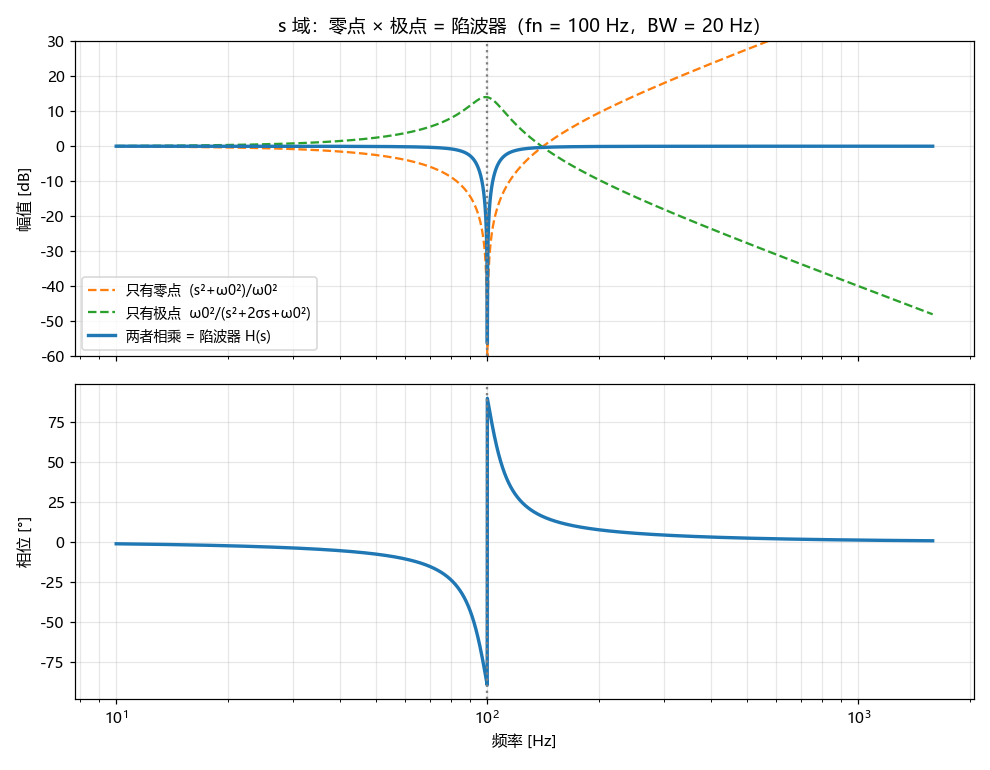
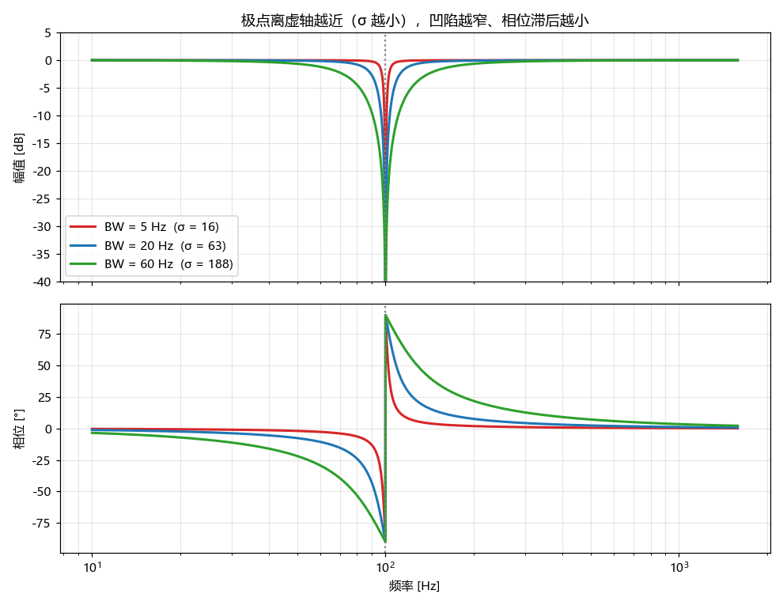
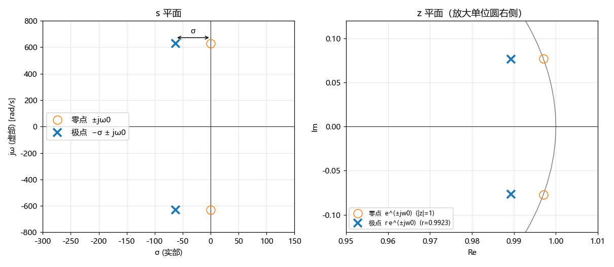
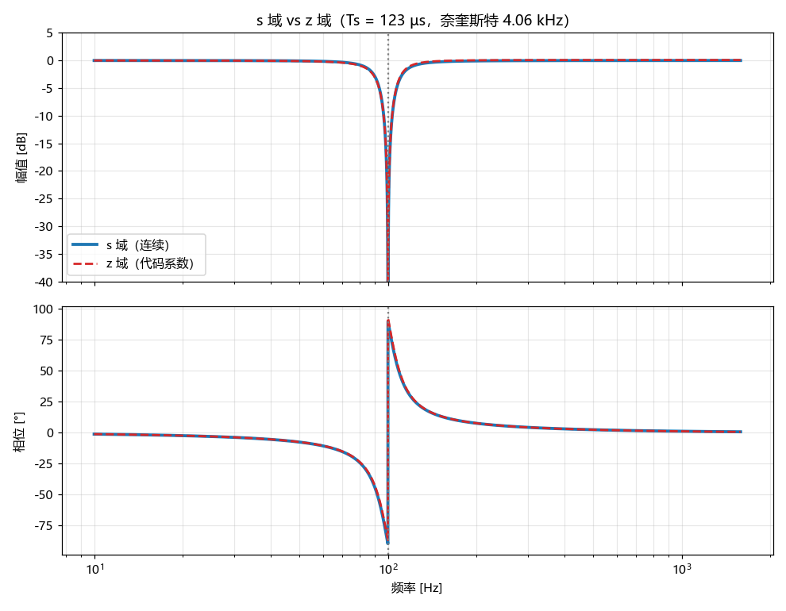
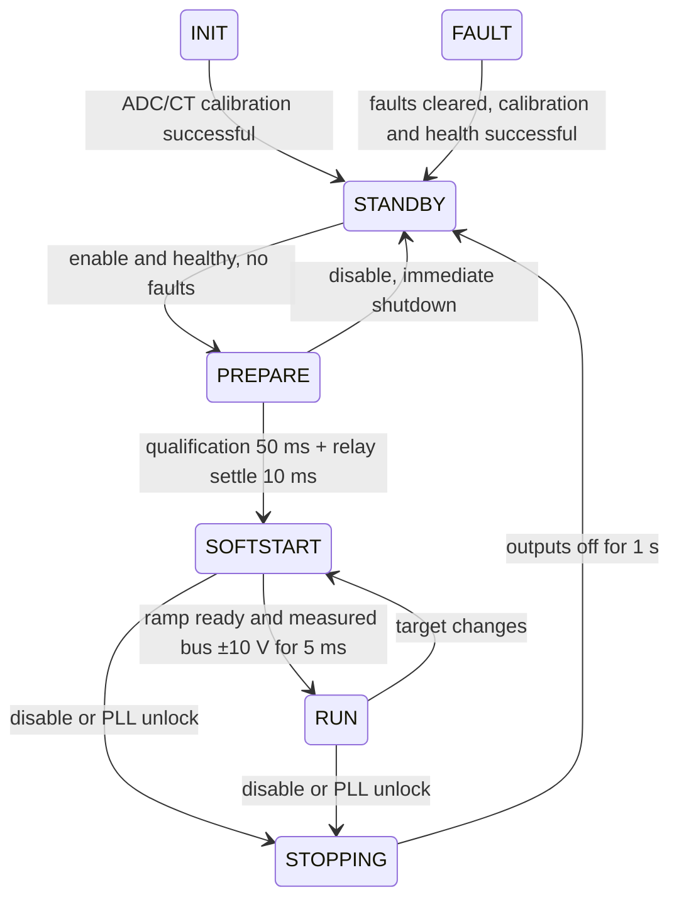

# 3 kW Interleaved Totem-Pole PFC Firmware — Software Architecture, Learning and Debugging Manual

| Item | Value |
|---|---|
| File Name | PFC_Software_Architecture_EN.md |
| Description | Manual covering software architecture, control algorithms, hardware resources, hardware bring-up and maintenance |
| Original Author | Chao Wang <chao.wang@microchip.com> |
| Created on | 2026/10/27 |
| Modified by | Chao Wang |
| Modified on | 2026/11/01 |
| Language | [中文](PFC_Software_Architecture_CN.md) · English |
| Project | `Microsoft_PSU_3kW_PFC.X` |
| MCU | dsPIC33AK256MPS206 (32-bit dsPIC33A, hardware single-precision FPU) |
| Toolchain | MPLAB X v6.35 + XC-DSC v4.00 + dsPIC33AK-MP_DFP 1.6.273 + MCC Melody |
| Companion document | [PFC ↔ LLC Communication Protocol](PFC_LLC_Comm_Protocol_EN.md) |

This document is for firmware engineers taking over this project for the first time. **Read Chapter 0 first (about 30 minutes)**. After reading it you should be able to:

1. Explain the responsibility of every file and every ISR, and how data flows between them;
2. Build and program the firmware on your own, and observe key variables with X2Cscope;
3. Follow the steps in Chapter 12 to safely perform the first power-up and close the loops stage by stage;
4. Change control parameters, add fault items or add new modules without breaking the existing real-time and safety constraints.

> **Terminology**:
> - In this document a "**cycle**" or "**tick**" depends on context: in the 65 kHz control ISR a cycle is one PWM period (15.38 µs); in the state machine, fault handling and scheduling a tick is one T1 period (100 µs). Where confusion is likely, the unit is stated explicitly.
> - "**Fast leg**" refers to the GaN bridge legs switching at 65 kHz (PG1/PG2); "**slow leg**" refers to the line-frequency leg (PG3).
> - "**PU**" means per-unit; see Chapter 7.

---

## Contents

0. [Quick Start (30 Minutes)](#0-quick-start-30-minutes)
1. [System Overview](#1-system-overview)
2. [Project Directory Structure](#2-project-directory-structure)
3. [Build, Programming and Project Files](#3-build-programming-and-project-files)
4. [Startup Sequence](#4-startup-sequence)
5. [Runtime Scheduling: Three ISRs + Main Loop](#5-runtime-scheduling-three-isrs--main-loop)
6. [Hardware Resource Map (PWM / ADC / Interrupts / Communication)](#6-hardware-resource-map-pwm--adc--interrupts--communication)
7. [Per-Unit (PU) System and ADC Scaling](#7-per-unit-pu-system-and-adc-scaling)
8. [Control Algorithms](#8-control-algorithms)
9. [Zero Crossing and Polarity Handling](#9-zero-crossing-and-polarity-handling)
10. [State Machine](#10-state-machine)
11. [Fault Protection](#11-fault-protection)
12. [Hardware Bring-Up Guide](#12-hardware-bring-up-guide)
13. [X2Cscope Variable Reference](#13-x2cscope-variable-reference)
14. [Tunable Parameters](#14-tunable-parameters)
15. [Coding Conventions and Extension](#15-coding-conventions-and-extension)
16. [Known TODOs and Risks](#16-known-todos-and-risks)
17. [Troubleshooting](#17-troubleshooting)
18. [PFC ↔ LLC Communication](#18-pfc--llc-communication)

---

## 0. Quick Start (30 Minutes)

### 0.1 The Project in One Sentence

A 3 kW, two-phase interleaved totem-pole PFC; the GaN fast legs switch at 65 kHz per phase (130 kHz input ripple after interleaving), and the output is a 400 V bulk bus feeding the downstream LLC. All control uses **single-precision floating point + per-unit (PU)**:

- The 65 kHz ISR runs the PLL, the zero-crossing/polarity decision and the two-phase current loops;
- The voltage loop, with load feed-forward, runs at 8.125 kHz;
- The state machine and fault protection run in the 10 kHz T1.

There are two communication channels between the PFC and the secondary-side LLC: UART1 (LLC master, PFC slave) and two duty-cycle signals (RC4 outputs the bulk bus voltage, RD6 inputs the LLC load). See Chapter 18 and the [protocol document](PFC_LLC_Comm_Protocol_EN.md) for details.

### 0.2 Software at a Glance

```
 ┌──────────────── 65 kHz, priority 5 (the two phases do not preempt each other) ──────┐
 │ _AD5CH1Interrupt (phase A)            _AD1CH1Interrupt (phase B, +180°)             │
 │  ADC→PU → fast OC → PLL → polarity    ADC→PU → fast OC/OV → RD6 load                │
 │  → current loop A → PG1DC / slow PG3  → voltage loop (every 8th) → cur. loop B → PG2DC│
 └─────────────────────────────────────────────────────────────────────────────────────┘
 ┌──────────── 10 kHz T1, priority 1 ──────────┐   ┌────────────── main loop ───────────┐
 │ UART1 byte transfer → temp → ISR heartbeat  │   │ clear WDT (needs heartbeat)        │
 │ → RMS / X-cap → fault evaluation → SM       │   │ → X2Cscope → LLC frame handling    │
 │                                             │   │ → 1 ms task (RC4)                  │
 └─────────────────────────────────────────────┘   └────────────────────────────────────┘
```

See Section 2.1 for module layering and dependency direction, and Chapter 5 for details of the three ISRs.

### 0.3 Day One: Build, Program, Watch Variables

1. **Build**: MPLAB X or VS Code (Chapter 3). When adding source files, **both sets of project files must be updated** (Section 3.3).
2. **Check the switches** (`app_config.h`, Section 14.3a):
   - On first power-up of a new board, `APP_PFC_ENABLE_AT_STARTUP = 0` and `APP_PLL_PWM_TEST_ENABLE = 0`;
   - To test only PLL/PWM without power stage, set `APP_PLL_PWM_TEST_ENABLE` to 1; the PFC is then enabled automatically at power-up.
3. **After programming, watch these 5 variables in X2Cscope** (Chapter 13):

| Variable | Normal behaviour |
|---|---|
| `g_sm.state` | 0 INIT → 1 STANDBY (after about 63 ms); after enable 2 → 3 → 4 RUN; 6 = FAULT |
| `g_fault.latchedFlags` | 0; if non-zero, decode bit by bit using Section 11.2 |
| `g_pll.locked` / `g_pfcFreqPU` | 1 / about 1.0 (50 Hz) once connected to the grid |
| `g_pfcVoutPU` | bulk bus voltage / 400 V |
| `g_ilCalA.ok` / `g_ilCalB.ok` | 1 = CT zero-offset calibration succeeded |

4. Before the **first power-up with power stage**, complete every item of the checklist in Section 12.0, then close the loops stage by stage per 12.1 to 12.7.

### 0.4 Where to Change What

| Task | Where to change | Reference sections |
|---|---|---|
| Switching frequency, scaling factors, CT range, L/C | `sources/config/board_config.h` | 2.2, 14.6 |
| Feature switches, test modes, version number | `sources/config/app_config.h` | 2.2, 14.3a |
| Protection thresholds, hysteresis, recovery policy | `sources/apps/fault/fault.h` / `fault.c` | 11.2, 11.3 |
| Add a fault item | `fault.h` + `fault.c` | 11.6 |
| Current loop / voltage loop parameters | `smps_control.c` (derived automatically from L, C) | 8.1a, 14.2 |
| Zero crossing, soft start, duty cycle | `pfc_loop.c` | 9, 14.1 |
| State machine timing (pre-charge, soft-start rate, shutdown) | `smps_sm.c` / `smps_sm.h` | 10, 14.3 |
| PWM pins, SWAP, slow-leg mapping | `pfc_pwm.h` | 6.1 |
| Relay, X-capacitor discharge, unused pins | `sources/drivers/pfc_io/` | 6.4, 7.6 |
| PFC ↔ LLC protocol | protocol document + `llc_protocol.h` + `common/llc_duty_def.h` (change both sides together) | 18, protocol document |
| Add a module | Create .c/.h from the template and add them to both sets of project files | 15.4, 3.3 |

### 0.5 Five Hard Constraints (Violations Cause Safety or Real-Time Problems)

1. **Only `user_isr.c` reads ADC data registers**; all other modules use only PU variables (Section 2.1).
2. **Only `pfc_pwm` writes PWM registers at run time**; GPIO is accessed only through `pfc_io` (Section 2.1).
3. **Only T1 writes `g_fault`**; the 65 kHz ISRs only set `g_faultFastTrip[]` and `smpsTripLatched` (Sections 5.7 and 11.1).
4. **The 65 kHz path has a time budget**: the two phases together measure about 9 µs, and the period is 15.38 µs (Section 5.8). Do not add divisions, square roots, trigonometric functions or blocking operations on this path.
5. **When adding or moving source files, keep the MPLAB X and VS Code projects in sync** (Section 3.3).

### 0.6 Current Status and Main Risks

**Final build snapshot**: APP_PLL_PWM_TEST_ENABLE=1 forces effective startup enable. Test ISRs use synthetic Vac/Vout, zero currents and fixed 25 °C temperatures, without reading physical ADC data, starting CT calibration or requiring CT/ADC gain calibration for startup/PG. Gain-failure diagnostics remain. Actual ADC ISR heartbeat, PLL, state timing, fast latches, watchdog and hardware PCI remain active. Calibration procedures below apply to real sensing with test=0. Test PG/telemetry do not establish real power-stage readiness; restore zero before power operation.

User-code fixes were authorized and applied on 2026/11/01; both languages of this manual, the protocol and the review record are synchronized. MCC, PLL and X2Cscope sources retain the contents present at the start of this fix pass. The user updated PG1/2/3 double-update mode and dead time.

- `PwmInitExt()` sets PG1/2/3 override synchronization to `OSYNC=01` (as soon as possible), without UPDREQ. DC/SWAP UPDMOD remains configured separately; hardware/driver latency still needs validation.
- RUN requires the ramp to finish and measured bus voltage to stay within ±10 V of target for 5 ms. PREPARE and SOFTSTART each have a 10 s deadline. After 50 ms of continuous qualification the relay closes, followed by 10 ms before enabling control.
- UVP recovery/retries, heartbeat restart, calibration admission, manual-clear hysteresis, invalid load feed-forward, UART cache/timestamps and status snapshots have been corrected. Fault bits 15–18 are now used.
- Hardware validation remains for SWAP/OVRDAT and current reconstruction, PCI polarity/thresholds, sensor/NTC calibration, double-update sampling/interleaving, actual gate shutdown and worst-case ISR time. The current 200 ns, 10 ms and ±10 V settings need board confirmation.
- Online NVM update remains a session framework with `GET_INFO.bootCaps=0`. Valid hardware RD6 PWM does not prove that LLC software is alive.

See the [review record](PFC_Code_Review_EN.md) and Chapter 16 for the complete fix and validation scope.

## 1. System Overview

### 1.1 Power Topology

```
            L_A        fast leg A (PG1, GaN, 65 kHz)
   L ──┬──/\/\/──┬────┤ Q_AH ├──┬──────────┐
       │         └────┤ Q_AL ├──┤          │
       │   L_B        fast leg B (PG2, 180° from A)   ═╪═ C_bulk  → Vout ≈ 400 V
       └──/\/\/──┬────┤ Q_BH ├──┤          │             (to downstream LLC)
                 └────┤ Q_BL ├──┤          │
                                │          │
   N ─────────────────┤ S_H  ├──┘          │
                      ┤ S_L  ├─────────────┘
                      slow leg (PG3, line-frequency switching, driven directly by override)
```

- **Two-phase interleaved boost fast legs**: PG1 (phase A) and PG2 (phase B) operate at 65 kHz with a 180° phase shift, so their input current ripple cancels.
- **Slow leg**: PG3 does not generate a PWM waveform; instead, output override **statically** turns on the high-side or low-side switch according to grid polarity, so it acts as a synchronously rectifying line-frequency leg.
- The difference between the **positive and negative half cycles** is which fast-leg switch acts as the boost switch and which acts as the synchronous rectifier (SR) switch. The code switches this with the PWM `SWAP` bit, so that the `PGxDC` register **always** represents the duty cycle of the boost switch and the control algorithm does not need to distinguish half cycles.

### 1.1a Current Paths in the Positive and Negative Half Cycles

Convention: the inductors connect to the L line, vac = L − N (i.e. `g_pfcVacPU`). POS means vac > 0, NEG means vac < 0. Phase A is used as the example below; phase B is identical (Q_BH/Q_BL correspond to Q_AH/Q_AL).

```
                    Bus+ ●────────────┬───────────────┐
                         │            │               │
                    Q_AH (PWM1H)  S_H (PWM3H)        ═╪═ C_bulk
                         │            │               │
   L ●───L_A──/\/\/──────● SW_A       ● ──────────● N │
                         │            │               │
                    Q_AL (PWM1L)  S_L (PWM3L)         │
                         │            │               │
                    Bus− ●────────────┴───────────────┘
```

**POS (vac > 0, L higher than N): line-frequency switch S_L always on, boost switch = Q_AL, SR = Q_AH, both return through Bus−**

```
① Charge (Q_AL on, D·Ts):
   L → L_A → SW_A → Q_AL↓ → Bus− → S_L↑ → N                 inductor stores energy, iL rises

② Discharge (Q_AL off, Q_AH on, (1−D)·Ts):
   L → L_A → SW_A → Q_AH↑ → Bus+ → C_bulk → Bus− → S_L↑ → N   inductor discharges into bus, iL falls
```

**NEG (vac < 0, N higher than L): line-frequency switch S_H always on, boost switch = Q_AH, SR = Q_AL, both return through Bus+**

```
① Charge (Q_AH on, D·Ts):
   N → S_H↑ → Bus+ → Q_AH↓ → SW_A → L_A → L                 inductor stores energy, |iL| rises

② Discharge (Q_AH off, Q_AL on, (1−D)·Ts):
   N → S_H↑ → Bus+ → C_bulk → Bus− → Q_AL↑ → SW_A → L_A → L   inductor discharges into bus, |iL| falls
```

**Line-cycle timing** (everything is off during BLANK; see Chapter 9):

```
 Polarity      BLANK │        POS         │BLANK│        NEG         │BLANK
 vac             0  ↗  L > N (pos. half)  ↘  0  ↘  N > L (neg. half)  ↗  0
 PWM3H (S_H)   ____│____________________│_____│▔▔▔▔▔▔▔▔▔▔▔▔▔▔▔▔▔▔▔▔│_____
 PWM3L (S_L)   ____│▔▔▔▔▔▔▔▔▔▔▔▔▔▔▔▔▔▔▔▔│_____│____________________│_____
 Q_AL (PWM1L)   off│  Boost (PG1DC)     │ off │  SR                │ off
 Q_AH (PWM1H)   off│  SR                │ off │  Boost (PG1DC)     │ off
 PG1 SWAP       —  │        1           │  —  │        0           │  —
 I feedback     0  │  iDn (low-side I)  │  0  │  iUp (high-side I) │  0
```

| Half cycle | Line-frequency switch | Boost switch (PGxDC) | SR switch | Return bus | SWAP | Slow-leg OVRDAT | Current feedback |
|---|---|---|---|---|---|---|---|
| POS | S_L (PWM3L) | low-side Q_xL (PWMxL) | high-side Q_xH | Bus− | 1 | `0x1` | `iDn` |
| NEG | S_H (PWM3H) | high-side Q_xH (PWMxH) | low-side Q_xL | Bus+ | 0 | `0x2` | `iUp` |

Rules to remember:
- **The boost switch and the conducting line-frequency switch are always on the same side**: both low-side in POS, both high-side in NEG. The inductor charging loop must close through the same bus rail (Bus− or Bus+). If they were not on the same side, the charging loop could not close; the inductor would see the difference between bus voltage and grid voltage directly and the current would run away.
- **The SR switch is on the opposite side from the line-frequency switch**; during the discharge phase it delivers the inductor current to the other bus rail.
- Current feedback is taken from the boost switch: POS uses `iDn`, NEG uses `iUp` (`PfcInductorCurrentSelect`). CAHALF=1 with TRIGA=0 targets the half-cycle boundary; the on-time midpoint/average-current approximation depends on symmetric CCM operation and needs verification with the current double-update mode (6.2, #40).

### 1.2 Control Structure

The voltage loop runs every eighth phase B call (design 8.125 kHz, crossover 20 Hz), using measured bus after a tracking twice-line-frequency notch. Its signed power correction g_smpsPfcVctrlPU is added to RD6 feed-forward and limited to nonnegative total demand. Raw bus above target+10 V zeros demand; applied PI contribution tracks back into history.

```text
Vref - Notch(Vout) -> V PI [-1.2,1.2] --+
RD6 power -> validity/filter/gain ------+-> demand [0,1.2]
                                   applied PI <- demand - FF
demand -> 0.5 / vPk -> ipk_per_phase -> × |cos(theta)| -> iref
iref - |iL| -> I PI -> + (1 - |vac|/vout) -> duty clamp -> soft-start -> PGxDC
```

Both current loops target 65 kHz and approximately 4 kHz crossover, sharing amplitude and sine reference. Phase A advances SOGI-PLL and polarity; phase B updates load and voltage control. Boost steady-state duty feeds forward while PI corrects the residual; applied final output also tracks into the controller. The theory uses vctrl for total power demand, which differs from the actual PI variable with load feed-forward enabled. Actual double-update sampling rates and delays need measurement.

### 1.3 Design Targets and Key Numbers

| Item | Value | Source |
|---|---|---|
| Output power | 3 kW | Project requirement |
| Input | 90–264 Vac, 45–65 Hz | Design range; protection thresholds in `fault.h` (VAC_UVP 128 Vpk ≈ 90 Vrms, VAC_OVP 380 Vpk ≈ 269 Vrms) |
| Output | 400 V (settable 350–410 V) | `smps_sm.h` |
| Switching frequency | 65 kHz per phase, input ripple frequency 130 kHz after interleaving | `board_config.h` (`BOARD_FAST_LOOP_HZ`), must match MCC `PG1PER` |
| Current loop rate | 65 kHz (per phase) | Same as above |
| Voltage loop rate | 8.125 kHz | `PFC_VLOOP_DIVIDER = 8` |
| Slow task | 10 kHz (100 µs) | Timer1 |
| Arithmetic | All floating point, all per-unit | — |

### 1.4 Architecture Origin

This project's directory layout, fault framework, PU system and ISR layering are **inherited** from the LLC secondary-side project `sec_pkcmc_llc`; the PLL module is **ported** from `sogi_pll-main`. Anyone familiar with the LLC project can read the two side by side.

---

## 2. Project Directory Structure

```
Microsoft_PSU_3kW_PFC.X/
├── main.c                          Entry: initialisation order + main loop
├── mcc_generated_files/            Generated by MCC Melody (do not edit by hand; regeneration overwrites it)
│   ├── adc/        adc1..adc5      ADC channels, trigger sources, sampling time
│   ├── cmp/        cmp1,4,5,6,7,8  Comparators/DACs (CMP1/4/5/6 → PG1/PG2 cycle-by-cycle current limit; DAC7 → RA9 debug, DAC8 → RA8 external VREF)
│   ├── pwm_hs/     pwm.c           PG1/PG2/PG3 period, mode, triggers, override
│   ├── input_capture/ sccp1,2      RD6 capture (LLC load duty cycle; reconfigured by LLC_SIGNAL_Init)
│   ├── pwm/        sccp3           RC4 duty-cycle output (bulk bus voltage → LLC)
│   ├── timer/      tmr1            100 µs time base
│   ├── uart/       uart1, uart3    UART1 = LLC link, UART3 = X2Cscope (both 115200)
│   ├── uref/       uref            DAC7 → UREF pin (RA9), for debugging
│   └── system/     clock, pins, interrupt (priorities), traps, dmt, config_bits
├── sources/
│   ├── config/
│   │   ├── app_config.h            Software switches (enable at startup, test switches, load feed-forward, X-capacitor discharge, DAC voltages, firmware version)
│   │   └── board_config.h          Hardware constants (ISR/task rates, ADC scaling factors, CT range, L/C), see Section 14.6
│   ├── common/
│   │   └── llc_duty_def.h          RC4/RD6 duty-cycle encoding constants (shared by llc_signal and llc_protocol)
│   ├── drivers/
- ADC1–5 gain calibration uses internal AN6. Timeout/zero results retain unity for diagnostics but set `g_adcCalibrationFailedMask` and block startup.
│   │   ├── pfc_pwm/pfc_pwm.c/.h        Totem-pole PWM access layer: duty cycle, SWAP, override, slow leg
│   │   ├── pfc_io/pfc_io.c/.h          Sole GPIO driver: relay RB2, X-capacitor discharge RA4, unused pins driven low
│   │   ├── uart_link/uart_link.c/.h    UART1 register access (inline TX/RX, error flags, FIFO flush)
│   │   └── llc_signal/llc_signal.c/.h  LLC duty-cycle signals: RC4 bulk voltage output, RD6 load measurement (owns SCCP1/2/3 configuration)
│   ├── isr/
│   │   └── user_isr.c/.h           Three ISRs: ADC→PU conversion + calls to state machine tasks
│   ├── apps/
│   │   ├── control/
│   │   │   ├── smps_control.c/.h   PU base values, measurement variables, floating-point 2P2Z controllers
│   │   │   ├── pfc_loop.c/.h       Fast control path: PLL call, polarity, current loops, voltage loop, soft start
│   │   │   ├── smps_sm.c/.h        State machine: INIT→STANDBY→PREPARE→SOFTSTART→RUN
│   │   │   └── smps_common.c/.h    Common utilities: reference ramp
│   │   ├── fault/
│   │   │   ├── fault.c/.h          Fault objects, recovery policy, fast-trip latch
│   │   │   └── fault_common.c/.h   Generic detector: threshold + hysteresis + debounce
│   │   ├── pll/
│   │   │   └── sogi_pll.c/.h       Single-phase SOGI-PLL (reusable module)
│   │   ├── meas/
│   │   │   ├── grid_meas.c/.h      Grid voltage / input current RMS, X-capacitor discharge decision (drives RA4 via pfc_io)
│   │   │   └── il_cal.c/.h         Current CT zero-offset self-calibration (Section 7.3a)
│   │   └── comm/
│   │       ├── llc_protocol.h      PFC ↔ LLC protocol definition (shared with the LLC project, byte-for-byte identical)
│   │       ├── llc_link.c/.h       UART1 slave protocol layer: ring buffer, frame parsing, command handling (registers via uart_link)
│   │       └── fw_update.c/.h      Firmware update session (framework; Flash erase/write not yet implemented; no dependency on the state machine)
│   ├── scheduler/
│   │   ├── scheduler.c/.h          Main-loop cooperative scheduler (100 µs / 1 ms / 10 ms / 500 ms)
│   │   └── app_tasks.c/.h          Periodic task implementations (watchdog clear gated by ISR heartbeat, LLC link, RC4 update)
│   └── third_party/
│       └── X2Cscope/               X2Cscope library (.a) + UART adaptation layer
├── nbproject/                      MPLAB X project files
└── docs/                           This document
```

### 2.1 Module Layering and Dependency Direction

```
                         main.c  (calls each module's Init in order, see Chapter 4)
                           │
   ┌──────────────┬────────┴───────┬──────────────────────┐
   ▼              ▼                ▼                      ▼
scheduler      user_isr ─────► smps_sm (state machine) mcc_ext ──► pfc_pwm, pfc_io
   │            │    │             │
   ▼            │    │   ┌─────────┼──────────┬───────────┬──────────┐
app_tasks       │    │   ▼         ▼          ▼           ▼          ▼
 │    │         │    │ pfc_loop   fault     grid_meas  smps_common  il_cal
 │    │         │    │  │   │      │          │
 │    │         │    │  │   ▼      ▼          ▼
 │    │         │    │  │ sogi_pll fault_common  pfc_io ──► RB2 / RA4 / unused pins
 │    │         │    │  ▼
 │    │         │    └► smps_control ◄── board_config   (PU bases + measurements + controllers)
 │    │         │          │
 │    │         │          ▼
 │    │         │       pfc_pwm ──► registers (PG1/PG2/PG3)
 │    │         ▼
 │    │      il_cal (fed raw values during calibration), llc_signal (RD6), llc_link (byte transfer)
 │    ▼
 │  llc_link ──► uart_link ──► UART1
 │    ├──► fw_update ("PFC stopped" passed in as a parameter)
 │    └──► smps_sm / fault (read status, execute commands such as SET_ENABLE)
 ▼
llc_signal ──► SCCP1/2 (RD6 capture), SCCP3 (RC4 output)

llc_signal, llc_protocol ──► common/llc_duty_def.h
```

Rules:

- **Only `user_isr.c` reads ADC data registers**; it converts them to PU and writes the measurement variables in `smps_control.h`. All other modules use only PU variables.
- **Only `pfc_pwm` writes PWM registers** (except the one-time configuration by MCC initialisation and `PwmInitExt` in `mcc_ext.c`). Other modules operate through the `PFC_PWM_*` interface.
- `smps_control.h` is the "data bus": PU base values, all measurements, all control variables and controller objects are declared there.
- `g_fault` is written only in T1 context; the 65 kHz ISRs only set the `g_faultFastTrip[]` flags (see Chapter 11).
- **Only `pfc_io` operates GPIO** (RB2, RA4 and unused pins). `smps_sm` and `grid_meas` drive them through `PFC_IO_RelaySet()` and `PFC_IO_XcapSet()`.
- **Only `uart_link` operates UART1 registers**; `llc_link` does protocol only. **Only `llc_signal` configures and reads/writes SCCP1/2/3** (except MCC initialisation).
- **No module-level circular dependencies**: the state machine does not initialise other modules (`LLC_SIGNAL_Init`, `LLC_LINK_Init` and `IL_CAL_Start` are all called by `main`); `fw_update` does not read `g_sm` — whether "the PFC is stopped" is passed in as a parameter by `llc_link`.
- Private functions are always `static`. Private variables keep external linkage so that X2Cscope can access them by name.

### 2.2 Split Between Configuration and Common Headers

The three headers under `sources/config/` and `sources/common/` are split by "**who changes them and why**". Parameter details are in Section 14.3a (app_config) and Section 14.6 (board_config).

**[app_config.h](../sources/config/app_config.h): software feature switches ("what" this firmware build does)**

| Category | Macros | Used by |
|---|---|---|
| Run switches | `APP_PFC_ENABLE_AT_STARTUP`, `APP_PLL_PWM_TEST_ENABLE` (when the test switch is 1, enable at startup is forced automatically) | smps_sm.c, user_isr.c |
| Feature selection | `APP_PFC_LOAD_FF_ENABLE`, `APP_XCAP_ENABLE`, `APP_X2CSCOPE_ENABLE` | pfc_loop.c, llc_link.c (status flag `LOAD_FF_ON`), grid_meas.c, X2Cscope.h |
| Application set points | `APP_XCAP_*` (time, voltage), `APP_DAC_VREF_RA8_V`, `APP_DAC_DEBUG_RA9_V` | grid_meas.c, mcc_ext.c |
| Version number | `APP_FW_VERSION_MAJOR/MINOR/BUILD` | llc_link.c (reported by `GET_INFO`) |

Differences between debug, production and bench-test builds should appear only in this file.

**[board_config.h](../sources/config/board_config.h): constants determined by hardware ("what" this board is)**

| Category | Macros | Must match |
|---|---|---|
| Execution rates | `BOARD_FAST_LOOP_HZ` (65 kHz), `BOARD_VLOOP_DIVIDER`, `BOARD_SLOW_TICK_US` (100 µs) | MCC `PG1PER`, `PR1` |
| ADC scaling | `BOARD_FB_VAC/VOUT/TEMP_*`, `BOARD_FB_IL_RANGE_A` (±50 A; `BOARD_FB_IL_SCALE` is derived from it) | Divider ratios, CT turns ratio, op-amp gain |
| Power stage | `BOARD_PFC_L_H`, `BOARD_PFC_COUT_F` | Measured inductance and capacitance |

Used by:
- smps_control.h: derives `PFC_FAST_LOOP_HZ`, `PFC_VLOOP_DIVIDER`, `PFC_VLOOP_HZ`; smps_control.c derives `PFC_L_H`, `PFC_COUT_F`, and the controller Kp, Ki are derived from L and C.
- user_isr.c: ADC → PU conversion.
- llc_signal.c: call rate.
- pfc_loop.c: `#error` when `BOARD_FAST_LOOP_HZ ≠ 65000` (PLL step is hard-coded).
- smps_sm.c: soft-start step (`BOARD_SLOW_TICK_US`).
- grid_meas.c: X-capacitor timing (`BOARD_SLOW_TICKS_PER_MS`).
- scheduler.h: `SCHED_TICK_US = BOARD_SLOW_TICK_US`.
- fault.c: `_Static_assert` checks that the fast OCP threshold is within the CT range.

This file only needs changing when the board changes, the MCC clock changes, or the sensing circuit changes; it is not a tuning file.

**[common/llc_duty_def.h](../sources/common/llc_duty_def.h): conventions shared by PFC and LLC**

It contains the RC4/RD6 duty-cycle encoding: 10 kHz (±1 %), linear over 10 %~90 %, anything outside 5 %~95 % treated as invalid, no edge for 2 ms treated as timeout, full scale 500 V / 3600 W. It is used by llc_signal.c (driver layer, generates and decodes the duty cycle) and llc_protocol.h (protocol layer). It is an interface convention between the two MCUs and must be **byte-for-byte identical** to the LLC project; if either side changes it, the other side must be updated too.

**Why it is split this way**

1. **Separated by reason for change**: debugging touches only app_config, a hardware change touches only board_config, a protocol change touches only common. Each file has only one reason to change, so changing a switch never touches hardware parameters.
2. **Hardware constants are defined once and everything else is derived**: previously the numbers 65000, 8125, 10, 0.01465 were scattered across pfc_loop, smps_control, llc_signal and user_isr; changing the PWM frequency meant finding several places, and missing one caused a bug. Now only one macro is changed, and `pfc_loop.c` raises `#error` if the frequency does not match the PLL step.
3. **common fixes the layering direction**: these constants used to live in `apps/comm/llc_protocol.h`, so the driver layer `drivers/llc_signal` had to include an application-layer header in the reverse direction. After moving them to `common/`, both the driver layer and the protocol layer depend only on a low-level, constants-only header.
4. **Easy to port to the LLC**: the LLC project only needs to copy the two files `llc_protocol.h` and `common/llc_duty_def.h`, without dragging in the PFC board configuration. If these constants were in board_config, the LLC side could not share them directly.
5. **Tuning items are not in config**: the `FLT_*` thresholds are in fault.h, `PFC_ZC_*` in pfc_loop.c, controller bandwidths in smps_control.c. These parameters are meaningless without their algorithms; keeping them next to the code means you see them while reading the algorithm (Chapter 14 also lists parameters by module).
6. **Only `#define`, no code or variables**: these macros can be used in `#if`, static initialisers and `_Static_assert`; including them from any layer introduces no module dependency or linkage problem.

**Where to put a new constant** — decide in this order:

1. Needed by both PFC and LLC? → `common/`
2. Changes only when the board changes? → `board_config.h`
3. Is it a feature switch or version number? → `app_config.h`
4. None of the above → put it in the module that uses it

---

## 3. Build, Programming and Project Files

### 3.1 Building in the IDE

Open `Microsoft_PSU_3kW_PFC.X` in MPLAB X, select the `default` configuration and run Clean and Build. Compiler options are `-O2 -msmart-io=1 -Wall`; the target is **0 errors / 0 warnings**.

### 3.2 Command-Line Build (Same Result as the IDE)

```bash
cd Microsoft_PSU_3kW_PFC.X
MK="/c/Program Files/Microchip/MPLABX/v6.35/gnuBins/GnuWin32/bin/make.exe"
"$MK" -f nbproject/Makefile-default.mk SUBPROJECTS= .build-conf TYPE_IMAGE=DEBUG_RUN   # debug build
"$MK" -f nbproject/Makefile-default.mk SUBPROJECTS= .build-conf                       # release build
```

Output location: `dist/default/{debug,production}/Microsoft_PSU_3kW_PFC.X.*.elf/.hex/.map`.

### 3.3 Required Steps After Adding Source Files

The MPLAB X Makefile (`nbproject/Makefile-default.mk`) is **generated** from `configurations.xml`. After adding a `.c`/`.h`:

1. In the IDE, right-click Source Files → Add Existing Item (this updates `configurations.xml`);
2. Or edit `nbproject/configurations.xml` by hand (add `itemPath` under the HeaderFiles / SourceFiles logical folders), as well as `sourceRootList` in `nbproject/project.xml`;
3. Then regenerate the Makefile:
   ```bash
   "/c/Program Files/Microchip/MPLABX/v6.35/mplab_platform/bin/prjMakefilesGenerator.bat" .
   ```

> **The two sets of project files must stay in sync**: this project has two build systems at the same time; when adding or moving source files, **change both**:
>
> | Build method | Project file | Generated file | Output |
> |---|---|---|---|
> | MPLAB X IDE | `nbproject/configurations.xml`, `project.xml` | `nbproject/Makefile-default.mk` | `dist/default/` |
> | VS Code MPLAB extension (CMake + Ninja) | `fileSets` in `.vscode/Microsoft_PSU_3kW_PFC.mplab.json` | `cmake/.../.generated/file.cmake` | `out/Microsoft_PSU_3kW_PFC/` |
>
> If only one side is changed, the other side gets link errors. For example, when `sources/apps/meas/grid_meas.c` was added and only nbproject was updated, the VS Code build reported `undefined reference to '_GRID_MEAS_Init'`. The fix is to add the string entry `"sources/apps/meas/*"` to `fileSets` in `.mplab.json`; `file.cmake` is regenerated automatically by the extension — **do not edit it by hand**.
>
> **Past issue**: after X2Cscope was moved from `sources/utils/` to `sources/third_party/` without updating the project files, the build failed with `No rule to make target 'sources/utils/X2Cscope/X2Cscope.c'`. When you see "No rule to make target", the first step is to check that the paths in `configurations.xml` match the disk.

### 3.3a Include Paths and Project Properties

`#include "..."` is searched in this order: **first the directory of the current source file**, then the directories given to the compiler with `-I`. GCC does not automatically add the current directory of the compile command (the project root) to the search path.

| File | Directory | First lookup location for `#include "sources/third_party/..."` | Result |
|---|---|---|---|
| `main.c` | project root | `<root>/sources/third_party/...` | Found, no dependency on `-I` |
| `user_isr.c` | `sources/isr/` | `<root>/sources/isr/sources/third_party/...` | Does not exist; must fall back on `-I.` |

`-I.` configuration in the two builds:

| Build method | Configuration location | Value |
|---|---|---|
| VS Code | `.vscode/Microsoft_PSU_3kW_PFC.mplab.json`: `compiler.extra-include-directories`, `assembler.extra-include-directories-for-assembler`, `assembler.extra-include-directories-for-preprocessor` | `"."` |
| MPLAB X | The three items of the same name in `nbproject/configurations.xml` (`C30` / `C30-AS` sections); after changing them run `prjMakefilesGenerator.bat` to regenerate the Makefile and reopen the project | `.` |

Scope of the four MPLAB X include-directory properties (obtained by setting each one in a test copy and checking the generated compile commands):

| Property | `.c` | `.s` | `.S` (passes through the C preprocessor first) |
|---|---|---|---|
| `extra-include-directories` | `-I` | — | — |
| `extra-include-directories-for-assembler` | — | `-I` | — |
| `extra-include-directories-for-preprocessor` | — | — | `-I` |
| `common-include-directories` | `-I` | `-I` | not tested |

- This project has only lowercase `.s` files, so `for-preprocessor` currently has no effect; it is set only to stay consistent with the VS Code configuration.
- Alternatively you can put `.` only in `common-include-directories` and leave the other three empty, with the same effect; VS Code's `.mplab.json` has no common item, so both sides currently "write it in three separate places" for consistency.

> **Convention**: files under `sources/` include other modules using **paths relative to the file itself** (e.g. `user_isr.c` writes `"../third_party/X2Cscope/X2Cscope.h"`), with no dependency on `-I.`; `-I.` is only a fallback. Past issue: `user_isr.c` once used the `"sources/..."` form; the VS Code build passed but the MPLAB X build reported `X2Cscope.h: No such file or directory`, because the MPLAB X include-directory properties were empty. `main.c` is in the project root, so `"sources/..."` is correct there.

### 3.4 Link Libraries

X2Cscope uses the precompiled library `sources/third_party/X2Cscope/libx2cscope-generic-32dsp-dspic33a-mlarge-elf.a` (large memory model version), referenced in `linkerLibFileItem` in `configurations.xml`.

---

## 4. Startup Sequence

[main.c](../main.c) defines the sequence:

```c
SYSTEM_Initialize();             // MCC may enable global interrupts internally
MCC_EXT_SystemInitialize();      // Disable IRQs first; configure dead time, overrides, PCI and ADC
USER_ISR_AdcScaleInit();
SMPS_SM_Init();                  // Faults, PLL, controllers and safe outputs
LLC_SIGNAL_Init();
LLC_LINK_Init();
#if !APP_PLL_PWM_TEST_ENABLE
IL_CAL_Start();                  // Real sensing only, with gates held off
#endif
SCHEDULER_Init();
TMR1_Start();
X2Cscope_Init();
WATCHDOG_TimerSoftwareEnable();  // Approximately 4 ms from configuration words
g_userIsrReady = true;           // Every object used by these ISRs is initialized
INTERRUPT_GlobalEnable();
while (1) SCHEDULER_Run();
```

`g_userIsrReady` starts false. Both ADC ISRs and T1 only acknowledge their own interrupt and return while it is false, protecting user objects from the early enable in MCC initialization. Additional ISRs must follow this startup constraint. `SMPS_SM_Init()` holds overrides low; PWM time bases run for ADC calibration while the state machine controls gate admission.

ADC gain timeout or a zero result sets `g_adcCalibrationFailedMask`. CT calibration must finish with both `g_ilCalA.ok` and `g_ilCalB.ok`. A missing success condition latches `FLT_CALIBRATION` and prevents startup.

## 5. Runtime Scheduling: Three ISRs + Main Loop

### 5.1 Execution Context Summary

| Context | Trigger source | Rate | Priority | Entry | Main work |
|---|---|---|---|---|---|
| Phase A ISR | AD5CH1 conversion complete (PWM1 Trigger1) | 65 kHz | 5 | `_AD5CH1Interrupt` | (during calibration `IL_CAL_Update` accumulates raw iA) sample iA_up/dn, vac → `SMPS_SM_TaskPhaseA` |
| Phase B ISR | AD1CH1 conversion complete (PWM2 Trigger1) | 65 kHz | 5 | `_AD1CH1Interrupt` | (during calibration `IL_CAL_Update` accumulates raw iB) sample iB_up/dn, vout → RD6 load `LLC_SIGNAL_LoadUpdate` → `SMPS_SM_TaskPhaseB` → `X2Cscope_Update` |
| Slow-task ISR | Timer1 (PR1 = 9999) | 10 kHz | 1 | `_T1Interrupt` | sample temperature → `SMPS_SM_TaskSlow` → UART1 byte transfer `LLC_LINK_ByteService` → scheduler tick +1 |
| Main loop | — | as fast as possible | 0 | `SCHEDULER_Run` | Clear watchdog (requires ISR heartbeat), X2Cscope communication, LLC frame parsing and replies `LLC_LINK_Task`, 1 ms task (link timing, RC4 update) |

### 5.2 Timing Diagram (One PWM Period ≈ 15.38 µs)

```
 PWM1 period |<─────────────────── 15.38 µs ───────────────────>|
            ▲ Trigger1(A)                  ▲ Trigger1(B, +180°)
 ADC        [AD5/AD2/AD4 conversion]        [AD1/AD3CH0 conversion]
 ISR(prio5)   ├─ phase A ISR ──┤              ├─ phase B ISR ┤
                PLL ~1.3 µs                    (every 8th) voltage loop
                polarity + current loop A      current loop B
                RMS accumulation               X2Cscope_Update
 T1(prio1)  ──────(once every 100 µs, can be preempted by both ISRs above)──
 main(prio0)────────────(all idle time goes to the main loop)──────────────
```

### 5.3 Phase A Task `SMPS_SM_TaskPhaseA()` ([smps_sm.c](../sources/apps/control/smps_sm.c))

The following describes real sensing (test=0); see 0.6 for bench-mode exceptions.

The phase A ADC ISR reads the CT and L/N data and then runs the phase A task. The code does not check `ADxSTAT.CHyRDY`; see risk #7 for AD2/AD5 completion timing.

`SMPS_SM_TaskPhaseA()` advances its heartbeat, handles the controller-reset handshake, PLL, grid measurement and phase A current control. BLANK entry requests both fast legs and the slow leg off in one path and zeros both duties. With control disabled, raw CT magnitudes still update the slow-OCP filtered input so a frozen stopped-state current cannot prevent recovery.

### 5.4 Phase B Task `SMPS_SM_TaskPhaseB()`

The following describes real sensing (test=0); see 0.6 for bench-mode exceptions.

The phase B ADC ISR reads the CT and bus data and then runs the phase B task. Phase B advances its heartbeat, updates RD6 capture, divides the voltage-loop execution rate and runs its current loop. Voltage PI runs every eight phase B calls, targeting 8.125 kHz. RD6 capture and other per-cycle work are outside this divider. Stopped-state phase B OCP filtering remains active. Actual ISR rates in double-update mode require measurement.

### 5.5 Slow Task `SMPS_SM_TaskSlow()` (10 kHz)

Every 100 µs, T1 services UART bytes, the scheduling time base and `SMPS_SM_TaskSlow()`. The slow task checks both phase heartbeats first. Judging starts only after both counters have moved once (`smpsHealthArmed`), so the first ticks after power-up, before the ADC ISRs run, are not a fault. After that, a stalled phase latches `FLT_ISR_HEALTH`, revokes the watchdog token, shuts down and enters FAULT; the latched fault prevents startup now and later and must be cleared manually. INIT is left only once the heartbeat has been armed.

T1 is the sole runtime writer of `g_fault`: it transfers fast faults, checks calibration, handles a one-shot clear request, evaluates hysteresis/debounce and then runs the state machine. Outside RUN only new UVP detection is inhibited; an already detected UVP still evaluates recovery. FAULT may return to STANDBY only after faults clear and health conditions hold.

### 5.6 Main Loop `SCHEDULER_Run()`

The main loop runs `SCHEDULER_Run()`; always-run tasks handle communication, update sessions, RMS and X2Cscope. Periodic tasks may catch up, but UART cache/link/status ages and update-session timeout use actual T1 timestamps rather than replay counts.

The user's configuration words `FWDT_SWDTMPS=PS4`, `FWDT_RWDTPS=PS4` and `FWDT_RCLKSEL=BFRC244` select approximately **4 ms**. The extension no longer overrides RMPS; software enable and `WATCHDOG_TimerClear()` remain. Main may service the watchdog only after consuming a new healthy two-phase token. Consuming the token does not mask interrupts: single-byte accesses are atomic, and a token lost to a T1 preemption is set again by the next 100 µs tick, far below the watchdog period. Failure of either ADC heartbeat invalidates the token immediately and stops servicing.

### 5.7 Concurrency and Data-Sharing Rules (**Mandatory**)

- Both ADC ISRs run at priority 5 and cannot preempt each other; T1 is priority 1 and main is 0. Phase A owns polarity decisions and control reset; B consumes the published state.
- `volatile FAULT_OBJ_T g_fault` is modified only by T1 at runtime. Fast ISRs publish `g_faultFastTrip[]` and shut down. The lockout mask is cached for fixed-cost queries; the latch query includes fast faults pending transfer to T1.
- UART RX/TX rings have single-writer/single-reader ownership and compiler barriers before head/tail publication. Each RX byte carries a 100 µs T1 timestamp. Errors discard backlog in a short critical section and reset parsing.
- `GET_STATUS` and `GET_LOAD_ECHO` briefly mask global interrupts to copy state, masks, flags and raw floats; fixed-point encoding and framing run after restoration. This provides a coherent protocol snapshot. NaN/Inf encode as zero and do not imply a valid measurement.
- Critical-section APIs are restricted to their existing main-loop call paths. Do not move an API that restores global interrupts into an ISR. New higher-priority ISRs require another sharing and latency review.
- `volatile` does not make a group of fields atomic. Safety decisions must not rely on ordinary multi-field reads across contexts. RMS and control reset retain their handshakes.

### 5.8 CPU Load Estimate (-O2, 200 MHz)

A≈4.4 µs and B≈4.6 µs are historical measurements. This pass adds filtering, protection and snapshots without a new board WCET measurement; the estimates below do not establish the current 4 ms servicing budget or continuous UART service.

| Item | Time |
|---|---|
| SOGI-PLL | ~1.3 µs |
| 2P2Z controller | ~0.37 µs per call |
| Polarity decision + soft start + RMS accumulation | ~0.1 µs |
| Phase A ISR total | **measured about 4.4 µs** (estimated 2–2.5 µs; measured is higher, includes interrupt entry/exit overhead) |
| Phase B ISR total | **measured about 4.6 µs** (estimated 1–1.5 µs); need to confirm whether this is the worst case of the voltage-loop cycle (once every 8 cycles) |
| Share of the 15.38 µs period used by both phases | **about 59 %** (4.4 + 4.6 = 9.0 µs measured), leaving about 6.4 µs per period for T1 and the main loop |
| T1 ISR (100 µs) | **measured pin pulse width about 15 µs**; this is wall-clock time including preemption by the two 65 kHz ISRs (about once each, 9.0 µs); T1 itself takes about 6 µs, about 6 % of CPU |
| Total CPU load | about 59 % + 6 % ≈ **65 %**, leaving about 35 % for the main loop (X2Cscope communication, LLC frame handling) |

> Measurement method: toggle a spare GPIO at ISR entry and exit and measure the pulse width with an oscilloscope (see Section 12.8).

---

## 6. Hardware Resource Map (PWM / ADC / Interrupts / Communication)

> The following comes from the MCC-generated code (`mcc_generated_files/`) and `mcc_ext.c`. **Make hardware configuration changes in MCC**, then regenerate.

### 6.1 PWM

| Generator | Purpose | Mode | Period | Update mode | Notes |
|---|---|---|---|---|---|
| PG1 | Phase A fast leg | Double-update center-aligned, complementary (MODSEL=5) | `PG1PER = 0x1808E` (design 65 kHz) | UPDMOD = SOC | Master time base; Trigger B compare event triggers PG2; TRIGA is used to trigger the ADC |
| PG2 | Phase B fast leg | Double-update center-aligned, complementary (MODSEL=5) | Same as PG1 | UPDMOD = SOC | Triggered by PG1, design 180° phase shift |
| PG3 | Slow leg | Double-update center-aligned MODSEL=5 | Same as PG1 | Immediate | Driven through override |
| PG4 | Not used by the power stage | Independent edge, only PWM4H (RC3) enabled | `PG4PER = 0xC7F0` | UPDMOD = Immediate | Configured by MCC, started together by `PWM_Enable()`; `DC = 0` so RC3 stays low; not managed by `PFC_PWM_*`, not used by software |

> **Current MCC snapshot (#40)**: the user updated PG1/2/3, with CON 0x8D / 0x1008D / 0x101008D, all MODSEL=5. Double update offers two buffer-update opportunities per full cycle. ADC Trigger 1 still selects only TRIGA, 1:1 postscaling, CAHALF=1 and compare zero. Update count does not establish ADC rate; verify the design targets of 65 kHz per phase and 180° interleaving with simultaneous gate/ADC/update measurements.

**Override mechanism** (`PGxIOCON2`):

- `OVRENH/OVRENL = 1`: the output is determined by `OVRDAT`, not by the PWM generator.
- `OVRDAT<1>` corresponds to PWMxH, `OVRDAT<0>` to PWMxL.
- MCC reset value `PGxIOCON2 = 0x300800`, i.e. OVREN set, OVRDAT = 0: **all outputs are low by default at power-up**.
- `PwmInitExt()` sets PG1/2/3 override synchronization to `OSYNC=01` (as soon as possible), without UPDREQ. DC/SWAP UPDMOD remains configured separately; hardware/driver latency still needs validation.

**SWAP mechanism** (`PGxIOCON1.SWAP`): swaps the PWMxH and PWMxL outputs. The code ensures that `PGxDC` always represents the duty cycle of the boost switch:

| Polarity | Fast-leg SWAP | Slow-leg OVRDAT | Meaning (**must be confirmed against the schematic**) |
|---|---|---|---|
| POS (vac > 0) | `PFC_PWM_FAST_LEG_SWAP_POS = 1` | `0x1` (PWM3L on) | Low-side switch is the boost switch |
| NEG (vac < 0) | `PFC_PWM_FAST_LEG_SWAP_NEG = 0` | `0x2` (PWM3H on) | High-side switch is the boost switch |
| BLANK | — | `0x0` (all off) | Switching inhibited around zero crossing |

**Pin carrying the SR switch** (`PFC_PWM_SYNC_OVREN_POS/NEG` in `pfc_pwm.h`): override acts on the **pin**, after SWAP (datasheet 16.x: SWAP is applied first and is overridden by other controls), so the pin carrying the SR switch changes with the half cycle:

| Polarity | SWAP | Pin driven by PGxDC (boost switch) | Pin carrying the SR switch | Override bit held during soft start |
|---|---|---|---|---|
| POS | 1 | PWMxL (low-side) | PWMxH (high-side) | `OVRENH` |
| NEG | 0 | PWMxH (high-side) | PWMxL (low-side) | `OVRENL` |

> ⚠️ The above is derived assuming "PWMxH pin = high-side switch, PWMxL pin = low-side switch" and **must be confirmed against the schematic** (same item as the TODO for the SWAP table). On the bench it has been confirmed that PWM1H is the high-side switch, and in the NEG half cycle PWM3H is high and PWM1H is the boost switch, consistent with the table above. See Section 1.1a for the current paths in each half cycle.

> **Dead time**: 200 ns on both edges of PG1/2/3, updated by the user in MCC and reapplied by `PwmInitExt()` before start as `PGxDT=0x0A000A00` (1.25 ns coarse clock, four fine-count bits). Verify actual gates; the register value alone does not establish safety.

**Cycle-by-cycle current limit (CBC, [mcc_ext.c](../sources/drivers/mcc_extended/mcc_ext.c) `PinsInitExt` + `PwmInitExt`)**:

| Item | PG1 (phase A) | PG2 (phase B) |
|---|---|---|
| PCI sources (`PGxF1PCI2`) | CMP4, CMP6, RD4 (external OCP A), via PCI8/9/10 | CMP5, CMP1, RD7 (external OCP B), via PCI11/12/13 |
| Output action | `FLT1DAT = 00`: both PWMxH and PWMxL driven low while PCI is active | Same as left |

The Fault PCI configuration is the same for both phases:
- **Acceptance**: `ACP = Latched`; the PCI signal is latched as soon as it arrives and switching stops immediately in the current cycle (`PSYNC = 0`, does not wait for the end of the period).
- **Termination**: `TERM = Auto`; ends automatically once the PCI source becomes inactive; `TSYNCDIS = 0`, released only at the end of cycle (EOC), so the next period resumes from the start, implementing cycle-by-cycle current limiting.
- **Leading-edge blanking**: LEB is used as the acceptance qualifier (`AQSS = LEB`, inverted); LEB starts on the PWMxH rising edge (`PGxLEBbits.PHR = 1` is set explicitly in `PwmInitExt()`; previously the MCC value was 0 so LEB had no trigger source — fixed). Blanking time `LEB_TIME_NS = 200 ns`, to ride through the current spike at turn-on.
  - Conversion: PWM clock 800 MHz, 1 count = 1.25 ns; blanking time = (LEB + 1) × 1.25 ns, so `PERIOD_LEB` = 200 / 1.25 − 1 = 159, and the register reads back `PGxLEB = 0x080009F0` (PHR is bit 27, LEB = 159 in bits 19:4).
- **Hardware thresholds**: the comparator thresholds are set by the DACs of CMP1/4/5/6 respectively (MCC) and **still need calibration on the board** (Chapter 16 risk #4).

### 6.2 ADC (Single Sample, 12-Bit Result 0–4095)

> All running channels have `ADxCHyCON1.MODE = 0` (Single sample), **no oversampling**, and full scale is 4095. The comment "ACCNUM 4 samples, 13 bits result" in the MCC-generated code is only a textual rendering of `ACCNUM = 0` (the reset value); it has no effect when `MODE ≠ 3`, so do not take it to mean 13 bits. Only the gain calibration channel at startup (`mcc_ext.c`) explicitly uses `MODE = 3`, `ACCNUM = 3` (256 samples, 16 bits).

| ADC channel | Pin | Signal | Trigger | Read in | PU variable |
|---|---|---|---|---|---|
| AD5CH0 | AD5AN1 | Phase A high-side current | PWM1 Trig1 | Phase A ISR | `g_pfcIaUpPU` |
| AD5CH1 | AD5AN2 | Phase A low-side current (**generates the phase A interrupt**) | PWM1 Trig1 | Phase A ISR | `g_pfcIaDnPU` |
| AD2CH0 | AD2AN4 | Grid L line | PWM1 Trig1 | Phase A ISR | `g_pfcVacPU` (L − N) |
| AD2CH1 | AD2AN3 | Grid N line | PWM1 Trig1 | Phase A ISR | ↑ |
| AD3CH0 | AD3AN0 | Bulk bus voltage Vout | PWM2 Trig1 (PG2TRIGA, same cycle as phase B) | Phase B ISR | `g_pfcVoutPU` |
| AD1CH0 | AD1AN4 | Phase B high-side current | PWM2 Trig1 | Phase B ISR | `g_pfcIbUpPU` |
| AD1CH1 | AD1AN0 | Phase B low-side current (**generates the phase B interrupt**) | PWM2 Trig1 | Phase B ISR | `g_pfcIbDnPU` |
| AD3CH1 | AD3AN2 | GaN heatsink temperature | PWM1 Trig1 | T1 | `g_pfcTempGanPU` |
| AD4CH0 | AD4AN5 | Air inlet temperature | PWM1 Trig1 | T1 | `g_pfcTempInletPU` |
| AD4CH1 | AD4AN3 | LLC-A temperature | PWM1 Trig1 | T1 | `g_pfcTempLlcAPU` |
| AD4CH2 | AD4AN0 | LLC-B temperature | PWM1 Trig1 | T1 | `g_pfcTempLlcBPU` |

Notes:

- **Current sampling point**: `PG1TRIGA = PG2TRIGA = 0x80000000` selects the second half of the center-aligned cycle with compare value 0, targeting the half-cycle boundary. This can approximate average inductor current for an ideal symmetric CCM waveform. Double-update edge asymmetry, DCM, acquisition delay and switching noise can invalidate the approximation; neither exact average current nor freedom from filtering/calibration is guaranteed. See #7 and #40.
- **Inductor current reconstruction**: the hardware measures only switch currents. `PfcInductorCurrentSelect()` selects, by polarity, the switch that is at the midpoint of its on-time (low-side for POS, high-side for NEG), and takes its absolute value as |iL|. **This assumption must be confirmed against the schematic**.
- The **temperature channels** are also PWM-triggered, but the latest value is read only in T1; the sampling instant is asynchronous to T1, which does not matter for slowly varying temperatures.
- ADC1–5 gain calibration uses internal AN6. Timeout/zero results retain unity for diagnostics but set `g_adcCalibrationFailedMask` and block startup.


### 6.3 Interrupt Priorities (`mcc_generated_files/system/src/interrupt.c`)

| Interrupt | Priority |
|---|---|
| AD5CH1 (phase A) | 5 |
| AD1CH1 (phase B) | 5 |
| T1 (slow task) | 1 |
| Main loop | 0 |

> If a higher-priority interrupt is added in future (for example a hardware comparator fault interrupt), the concurrency assumptions in Section 5.7 must be re-examined.
>
> UART1 (LLC link) **has no interrupt enabled** and is polled by T1 every 100 µs. Each hardware FIFO holds 8 bytes; 115200 bps gives about 1.15 bytes per 100 µs, or about 7 nominal ticks of RX capacity. Historical ADC ISR measurements exceed the former 2 µs estimate, and T1 can wait for successive A/B ISRs. Neither worst-case latency nor continuous TX is established by this estimate; measure service gaps and check RX overflow (5.8, #27).

### 6.4 Communication and Other Peripherals

| Peripheral | Purpose |
|---|---|
| UART3 | X2Cscope, 115200 bps (BRG = 868, 100 MHz peripheral clock), adapted in `X2CscopeComm.c` |
| UART1 | **LLC link**, 115200 8N1, RC8 = RX, RC9 = TX, PFC is slave, polled by T1 (Chapter 18) |
| SCCP3 | **RC4 output**: 10 kHz dual-edge PWM, duty cycle 10%~90% corresponds to bus 0~500 V (`LLC_SIGNAL_VbusUpdate`). MCC already writes `CCP3CON2 = 0x1000000` (OCAEN = 1); `LLC_SIGNAL_Init` sets it explicitly once more so it is not lost after MCC regeneration |
| SCCP1 + SCCP2 | RD6: free-running SCCP2 captures rising-edge period while resetting SCCP1; SCCP1 captures falling-edge high time. Phase B polls FIFOs, checks frequency/overflow/backlog and divides high time by actual period |
| CMP1/4/5/6 | PCI sources for PG1/PG2 cycle-by-cycle current limit: CMP4/CMP6 → PG1, CMP5/CMP1 → PG2 (Section 6.1). Thresholds set by the respective DACs (MCC) |
| RD4 / RD7 | External OCP signals, the third PCI source for PG1 / PG2 cycle-by-cycle current limit respectively |
| CMP7 / DAC7 + UREF | **RA9 debug output**: DAC7 is output to RA9 through UREF (`UREFCON = 0x8C01`: INSEL = DAC7, UREFOUTEN = 1). Voltage set by `APP_DAC_DEBUG_RA9_V`, default 3.135 V (DACDAT = 3890) |
| CMP8 / DAC8 | **RA8 external VREF**: DAC8 is output to RA8 through DACOUT2 (`DAC8CON.DACOEN = 1`). Voltage set by `APP_DAC_VREF_RA8_V`, default 3.135 V (DACDAT = 3890) |
| Unused pins | RA0, RB6, RB7, RB10, RB11: `PFC_IO_Init()` ([pfc_io.c](../sources/drivers/pfc_io/pfc_io.c)) writes LAT = 0 first and then sets them as outputs, without relying on MCC's TRIS |
| DMT / WDT | Approximately 4 ms from configuration words; no application RMPS override; main services after a healthy token (5.6) |
| RA4 (GPIO output) | **X-capacitor discharge**; high level connects the bleeder resistor; `PFC_IO_Init()` sets it as a low output. Decided by `grid_meas.c`, driven through `PFC_IO_XcapSet()` (Section 7.6) |
| RB2 (GPIO output) | Bypass relay for the inrush-limiting resistor, **energised on high level**; `PFC_IO_Init()` sets it as a low output, so the relay is open at power-up (`SmpsRelaySet()` → `PFC_IO_RelaySet()`, Section 10.3) |

> All GPIO outputs are driven only by `pfc_io`. Even if an MCC regeneration changes a pin to input, `PFC_IO_Init()` sets the direction back to output, so the relay and discharge do not stop working.

---

## 7. Per-Unit (PU) System and ADC Scaling

### 7.1 Why PU

- Controller gains are decoupled from the power rating; changing the voltage/current specification only requires changing the base values and scaling factors.
- All thresholds are of order 0~1, which makes them easy to check and easy to observe in X2Cscope.
- Consistent with the LLC project, so values exchanged between the stages have the same meaning.

### 7.2 Base Values ([smps_control.h](../sources/apps/control/smps_control.h))

The base values are defined at the rated operating point **230 Vac / 3 kW / 400 V**, computed from the two macros `PFC_VAC_NOM_RMS_V = 230` and `PFC_P_NOM_W = 3000`:

| Macro | Definition | 1.0 PU = |
|---|---|---|
| `VAC_BASE` | `PFC_VAC_NOM_RMS_V * 1.41421356f`, the **peak** of 230 Vac | 325.27 V |
| `VOUT_BASE` | Rated bulk bus voltage | 400 V |
| `IL_BASE` | `PFC_P_NOM_W / PFC_VAC_NOM_RMS_V * 1.41421356f`, the **peak input current** at 230 Vac, 3 kW (both phases combined, not divided by 2) | 18.45 A |
| `TEMP_BASE` | Temperature base | 25 °C |
| `FREQ_BASE` | Grid frequency base | 50 Hz |

- √2 is written directly as the literal `1.41421356f`, so the base values are pure constant expressions usable in static initialisation of globals and in `_Static_assert`, without relying on the compiler to fold `sqrtf()`.
- **Per-phase inductor current also uses IL_BASE as its base**. Each phase carries half the current, so at 230 Vac full load the peak of `g_pfcIaPU / g_pfcIbPU` is **0.5 PU** (9.22 A), and the total input current is 1.0 PU. At low-line input the per-phase current is larger: 1.0 PU per phase at 115 Vac full load, 1.28 PU per phase (23.6 A) at 90 Vac full load.
- At the rated operating point all quantities are close to 1: `g_pfcVacPeakPU ≈ 1.0`, `g_pfcVoutPU ≈ 1.0`, `g_smpsPfcVctrlPU ≈ 1.0` (see 8.1a.4).

> **All PU thresholds are written as "physical value / base"**, e.g. `FLT_VOUT_OVP_THRESHOLD = 430.0f / VOUT_BASE`. When a base value changes, the physical value of the threshold stays the same and nothing needs recalculating. Please use the same form for new thresholds; do not write PU numbers directly.

### 7.3 ADC → PU Conversion ([user_isr.c](../sources/isr/user_isr.c))

```c
pu = (float)((int32_t)DATA − (int32_t)OFFSET) * k
- ADC1–5 gain calibration uses internal AN6. Timeout/zero results retain unity for diagnostics but set `g_adcCalibrationFailedMask` and block startup.
```

- Casting to `int32_t` before subtracting ensures values below the offset (negative current, negative voltage) keep their sign.
- Each conversion needs only **one multiplication**; `k` is precomputed in `USER_ISR_AdcScaleInit()`.

**Fixed-point → floating-point conversion of the gain calibration coefficient (`AdcGainGet()`)**

```c
#define ADC_GAIN_FRAC_SCALE  (1.0f / 262144.0f)   // 2^-18
gain = (coeff == 0U) ? 1.0f : ((float)coeff * ADC_GAIN_FRAC_SCALE);
```

`g_adcxGainCoeff[]` is a fixed-point number with 18 fractional bits (`1 << 18` = 1.0). This conversion is **completely lossless**:

| Step | Exact? | Reason |
|---|---|---|
| `(float)coeff` | Exact | coeff ≈ 2^18 ≪ 2^24; the 24-bit significand of float represents every integer below 2^24 exactly (i.e. any gain < 64 is exact) |
| `1.0f / 262144.0f` | Exact | 2^-18 is an integer power of 2, its binary mantissa is all zeros (bit pattern `0x36800000`), exact decimal value `0.000003814697265625` |
| `× 2^-18` | Exact | Multiplying by a power of 2 changes only the exponent, not the mantissa, so no rounding occurs |

> Common misconception: "float has only about 7 significant digits, so `1/262144` is not precise enough when expanded". The 7 digits are a decimal estimate of the **relative precision** (2^-24 ≈ 6e-8), independent of magnitude; the debugger showing `3.814697e-06` is only display truncation, the stored value is exact. The float step near a result of 1.0 is 2^-23 ≈ 1.2e-7, 32 times finer than the 2^-18 ≈ 3.8e-6 resolution of the fixed-point source data.
>
> The only quantisation error is the integer-division truncation when `mcc_ext.c` computes coeff upstream (≤ 1 LSB = 2^-18 ≈ 3.8 ppm), which is smaller than 1 LSB of the 16-bit calibration result (≈ 15 ppm) and negligible.

| Signal | `BOARD_FB_*_SCALE` (physical unit/count, [board_config.h](../sources/config/board_config.h)) | `OFFSET` (count) | Notes |
|---|---|---|---|
| vac (one channel each for L and N) | 0.2000 V/count | 2048 / 2048 | Differential L − N, bipolar |
| vout | 0.1221 V/count | 0 | About 500 V full scale |
| Current (four CT channels) | 0.02441 A/count (= 50 A / 2048) | Default 2048; **after power-up self-calibration each channel uses its own measured value** (see 7.3a) | Bipolar CT, mid-point offset, full scale ±50 A, larger than the 35 A fast OC threshold |
| Temperature | 0.0806 °C/count | 0 | NTC linearisation placeholder |

> ⚠️ All of these are placeholder values (TODO) and must be recalculated from the divider ratios, op-amp gains and sensor datasheets of the sensing circuits. Calculation: `SCALE = (3.3 V / 4096) / sensing circuit gain [V/physical unit]` (12 bits, full scale 4095).

### 7.3a Current CT Zero-Offset Self-Calibration ([il_cal.c](../sources/apps/meas/il_cal.c))

The following describes real sensing (test=0); see 0.6 for bench-mode exceptions.

The four CTs must be sampled with gates off and actual inductor current zero. `IL_CAL_Start()` saves/masks interrupt state and checks admission: INIT is allowed; STANDBY/FAULT require enable=0; PREPARE/SOFTSTART/RUN/STOPPING and armed stopped states are rejected. Admission and both resets share one critical section, followed by restoration of the original interrupt state, so main initialization cannot accidentally enable interrupts.

```text
main -> IL_CAL_Start -> 4096 raw sample pairs per phase (design approximately 63 ms)
offset = (sum + 2048) >> 12
both offsets within 2048 ±256 -> ok=true, adopt averages
either outside window -> ok=false, retain default 2048
completion sets done=true
T1: done && A.ok && B.ok && ADC gain failure mask zero -> calibration successful
otherwise a completed rejected result latches FLT_CALIBRATION and blocks startup
```

`IL_CAL_Done()` reports completion only, not success. Each phase's ADC ISR owns its updates; T1 reads completion/success flags. Default offsets support pre-calibration and failure diagnostics but cannot guarantee that abnormal hardware will not trip fast OCP. Runtime maintenance requires enable off and confirmed stopped/zero-current conditions. Successful recalibration still requires manual clear of an existing calibration latch. Gain calibration has no runtime retry API; address the cause and reset after failure. Physical gain and ratios still require Chapter 12 calibration.

### 7.4 PU → Physical Quantities

When actual values are needed (display, communication, RMS), simply multiply by the base value:

```c
g_pfcVacRms = g_pfcVacRmsPU * VAC_BASE;     // V
g_pfcIinRms = g_pfcIinRmsPU * IL_BASE;      // A
```

When comparing across different bases, convert to the same base first, e.g. the pre-charge check `vout ≥ 0.9 × vPk`:

```c
g_pfcVoutPU >= 0.9f * (VAC_BASE / VOUT_BASE) * vPkPU
```

### 7.5 Measurement Variables (All `volatile float`)

| Variable | Writer | Rate | Meaning |
|---|---|---|---|
| `g_pfcVacPU` | Phase A ISR | 65 kHz | Instantaneous grid voltage, signed |
| `g_pfcVoutPU` | Phase B ISR | 65 kHz | Bulk bus voltage (includes 2× line-frequency ripple; used by feed-forward, OVP, fault detection) |
| `g_pfcVoutNotchPU` | Phase B ISR (voltage loop) | 8.125 kHz | Notch-filtered bulk bus voltage, feedback of the voltage-loop PI |
| `g_pfcIaUpPU / g_pfcIaDnPU` | Phase A ISR | 65 kHz | Phase A high-/low-side switch current, signed |
| `g_pfcIbUpPU / g_pfcIbDnPU` | Phase B ISR | 65 kHz | Phase B high-/low-side switch current |
| `g_pfcIaPU / g_pfcIbPU` | Phase A/B ISR | 65 kHz | Reconstructed \|iL\|, 0 during BLANK, cleared when stopped |
| `g_pfcIaFiltPU / g_pfcIbFiltPU` | Phase A/B ISR | 65 kHz | \|iL\| through a first-order low-pass of about 1 kHz, used for slow OCP |
| `g_pfcVacPeakPU` | T1 | 10 kHz | PLL amplitude estimate (peak) |
| `g_pfcFreqPU` | T1 | 10 kHz | PLL frequency / 50 Hz |
| `g_pfcVacRmsPU / g_pfcVacRms` | T1 | Every line cycle | Grid voltage RMS (PU / V) |
| `g_pfcIinRmsPU / g_pfcIinRms` | T1 | Every line cycle | Input current RMS (PU / A), iin = \|iA\| + \|iB\| |
| `g_pfcTemp*PU` | T1 | 10 kHz | Four temperatures |

### 7.6 X-Capacitor Discharge (RA4, [grid_meas.c](../sources/apps/meas/grid_meas.c))

**Why it is needed**: after the AC plug is pulled, the X capacitors of the input EMI filter can retain a DC voltage close to the peak, and touching the plug is a shock hazard. Safety standards (IEC 62368-1) require the voltage across the plug to fall to a safe value within a specified time. The usual approach is a permanently connected bleeder resistor, but it dissipates power all the time in normal operation and hurts standby power. Here instead, **RA4 connects the bleeder resistor only when AC disconnection is detected**.

**Detection principle**: while AC is present, vac crosses zero every 10 ms; after the plug is pulled, the X capacitor holds a DC voltage that no longer crosses zero. Only the raw `g_pfcVacPU` is used for the decision, **not the PLL**, because after power loss the PLL may keep free-running and still report locked.

| Step | Condition | Action |
|---|---|---|
| Zero crossing | vac goes from > +10 V to < −10 V, or vice versa (±10 V hysteresis, noise immunity) | Reset the no-zero-crossing timer, allow the next discharge |
| Start discharge | No zero crossing for 40 ms in a row, **and** \|vac\| > 30 V | RA4 = 1, `g_xcapEvents++` |
| Stop discharge | \|vac\| < 30 V; or discharge has lasted 1 s; or zero crossings reappear (AC restored) | RA4 = 0 |
| Prevent repetition | After stopping because of the 1 s limit, no further discharge until a zero crossing occurs again | At most one discharge per power loss, protecting the bleeder resistor |

- Runs in T1 (100 µs), in every state, including FAULT and STANDBY.
- 40 ms is about 2 line half-cycles at 47 Hz, so a normal grid is never misjudged.
- During a short grid dip (vac close to 0), \|vac\| < 30 V, so discharge is not triggered and ride-through is unaffected.
- Simulation (230 Vac, assumed discharge time constant 0.2 s): with the grid present RA4 stays low; pulling the plug at the peak, discharge starts after 40 ms and the voltage falls to 30 V and discharge stops after about 0.5 s. If the DC never decays (e.g. sensing fault), discharge stops after 1 s and is not repeated.
- All parameters are `APP_XCAP_*` macros in `app_config.h` (Section 14.3a); the default values must be checked against the actual X capacitance, bleeder resistor and safety requirements (Chapter 16 risk #22).

---
## 8. Control Algorithms

### 8.1 Floating-Point 2P2Z Controller ([smps_control.c](../sources/apps/control/smps_control.c))

The data structure `SMPS_FLOAT_NPNZ_T` binds the reference, feedback and output variables through pointers:

```c
e[n] = *ref − *fb
u[n] = B0·e[n] + B1·e[n−1] + B2·e[n−2] + A1·u[n−1] + A2·u[n−2]
u[n] = clamp(u[n], min, max)          // clamped value is written back to the history → inherent anti-windup
```

All three controllers are currently **PI** controllers written in 2P2Z form (backward-Euler integration):

```
u[n] = u[n−1] + (Kp + Ki·Ts)·e[n] − Kp·e[n−1]
A1 = 1, A2 = 0, B0 = Kp + Ki·Ts, B1 = −Kp, B2 = 0
```

| Controller | Loop | Ts | Kp | Ki | Output limits | ref | fb | out |
|---|---|---|---|---|---|---|---|---|
| `g_vLoop2p2z` | Voltage loop | 1/8125 s | 6.702 | 168.4 | [−1.2, 1.2] PI; demand [0, 1.2] | `g_smpsPfcVrefPU` | **`g_pfcVoutNotchPU`** (after the notch filter, see 8.2a) | `g_smpsPfcVctrlPU` |
| `g_iaLoop2p2z` | Phase A current loop | 1/65000 s | 0.3477 | 873.9 | [−0.5, 0.5] | `g_smpsPfcIrefPU` | `g_pfcIaPU` | `g_smpsPfcIaCtrlPU` |
| `g_ibLoop2p2z` | Phase B current loop | 1/65000 s | 0.3477 | 873.9 | [−0.5, 0.5] | `g_smpsPfcIrefPU` | `g_pfcIbPU` | `g_smpsPfcIbCtrlPU` |

> Kp and Ki are no longer hand-written; they are **derived at compile time** from the power-stage parameters (L, C, Vout) and the target crossover frequency. The derivation is given in Section 8.1a.

Helper functions:

| Function | Purpose | When called |
|---|---|---|
| `SMPS_FloatController2P2ZUpdate` | Executes one cycle (about 370 ns) | Every control period |
| `SMPS_FloatController2P2ZReset` | Clears all history and the output | At run time **only** in `PFC_LOOP_Reset` (shutdown/fault); also called once by `Controller2P2ZSetup` during initialisation |
| `SMPS_FloatController2P2ZErrorSeed` | Fill error history with present error; combine with output tracking | Soft-start handover |
| `SMPS_FloatController2P2ZTrackOutput` | Store applied output/history for external saturation | PI+FF clamp, final duty clamp and handover |

### 8.1a Controller Parameter Design (Deriving Kp, Ki from L, C)

This section is written for readers doing loop design for the first time; every step includes a unit check and a numerical example. Design inputs:

| Input | Macro | Value |
|---|---|---|
| Inductance per phase (effective inductance **at peak current**) | `PFC_L_H` | 300 µH |
| Total bulk capacitance | `PFC_COUT_F` | 1000 µF |
| Nominal bulk bus voltage | `PFC_VOUT_NOM_V` (= `VOUT_BASE`) | 400 V |
| Current base value | `IL_BASE` | 18.45 A (Section 7.2) |
| Current loop target crossover frequency | `I_LOOP_FC_HZ` | 4 kHz |
| Voltage loop target crossover frequency | `V_LOOP_FC_HZ` | 20 Hz (with notch filter, see 8.2a) |

#### 8.1a.1 Basic Concepts

| Concept | Meaning |
|---|---|
| Plant | The physical system being controlled. Current loop: duty → inductor current; voltage loop: power command → bulk bus voltage |
| Open-loop transfer function L(s) | Controller × plant. It determines closed-loop performance |
| Crossover frequency fc | The frequency at which \|L\| falls to 1 (0 dB); roughly equal to the closed-loop bandwidth; higher means faster response |
| Phase margin PM | How far the phase of L at fc is from −180°. In practice 45°–60°; too small causes oscillation |
| Gain margin GM | How many dB \|L\| is below 1 where the phase reaches −180°; usually > 6 dB |
| Cost of delay | A delay Td consumes `360° × f × Td` of phase at frequency f; this is why fc cannot be too high in digital control |
| 2P2Z form of PI | `u[n] = u[n−1] + (Kp + Ki·Ts)·e[n] − Kp·e[n−1]`, i.e. `B0 = Kp + Ki·Ts`, `B1 = −Kp`, `A1 = 1` |

> **Naming convention**: the plant gain is written **G_i (current loop) / G_v (voltage loop)** and is set by the hardware; the controller gains are written **Kp, Ki** and are the unknowns to be designed. Do not confuse the two.

#### 8.1a.2 Current Loop Plant Model: G_i

**(1) Voltage across the inductor within one switching period** (`PGxDC` is always the duty D of the boost switch; SWAP has already unified the positive and negative half-cycles):

| Phase | Duration | Voltage across inductor |
|---|---|---|
| Boost switch on | D·T | vin |
| Boost switch off | (1−D)·T | vin − Vout (negative) |

**(2) Average over one period** (65 kHz ≫ 50 Hz, so only the average matters):

```
vL = D·vin + (1−D)·(vin − Vout) = vin − (1−D)·Vout
```

Example: vin = 200 V, Vout = 400 V, D = 0.5 → vL = 200 − 0.5×400 = 0, current unchanged (steady state).

**(3) Split into "steady-state D0 + small change ΔD"**:

- D0 = the duty that makes vL = 0, `D0 = 1 − vin/Vout`, **which is exactly the feed-forward `dutyFf` in the code**;
- ΔD = current loop output `ctrlOut`; the actual duty is D = D0 + ΔD;
- Substituting: `vL = [vin − (1−D0)·Vout] + ΔD·Vout = 0 + ΔD·Vout`.

Example: D0 = 0.5, ΔD = +0.01 → vL = 200 − 0.49×400 = +4 V; formula 400 × 0.01 = 4 V ✓.

**(4) Current equation**: `L · d(ΔiL)/dt = Vout · ΔD`. Units: left side H·A/s = V, right side V ✓.

**(5) Convert to PU**: PU is defined as `iL_pu ≡ ΔiL / IL_BASE` (A÷A, dimensionless). Divide both sides by IL_BASE; the constant can be moved inside the derivative:

```
d(iL_pu)/dt = [Vout / (L · IL_BASE)] · ΔD          both sides in 1/s
```

The bracket is a constant, written **G_i**:

```
G_i = Vout / (L · IL_BASE) = 400 / (300e-6 × 18.45) = 72 282  (1/s)
```

**Meaning of G_i: for each additional 1 (100%) of duty, the current rises by 72 282 PU per second.** Numerical check (ΔD = 0.01):

| Step | Value |
|---|---|
| Additional voltage across the inductor | 0.01 × 400 = 4 V |
| Current slope 4 V / 300 µH | 13 333 A/s |
| Divided by IL_BASE 18.45 A | 723 PU/s = 72 282 × 0.01 ✓ |

> The **numerical values** of G_i and of Kp, Ki below depend on IL_BASE, but the **physical bandwidth** (4 kHz) and margins of the current loop depend only on L and Vout, not on the base value. After IL_BASE was changed from 40 A to 18.45 A, G_i became larger and Kp smaller; the product Kp·G_i is unchanged.

**(6) Why it is written G_i/s**: integrating `d(iL_pu)/dt = G_i·ΔD` gives `iL_pu = G_i·∫ΔD dt`. In the Laplace transform integration is written as "divide by s", so the plant is an **integrator** `G_i/s`: a constant ΔD makes the current ramp linearly.

**(7) Delay**: the following design calculation assumes an equivalent **1.5 Ts ≈ 23 µs** delay for the former single-update center-aligned mode. PG1/PG2 now provide two update opportunities per full cycle. Sampling, ISR execution and register-write timing determine the actual delay; `UPDMOD=SOC` alone no longer establishes loading only at the full-cycle start. Measure timing and recalculate margins per #40; the numbers below are design results under the stated model.

#### 8.1a.3 Current Loop Controller: Kp, Ki

Write the PI as `C(s) = Kp·(s + ωz)/s`, with ωz = Ki/Kp as the zero. Placing the zero well below fc, the PI is approximately a pure gain Kp near fc, and the open loop is `L ≈ Kp·G_i/s`:

```
|L(ωc)| = 1  →  Kp = ωc / G_i              ωc = 2π·fc
zero placed at fc/10  →  Ki = Kp · ωc / 10
```

| Quantity | Expression | Result |
|---|---|---|
| ωc | 2π × 4000 | 25 133 rad/s |
| Kp | 25 133 / 72 282 | **0.3477** |
| Ki | 0.3477 × 2513 | **873.9** |
| B0 / B1 | 0.3477 + 873.9/65000 / −0.3477 | 0.3611 / −0.3477 |

Numerical verification (discrete PI + 1.5 Ts delay):

| Item | Result |
|---|---|
| Actual crossover / phase margin / gain margin | 4.1 kHz / **50.6°** / **8.3 dB** |
| Step response | About 20% overshoot, 10→90% rise time about 46 µs |
| Loop gain at 50 / 150 Hz | 56 dB / 38 dB (small residual when tracking a sinusoidal reference) |

Hand check of PM: integrator −90°, PI zero −90° + atan(10) = −5.7°, delay −360×4000×23e-6 = −33°, total −129°, PM ≈ 51° ✓.

**Sensitivity (important)**:

| Case | Crossover | Phase margin | Gain margin |
|---|---|---|---|
| Nominal | 4.1 kHz | 50.6° | 8.3 dB |
| Inductance 30% lower | 5.8 kHz | 37.8° | 5.2 dB |
| Inductance 40% lower | 6.8 kHz | 30.3° | 3.9 dB |
| Delay becomes 2 Ts | — | about 40° | — |

Therefore `PFC_L_H` must be the inductance **at peak current**; during bring-up, check specifically for ringing near the full-load current peak.

#### 8.1a.4 Voltage Loop Plant Model: G_v

**(1) How many watts 1 PU of vctrl represents**. The current loop is 200 times faster than the voltage loop and is treated as a gain of 1. From `ipk_phase = 0.5·vctrl/vPk` (0.5 = split equally between the two phases), the total peak current of both phases is `vctrl·IL_BASE/vPk` and the voltage peak is `VAC_BASE·vPk`; at unity power factor:

```
P = ½ × (VAC_BASE·vPk) × (vctrl·IL_BASE/vPk) = 0.5 × 325.27 × 18.45 × vctrl = 3000·vctrl  (W)
```

Conclusion: **vctrl = 1 PU is the rated 3 kW** (a direct result of IL_BASE being defined as the peak input current at 230 Vac / 3 kW); the output upper limit 1.2 is 3.6 kW. vPk cancels out → **the plant gain is independent of the input voltage**.

| Example | vPk | vctrl | Peak current reference per phase |
|---|---|---|---|
| 230 Vac, 3 kW | 1.0 | 1.0 | 0.5 × 1.0 / 1.0 = **0.5 PU = 9.22 A** |
| 115 Vac, 3 kW | 0.5 | 1.0 | 0.5 × 1.0 / 0.5 = 1.0 PU = 18.45 A |
| 230 Vac, 1.5 kW | 1.0 | 0.5 | 0.25 PU = 4.61 A |

**(2) Capacitor energy balance**: `d(½CV²)/dt = C·V0·dV/dt = P_in − P_out`, units F·V·V/s = W ✓. Linearised: `C·V0·dΔV/dt = 3000·Δvctrl − ΔP_out`.

Expanded derivation ((1) already gives `P_in = 3000·vctrl`; the current loop is treated as a gain of 1):

1. **Energy conservation**: the capacitor stored energy is `W = ½CV²` (80 J at C = 1000 µF, V = 400 V); its rate of change equals inflowing power minus outflowing power, `dW/dt = P_in − P_out`.
2. **Differentiate the left side** (chain rule): `d(½CV²)/dt = ½C·2V·dV/dt = C·V·dV/dt`. Dimensions: `F·V·V/s = (C/V)·V·V/s = C·V/s = J/s = W`; both sides are power.
3. **Linearisation**: `C·V·dV/dt` contains the product `V × dV/dt` and is nonlinear. Let `V = V0 + ΔV` (V0 = 400 V is the operating point, ΔV a small deviation). Since `ΔV ≪ V0`, `C·(V0+ΔV)·d(V0+ΔV)/dt ≈ C·V0·dΔV/dt` (V0 is constant, its derivative is 0). Approximation error in terms of stored energy:

   | ΔV | Exact ½CV² | Linearised ½CV0² + C·V0·ΔV | Error |
   |---|---|---|---|
   | 1 V | 80.401 J | 80.400 J | 0.0006% |
   | 10 V | 84.050 J | 84.000 J | 0.06% |
   | 24 V | 89.888 J | 89.600 J | 0.32% |

   The steady-state twice-line-frequency ripple is about 24 V peak-to-peak; the error is only 0.3%, so the linearisation is reasonable.
4. **Linearise the right side**: in steady state `P_in0 = P_out0` cancel, leaving only the deviations. `ΔP_in = 3000·Δvctrl`, so `C·V0·dΔV/dt = 3000·Δvctrl − ΔP_out`. `ΔP_out` is the load change; for the voltage loop it is a **disturbance**, not a control input.

   Details of this step:

   - **Δ means** the deviation from the steady-state operating point: `vctrl = vctrl0 + Δvctrl`, `P_in = P_in0 + ΔP_in`, `P_out = P_out0 + ΔP_out`.
   - **Where `ΔP_in = 3000·Δvctrl` comes from**: (1) has shown `P_in = 3000·vctrl` (`vPk` cancels top and bottom; the coefficient is independent of grid voltage), a straight line through the origin with slope 3000 W/PU. Substituting `vctrl = vctrl0 + Δvctrl` gives `P_in = 3000·vctrl0 + 3000·Δvctrl`; the first term is `P_in0`, the second is `ΔP_in`. The line is linear to begin with, so this step is **exact, with no approximation**.
   - **The slope does not depend on the operating point**: at the 3 kW operating point (vctrl0 = 1.0) and at the 1.5 kW operating point (vctrl0 = 0.5), an extra 0.01 of `vctrl` is an extra 30 W in both cases.
   - **Why the steady-state terms cancel**: `C·V0·dΔV/dt = (P_in0 + ΔP_in) − (P_out0 + ΔP_out) = (P_in0 − P_out0) + ΔP_in − ΔP_out`. In steady state the voltage is constant (`dV/dt = 0`), meaning inflow equals outflow, `P_in0 = P_out0`, and the bracket is 0.
   - **Assumptions**: the current loop is fast enough that the actual input current equals the reference (current loop about 4 kHz, voltage loop 20 Hz, a ratio of about 200, treated as gain 1); unity power factor and losses neglected, i.e. `P_in` is the power delivered into the bulk capacitor (actual losses are a few percent, with very little effect on the design of a 20 Hz voltage loop).
   - **Division of roles between control input and disturbance**: `Δvctrl` is decided by the controller itself and enters the plant `G_v`; `ΔP_out` is the power change of the downstream load (LLC), which the controller cannot influence and can only compensate through voltage feedback.

**(3) Convert to PU** (divide both sides by C·V0·VOUT_BASE):

```
G_v = 3000 / (C · V0 · VOUT_BASE) = 3000 / (1e-3 × 400 × 400) = 18.75  (1/s)
```

Check (Δvctrl = 0.01 → an extra 30 W): 30 / (1e-3 × 400) = 75 V/s, ÷400 = 0.1875 PU/s = 18.75 × 0.01 ✓. The plant is again an integrator `G_v/s`. The load change ΔP_out is a disturbance.

Further explanation:

- **Derivation**: `vctrl` is already in PU; the voltage deviation must be divided by the base value, `ΔV_pu = ΔV / VOUT_BASE`. Dividing both sides of the equation in (2) by `C·V0·VOUT_BASE`, the left side becomes `d(ΔV_pu)/dt`, the coefficient of the first right-hand term is `G_v = 3000 / (C·V0·VOUT_BASE)`, and the second term is `ΔP_out / (C·V0·VOUT_BASE)` (disturbance). That is, `d(ΔV_pu)/dt = G_v·Δvctrl − disturbance`.
- **Physical meaning**: for each additional 1 PU of `vctrl` (3 kW more input power), the per-unit value of Vout rises by 18.75 PU per second. Check: Δvctrl = 0.01 is an extra 30 W; if nothing removes it, the voltage rises by `75 V/s × 0.1 s = 7.5 V` within 100 ms.
- **Units and the integrator**: PU is dimensionless and `d/dt` gives 1/s, so `G_v` has units of 1/s. The Laplace transform with zero initial conditions gives `V(s)/U(s) = G_v/s`, a pure integrator; its Bode plot is a −20 dB/dec straight line crossing 0 dB at `ω = G_v`.
- **The two 400s in the denominator**: `C·V0` converts power into a rate of voltage change (V/s); dividing further by `VOUT_BASE` gives PU/s. `V0` (operating point) and `VOUT_BASE` (base value) happen to both be 400 V in this project, but they mean different things; if the base value changes, only `VOUT_BASE` changes with it.
- **Why the denominator has V0 rather than V**: linearisation treats the variable V as the constant V0; only then is the plant linear.
- **Formulation without linearisation**: with energy `W = ½CV²` as the variable, `dW/dt = 3000·vctrl − P_out` is linear to begin with and independent of V; it is only because the controller regulates voltage that the variable is changed to voltage.
- **Corresponding code** ([smps_control.c](../sources/apps/control/smps_control.c)): `V_LOOP_PLANT_G = (0.5·VAC_BASE·IL_BASE) / (PFC_COUT_F·PFC_VOUT_NOM_V·VOUT_BASE)`; the numerator `0.5·VAC_BASE·IL_BASE = 3000 W`, the denominator is `C·V0·VOUT_BASE`; it is the same quantity as the 18.75 in this document.

> A constant-resistance load adds an extra pole (about 6 Hz at 3 kW), which increases PM, so designing for a pure integrator is conservative; the downstream LLC is a constant-power load without this benefit, so the design is still based on a pure integrator.

**(4) Delay**: the voltage loop period is 8/65000 = 123 µs and the delay is about 185 µs, consuming only 1.3° at 20 Hz; negligible.

#### 8.1a.5 Voltage Loop Controller: Kp, Ki

The formula is the same as for the current loop, with the zero placed at **fc/5** (there is plenty of phase margin, traded for higher low-frequency gain):

```
Kp = ωc / G_v,  Ki = Kp · ωc / 5
```

| fc | Kp | Ki | Phase margin (incl. notch) | Full-load 3 kW step droop | 2% settling time |
|---|---|---|---|---|---|
| 10 Hz | 3.351 | 42.11 | 77° | about 92 V | about 290 ms |
| **20 Hz (chosen)** | **6.702** | **168.4** | **75°** | **about 47 V** | **about 143 ms** |
| 30 Hz | 10.05 | 379.0 | 73° | about 31 V | about 95 ms |

(The values of Kp and Ki change with the base values; phase margin, droop and settling time are physical quantities independent of the base values.)

Hand check (20 Hz): integrator −90°, PI zero −90° + atan(5) = −11.3°, notch filter about −2.4°, delay −1.3°, PM ≈ 75° ✓.

**Why 20 Hz was chosen**:
- At 10 Hz a full-load step drops the bus from 400 V to about 308 V, **below the 315 V of `FLT_VOUT_UVP`**, triggering undervoltage; at 20 Hz it drops to about 353 V, leaving margin;
- Without a notch filter the 3rd harmonic ≈ `Kp·ΔV/vctrl/2`, as high as 10% at 20 Hz, so **20 Hz must be combined with the notch filter of 8.2a**;
- 30 Hz is close to the line frequency and is not used in the first version.

#### 8.1a.6 When Changing Hardware Parameters

Only change `PFC_L_H`, `PFC_COUT_F` (or fc); Kp and Ki are recomputed automatically at compile time. All macros are constants and add no run-time overhead. Changes to `IL_BASE`, `VAC_BASE`, `VOUT_BASE` are likewise followed automatically.

### 8.2 Voltage Loop `PfcVoltageLoop()` (8.125 kHz, in the Phase B ISR)

`PfcVoltageLoop()` runs every eight phase B calls, targeting 8.125 kHz. Notch output feeds PI error; raw bus voltage feeds the excess-voltage guard. T1 ramps the reference at 90 V/s.

```text
PI ∈ [-1.2, +1.2] PU
FF = qualified RD6 load / 3000 W × (1 / 0.97), limited to [0, 1.2]
demand = clamp(PI + FF, 0, 1.2)
if raw Vout > target + 10 V: demand = 0
TrackOutput(PI, demand - FF)
```

One PU of total demand represents 3 kW; negative PI can cancel feed-forward. `SMPS_FloatController2P2ZTrackOutput()` stores applied output in the controller output and both control-history entries, preventing windup at the external demand limit. The ±10 V guard acts when this function runs and does not replace fast/slow OVP.

### 8.2b Load Feed-Forward (LLC → RD6)

Phase B polls SCCP1/2 for actual period and high time; duty filtering uses α=1/8. Valid input decodes to 0–3600 W and feeds `PFC_LOAD_FF_GAIN=1/0.97`. Invalid input zeros feed-forward on the next voltage-loop call; the former approximately 50 ms decay has been removed.

`LOAD_FF_ON` means the compile switch is enabled, RD6 is valid and present feed-forward contribution is positive. It alone does not indicate enabled control. Efficiency gain still needs calibration; load removal, disconnection, wrong frequency and light load require board step tests.

### 8.2a Outer-Loop Notch Filter (Tracking the Grid Frequency)

**Why it is needed**: the input power of a single-phase PFC is `P·(1 − cos 2ωt)`; the bulk capacitor absorbs this pulsation, so there is inevitably a twice-line-frequency ripple:

```
ΔV_pk = P / (2π·2f · C · V0) = 3000 / (628 × 1e-3 × 400) = 11.9 V   (about 24 V peak-to-peak, 0.0298 PU)
```

This ripple is **normal** and the controller should not try to correct it. Without a notch filter, the PI proportional term multiplies it by Kp and feeds it into `vctrl`, with modulation depth `m = Kp·0.0298/1.0` (vctrl = 1.0 at full load); multiplied by |cosθ| this produces a **3rd harmonic** of about `m/2`: about 5% at fc = 10 Hz and about 10% at 20 Hz. Lowering Kp reduces the harmonic, but the step droop becomes unacceptably large (at 2 Hz the full-load droop exceeds 450 V). So the only option is to filter the ripple out of the feedback.

**Why it must track the grid frequency**: ripple frequency = 2 × grid frequency; a 45–65 Hz grid corresponds to 90–130 Hz. A fixed 100 Hz notch attenuates only about −14 dB when the grid is at 49 Hz, so the centre frequency is set to `fn = 2 × SOGI_PLL_GetFrequency()` and recomputed every voltage loop period.

**Structure** (second-order IIR, zeros on the unit circle):

```
y[n] = b0·(x[n] + x[n−2]) + b1·x[n−1] + a1·y[n−1] + a2·y[n−2]

w0 = 2π·fn·Tv                         Tv = 8/65000 s
r  = 1 − π·BW·Tv                      BW = −3 dB bandwidth
c  = cos(w0)
K  = (1 − 2r·c + r²) / (2 − 2c)      ← ensures unity DC gain
b0 = b2 = K,  b1 = −2K·c,  a1 = 2r·c,  a2 = −r²
```

- Zeros at `e^(±jw0)` → gain at fn is **exactly 0**;
- Poles at the same angle with radius r → attenuation only in a narrow band around fn, gain close to 1 at other frequencies;
- a2 depends only on BW and is computed once in `PFC_LOOP_Init`; b0, b1 and a1 follow fn (one `cosf` every 123 µs, executed by the voltage-loop work in every eighth phase B ADC ISR). Include its execution in the worst-case B ISR; the previous ~1 µs figure was an estimate.

**Understanding the structure from the s-domain prototype**: this IIR is a discretisation of a continuous notch filter. First look at the s domain, then move to the z domain.

```
         s² + ω0²                 ω0 = 2π·fn  (frequency to be removed)
H(s) = ─────────────────          σ  = π·BW   (distance of poles from the imaginary axis, sets notch width)
        s² + 2σs + ω0²
```

- **Zeros** on the imaginary axis at `±jω0`: at `s = jω0` the numerator is 0, so the gain at fn is exactly 0.
- **Poles** at approximately `−σ ± jω0`: almost the same frequency as the zeros, shifted left by σ (the exact value is `−σ ± j√(ω0²−σ²)`; at Q = 5 the imaginary part is about 0.5% smaller than ω0; the code uses ω0 directly, see "Coefficient correspondence" below). The closer the poles are to the zeros (smaller σ), the narrower the notch; quality factor `Q = ω0 / 2σ` (Q = 5 at fn = 100 Hz, BW = 20 Hz).
- `H(0) = ω0² / ω0² = 1`, so the DC gain is automatically 1.

**How to read the Bode plot** (fn = 100 Hz, BW = 20 Hz):


*Figure labels are in Chinese.*

- Zeros only (orange dashed): a deep notch at fn, but very wide, and rising at +40 dB/decade at high frequency, which amplifies noise;
- Poles only (green dashed): a resonant peak of about +14 dB at fn, falling at −40 dB/decade at high frequency;
- Product of the two (blue solid): away from fn, the orange and green slopes are equal and opposite and cancel to 0 dB; only in a narrow slot right at fn do the zeros dominate and form the notch. **The role of the poles is to narrow the wide notch created by the zeros**;
- Phase: lagging below fn (towards −90°), leading above fn (+90° falling back to 0°), with a 180° jump at fn. At 20 Hz the lag is only 2.4°, with little effect on a voltage loop with fc = 20 Hz.

**Effect of bandwidth BW (i.e. σ)**:


*Figure labels are in Chinese.*

Smaller BW gives a narrower notch and less phase lag, but the ripple is not removed when the PLL frequency has an error; larger BW tolerates more error but increases low-frequency phase lag. 20 Hz is a compromise (see the "Bandwidth trade-off" table below).

**Moving to the z domain**: after sampling, the mapping `z = e^(s·Tv)` is used; it turns the **imaginary part of the s plane into angle and the real part into radius**:

| s plane | z plane |
|---|---|
| Zeros `±jω0` (on the imaginary axis) | `e^(±jw0)`, **on the unit circle**, angle `w0 = ω0·Tv = 0.0773 rad` |
| Poles approx. `−σ ± jω0` (shifted left by σ) | `r·e^(±jw0)`, **inside the circle**, radius `r = e^(−σ·Tv) = 0.9923` |


*Figure labels are in Chinese.*

- The code uses `r = 1 − π·BW·Tv` instead of `e^(−π·BW·Tv)` (first-order approximation, avoids computing an exponential on the MCU): 0.992267 vs. 0.992297, a difference of 3×10⁻⁵;
- A pair of conjugate zeros expands to the numerator `1 − 2c·z⁻¹ + z⁻²`, a pair of conjugate poles expands to the denominator `1 − 2rc·z⁻¹ + r²·z⁻²`; adding the gain K gives the `b0, b1, a1, a2` above;
- After the zero and pole positions are mapped, the DC gain is not necessarily still 1, so `K = (1 − 2rc + r²) / (2 − 2c)` is used to bring `H(z=1)` back to 1.

**Comparison of s-domain and z-domain responses** (Tv = 123 µs, Nyquist 4.06 kHz; only the band around 100 Hz matters, so sampling has little effect):


*Figure labels are in Chinese.*

| Frequency | s-domain gain / phase | z-domain (code coefficients) gain / phase |
|---|---|---|
| 20 Hz | −0.01 dB / −2.39° | −0.01 dB / −2.37° |
| 50 Hz | −0.08 dB / −7.60° | −0.10 dB / −7.53° |
| 90 Hz | −2.78 dB / −43.4° | −2.95 dB / −42.1° |
| 110 Hz | −3.20 dB / +46.3° | −2.94 dB / +47.8° |
| 150 Hz | −0.24 dB / +13.5° | −0.09 dB / +13.6° |

**Coefficient correspondence (H(s) → b0, b1, a1, a2)**: map the roots of H(s) to the z domain, then expand into polynomials.

```
          s domain                      z domain
zeros  s = ±jω0                →   z = e^(±jw0)          w0 = ω0·Tv
poles  s ≈ −σ ± jω0            →   z = r·e^(±jw0)        r  = e^(−σ·Tv) ≈ 1 − σ·Tv
overall gain H(0) = 1          →   K makes H(z=1) = 1
```

A pair of conjugate roots `ρ·e^(±jθ)` corresponds to the polynomial `1 − 2ρ·cosθ·z⁻¹ + ρ²·z⁻²`:

| Part | Roots | Polynomial | Coefficients |
|---|---|---|---|
| Numerator | `e^(±jw0)` (ρ = 1) | `K·(1 − 2c·z⁻¹ + z⁻²)` | `b0 = b2 = K`, `b1 = −2K·c` |
| Denominator | `r·e^(±jw0)` (ρ = r) | `1 − 2rc·z⁻¹ + r²·z⁻²` | `a1 = 2r·c`, `a2 = −r²` (moved to the other side in the difference equation, so the sign is opposite to the polynomial) |

Origin of K: once the pole and zero positions are fixed, the overall gain is still free. Requiring `H(z=1) = 1`, i.e. `K·(2 − 2c) / (1 − 2rc + r²) = 1`, gives `K = (1 − 2rc + r²) / (2 − 2c)`. In the s domain `H(0) = ω0²/ω0² = 1` holds automatically; after mapping it has to be restored explicitly.

Substituting fn = 100 Hz, BW = 20 Hz, Tv = 123.08 µs:

| Quantity | Formula | Value |
|---|---|---|
| w0 | `2π·fn·Tv` | 0.077332 rad |
| c | `cos w0` | 0.997011 |
| r | `1 − π·BW·Tv` | 0.992267 |
| K | `(1 − 2rc + r²) / (2 − 2c)` | 1.002272 |
| b0 = b2 | K | 1.002272 |
| b1 | −2K·c | −1.998553 |
| a1 | 2r·c | 1.978603 |
| a2 | −r² | −0.984593 |

**This is an approximate form of "pole-zero matching"**, with two approximations: ① `r` uses `1 − σ·Tv` instead of `e^(−σ·Tv)` (difference 3×10⁻⁵); ② the pole angle is taken directly as `w0`, whereas the exact value is `√(ω0²−σ²)·Tv` (about 0.5% smaller at Q = 5). In addition, `2 − 2c ≈ 0.006` in K is small and very sensitive to tiny deviations in `r` and `c`. Coefficient comparison of several discretisation methods (fn = 100 Hz, BW = 20 Hz):

| Method | b0 = b2 | b1 | a1 | a2 |
|---|---|---|---|---|
| **Code (approximate pole-zero matching)** | 1.002272 | −1.998553 | 1.978603 | −0.984593 |
| Exact pole-zero matching (`r = e^(−σTv)`, angle `√(ω0²−σ²)·Tv`) | 0.992307 | −1.978682 | 1.978721 | −0.984653 |
| Tustin (no prewarping) | 0.992338 | −1.978750 | 1.978750 | −0.984675 |
| Tustin (prewarped to fn) | 0.992334 | −1.978736 | 1.978736 | −0.984668 |

Gain comparison (dB); at fn all four methods are exactly 0 because every numerator is `K·(1 − 2c·z⁻¹ + z⁻²)`:

| Frequency | s domain | Code | Exact matching | Tustin prewarped |
|---|---|---|---|---|
| 20 Hz | −0.01 | −0.01 | −0.01 | −0.01 |
| 90 Hz | −2.78 | −2.95 | −2.78 | −2.78 |
| 99.5 Hz | −26.01 | −25.99 | −26.01 | −26.00 |
| 110 Hz | −3.22 | −2.95 | −3.22 | −3.21 |
| 150 Hz | −0.24 | −0.09 | −0.24 | −0.24 |

- The code's deviation appears only on the "shoulders" either side of the notch (90–110 Hz, 150 Hz) and does not exceed 0.3 dB; **at 20 Hz, where the voltage loop cares, the gain is −0.01 dB and the phase −2.37° (s domain −2.39°): no difference**.
- This method was chosen because it needs only one `cosf`, with no `expf`, `sqrtf` or `tanf`.
- If a closer match to the s domain is needed later, exact matching additionally computes `r = expf(−σ·Tv)` and the angle `√(ω0²−σ²)·Tv`. These operations still execute in the divided voltage-loop work of the phase B ADC ISR, requiring a new worst-case timing assessment. Since `a2 = −r²` is currently computed once in `PFC_LOOP_Init`, change it together with the computation of `r`.

> The figures are generated by [docs/images/notch_plot.py](images/notch_plot.py) (requires numpy, matplotlib; Chinese font Microsoft YaHei); rerun it after changing `fn`, `BW`, `Ts` to update them.

**Values (BW = 20 Hz)**:

| fn | b0 | b1 | a1 | a2 |
|---|---|---|---|---|
| 90 Hz (45 Hz grid) | 1.00462 | −2.00437 | 1.97973 | −0.98459 |
| 100 Hz | 1.00227 | −1.99855 | 1.97860 | −0.98459 |
| 130 Hz (65 Hz grid) | 0.99819 | −1.98630 | 1.97451 | −0.98459 |

| Frequency | Gain | Phase |
|---|---|---|
| 10 / 20 / 30 Hz | 0.9997 / 0.9987 / 0.9969 | −1.2° / −2.4° / −3.8° |
| 100 Hz (centre) | 0 | — |

**Bandwidth trade-off** (wider tolerates more frequency error but costs more phase):

| BW | Attenuation at ripple frequency error 0.5 / 1 / 2 / 5 Hz | PM at fc = 20 Hz |
|---|---|---|
| 10 Hz | −20 / −14 / −9 / −3 dB | 76.4° |
| **20 Hz (chosen)** | **−26 / −20 / −14 / −7 dB** | **75.1°** |
| 30 Hz | −29 / −23 / −18 / −10 dB | 74.0° |

**Residual 3rd harmonic** (fc = 20 Hz): 0 when the PLL frequency is accurate; about 0.5% / 1.0% / 2.0% at ripple frequency errors of 0.5 / 1 / 2 Hz. Without the notch filter it is 10%.

**Boundary handling**:

| Case | Handling |
|---|---|
| PLL not locked | Coefficients are not updated; the previous values are kept (100 Hz at power-up), so a diverging frequency estimate cannot pull the notch off |
| fn out of range | Clamped to 88–134 Hz (2 × the PLL's 44–67 Hz) |
| Shutdown / fault reset | `PFC_LOOP_Reset` calls `PfcNotchPreset`, filling the whole history with the current `g_pfcVoutPU`; when re-enabled the notch filter starts from steady state, with no 100 Hz ringing caused by a step |

**Related code** ([pfc_loop.c](../sources/apps/control/pfc_loop.c)): `PFC_NOTCH_T`, `PfcNotchCoefUpdate`, `PfcNotchRun`, `PfcNotchPreset`; state variable `pfcVoutNotch`; output `g_pfcVoutNotchPU` (declared in `smps_control.h`).

### 8.3 Current Reference (65 kHz, Computed in the Phase A ISR, Reused by Phase B)

```c
g_smpsPfcIrefPU = pfcIpkPerPhasePU * |SOGI_PLL_GetCos(&g_pll)|
```

- The PLL's `cos θ` is used as the waveform instead of the measured `vac`: when the grid voltage is distorted, the current stays sinusoidal, giving better THD.
- The SOGI-PLL input is in phase with `cos θ` (see the `sogi_pll.c` file header), so cos rather than sin is used here.
- During BLANK, `g_smpsPfcIrefPU = 0`.

**Why divide by vPk (first power) and not vPk²**: `pfcIpkPerPhasePU = 0.5 · vctrl / vPk` (`PfcVoltageLoop`, 8.125 kHz), because `vctrl` means **power demand** (`vctrl = 1 PU = 3 kW`, see 8.1a.4), not current. At unity power factor `v = Vpk·cosθ`, `i = Ipk·cosθ`, and the average input power is:

```
P = Vpk · Ipk / 2        →        Ipk = 2P / Vpk
```

`P` is already given by `vctrl`, so `Vpk` is divided only once; 0.5 is the equal current split between the two phases. When the grid voltage changes, `vctrl` does not need to re-integrate; the current reference changes immediately as `1/Vpk`, so the voltage loop plant gain is independent of input voltage (8.1a.4).

The square appears in a different structure: in the classic multiplier-type average current mode (e.g. UC3854) the voltage loop output acts as a "conductance", `Iref = Vea · v / Vrms²`; `v` is already multiplied in once, so dividing by `Vrms²` again also has the net effect `Iref ∝ P / Vrms`, equivalent to this project. This project defines the voltage loop output directly as power, so only one division is needed.

Divisor lower limit: `DOWNLMT(vPk, PFC_VPK_MIN_PU)`; when `vPk` is below 80 Vpk it is treated as 80 Vpk, preventing division by zero and an excessive current reference at low voltage.

### 8.4 Duty Synthesis `PfcDutyCompute()`

```c
dutyFf = 1 − |vac| · pfcInvVoutPU            // boost steady-state duty: 1 − Vin/Vout
duty   = clamp(dutyFf + ctrlOut, 0, 0.95)    // current loop only corrects the residual
```

After each exit from the zero-crossing BLANK, this is preceded by a soft-start coordination phase (Section 9.4).

### 8.5 SOGI-PLL ([sogi_pll.c](../sources/apps/pll/sogi_pll.c))

```
v_in ─► [SOGI] ─► va, vb ─► [phase detect + amplitude normalise] ─► ε ─► [PI + VCO] ─► θ, f
            ▲_______________________ω feedback__________________________|
```

1. **SOGI quadrature signal generator** (forward Euler, frequency-adaptive):
   `x1' = ω·(k·(v − x1) − x2)`, `x2' = ω·x1`. `va = x1` is in phase with the input, `vb = x2` lags by 90°.
2. **Phase detection**: `ε_raw = vb·cos θ̂ − va·sin θ̂ = V·sin(θ − θ̂)`, then divided by the estimated amplitude `v_est` for normalisation, so the loop gain is independent of grid voltage.
3. **PI + VCO** (Tustin integration, with back-calculation anti-windup): `ω = ω_ff + Kp·ε + Ki·∫ε`, `θ += Ts·ω`.
   Gain design: `ωn = 2π·fn`, `Kp = 2ζωn`, `Ki = ωn²`.
4. **Lock detection**: |ε| is low-pass filtered over about 3 line cycles; lock is declared when it stays below 0.05 continuously for 50 ms; loss of lock is declared immediately when it exceeds 0.10, the frequency is clamped, or the amplitude is too low.

| Parameter | Default | Meaning |
|---|---|---|
| `SOGI_PLL_TS_SEC` | 1/65000 | Sampling period |
| `SOGI_PLL_F0_HZ` | 50 | Nominal frequency (feed-forward) |
| `SOGI_PLL_K` | √2 | SOGI damping; trade-off between bandwidth and selectivity |
| `SOGI_PLL_FN_HZ` | 30 | PLL closed-loop bandwidth |
| `SOGI_PLL_ZETA` | 0.707 | Damping ratio |
| `SOGI_PLL_F_MIN/MAX_HZ` | 44 / 67 | Frequency limits |
| `SOGI_PLL_LOCK_EPS / UNLOCK_EPS` | 0.05 / 0.10 | Lock / unlock thresholds |
| `SOGI_PLL_LOCK_HOLD_SEC` | 0.05 | Lock hold time |
| `SOGI_PLL_V_EST_TAU_SEC` | 0.02 | Amplitude estimate time constant |
| `SOGI_PLL_V_MIN_PU` | 0.10 | Lock is not declared below this amplitude (about 32.5 Vpk with the new base value; the PLL is a reusable module, so the PU form is kept) |

Read interface (inline): `SOGI_PLL_GetAngle / GetSin / GetCos / GetAmplitude / GetFrequency / IsLocked / GetPhaseError`.

> The PLL runs in **all states** (including STANDBY and FAULT), so it is normally already locked when the state machine enters PREPARE.

### 8.6 Grid RMS `grid_meas.c`

- **Window**: exactly one line cycle, bounded by the PLL θ wrapping from 2π to 0; if more than 2048 samples accumulate without a wrap, the result is forced (prevents unbounded accumulation when the PLL is not locked).
- **65 kHz** (`GRID_MEAS_SampleUpdate`): `sumV += vac²`, `sumI += (|iA| + |iB|)²`, `n++`; no square root or division.
- **10 kHz** (`GRID_MEAS_TaskSlow`): `rms = sqrt(sum/n)`, then multiplied by the base value to convert to V/A.
- **Handshake**: the ISR writes the latched values only when `measLatchReady == false`; T1 reads them only when it is true and clears it after reading. Even if the priority-5 ISR pre-empts T1, the three words read by T1 (sumV, sumI, n) belong to the same cycle.
- The result is refreshed once per line cycle (20 ms at 50 Hz).

---

## 9. Zero Crossing and Polarity Handling

This is the **most critical and most dangerous** part of a totem-pole PFC. If the slow-leg polarity is ever opposite to the actual grid voltage, the boost operates in reverse and current is "dumped" from the bulk capacitor straight back into the grid, producing a shoot-through-level short-circuit current.

### 9.1 Three-State Polarity `PFC_PWM_POLARITY_e`

| State | Slow leg | Fast leg | Current loop |
|---|---|---|---|
| `PFC_PWM_POL_BLANK` | All off | All off (override) | **Frozen** |
| `PFC_PWM_POL_POS` | Conducting per POS | SWAP = POS, PWM output | Running |
| `PFC_PWM_POL_NEG` | Conducting per NEG | SWAP = NEG, PWM output | Running |

**POS and NEG never switch directly to each other**; BLANK must always be passed through in between, which guarantees that the slow-leg bridge arm cannot shoot through.

### 9.2 Decision Principle: Voltage First, PLL as Cross-Check (`PfcPolarityUpdate`)

> **Entering BLANK: enter as soon as any one condition is true (single-point trigger, biased towards safety)**
> **Leaving BLANK: leave only when all conditions are satisfied at the same time**

**The thresholds are scaled in proportion to the PLL amplitude (fixed angle)** and updated at 8.125 kHz in `PfcVoltageLoop()`:

```
vPkZc        = PLL locked ? vPk : 1.0          // vPk = SOGI_PLL_GetAmplitude, lower limit PFC_VPK_MIN_PU (80 Vpk)
pfcZcEnterPU = PFC_ZC_ENTER_PU × vPkZc         // 16 V at 325 Vpk, corresponds to 2.82°
pfcZcExitPU  = PFC_ZC_EXIT_PU  × vPkZc         // 24 V at 325 Vpk, corresponds to 4.23°
```

- vPk is not an instantaneous value: it is the peak √(x1²+x2²) synthesised from the SOGI quadrature components, passed through a 20 ms first-order low-pass filter, and is essentially constant within a half-cycle.
- When the PLL is not locked, the thresholds fall back to the nominal 16 V / 24 V, i.e. fixed voltage thresholds, which are wider at low voltage and therefore on the safe side.
- On a sudden voltage change vPk catches up only after about 20 ms: during a sudden drop BLANK is wider; during a sudden rise BLANK is narrower, but hysteresis and debounce still apply.

```
In POS/NEG state (PfcZcMustEnterBlank), any one true → BLANK
  ① lowVoltage: |vac| < pfcZcEnterPU (nominal 16 V, 0.049 PU × vPk)   normal zero crossing
  ② signFlip  : sign(vac) ≠ current polarity              phase jump / sampling anomaly; if |vac| ≥ ENTER then g_pfcZcMismatchCnt++
  ③ pllAtZc   : PLL locked and |cos θ| < PFC_ZC_PLL_WIN (0.035)  PLL says zero crossing reached
  none true → keep current polarity

In BLANK state (PfcZcLeaveBlank), pass three gates in order
  Gate 1 amplitude: |vac| ≤ pfcZcExitPU (nominal 24 V, 0.074 PU × vPk) → clear candidate and count, stay in BLANK
  Gate 2 debounce: same sign for PFC_ZC_DEBOUNCE_CNT (3) consecutive samples; restart count on sign change
  Gate 3 PLL (checked only when PLL is locked; skipped when not locked, voltage alone is the fallback):
       pllAtZc                 → keep waiting
       sign(cos θ) ≠ sign(vac) → reject, g_pfcZcRejectCnt++
  all passed → switch to sign(vac)
```

Function responsibilities ([pfc_loop.c](../sources/apps/control/pfc_loop.c)):

| Function | Purpose |
|---|---|
| `PfcPolarityUpdate` | Entry point, dispatch only: BLANK → `PfcZcLeaveBlank`; POS/NEG → `PfcZcMustEnterBlank`; if true, clears the candidate and returns BLANK, otherwise keeps the polarity |
| `PfcZcMustEnterBlank` | The "OR" of entry conditions ①②③, plus the mismatch count |
| `PfcZcLeaveBlank` | Gates 1-3 for leaving BLANK; maintains `pfcZcCandidate` / `pfcZcCnt` and the reject count |
| `PfcPllAtZeroCrossing` | PLL locked and \|cos θ\| < `PFC_ZC_PLL_WIN`; always false when `PFC_ZC_PLL_WIN = 0`, i.e. the PLL window is disabled |
| `PfcVacSign` / `PfcPllSign` | Map sign(vac) / sign(cos θ) to POS/NEG (0 is treated as NEG) |

None of the above functions write `g_pfcPolarity`; it is written in one place by the caller `PFC_LOOP_PhaseAUpdate`.

**Theoretical BLANK duration** (pure sine, PLL locked, 1 cycle = 15.38 µs, not verified on hardware):

| Input | ENTER / EXIT | Before zero crossing | After zero crossing to EXIT | Debounce | **BLANK** | Previous fixed 16/24 V |
|---|---|---|---|---|---|---|
| 90 V / 47 Hz | 6.3 / 9.4 V | 10.7 cycles | 16.0 cycles | +2 cycles | **≈29 cycles (≈0.44 ms)** | 72 cycles |
| 115 V / 60 Hz | 8.0 / 12.0 V | 8.4 cycles | 12.5 cycles | +2 cycles | ≈23 cycles | 45 cycles |
| 230 V / 50 Hz | 16 / 24 V | 10.2 cycles | 15.3 cycles | +2 cycles | ≈27.5 cycles (0.42 ms) | Unchanged |
| 264 V / 63 Hz | 18.4 / 27.6 V | 8.0 cycles | 12.0 cycles | +2 cycles | ≈22 cycles | 20 cycles |

- With fixed angles, the number of BLANK cycles depends only on frequency (≈ 7.05° + 2 cycles), not on voltage.
- The table counts BLANK only, excluding subsequent soft start of at least 16 calls (design approximately 246 µs). SR releases after handover. Sampling quantization of ±1 call and actual override/DC/SWAP/driver delays are excluded; OSYNC=01 and double update do not justify a fixed one-cycle application delay. Measure per #37/#40.

**230 V / 50 Hz worked example** (1 cycle = 15.38 µs ≈ 0.277°):

| Segment | Condition | Angle | Cycles |
|---|---|---|---|
| ① Before zero crossing | \|vac\| falls from 16 V to 0 | asin(16/325) = 2.82° | ≈ 10.2 |
| ② After zero crossing | \|vac\| rises from 0 to 24 V | asin(24/325) = 4.23° | ≈ 15.3 |
| ③ Debounce | First sample above 24 V counts as 1, 2 more cycles to reach 3 | — | +2 |
| **BLANK total** | All PWM off | ≈ 7.6° | **≈ 27.5 cycles (≈ 0.42 ms)** |
| ④ Soft start | Boost switch switching, duty ramping, SR switch still off | — | +16 cycles (**to be tuned**) |
| Turn-off to full closed-loop recovery | | | ≈ 43.5 cycles (≈ 0.67 ms) |

```
|vac|<16V      zero crossing     |vac|>24V  +2cyc    +SS cycles (now 16)
   │◄──── 10.2 ────►│◄──── 15.3 ────►│◄─2─►│◄──── 16 ────►│
   │      BLANK: all PWM off, ≈27.5 cycles │  soft start    │
                                                              ▲ handover to loop, SR switch released
```

> **Soft start needs board tuning**: handover requires the ramp to reach frozen duty and at least 16 calls. Small duty or negative PI no longer releases SR early. Sixteen is the current initial setting; verify light/full-load currents and gates.
> - N too small: large zero-crossing current spike, with the Coss charge/discharge from slow-leg switching added on top.
> - N too large: current stays low for a long time after the zero crossing and THD gets worse. At 230 V, 16 cycles is roughly an additional 4.4° of current deficit.
> - Tuning method: observe the inductor current and the SR switch gate on an oscilloscope, adjust up and down starting from 16 cycles, and find a compromise between zero-crossing spike and THD. Confirm at both low and high line.
- At 90 V the THD caused by BLANK drops from about 4.5% to about 1.1%. The cost is a narrower hysteresis at low voltage (about 3.1 V at 90 V), which requires the noise plus offset of the vac measurement to be less than about ±2 V.

**Why not use the PLL alone**: the PLL is a filter and lags by several milliseconds on a phase jump; on a grid dropout the PLL also keeps free-running. The slow-leg polarity must match the **real** voltage.

**Why not use dv/dt**: with 65 kHz sampling, the voltage difference between adjacent samples near the zero crossing is only about 1.5 V (0.004 PU), smaller than the ADC noise, so the slope obtained by differencing is unreliable. The SOGI quadrature component already contains the direction information, so the PLL cross-check already acts as "voltage + slope".

**Why no "positive/negative alternation" check**: a voltage dip near the peak can make the circuit drop into BLANK and then re-enter with the **same** polarity; this is legitimate and an alternation check would wrongly block it.

### 9.3 Switching Sequence (Phase A `PFC_LOOP_PhaseAUpdate`)

Phase A owns polarity changes. BLANK entry calls `PFC_PWM_AllOutputsOff()`, zeros PG1/PG2 duty and both duty diagnostics, then publishes BLANK. Phase B's later ISR sees both off requests already issued; phase B shutdown no longer waits for that call.

On BLANK exit, fast-leg SWAP is set while overrides remain held, the slow leg selects the new polarity, and each phase starts its 16-call soft start with SR held off. `OSYNC=01` applies overrides as soon as possible; DC/SWAP buffering still follows each PG's UPDMOD. A register write does not establish completion at the physical gate.

The slow leg selects the new half-cycle freewheeling path on BLANK exit. This depends on schematic mapping, current direction and driver timing and requires simultaneous fast/slow gate waveforms. PG3's configured 200 ns dead time alone does not prove safe direct-override commutation.

### 9.4 Inner-Loop Freeze + Soft-Start to Closed-Loop Handover (`PfcDutyCompute`)

After BLANK, each phase's `PfcDutyCompute()` freezes its controller while increasing the soft-start call count and duty ceiling.

1. Frozen closed-loop duty is `clamp(dutyFF + frozenPI, 0, 0.95)`; returned duty is the smaller of that value and the ramp ceiling.
2. Handover and SR release require at least `PFC_ZC_SS_CYCLES=16` calls even when the requested duty is small.
3. At handover, `ErrorSeed` uses present error and output tracking stores applied duty minus `dutyFF` in PI history. That call returns frozen duty directly without another PI step.
4. Subsequent closed-loop calls track the applied PI contribution after final duty saturation, extending anti-windup to that limit.

This removes the former extra PI step at handover. Operating point, feed-forward, sampling and buffer updates can still change physical pulses, so universal exact continuity is not claimed. The 16-call holdoff and SR timing require light/full-load waveforms.

### 9.5 Zero-Crossing Debug Observation Points

| Variable | Expected behaviour |
|---|---|
| `g_pfcPolarity` | POS → BLANK → NEG → BLANK every line cycle, no chattering back and forth |
| `g_pfcDutyAPU` | Ramp-limited after BLANK; no extra PI step at handover, physical continuity still requires verification |
| `g_smpsPfcIaCtrlPU` | Continuous across the zero crossing; does not return to 0 every half-cycle |
| `g_smpsPfcIaCtrlPU` (frozen value) | Determines frozen duty; SR release requires at least 16 calls, with applied-output history tracking |
| `g_pfcZcRejectCnt` | Stays 0 on a normal grid |
| `g_pfcZcMismatchCnt` | Stays 0 on a normal grid |

---

## 10. State Machine

### 10.1 State Transition Diagram (`SMPS_SM_TaskSlow`, 10 kHz)



Any runtime state with a fault requests shutdown and enters FAULT. PREPARE and SOFTSTART each latch a fault at their 10 s deadline. New UVP detection is enabled only in RUN; existing UVP continues recovery evaluation.

### 10.2 State Descriptions

The following describes real sensing (test=0); see 0.6 for bench-mode exceptions.

| State | Current implementation |
|---|---|
| INIT | Gates off; CT done and both phases ok, with ADC gain failure mask zero, before STANDBY |
| STANDBY | Wait for enable; health/calibration must pass and fault processing precedes transition |
| PREPARE | PLL lock and Vout ≥ 0.9×Vac peak for 50 ms close the relay; another continuously qualified 10 ms admits control. Lost qualification opens the relay and resets stability timing; total deadline 10 s. PREPARE requests a controller reset every tick, so the notch and controller history hold the present bus voltage when SOFTSTART begins; the tick that enters SOFTSTART does not request one |
| SOFTSTART | Reference ramps at 90 V/s; finished ramp and measured Vout within target ±10 V for 50 T1 ticks admit RUN; deadline 10 s |
| RUN | Control runs; a new target re-enters SOFTSTART and resets its deadline. PG continuously checks bus, calibration, PLL, health, enable and faults |
| STOPPING | Control and relay off; STANDBY after 1 s |
| FAULT | Remain off; cleared/recovered faults plus successful calibration and health admit STANDBY |

`SMPS_SM_IsPowerGood()` requires more than RUN: enable, admitted control, no fast latch/health failure/fault, successful calibration, PLL lock and finite measured bus within target ±10 V.

### 10.3 Shutdown Paths

`SmpsShutdown()` disables control, requests controller reset, clears reference/duty diagnostics, requests all outputs off and opens the relay. Cancellation during PREPARE, including relay settling, and stop/PLL unlock in SOFTSTART or RUN execute shutdown in that same slow-task call.

Fast OCP, fast OVP or missing ADC data call `SmpsFastTrip()` to publish a sticky fast latch and shutdown request; T1 later writes the fault object. Heartbeat failure revokes the token and enters FAULT. Overrides use `OSYNC=01` for earliest application; actual latency still includes sampling, ISR, hardware synchronization and drivers and requires measurement. Automatically recovering CBC is not an independent system-stop latch.

### 10.4 External Interface

| Function | Purpose |
|---|---|
| `SMPS_SM_Enable(bool)` | Sets the enable command (`g_sm.enableCommand` can also be written directly from X2Cscope) |
| `SMPS_SM_SetVoutRef(float refPU)` | Sets the Vout target, limited to 0.875–1.025 PU (350–410 V), default 1.0 PU (400 V) |
| `SMPS_SM_RequestFaultClear()` | Requests fault clearing, executed by T1 |

---
## 11. Fault Protection

### 11.1 Two Paths

```
           ┌─────────────── Fast path (65 kHz ISR) ─────────────┐
 Instant value ──► compare > threshold ──► SmpsFastTrip: override request + g_faultFastTrip[i]=true
                                                        │
           ┌─────────────── Slow path (T1 10 kHz) ───────▼──────┐
 PU variable ──► FAULT_DETECT_Evaluate (threshold+hyst.+debounce)    FaultFastTripLatch
                 │ FAULT_Set / FAULT_Clear                │ FAULT_Set
                 ▼                                        ▼
               g_fault (written only in T1) ──► FAULT_IsActive() ──► state machine → FAULT
```

- `PwmInitExt()` sets PG1/2/3 override synchronization to `OSYNC=01` (as soon as possible), without UPDREQ. DC/SWAP UPDMOD remains configured separately; hardware/driver latency still needs validation.
- **Slow path**: evaluated once every 100 µs, with debounce (by default 5 ticks to set and 10 ticks to clear, i.e. 0.5 ms / 1 ms).
- **Hardware path (cycle-by-cycle current limit)**: CMP1/4/5/6 and external RD4/RD7 → PWM Fault PCI. When the limit is exceeded, PG1/PG2 are turned off in that cycle and recover automatically in the next cycle; after turn-on there is a 200 ns leading-edge blanking (Section 6.1). It only limits current: it does not latch a fault and does not notify the state machine. A sustained overcurrent is still shut down by the software fast OCP described above.

### 11.2 Fault List and Thresholds ([fault.h](../sources/apps/fault/fault.h))

All threshold macros are written as `physical value / base value` (e.g. `430.0f / VOUT_BASE`). The PU values in the table below are the result of converting with the base values in Section 7.2:

| ID | Fault | Signal source | Physical threshold | Hysteresis | Threshold (PU) | Recovery policy |
|---|---|---|---|---|---|---|
| 0 | `FLT_VAC_OVP` | `g_pfcVacPeakPU` | ≥ 380 Vpk | 12 V | 1.168 | Limited retries (3) |
| 1 | `FLT_VAC_UVP` | `g_pfcVacPeakPU` | ≤ 128 Vpk (about 90 Vrms) | 12 V | 0.394 | Unlimited retries |
| 2 | `FLT_VOUT_OVP` | `g_pfcVoutPU` | ≥ 430 V | 9 V | 1.075 | **No recovery (latched)** |
| 3 | `FLT_VOUT_UVP` | `g_pfcVoutPU` | ≤315 V; new detection only in RUN | 13.5 V | 0.788 | Hysteretic recovery, 3 retries |
| 4 | `FLT_IA_OCP` | `g_pfcIaFiltPU` | ≥ 30 A (per phase, filtered) | 2 A | 1.626 | Limited retries |
| 5 | `FLT_IB_OCP` | `g_pfcIbFiltPU` | ≥ 30 A | 2 A | 1.626 | Limited retries |
| 6 | `FLT_FREQ_HI` | `g_pfcFreqPU` | ≥ 65 Hz | 1 Hz | 1.30 | Unlimited retries |
| 7 | `FLT_FREQ_LO` | `g_pfcFreqPU` | ≤ 45 Hz | 1 Hz | 0.90 | Unlimited retries |
| 8–11 | `FLT_OTP_*` | `g_pfcTemp*PU` | ≥ 100 °C | 10 °C | 4.00 | Unlimited retries |
| 12 | `FLT_FAST_IA_OCP` | \|iA_up\|, \|iA_dn\| | > 35 A instantaneous | — | 1.897 | **No recovery** |
| 13 | `FLT_FAST_IB_OCP` | \|iB_up\|, \|iB_dn\| | > 35 A instantaneous | — | 1.897 | **No recovery** |
| 14 | `FLT_FAST_VOUT_OVP` | `g_pfcVoutPU` | > 440 V instantaneous | — | 1.100 | **No recovery** |
| 15 | `FLT_ISR_HEALTH` | ADC heartbeats | No progress | — | — | Manual/reset |
| 16 | `FLT_CALIBRATION` | CT / ADC gain health | Calibration failure | — | — | Manual/reset |
| 17 | `FLT_STARTUP_TIMEOUT` | Total startup wait | 10 s | — | — | Manual after stop |
| 18 | Reserved | — | — | — | — | — |
| 19–31 | Reserved | — | — | — | — | NONE |

> The current sensing full scale is ±50 A (`BOARD_FB_IL_RANGE_A`); both the 35 A fast overcurrent threshold and the 30 A slow threshold are within range. `fault.c` uses `_Static_assert` to guarantee that the fast threshold is < 90 % of full scale, so any conflict is caught at compile time when the range or the threshold is changed.
>
> **Threshold rationale**: the bulk bus capacitors are rated 450 V; the fast OVP leaves a 10 V margin, and the slow OVP is 20 V above the Vout reference upper limit (410 V). At 90 Vac full load the average peak current per phase is 23.6 A; with the 65 kHz ripple added, the instantaneous peak per switch is about 26 A. The fast OCP is set to 1.35 times this value, and the slow OCP to 1.27 times the average peak.

### 11.3 Recovery Policies

| Mode | Recovery behavior |
|---|---|
| NONE | Remains latched after recovery conditions; requires manual clear |
| LIMITED | Hysteresis plus recovery debounce permit automatic clear/counting; three retries allowed, fourth recovery locks out until reset |
| UNLIMITED | Automatically clears after qualified recovery; count saturates at UINT16_MAX to avoid wrap |

Outside RUN, bus UVP only inhibits a new fault that is not already detected. A detected UVP still requires Vout > 328.5 V for ten ticks before normal recovery and retry counting. The former `FaultClearNoRetry` path was removed. If the bus cannot recover to that value the fault stays latched; a state transition cannot bypass it.

`active` is debounced detection state, `latched` blocks restart, `retryCount` records automatic recovery and `lockedOut` requires reset. The latch query includes pending fast faults; the lockout mask is cached.

#### 11.3a State and Masks

Field semantics are described above; masks include pending fast events.

#### 11.3b Manual Clear

See 11.4 for stopped-state admission, recovery qualification and asynchronous acknowledgement.

### 11.4 Detector `FAULT_DETECT_T` ([fault_common.c](../sources/apps/fault/fault_common.c))

`FAULT_DETECT_Evaluate()` combines comparison, hysteresis and consecutive counts. Greater-than faults trip at value ≥ threshold and recover below threshold−hysteresis; less-than faults trip at value ≤ threshold and recover above threshold+hysteresis. The hysteresis band resets both counters. Defaults are five trip ticks and ten recovery ticks. NaN/Inf count as a fault and cannot qualify recovery.

Manual `FAULT_ClearAll()` returns whether all faults could clear, preserves detector history and leaves pending fast flags intact. Only recovered, non-locked-out latches release: slow faults require cleared active state plus a finite current value beyond recovery hysteresis; fast currents require both raw magnitudes <33 A, and fast bus requires <421 V; event faults require the event's active state cleared. Eligible entries clear active/latch/retry together; others remain.

UART `CLEAR_FAULT` requires FAULT/STANDBY with enable=0. T1 handles requests only in those stopped states with control disabled. `OK` means queued; query status to confirm the result. Health failure normally leads to the approximately 4 ms watchdog reset and reinitialization.

### 11.5 Diagnostic Variables

| Variable | Meaning |
|---|---|
| `g_fault.latchedFlags` | 32-bit bitmap: currently latched faults (bit n = fault ID n) |
| `g_fault.activeFlags` | 32-bit bitmap: faults whose condition is still present |
| `g_fault.state[n].retryCount / lockedOut` | Retry count and lock-out status of a single fault |
| `FAULT_GetLockedOutFlags()` | Bitmap of locked-out faults |

### 11.6 Steps to Add a New Fault

A new fault requires synchronized [fault.h](../sources/apps/fault/fault.h), [fault.c](../sources/apps/fault/fault.c) and both protocol languages. Preserve existing bits 0–18; do not shift them by inserting an enum. Bits19–31 can host new events/fast faults.

Slow detectors currently use contiguous IDs0–11, FLT_DETECT_COUNT=12 and a boundary static assertion. A new slow fault allocated to a later free bit first needs explicit detector-ID mapping, followed by detector and clear/recovery updates. A fast fault needs FAST_ID, fltFastIdMap[], publication-array and threshold/recovery updates; the latch query already iterates FAST_ID_COUNT. Event faults must define active clearing and manual recovery. Sources are volatile PU values; NaN/Inf must not admit recovery.

## 12. Hardware Bring-Up Guide

> **Principle**: go from low voltage to high voltage, from open loop to closed loop, from single phase to two phases. Confirm the result of each step before continuing. Power-stage debugging must use an isolated supply / isolated oscilloscope and a current-limited AC source, and must be supervised.

### 12.0 Pre-Power-Up Checklist (**all items must be completed**)

- [x] PG1/2/3 both-edge 200 ns dead time configured and reapplied before start in mcc_ext
- [ ] Confirm actual gate dead time, driver delay and commutation order on hardware
- [ ] `PFC_PWM_SLOW_LEG_POS/NEG_OVRDAT` and `PFC_PWM_FAST_LEG_SWAP_POS/NEG` ([pfc_pwm.h](../sources/drivers/pfc_pwm/pfc_pwm.h)) checked against the schematic
- [ ] High-side/low-side switch selection in `PfcInductorCurrentSelect()` checked against the schematic
- [ ] `BOARD_FB_*_SCALE / BOARD_FB_*_OFFSET` ([board_config.h](../sources/config/board_config.h)) recalculated from the sensing circuit; the zero points of the four current channels come from the power-up self-calibration (Section 7.3a), `IL_CAL_OFFSET_DEFAULT = 2048` is only the default value and the centre of the validity check
- [x] Base values fixed at 230 Vac / 3 kW / 400 V (Section 7.2); thresholds are written as "physical value / base value" and scale automatically with the base values
- [ ] Actual full scale of CT and op-amp confirmed as ±50 A (`BOARD_FB_IL_RANGE_A`), matching the software
- [ ] `APP_PFC_ENABLE_AT_STARTUP = 0`, `APP_PLL_PWM_TEST_ENABLE = 0`
- [ ] Sampling point of `PG1TRIGA` confirmed to be at the middle of the switch on-time

### 12.1 Step 1: MCU Board Only (No Power Stage)

| Check | Method | Expected |
|---|---|---|
| Program runs | Debugger single-step / breakpoint at `while(1)` | Reaches the main loop |
| Interrupt frequency | Toggle a GPIO in the phase A/B ISRs, measure with oscilloscope | Both 65 kHz, A and B offset by half a period |
| T1 frequency | Same as above | 10 kHz |
| PWM outputs | Oscilloscope on PWM1H/L, 2H/L, 3H/L | **All low** (override) |
| X2Cscope | Connect UART3, 115200 | Can read `g_sm.state = 1` (STANDBY) |
| ISR execution time | GPIO pulse width | Measured: phase A about 4.4 µs, phase B about 4.6 µs (Section 5.8); the sum of both phases must be clearly less than 15.38 µs |
| Analog outputs | Multimeter on RA8 (DACOUT2, external VREF), RA9 (UREF, debug) | Both about 3.13 V. If low or near 0 V, see Chapter 16 risk #21 |

### 12.2 Step 2: Sensing Channel Calibration (Power Stage Connected, **PWM Not Enabled**)

1. With no AC applied, first check the zero-point calibration result: `g_ilCalA.done / g_ilCalB.done = 1`, `g_ilCalA.ok / g_ilCalB.ok = 1`, and each of the four `offsetUp / offsetDn` close to 2048 (they need not be equal). Then read `g_pfcIaUpPU / g_pfcIaDnPU / g_pfcIbUpPU / g_pfcIbDnPU`: they should be close to 0.
   - `ok = 0`: the average of one channel deviated from 2048 by more than 256 counts and fell back to 2048. This indicates a problem with op-amp bias or wiring; investigate the hardware first;
   - Recalibration requires enable=0, STANDBY/FAULT and actual zero current. IL_CAL_Start rejects running/armed states; manually clear the calibration latch after recovery.
2. Supply a low voltage (e.g. 50 V) to the bulk bus from the output side with a DC supply, compare `g_pfcVoutPU × VOUT_BASE` with the multimeter reading, and correct `BOARD_FB_VOUT_SCALE` ([board_config.h](../sources/config/board_config.h)).
3. Apply a low AC voltage (e.g. 30 Vac) at the input with an isolated variac and observe the `g_pfcVacPU` waveform in X2Cscope:
   - It should be sinusoidal, with peak × `VAC_BASE` ≈ 30 × √2 ≈ 42 V;
   - Check the L/N direction: `g_pfcVacPU > 0` when L is positive;
   - Correct `BOARD_FB_VAC_SCALE` and the L/N offsets `BOARD_FB_VAC_L/N_OFFSET`.
4. Check the PLL: `g_pll.locked = 1`; `g_pfcFreqPU × 50` ≈ 50 Hz; `g_pfcVacPeakPU` ≈ peak of `g_pfcVacPU`; `SOGI_PLL_GetCos` is **in phase** with `g_pfcVacPU`.
5. Check RMS values: `g_pfcVacRms` matches the power meter reading, `g_pfcVacRmsPU ≈ g_pfcVacPeakPU / √2`.
6. Check X-capacitor discharge (Section 7.6):
   - While AC is present, `g_xcapNoCrossMs` should stay within about 10, `g_xcapDischarging = 0`, and RA4 is low;
   - First raise the variac to 50~100 Vac (the threshold is 30 V), then disconnect AC **near the voltage peak**. Watch RA4 and the L−N voltage together on the oscilloscope: after about 40 ms RA4 goes high, the L−N voltage discharges through the bleeder resistor, and when it drops below 30 V RA4 goes low and `g_xcapEvents` increments by 1;
   - If the disconnection happens right at a zero crossing, the residual voltage on the X capacitor is below 30 V and no discharge is triggered; this is normal;
   - Record the time from disconnection until the voltage falls to the safety limit and check that it meets the requirement (Chapter 16 risk #22); if `g_pfcVacPU` no longer reflects the L−N voltage after disconnection, see risk #23.

### 12.3 Step 3: Polarity and Slow Leg Verification (Low-Voltage AC, **Fast Leg Not Switching**)

This step verifies the most dangerous part, the polarity logic, **without letting the fast leg switch**:

- Temporarily comment out `PFC_PWM_PhaseABoostEnable()` in `PFC_LOOP_PhaseAUpdate()` and `PFC_PWM_PhaseBBoostEnable()` in `PFC_LOOP_PhaseBUpdate()`, so that the fast leg stays in override-off (also comment out `PFC_PWM_PhaseASyncEnable()` / `PFC_PWM_PhaseBSyncEnable()` at the handover point, otherwise the pin of the synchronous rectifier (SR) switch is released at the soft-start handover). Only the slow leg switches according to polarity;
- ⚠️ **Do not** substitute this with "set the duty cycle to 0": the fast leg has complementary outputs, and with a boost switch duty of 0 the SR switch conducts 100 %, so the pre-charged bulk bus would feed current back into the grid through the inductor;
- Set `g_sm.enableCommand = 1` in X2Cscope. (The pre-charge check requires `vout ≥ 0.9 × vPk`; in a low-voltage test the bulk bus is pre-charged through the rectifier to near the peak. If this is not met, `SMPS_PRECHARGE_RATIO` can be relaxed temporarily.)

Checks:

| Observation | Expected |
|---|---|
| `g_pfcPolarity` | Positive half cycle = 1, negative half cycle = 2, near zero crossing = 0 |
| Oscilloscope: PWM3H/L vs. vac | Slow leg conducts in the correct half cycle, both off at zero crossing, **no overlap** |
| `g_pfcZcRejectCnt / g_pfcZcMismatchCnt` | 0 |
| BLANK width | After PLL lock the thresholds scale with vPk, so BLANK is about 7° plus debounce, largely independent of input voltage (table in Section 9.2); without PLL lock the fixed 16 V / 24 V are used, giving a wider BLANK at low voltage |

### 12.4 Step 4: Open-Loop Duty Cycle (Low Voltage, Resistive Load)

- ⚠️ A synchronous boost in complementary mode is **bidirectional**: with a fixed duty D, the converter pulls Vout towards |vac|/(1−D). Whenever the bulk bus voltage is above this value, current flows **backwards** into the grid. Therefore, for open-loop testing:
  - It is recommended to temporarily change PG1/PG2 to **independent mode** in MCC, driving only the boost switch and keeping the SR switch off, freewheeling through the GaN reverse conduction (or body diode); the power stage then behaves like an ordinary diode boost;
  - Connect a resistive load to the bulk bus and start from a low input voltage;
- In `PfcDutyCompute`, temporarily `return` a small fixed duty (e.g. 0.1) to bypass the current loop and verify only the power stage and the drive;
- Increase it gradually while observing the inductor current waveform, switch node voltage and dead time; after verification switch back to complementary mode and recheck the dead time;
- Confirm that the measured `g_pfcIaPU` matches the current probe reading (verifies the inductor current reconstruction logic and `BOARD_FB_IL_RANGE_A` / `BOARD_FB_IL_SCALE`).

### 12.5 Step 5: Closed Current Loop (Low Voltage)

- Restore `PfcDutyCompute`; temporarily set the voltage loop output clamp `V_COMP_FLOAT_2P2Z_MAX_CLAMP` to a small value (e.g. 0.1), **and at the same time set `APP_PFC_LOAD_FF_ENABLE` to 0** (otherwise, when RD6 is valid, the load feed-forward is added on top of the PI output and is limited only by `PFC_DEMAND_MAX_PU = 1.2`), or write a fixed `pfcIpkPerPhasePU` directly in X2Cscope for testing (requires temporarily stopping `PfcVoltageLoop` from writing to it);
- Observe `g_smpsPfcIrefPU` and `g_pfcIaPU`: the current should follow the reference and the two should overlap;
- Apply a small step to the reference: per the design in 8.1a, overshoot about 20 %, rise time about 46 µs, and no ringing near the switching frequency;
- Check again near the **full-load peak current**: inductor saturation pushes the crossover frequency up and reduces the margin (sensitivity table in 8.1a.3);
- If tuning is needed, change `I_LOOP_FC_HZ` (or back-fill the measured `PFC_L_H`); do not change Kp/Ki directly: ringing → lower fc; tracking lag / zero-crossing distortion → raise fc;
- Check zero crossing: refer to the observation points in Section 9.5.

### 12.6 Step 6: Closed Voltage Loop

- Restore the voltage loop clamp and start from a low Vout target. Note that `SMPS_SM_SetVoutRef()` clamps to `SMPS_VOUT_REF_MIN_PU` = 350 V ~ `SMPS_VOUT_REF_MAX_PU` = 410 V; a target below 350 V requires temporarily changing `SMPS_VOUT_REF_MIN_PU` ([smps_sm.h](../sources/apps/control/smps_sm.h)), and the target must be higher than the input peak;
- Observe the ramp of `g_smpsPfcVrefPU`, the tracking of `g_pfcVoutPU`, and `g_smpsPfcVctrlPU`;
- **Notch filter**: watch `g_pfcVoutPU` and `g_pfcVoutNotchPU` together in X2Cscope. The former should show a twice-line-frequency ripple (about ±12 V at 3 kW), the latter should be essentially flat; almost no 100 Hz ripple should be visible on `g_smpsPfcVctrlPU`;
- Load step test: first apply steps ≤ 50 %; per 8.1a.5, a 1.5 kW step is expected to cause a dip of about 23 V and settle to 2 % in about 143 ms; `g_smpsPfcVctrlPU` should not saturate at the upper limit of 1.2;
- 3rd harmonic: expected < 1.5 %. If higher, first check whether `g_pll.freq_filt` is accurate, then consider widening `PFC_NOTCH_BW_HZ`;
- Frequency variation test: sweep the grid simulator from 47 Hz to 63 Hz; the twice-line-frequency component of `g_pfcVoutNotchPU` should stay small throughout;
- If tuning is needed, change `V_LOOP_FC_HZ`: step dip too large → raise it; THD too high or oscillation → lower it (below 10 Hz a full-load step may trigger the 315 V undervoltage).

### 12.7 Step 7: Two Phases, Rated Voltage, Full Load

- Phase B: repeat Steps 4 and 5, and compare `g_pfcIaPU` with `g_pfcIbPU` for current sharing;
- Raise the input voltage gradually to 230 Vac, then to 264 Vac;
- Check THD / PF, efficiency and temperature rise (`g_pfcTemp*PU`);
- Use a grid simulator for abnormal tests: phase jumps, half-cycle dropouts, frequency sweep (45–65 Hz), undervoltage/overvoltage; check the counters in Section 9.5 and the fault responses in Chapter 11.

### 12.8 Practical Debugging Tips

| Tip | Method |
|---|---|
| Measure ISR execution time | `_LATxy = 1` at ISR entry, `_LATxy = 0` at exit, measure pulse width with oscilloscope |
| View 65 kHz waveforms | The X2Cscope sampling point `X2Cscope_Update()` is in the phase B ISR (65 kHz), so waveforms at current-loop level can be seen; `X2CSCOPE_BUFFER_SIZE = 5000` |
| Freeze the state machine | Write `g_sm.enableCommand = 0` in X2Cscope to enter STOPPING |
| Clear faults | Write `smpsFaultClearRequest = 1` (equivalent to `SMPS_SM_RequestFaultClear()`) |
| Find fault cause | Read `g_fault.latchedFlags` and decode it using the IDs in Section 11.2 |
| Change the reference | `g_smpsPfcVrefTargetPU` or `smpsVrefCmdPU` |
| Debugger breakpoints | **Do not set breakpoints in an ISR while the power stage is energised**: when the CPU halts, the PWM may stay in its last state. Debug ISR logic with power off |

---

## 13. X2Cscope Variable Reference

### 13.1 State and Commands

| Variable | Type | R/W | Description |
|---|---|---|---|
| `g_sm.state` | enum | R | 0 INIT / 1 STANDBY / 2 PREPARE / 3 SOFTSTART / 4 RUN / 5 STOPPING / 6 FAULT |
| `g_sm.enableCommand` | bool | **W** | 1 = start, 0 = stop |
| `g_sm.stateTimer` | u16 | R | Time in current state (×100 µs) |
| `smpsVrefCmdPU` | float | W | Vout command (calling `SMPS_SM_SetVoutRef` is recommended, it applies limits) |
| `smpsFaultClearRequest` | bool | **W** | 1 = clear faults |
| `smpsLoopEnabled` | bool | R | Whether the control loops are running |

### 13.2 Measurements

`g_pfcVacPU`, `g_pfcVoutPU`, `g_pfcVoutNotchPU`, `g_pfcIaPU`, `g_pfcIbPU`, `g_pfcIaFiltPU`, `g_pfcIbFiltPU`, `g_pfcVacPeakPU`, `g_pfcFreqPU`, `g_pfcVacRms`, `g_pfcIinRms`, `g_pfcTempGanPU`, etc.; see Section 7.5 for their meaning.

### 13.3 Control

| Variable | Description |
|---|---|
| `g_smpsPfcVrefPU` | Vout reference during the ramp |
| `g_smpsPfcVctrlPU` | Voltage loop PI output |
| `g_pfcLoadFfPU` | LLC load feed-forward (8.2b) |
| `g_pfcPowerDemandPU` | Total power demand = PI + feed-forward, clamped to 0~1.2 |
| `g_smpsPfcIrefPU` | Current reference per phase |
| `g_smpsPfcIaCtrlPU / g_smpsPfcIbCtrlPU` | Current loop output (duty correction) |
| `g_pfcDutyAPU / g_pfcDutyBPU` | Duty cycle actually written |
| `g_pfcPolarity` | 0 BLANK / 1 POS / 2 NEG |
| `pfcZcEnterPU / pfcZcExitPU` | Zero-crossing thresholds actually used (= nominal value × vPk; nominal value when the PLL is not locked) |

### 13.4 PLL

`g_pll.locked`, `g_pll.theta`, `g_pll.cos_theta`, `g_pll.v_est`, `g_pll.freq_filt`, `g_pll.eps_norm`, `g_pll.eps_mag_lpf`, `g_pll.freq_limited`.

### 13.5 Diagnostics

`g_fault.latchedFlags`, `g_fault.activeFlags`, `g_pfcZcRejectCnt`, `g_pfcZcMismatchCnt`.

### 13.5b X-Capacitor Discharge

| Variable | Description |
|---|---|
| `g_xcapDischarging` | Current state of RA4 (1 = discharging) |
| `g_xcapEvents` | Cumulative number of discharges |
| `g_xcapNoCrossMs` | Time since the last zero crossing [ms]; does not exceed about 10 on a normal grid, reaching 40 is judged as disconnected |

### 13.5a LLC Link and Duty-Cycle Signals

| Variable | Meaning |
|---|---|
| `g_llcLinkUp` / `g_llcStatusValid` | Actual receive age of CRC-valid request / LLC_STATUS is <500 ms |
| `g_llcLoadValid` | RD6 period, range, edges and continuity qualify |
| `g_llcLoadDuty` / `g_llcLoadPowerW` | α=1/8 filtered duty / decoded power |
| `g_llcLoadFreqHz` | Measured rising-edge period converted to frequency; zero on timeout, overflow or mismatched backlog |
| `g_llcLoadBadCnt` | Range, frequency, overflow/capture-backlog error count |
| `g_llcLinkStats` | Frames, CRC, length, gaps, retries, overruns and TX drops |

See the [protocol](PFC_LLC_Comm_Protocol_EN.md). LOAD_VALID does not prove LLC CPU liveness.

### 13.6 Current CT Zero-Point Calibration ([il_cal.c](../sources/apps/meas/il_cal.c))

The following describes real sensing (test=0); see 0.6 for bench-mode exceptions.

| Variable | Description |
|---|---|
| `g_ilCalA.offsetUp / offsetDn` | Zero point (counts) of the phase A high-side/low-side CT; 2048 before calibration |
| `g_ilCalB.offsetUp / offsetDn` | Zero point (counts) of the phase B high-side/low-side CT |
| `g_ilCalA.active / g_ilCalB.active` | Accumulation in progress |
| `g_ilCalA.done / g_ilCalB.done` | Calibration of this phase finished (including rejected) |
| `g_ilCalA.ok / g_ilCalB.ok` | Both zero points of this phase are within 2048 ± 256 and were accepted |
| `g_ilCalA.count / g_ilCalB.count` | Number of samples accumulated (0–4096) |

### 13.7 Safety and Heartbeat ([smps_sm.c](../sources/apps/control/smps_sm.c))

| Variable / API | Meaning |
|---|---|
| `smpsIsrCntA/B` | Phase ADC heartbeat counters |
| `smpsHealthArmed` / `smpsHealthTick` | Heartbeat judging started (both ADC ISRs have run) / consumable main-loop token |
| `smpsTripLatched` / `smpsLoopEnabled` | Fast stop latch / control admission |
| `g_userIsrReady` | User ISR objects initialized |
| `g_adcCalibrationFailedMask` | ADC1–5 gain failures, bits 0–4 identify ADC1–5 |
| `g_sm.startupTimer` | Total PREPARE or SOFTSTART ticks, independent of stability timing |
| `SMPS_SM_IsPowerGood()` | RUN, enable, calibration, PLL, health, no faults and measured-voltage qualification |

## 14. Tunable Parameters

### 14.1 Zero Crossing and Duty Cycle ([pfc_loop.c](../sources/apps/control/pfc_loop.c))

| Macro | Default | Function | Tuning direction |
|---|---|---|---|
| `PFC_ZC_ENTER_PU` | 16 V / VAC_BASE (0.049) | Entry threshold at vPk = 1 PU (325 Vpk); the value actually used is `× vPk` (2.82°); used directly when the PLL is not locked | Increase: wider BLANK, safer zero crossing, but more current distortion near the zero crossing |
| `PFC_ZC_EXIT_PU` | 24 V / VAC_BASE (0.074) | Exit threshold at vPk = 1 PU; the value actually used is `× vPk` (4.23°) | Must be larger than ENTER; the difference is the hysteresis width (also scaled by vPk) |
| `PFC_ZC_DEBOUNCE_CNT` | 3 | Number of consecutive samples that must meet the condition before exit | Increase when noise is high |
| `PFC_ZC_PLL_WIN` | 0.035 | PLL zero-crossing window \|cos θ\| | Set to 0 to disable PLL-predicted entry into BLANK |
| `PFC_ZC_SS_CYCLES` | 16 (**initial value, to be tuned on hardware**) | Number of soft-start cycles after a zero crossing, counted separately after BLANK | Increase if the zero-crossing spike is large; decrease if THD is poor; set to 0 to disable the soft start (see Section 9.2) |
| `PFC_DUTY_MAX / MIN` | 0.95 / 0.0 | Duty cycle clamp | — |
| `PFC_VPK_MIN_PU` | 80 V / VAC_BASE (0.246) | Lower limit for 1/vPk | Prevents an excessive current reference at low voltage |
| `PFC_VOUT_MIN_PU` | 90 V / VOUT_BASE (0.225) | Lower limit for 1/vout | — |
| `PFC_IL_FILT_ALPHA` | 0.0921 | \|iL\| low-pass coefficient (about 1 kHz) | Affects the response speed of the slow OCP |
| `LEB_TIME_NS` ([mcc_ext.c](../sources/drivers/mcc_extended/mcc_ext.c)) | 200 | Leading-edge blanking time of the cycle-by-cycle current limit [ns]; `PERIOD_LEB` is calculated from it (1.25 ns/count, (LEB+1) clocks) | Increase if turn-on spikes cause false current limiting; decrease if current limiting responds too slowly. Minimum 5 clocks (6.25 ns) |

### 14.2 Controllers ([smps_control.c](../sources/apps/control/smps_control.c))

| Macro | Default | Description |
|---|---|---|
| `PFC_L_H` | 300 µH | **Design input**: inductance per phase (at peak current) |
| `PFC_COUT_F` | 1000 µF | **Design input**: bulk bus capacitance |
| `PFC_VOUT_NOM_V` | `VOUT_BASE` (400 V) | **Design input**: rated bulk bus voltage |
| `I_LOOP_FC_HZ` | 4000 | **Design input**: current loop crossover frequency |
| `V_LOOP_FC_HZ` | 20 | **Design input**: voltage loop crossover frequency (relies on the notch filter) |
| `I_LOOP_PLANT_G / V_LOOP_PLANT_G` | 72 282 / 18.75 | Plant gains G_i, G_v (derived values, see 8.1a) |
| `V_LOOP_KP / V_LOOP_KI` | 6.702 / 168.4 | Voltage loop PI (derived: Kp = ωc/G_v, zero at fc/5) |
| `V_COMP_FLOAT_2P2Z_MAX/MIN_CLAMP` | +1.2 / −1.2 | Voltage PI can cancel feed-forward; total demand remains 0–1.2 PU |
| `I_LOOP_KP / I_LOOP_KI` | 0.3477 / 873.9 | Current loop PI (derived: Kp = ωc/G_i, zero at fc/10, same for both phases) |
| `I_COMP_FLOAT_2P2Z_MAX/MIN_CLAMP` | ±0.5 | Current loop output (duty correction) clamp |
| `PFC_VLOOP_DIVIDER` | 8 | Voltage loop divider ([smps_control.h](../sources/apps/control/smps_control.h)) |

Outer-loop notch filter ([pfc_loop.c](../sources/apps/control/pfc_loop.c), see 8.2a):

| Macro | Default | Description |
|---|---|---|
| `PFC_NOTCH_BW_HZ` | 20 | −3 dB bandwidth. Widening it tolerates a larger PLL frequency error but costs more phase |
| `PFC_NOTCH_FN_DEFAULT_HZ` | 100 | Centre frequency used before PLL lock |
| `PFC_NOTCH_FN_MIN/MAX_HZ` | 88 / 134 | Centre frequency limits (2 times the PLL frequency range) |

### 14.3 State Machine ([smps_sm.c](../sources/apps/control/smps_sm.c) / [smps_sm.h](../sources/apps/control/smps_sm.h))

| Macro | Default | Description |
|---|---|---|
| `SMPS_VOUT_REF_PU_DEFAULT` | 400 V / VOUT_BASE (1.0) | Default Vout target |
| `SMPS_VOUT_REF_MIN/MAX_PU` | 350 / 410 V (0.875 / 1.025) | Vout target limits |
| `SMPS_SOFTSTART_VREF_STEP_PU` | 90 V/s × 100 µs / VOUT_BASE (2.25e-5 / tick) | Soft-start slope 90 V/s |
| `SMPS_PRECHARGE_RATIO` | 0.90 | Pre-charge completion criterion |
| `SMPS_PREPARE_STABLE_TICKS` | 500 | 50 ms |
| `SMPS_RUN_ENTRY_STABLE_TICKS` | 50 | 5 ms |
| `SMPS_STOPPING_TIMEOUT_TICKS` | 10000 | 1 s |

### 14.3a Compile-Time Test Switches ([app_config.h](../sources/config/app_config.h))

| Macro | Default | Description |
|---|---|---|
| `APP_PFC_ENABLE_AT_STARTUP` | Literal 0, currently forced to 1 by test mode | Effective value is overridden by test selection; current build auto-enables |
| `APP_PLL_PWM_TEST_ENABLE` | **Current 1; real power requires 0** | PLL / PWM bench test. When set to 1, in the ADC interrupt ([user_isr.c](../sources/isr/user_isr.c)): phase A overwrites the measured `g_pfcVacPU` with an internal 50 Hz, 1.0 PU sine; phase B fixes `g_pfcVoutPU` at 1.0 PU (400 V); all four inductor currents `g_pfcIa/IbUp/DnPU` are cleared (the bench has no power stage, the CT readings are floating values, and with the ±50 A range they would falsely trigger the 35 A fast overcurrent and lock the state machine in FAULT). Used to test the PLL, zero-crossing polarity and PWM timing without grid and without power. **It overwrites `g_pfcVacPU` and `g_pfcVoutPU`**, so the PLL, polarity, current loop, feed-forward and faults all see these virtual values (bulk bus over/undervoltage protection is ineffective); it must stay 0 on real hardware. When set to 1 the build emits a `#warning` and automatically sets `APP_PFC_ENABLE_AT_STARTUP` to 1 (switching starts at power-up; the bench test does not need X2Cscope to enable it) Test selection bypasses physical calibration and fixes temperatures at 25 °C; ADC ISR/heartbeat and hardware PCI still apply. |
| `APP_X2CSCOPE_ENABLE` | 1 | Master switch for the X2Cscope debug interface. At 0, `X2Cscope_Init/Communicate/Update` compile to empty, removing the 5000-byte buffer and X2Cscope communication implementation. The MCC UART3 driver and UART3 initialization inside `SYSTEM_Initialize()` remain; distinguish these layers when trimming a production build |
| `APP_PFC_LOAD_FF_ENABLE` | 1 | LLC load feed-forward (8.2b). When set to 0 only the voltage loop PI is used |
| `APP_FW_VERSION_MAJOR/MINOR/BUILD` | 0 / 1 / 1 | Firmware version, reported to the LLC via `GET_INFO` |
| `APP_PFC_PWM_DEADTIME_NS` | 200 | Both-edge PG1/2/3 dead time, ns |
| `APP_PFC_PG_WINDOW_V` | 10 | RUN settling and PG voltage-error window, V |
| `APP_PFC_STARTUP_TIMEOUT_MS` | 10000 | Separate PREPARE / SOFTSTART deadline, ms |
| `APP_PFC_RELAY_SETTLE_MS` | 10 | Control admission delay after relay close, ms |
| `APP_XCAP_ENABLE` | 1 | X-capacitor discharge function (Section 7.6). When set to 0, RA4 is always low |
| `APP_XCAP_NO_CROSS_MS` | 40 | How long without a zero crossing before AC is judged disconnected [ms] |
| `APP_XCAP_VAC_ON_V` / `APP_XCAP_VAC_OFF_V` | 30 / 30 | Discharge starts only if \|vac\| is above this value / stops when \|vac\| falls below this value [V] |
| `APP_XCAP_ZC_HYST_V` | 10 | Zero-crossing detection hysteresis (±) [V] |
| `APP_XCAP_MAX_MS` | 1000 | Maximum duration of one discharge [ms], set according to the power rating of the bleeder resistor |
| `APP_DAC_VREF_RA8_V` | 3.135 | RA8 (DACOUT2 ← DAC8) external VREF voltage [V] |
| `APP_DAC_DEBUG_RA9_V` | 3.135 | RA9 (UREF ← DAC7) debug output voltage [V] |

> Both DAC voltages are written at power-up by `CmpInitExt()` ([mcc_ext.c](../sources/drivers/mcc_extended/mcc_ext.c)), overriding DACDAT from MCC. Conversion: `DACDAT = V × 4095 / 3.3`, clamped to 0x0CD~0xF32 (about 0.165~3.135 V). Out-of-range settings are clamped to the limits without an error. MCC keeps only the channel and enable configuration; the voltages are changed only here.

### 14.3b LLC Communication and Load Feed-Forward

| Macro | Default | Current behavior |
|---|---|---|
| `PFC_LOAD_FF_GAIN` | 1/0.97 | LLC efficiency compensation, pending calibration |
| `PFC_DEMAND_MAX_PU` | 1.2 | PI+FF demand maximum, minimum zero; external saturation tracks back into PI |
| `LLC_SIG_FILT_ALPHA` | 0.125 | Duty filtering |
| `LLC_SIG_VALID_CNT` | 8 | Eight consecutive qualified complete captures after a measured period restore validity |
| `LLC_DUTY_FREQ_TOL` | 0.01 | Measured frequency must be within 10 kHz ±1% |
| UART cache / gap / link / session | 100 ms / 2 ms / 500 ms / 5 s | Actual T1 timestamps; cache compares SEQ/CMD/LEN/PAYLOAD |

Invalid RD6 zeros feed-forward at the next voltage-loop call; there is no decay macro. See the [protocol](PFC_LLC_Comm_Protocol_EN.md) for fields; shared-header changes require synchronization with the LLC project.

### 14.4 Faults

See Section 11.2, plus `FLT_DEBOUNCE_SET_DEFAULT = 5`, `FLT_DEBOUNCE_CLR_DEFAULT = 10`, `FLT_DEFAULT_MAX_RETRIES = 3`.

### 14.5 Sensing and Base Values

Base values ([smps_control.h](../sources/apps/control/smps_control.h), see Section 7.2 for details):

| Macro | Default | Description |
|---|---|---|
| `PFC_VAC_NOM_RMS_V` | 230 | Rated grid RMS voltage; `VAC_BASE` and `IL_BASE` are calculated from it |
| `PFC_P_NOM_W` | 3000 | Rated power; `IL_BASE` is calculated from it |
| `VAC_BASE` | 325.27 V | Peak of 230 Vac |
| `VOUT_BASE` | 400 V | Rated bulk bus voltage |
| `IL_BASE` | 18.45 A | Input current peak at 230 Vac / 3 kW |

For ADC scaling see Section 7.3; the calibration coefficients are in `board_config.h` (Section 14.6). Parameters of the current CT zero-point self-calibration ([il_cal.h](../sources/apps/meas/il_cal.h)):

| Macro | Default | Description |
|---|---|---|
| `IL_CAL_OFFSET_DEFAULT` | 2048 | Default zero point used before calibration is complete; also the centre of the validity window |
| `IL_CAL_SHIFT` | 12 | Accumulates 2^12 = 4096 samples per channel, about 63 ms at 65 kHz; averaging is done by shifting |
| `IL_CAL_WINDOW` | 256 | Maximum deviation in counts of the average from `IL_CAL_OFFSET_DEFAULT`; beyond this the result is rejected and the default is kept |

### 14.6 Board Hardware Constants ([board_config.h](../sources/config/board_config.h))

Constants determined by hardware, which are not tuning parameters, are collected here; software switches are in `app_config.h`, and control and protection tuning parameters remain next to the code that uses them.

| Macro | Default | Purpose |
|---|---|---|
| `BOARD_FAST_LOOP_HZ` | 65000 | Phase A/B ISR frequency; must match `PG1PER` in MCC. `PFC_FAST_LOOP_HZ` and `LLC_SIG_CALL_HZ` are derived from it; `pfc_loop.c` raises `#error` if it is ≠ 65000 (`SOGI_PLL_TS_SEC` is hard-coded to 1/65 kHz) |
| `BOARD_VLOOP_DIVIDER` | 8 | Voltage loop divider (8.125 kHz); `PFC_VLOOP_DIVIDER` and `PFC_VLOOP_HZ` are derived from it |
| `BOARD_SLOW_TICK_US` | 100 | T1 period; must match `PR1` in MCC; the soft-start step is calculated from it |
| `BOARD_SLOW_TICKS_PER_MS` | 10 | Derived from the previous item; used by X-capacitor discharge timing and others |
| `BOARD_FB_VAC_SCALE` / `_L_OFFSET` / `_N_OFFSET` | 0.2 V/count / 2048 / 2048 | Grid voltage sensing (placeholder) |
| `BOARD_FB_VOUT_SCALE` / `_OFFSET` | 0.1221 V/count / 0 | Bulk bus voltage sensing (placeholder) |
| `BOARD_FB_IL_RANGE_A` | 50 A | CT full scale (±); must match the hardware |
| `BOARD_FB_IL_SCALE` | 0.02441 A/count | Derived from the previous item: 50 A / 2048 |
| `BOARD_FB_TEMP_SCALE` / `_OFFSET` | 0.0806 °C/count / 0 | Temperature (placeholder) |
| `BOARD_PFC_L_H` | 300 µH | Boost inductance per phase (at peak current); current loop Kp/Ki are derived from it |
| `BOARD_PFC_COUT_F` | 1000 µF | Bulk bus capacitance; voltage loop Kp/Ki are derived from it |

> Compile-time checks: `fault.c` uses `_Static_assert` to ensure the fault table length matches the enum; `llc_link.c` checks the size of the protocol payload structures and that `SMPS_STATE_e` maps one-to-one to the protocol state codes. `fault.c` also checks that the fast OCP threshold is < 90 % of the CT full scale (`_Static_assert` can use floating-point constant expressions, `#if` cannot).

---

## 15. Coding Conventions and Extension

### 15.1 File Template

All modules follow a common `.c/.h` template (the same as the LLC project):

```c
// xxx.h
#ifdef XXX_C
    #define XXX_C_PUBLIC            // in xxx.c: definition
#else
    #define XXX_C_PUBLIC extern     // in other files: extern declaration
#endif
XXX_C_PUBLIC volatile float g_xxx;
XXX_C_PUBLIC void XXX_Init(void);

// xxx.c
#define XXX_C
#include "xxx.h"
volatile float g_xxx;
...
#undef XXX_C
```

> It is **normal** for the same variable to appear once in the `.h` and once in the `.c`: in `xxx.c` the header line expands to a definition, which merges with the definition in the `.c` into the same object (a C tentative definition); in other files it expands to `extern`. There is only one copy of the storage in the whole program.

Section order within a file: Include → Constants and Macro Definitions → Public Variables → Private Enumerated and Structure Definitions → Private Function Prototypes → Private Variables → Public Function Implementation → Private Function Implementation.

### 15.2 Naming Rules

| Category | Rule | Example |
|---|---|---|
| Public functions | `MODULE_PascalCase` | `PFC_LOOP_PhaseAUpdate`, `GRID_MEAS_TaskSlow`, `APP_TASKS_Task1ms`. Exception: `smps_control` / `smps_common` keep the `SMPS_Float*` prefix from the LLC project (e.g. `SMPS_FloatController2P2ZUpdate`) |
| Private functions | `PascalCase`, **with `static`** (prototype and definition) | `PfcPolarityUpdate`, `PfcDutyCompute` |
| Cross-module global variables | `g_` + camelCase | `g_pll`, `g_sm`, `g_fault` |
| File-level private variables | camelCase, module prefix | `pfcZcCnt`, `measSumV` |
| Physical quantity suffixes | `PU` / `Hz` / `W` / `Ms` / `Us` / `DegC` / `Raw`; `Rms` denotes an RMS value (in V or A) | `g_pfcVoutPU`, `g_llcLoadPowerW`, `g_xcapNoCrossMs`, `g_pfcVacRms` |
| Structures / enums | `XXX_T` / `XXX_e` | `PFC_SS_T`, `PFC_PWM_POLARITY_e` |
| Forbidden | Hungarian prefixes (`f32`, `u16`), Doxygen-style comments | — |

Every function is preceded by a comment block in a fixed format: Description / Purpose / Input / Return / Calls / Called by / Note. **When changing call relationships, update Calls and Called by accordingly**.

### 15.3 Real-Time Code Constraints

| Constraint | Reason |
|---|---|
| **No division, square root or trigonometric functions** in the 65 kHz path (exception: the SOGI-PLL has `sinf`, `cosf`, `sqrtf` and one division per cycle) | Time budget; divisions go into the 8 kHz voltage loop or T1 |
| No blocking functions or long loops in an ISR | — |
| Multi-word data between ISR and T1 uses handshake flags | See Section 5.7 |
| New 65 kHz functions are called from `SMPS_SM_TaskPhaseA/B` | Managed together with the state machine |
| Slow functions go into `SMPS_SM_TaskSlow` (10 kHz, ISR context) or `app_tasks.c` (main loop) | Non-real-time functions such as communication and display go into the main loop |

### 15.4 Adding a New Module (Example: `grid_meas`)

1. Create `sources/apps/meas/grid_meas.c/.h` from the template;
2. Include the header in `smps_sm.c` and call the Init / fast task / slow task functions at the appropriate places;
3. Update `nbproject/configurations.xml` and `project.xml`, then run `prjMakefilesGenerator.bat` (Section 3.3);
4. Build Debug and Production and confirm 0 warnings;
5. Confirm in the `.map` file that the new symbols are linked in.

---

## 16. Known TODOs and Risks

The numbering stays fixed (Chapter 0 and code comments refer to these numbers). Open items are listed by number; items in **bold** must be handled before the first power-up.

### 16.1 Open

| # | Item | Location | Risk | Further validation |
|---|---|---|---|---|
| 2 | Mapping of slow leg OVRDAT / fast leg SWAP not verified | `pfc_pwm.h` | Reversed polarity, causing a short circuit | Check against the schematic and verify at low voltage per Section 12.3 |
| 3 | Inductor current reconstruction (high-side/low-side selection) not verified | `PfcInductorCurrentSelect` | Wrong current loop feedback | Check against the schematic and compare with a current probe per Section 12.4 |
| 4 | Cycle-by-cycle current limit is wired in, parameters not verified (LEB `PHR` changed to 1 on 2026/11/01) | `mcc_ext.c` (PinsInitExt / PwmInitExt), DAC of CMP1/4/5/6 in MCC | Wrong thresholds cause false current limiting or fail to protect; the active level of the RD4/RD7 external OCP signals (currently assumed active-high, `PPS = 0`) is unconfirmed; 200 ns blanking may be too short or too long | Calibrate the comparator thresholds on hardware; confirm RD4/RD7 polarity against the schematic; adjust `LEB_TIME_NS` after measuring the turn-on spike width with an oscilloscope; if a hard shutdown is needed, configure an additional latched PCI |
| 5 | Sensing coefficients (`BOARD_FB_*`) are still placeholders; **base values are fixed** (2026/10/29: 230 Vac / 3 kW / 400 V, thresholds changed to physical value / base value) | `board_config.h` | Physical meaning of measurements and thresholds is off | Calculate the sensing coefficients from the hardware design and calibrate per Section 12.2 |
| 7 | Cross-core ADC completion/trigger timing | user_isr / MCC | There is no RDY guard; if a channel has not finished converting at ISR entry, the previous cycle's value is read | Measure AD2/3/5/1 completion order and data age |
| 9 | PI parameters derived for L = 300 µH, C = 1000 µF (2026/10/29), **not yet verified on hardware** | `smps_control.c` | Margins change when actual L, C and delays differ from the design values | Verify per Sections 12.5 and 12.6; after measuring L and C, change only `BOARD_PFC_L_H` and `BOARD_PFC_COUT_F` in `board_config.h` |
| 9a | Inductance at peak current not measured | `PFC_L_H` | If inductance drops by 40 %, the current loop gain margin is only 3.9 dB | Measure the inductance at peak current and back-fill it |
| 9b | Vout dip on full-load step | `V_LOOP_FC_HZ`, `FLT_VOUT_UVP` | At 20 Hz a 3 kW step dips about 47 V (to about 353 V); if changed back to 10 Hz it dips to about 308 V and triggers the 315 V undervoltage | On hardware first test steps ≤ 50 %; add load power feed-forward if necessary |
| 9c | Notch filter depends on the PLL frequency estimate | `PfcVoltageLoop` | When the grid frequency changes quickly, the notch centre lags and the 3rd harmonic rises; when the PLL loses lock the coefficients are frozen | Observe `g_pfcVoutNotchPU` during the frequency variation test (47–63 Hz); widen `PFC_NOTCH_BW_HZ` if necessary |
| 10 | Temperature conversion is a linear placeholder | `BOARD_FB_TEMP_*` (board_config.h) | OTP thresholds are inaccurate | Use a lookup table or polynomial fit based on the NTC B value |
| 11 | Input RMS current is based on \|iA\| + \|iB\| | `grid_meas.c` | Counted as 0 during BLANK, slightly different from the real grid current | Add independent grid current sensing if accurate metering is needed |
| 12 | ENTER threshold angle is close to the PLL window | `PFC_ZC_ENTER_PU`, `PFC_ZC_PLL_WIN` | ENTER is fixed at 2.82° and the PLL window is ±2°, so the voltage triggers first at all voltages; if the PLL leads by > 0.8°, the PLL triggers first and BLANK becomes wider | Observe `g_pfcZcRejectCnt` and the BLANK cycle count on hardware; narrow the PLL window if needed |
| 12a | Zero-crossing hysteresis narrows at low voltage | `pfcZcEnterPU` / `pfcZcExitPU` | At 90 Vac the hysteresis is about 3.1 V; with high vac sampling noise BLANK may be entered and exited repeatedly | Measure vac noise on hardware; add a voltage floor to the thresholds if necessary |
| 12b | Zero-crossing soft-start cycle count not tuned | `PFC_ZC_SS_CYCLES` | 16 cycles is an initial value: too small gives a large zero-crossing current spike, too large degrades THD | Tune with an oscilloscope at low and high voltage using the method in Section 9.2 |
| 16 | Firmware update implements only the session framework | `FwUpdateNvm*()` in `fw_update.c` | `BOOT_ERASE` returns `NOT_IMPLEMENTED`; in-field update is not possible | Implement the NVM driver (erase, quad-word write, read-back CRC32, boot partition swap), then set `FW_UPDATE_NVM_IMPLEMENTED` to 1; protocol document Section 6.8 |
| 17 | Partition swap configuration bit not enabled | `config_bits.c`: `FICD_NOBTSWP = BTSWP_DISABLED` | Cannot switch to the new partition | Enable it in MCC when implementing the update; the device is dsPIC33AK256MPS206 (nbproject and MCC already use this part; the device in `.vscode/*.mplab.json` is corrected by the user), 124 KB per partition |
| 18 | Uncalibrated feed-forward efficiency gain | PFC_LOAD_FF_GAIN | Negative PI can cancel it, but wrong gain still affects dynamics | Calibrate efficiency and validate load steps |
| 19 | Polarity, levels and isolator delay of RD6 / RC4 not verified | `llc_signal.c` | Reading offset, or the feed-forward injects a wrong load | Inject a 10 kHz square wave from a signal generator to verify RD6; measure RC4 with an oscilloscope; once the LLC is ready, do a closed-loop comparison with `GET_LOAD_ECHO` |
| 20 | PFC does not stop on link loss; demand fields of `LLC_STATUS` are not executed | `llc_link.c` | This is the design per protocol 1.0; if the system requires a stop on link loss, it must be defined separately | Bump the protocol to 1.1 once the system-level policy is decided |
| 21 | Pin direction of RA8/RA9 analog outputs | MCC `pins.c`: RA8/RA9 with TRIS = 0, LAT = 0, ANSEL = 1 | Datasheet 12.4.9.7 says analog outputs are not affected by TRIS; 12.4.3 says that with ANSEL = 1 and TRIS = 0 the digital driver is still active, which may pull the DAC output low | Measure the RA8 and RA9 voltages on hardware (Section 12.1). If abnormal, change these two pins to inputs (TRIS = 1) in MCC |
| 22 | X-capacitor discharge parameters not checked against hardware | `APP_XCAP_*` (`app_config.h`) | Too slow a discharge fails safety requirements; too long a discharge burns the bleeder resistor | Check against the X-capacitor value, bleeder resistor value and power rating, and safety requirements (IEC 62368-1); confirm that the required voltage is reached within 1 s; on hardware unplug while energised and watch RA4 and the L−N voltage on the oscilloscope |
| 23 | Whether vac sensing remains valid after AC disconnection | `user_isr.c` (L and N sampled separately and subtracted) | If the sensing circuit loses its reference after disconnection (both L and N floating), `g_pfcVacPU` may not reflect the X-capacitor voltage, causing no discharge or false discharge | Confirm the reference point of the sensing circuit against the schematic; verify on hardware |
| 27 | Current firmware WCET unmeasured | user_isr / T1 / main | Historical A≈4.4 µs/B≈4.6 µs excludes these fixes; main starvation stops WDT servicing | Measure worst voltage-loop cycle, T1/UART gaps and snapshot critical section against the 4 ms budget |
| 38 | RD6 validity does not prove CPU freshness | LLC_SIGNAL_LoadUpdate | Period/overflow/backlog are guarded, but hardware PWM can outlive CPU progress | Define independent software heartbeat/freshness and loss policy |
| 40 | All three PG double-update timing unverified | User PG1/2/3 MODSEL=5 | Two updates may form asymmetric pulses; single-update average-current/delay assumptions do not carry over | Measure 65 kHz, 180° interleaving, TRIGA, RDY, DC/SWAP/overrides and gates |

### 16.2 Closed (Kept for Record)

| # | Item | Location | Risk | Further validation |
|---|---|---|---|---|
| 8 | ~~`PG1TRIGA` assigned twice in `PwmInitExt()`, PG2 trigger point not set~~ | `mcc_ext.c` | — | **Fixed (2026/10/29)**: third line changed to `PG2TRIGA` |
| 13 | ~~Leftover `sources/utils/X2Cscope` in `project.xml`~~ | `nbproject/` | — | **Removed (2026/10/29)** |
| 15 | ~~CT full scale only ±30 A, below the 35 A fast overcurrent threshold~~ | `board_config.h`, `fault.c` | — | **Fixed (2026/11/01)**: range changed to ±50 A (`BOARD_FB_IL_RANGE_A`, with `BOARD_FB_IL_SCALE` derived from it), and `_Static_assert` added. On hardware, confirm that the CT ratio and op-amp gain really correspond to ±50 A |
| 24 | Test warning and forced enable made explicit | app_config.h | — | Former real-power setting was 0; user currently selects bench mode 1, warning retained, restore 0 for real power |
| 26 | ~~Race between fast trip and PREPARE→SOFTSTART, switching may restart~~ | `smps_sm.c` | — | **Fixed (2026/11/01)**: sticky flag `smpsTripLatched`. To verify on hardware: inject a fast OCP during PREPARE; the PWM must not switch again |
| 1 | 200 ns PG1/2/3 dead time | `mcc_ext` | — | Software fixed 2026/11/01; board validation in 16.1 |
| 6 | relay settling | `smps_sm` | — | Software fixed 2026/11/01; board validation in 16.1 |
| 12c | minimum SR holdoff | `pfc_loop` | — | Software fixed 2026/11/01; board validation in 16.1 |
| 14 | both CT success interlock | `smps_sm` | — | Software fixed 2026/11/01; board validation in 16.1 |
| 25 | config-word 4 ms | `mcc_ext` | — | Software fixed 2026/11/01; board validation in 16.1 |
| 28 | coordinated BLANK off requests | `pfc_loop` | — | Software fixed 2026/11/01; board validation in 16.1 |
| 29 | measured PG and deadlines | `smps_sm` | — | Software fixed 2026/11/01; board validation in 16.1 |
| 30 | UVP hysteresis and retries | `fault` | — | Software fixed 2026/11/01; board validation in 16.1 |
| 31 | sticky health failure | `smps_sm` | — | Software fixed 2026/11/01; board validation in 16.1 |
| 32 | ISR readiness guard | `user_isr` | — | Software fixed 2026/11/01; board validation in 16.1 |
| 33 | volatile faults and coherent snapshot | `fault / llc_link` | — | Software fixed 2026/11/01; board validation in 16.1 |
| 34 | FF cancellation and tracking | `pfc_loop / smps_control` | — | Software fixed 2026/11/01; board validation in 16.1 |
| 35 | qualified clear | `fault / llc_link` | — | Software fixed 2026/11/01; board validation in 16.1 |
| 36 | full request cache and timestamps | `llc_link / fw_update` | — | Software fixed 2026/11/01; board validation in 16.1 |
| 39 | gain-failure mask and interlock | `mcc_ext / smps_sm` | — | Software fixed 2026/11/01; board validation in 16.1 |

### 16.3 Scope of This Review and Validation

This pass applies authorized application C/H fixes and synchronizes all six bilingual documents. MCC, PLL and X2Cscope sources are checked against the SHA-256 snapshot from before this fix pass. The user's prior PG1/2/3 and watchdog changes are preserved. See the [review record](PFC_Code_Review_EN.md) for target Debug build/link, logic regression and document structure/link/CRC results. No programming or powered measurements were performed; #37/#38/#40, sensing/protection configuration and NVM remain pending as listed above.

## 17. Troubleshooting

| Symptom | Possible cause | How to investigate |
|---|---|---|
| Build reports `No rule to make target ...` | Paths in `configurations.xml` do not match the disk | Section 3.3; regenerate the Makefile after the change |
| MPLAB X builds, VS Code reports `undefined reference` | New source directory missing from `fileSets` in `.vscode/*.mplab.json` | Section 3.3; keep both sets of project files in sync |
| State machine stays in STANDBY | `enableCommand = 0` | Write 1 in X2Cscope |
| Stays in PREPARE | PLL not locked, or pre-charge condition not met | Check `g_pll.locked`, `g_pfcVacPeakPU`, `g_pfcVoutPU`; check that `BOARD_FB_VAC_SCALE` / `BOARD_FB_VOUT_SCALE` are correct |
| PLL does not lock | Wrong vac sign/amplitude, frequency outside 44–67 Hz, amplitude below 0.1 PU | Check `g_pll.v_est`, `g_pll.freq_filt`, `g_pll.eps_mag_lpf`, `g_pll.freq_limited` |
| Enters FAULT as soon as enabled | A threshold false-triggers with the placeholder calibration | Read `g_fault.latchedFlags` and decode by ID; most common are VAC_UVP (wrong calibration) and OTP (wrong temperature coefficients) |
| Occasional FAST_IA_OCP | Wrong current sensing offset, sampling point on a switching edge, noise | While stopped, check that `g_pfcIaUpPU` is 0; check `g_ilCalA.ok` (0 means the zero-point calibration was rejected and 2048 is still used); check the sampling point of `PG1TRIGA` |
| Stays in INIT for a long time after power-up | Zero-point calibration not finished: the ADC interrupt is not running (PWM not enabled, global interrupts not enabled) | Check whether `g_ilCalA.count / g_ilCalB.count` is increasing; at 4096 `done` should be 1 |
| Current PU not 0 while stopped | Zero-point calibration rejected and fell back to 2048, or inductor current not 0 during calibration | Check `g_ilCalA.ok / g_ilCalB.ok` and `offsetUp / offsetDn`; confirm that PWM is off and there is no residual current at power-up |
| Current spike near zero crossing | Soft start too short, BLANK too narrow, slow leg switching timing | Increase `PFC_ZC_SS_CYCLES`; increase the ENTER/EXIT thresholds moderately; check slow leg vs. fast leg timing with an oscilloscope |
| Current distortion near zero crossing (flat spot) | BLANK too wide | Decrease the ENTER/EXIT thresholds; check whether `g_pfcZcRejectCnt` is increasing (PLL phase error) |
| `g_pfcZcRejectCnt` keeps increasing | Phase difference between the PLL and the actual voltage | Check the PLL bandwidth; check the filter phase shift of the vac sensing path |
| `g_pfcZcMismatchCnt` increases | Grid phase jump, or spikes on the vac sensing | Check vac sensing noise and L/N offsets |
| Poor input current THD (high 3rd harmonic) | Twice-line-frequency ripple not removed by the notch filter: inaccurate PLL frequency, PLL not locked, notch bandwidth too narrow | Compare `g_pfcVoutPU` with `g_pfcVoutNotchPU`, the latter should be essentially flat; check whether `g_pll.freq_filt` is accurate; widen `PFC_NOTCH_BW_HZ` or lower `V_LOOP_FC_HZ` |
| Poor input current THD (higher harmonics / zero-crossing distortion) | Insufficient current loop gain | Check `I_LOOP_FC_HZ`; check the actual inductance |
| Current ringing near the peak | Inductor saturation raises the current loop crossover frequency and reduces margin | Measure the inductance at peak current, back-fill `PFC_L_H` or lower `I_LOOP_FC_HZ` |
| Vout oscillation | Voltage loop parameters | Lower `V_LOOP_KI` |
| X2Cscope cannot connect | UART3 pins/baud rate, main loop blocked | 115200 bps; confirm that `APP_TASKS_Always()` is called frequently |
| Watchdog reset | Main loop blocked for a long time, or ISR load too high | Measure ISR execution time (Section 12.8); check `app_tasks.c` for blocking code |
| RMS readings are 0 or not updating | PLL not locked and forced settlement not yet triggered; T1 not running | Check whether `g_pll.theta` is rotating |
| No response on the LLC link | Wrong baud rate, TX/RX swapped, frame CRC error | Check whether `g_llcLinkStats.rxFrames` increases; increasing `crcErrors` means bytes are received but frames are wrong; increasing `framingErrors` means wrong baud rate or levels |
| `g_llcLinkStats.rxOverruns` increases | T1 blocked for a long time and did not empty the UART FIFO in time | Check T1 execution time and whether higher-priority interrupts occupy the CPU for long periods |
| `g_llcLoadValid` stays 0 | Missing edges, wrong frequency/range, ICOV/backlog or fewer than eight qualified cycles | Check frequency, BadCnt, FIFOs and both edges |
| RD6 value differs from LLC value | Encoding, isolation/captured high time or filter response mismatch | Compare measured period/frequency/high time and encoding guard bands; wrong frequency invalidates, actual period is already the denominator |
| No output on RC4 | `OCAEN` of SCCP3 cleared, wrong PPS mapping | Confirm `CCP3CON2bits.OCAEN = 1`, `RPOR9bits.RP37R = OCM3`; check `g_llcVbusDuty` |
| X capacitor does not discharge after unplugging | Residual voltage at disconnection below `APP_XCAP_VAC_ON_V`; vac sensing loses reference after disconnection; `APP_XCAP_ENABLE = 0` | Check whether `g_xcapNoCrossMs` rises to 40 and whether `g_pfcVacPU` equals the actual L−N voltage; retry disconnecting near the peak |
| RA4 occasionally goes high while the grid is present (`g_xcapEvents` increases) | Missed zero crossings due to vac waveform distortion or noise, or grid frequency below about 25 Hz | Check the `g_pfcVacPU` waveform; increase `APP_XCAP_ZC_HYST_V` or `APP_XCAP_NO_CROSS_MS` moderately |
| Wrong RA8 / RA9 voltage | `APP_DAC_*_V` setting, DAC range clamp, pin TRIS (risk #21) | Check the read-back values of `DAC8DAT` / `DAC7DAT`; settings outside 0.165~3.135 V are clamped |

---

## 18. PFC ↔ LLC Communication

PFC is the UART1 slave (115200, 8N1, RC8 RX/RC9 TX); LLC is the master with one outstanding request. CRC16/Modbus covers LEN through PAYLOAD. RC4 10 kHz duty sends measured 0–500 V bus; RD6 receives 0–3600 W load. RC4 continues measured reporting when the power stage stops, and zero load encodes as 10%.

Protocol remains 1.0 with unchanged frame layout and newly used fault bits 15–18. The cache matches the complete request only within 100 ms. Historical byte gaps use T1 receive timestamps; link/status timeout is 500 ms and update session timeout is 5 s. Status uses a short critical-section snapshot; PG checks measured bus and all running interlocks. CLEAR_FAULT requires enable off and a stopped state; OK only acknowledges queuing.

Link loss changes diagnostics without automatically stopping PFC; LLC_STATUS demand fields are not executed. NVM remains unimplemented with bootCaps=0 and BOOT_ERASE returning NOT_IMPLEMENTED. See the [PFC ↔ LLC protocol](PFC_LLC_Comm_Protocol_EN.md) for fields, CRC vectors and edge cases.

## Document Maintenance

- After a code change, update the corresponding sections, in particular:
  - Chapter 0: quick reference tables and risk summary;
  - Chapter 6: hardware resources;
  - Chapter 11: faults;
  - Chapter 14: parameters;
  - Chapter 16: risk list;
  - Chapter 18: communication.
- **The Chinese version and the [English version](PFC_Software_Architecture_EN.md) have matching section numbers and must be changed together**, and the "Modified on" field in the file header must be updated.
- Identifiers in backticks must match the code exactly; after a rename, grep both versions of the document.

## Disclaimer

This document and the software it describes are provided by Microchip Technology Inc. "AS IS". No warranties, whether express, implied or statutory, apply, including any implied warranties of non-infringement, merchantability, or fitness for a particular purpose. The licence terms in the comment block at the top of this file govern.
